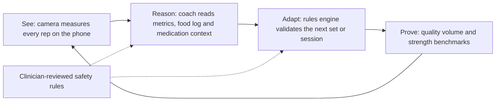
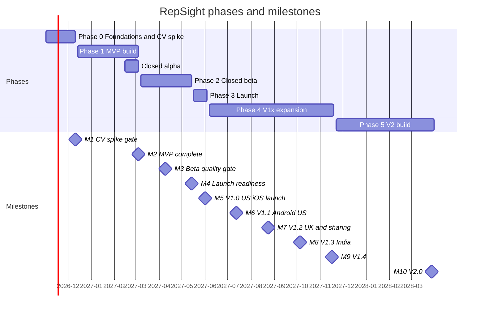

# RepSight — Business Requirements Document (BRD)

| Field | Value |
|---|---|
| Document | 01 — Business Requirements Document (BRD) |
| Version | 1.1 (consistency pass applying canon §0.8) |
| Date | 2026-10-18 |
| Status | Draft for review |
| Owner | CEO / product owner |
| Source of truth | [`research/00-product-canon.md`](research/00-product-canon.md) (Product Canon, decision record v1.1, 2026-10-18; §0.8 lists decisions settled after this document was first written). If this document and the canon disagree, the canon wins. |
| Related documents | `02-technical-specification.md` (architecture, interfaces, data model, ADR-###) · `03-product-roadmap-and-strategy.md` (phases, GTM, pricing, budget, full risk register) · `04-innovative-features.md` (IF-1..IF-7 deep dives) · `05-build-playbook.md` (build plan for Claude Code) · research briefs [R1](research/R1-competitors.md), [R2](research/R2-cv-tech-stack.md), [R3](research/R3-coach-medication-safety.md), [R4](research/R4-regulatory-privacy.md), [R5](research/R5-market-business.md), [R6](research/R6-feature-novelty.md) (evidence briefs) |

**How to read IDs.** P# = persona. F-### = feature (from the canon). FR-### = functional requirement, NFR-### = non-functional requirement, BR-## = business rule, BO-## = business objective (all defined here). KPI-##, M#, R-##, D-##, CON-##, DC-##, IF-#, EX-## and ERR-EX##-## come from the canon. Citations such as [R5 §2] point to the research briefs in `research/` (linked in the header; R5 = `research/R5-market-business.md`); key facts keep their original link.

## Table of contents

1. Executive Summary
2. Problem Statement
3. Business Objectives
4. Scope
5. Target Market Analysis
6. Competitive Context & Positioning
7. Feature Requirements (7.1 Must-Have · 7.2 Should-Have · 7.3 Nice-to-Have · 7.4 Functional Requirements by module)
8. Non-Functional Requirements
9. Business Rules
10. Data Requirements
11. Success Criteria
12. Timeline & Milestones
13. Stakeholders & RACI
14. Risks, Assumptions & Dependencies
15. Compliance Requirements
16. Open Decisions
- Appendix A — Traceability Matrix
- Appendix B — Glossary

---

## 1. Executive Summary

**Problem.** Many adults want to build or keep strength. They have no trainer to watch their reps. Adults who lose weight on a GLP-1 medicine (a weekly or daily weight-management medicine such as semaglutide or tirzepatide) can lose lean mass along with fat. In the STEP 1 trial, 38% of a 13.6 kg loss was lean mass, and the 2025 joint nutrition advisory recommends strength training at least 3 times a week [R3 #13](https://pmc.ncbi.nlm.nih.gov/articles/PMC12304835/). 11% of US adults now use a GLP-1 for weight loss [R5 #18](https://news.gallup.com/poll/712157/glp-usage-reaches-new-high.aspx). Adults on everyday medicines (beta-blockers, insulin, statins, anticoagulants) find that generic plans and heart-rate zones do not fit them. Today's apps either see the workout (camera form apps) or know the health context (AI health coaches). We found no consumer product that does both [R1 §2, §5].

**Solution.** RepSight is a phone-only AI strength coach for iOS and Android. It closes one loop: **see, reason, adapt, prove**.

| Step | What RepSight does |
|---|---|
| See | The phone camera counts every rep and checks form on the device. Video never leaves the phone by default. |
| Reason | The RepSight coach (AI) reads the measured metrics, the food log and the user's medication context, inside clinician-reviewed safety rules. |
| Adapt | A deterministic planner proposes the next set or session. The user confirms. Every change shows a "Why this changed" card. |
| Prove | Quality-volume tracking and monthly camera strength benchmarks show strength kept. The user can share a report with their care team (V1.2). |

**Who it is for.** Launch segment: US adults on GLP-1 medicines who want to keep strength while losing weight (P1 Jordan), and adults on everyday medicines that change how exercise feels (P2 Sam). Growth engine: solo lifters on the Free tier (P3 Riley). Later: India value users (P4 Kiran, V1.3) and partner clinicians (P5 Morgan, V1.2 pilot, V2 portal).

**Honest uniqueness.** Camera form cues, AI chat coaches and GLP-1 companion apps each already exist (section 6). What we did not find in any shipping product (searches to 2026-10-16) is the combination: medication-aware training changes, camera-verified strength for GLP-1 users, velocity loss plus form drift plus a next-set suggestion on one phone, and a coach that knows what the camera saw (canon §2.2, Medium confidence). External copy never says "first", "only" or "unique" (BR-27).

**Business model.** Freemium subscription. Free includes the full safety layer. Premium $14.99/month or $99.99/year. Premium+ $29.99/month or $179.99/year (adds the GLP-1 Strength Track). 7-day trial on annual plans only. B2B: free clinic design-partner pilot (V1.2), partner licences at $12 (US) or ₹149 (India) per activated member per month (V1.3), RepSight Clinic portal at $29 per practitioner per month plus $8 per active patient per month (V2). The US base case gives LTV36/CAC 1.20 (estimate, canon §13.3), below the 1.5 gate for paid scaling (KPI-17). Paid acquisition stays in test mode until the gate holds.

**Launch plan.** Kickoff 2026-11-02 → closed alpha 2027-02-15 → closed US beta 2027-03-08 (500 testers) → **V1.0 US iOS on Tuesday 2027-06-01** → Android US 2027-07-13 → UK 2027-08-24 → India 2027-10-05 (gated by D-08) → V1.4 2027-11-16 → V2.0 (B2B portal, learned CV models, EU) 2028-03-28. Lean budget to V1.0: $317,688 (estimate, canon §16.1).

**Decisions needed from the owner now** (full list in section 16):

| D | Decision | Recommended default | Deadline |
|---|---|---|---|
| D-17 | Budget scenario and funding | Lean scenario ($317,688 to V1.0), India-based team, raise 18 months of runway | 2026-11-06 |
| D-03 | Legal entity and team location | US Delaware C-corp with an Indian subsidiary | 2026-11-13 |
| D-07 | Clinical lead | US-licensed PharmD; sports-medicine physician as medical advisor; RD and DPT reviewers | 2026-11-13 |
| — | Confirm our Anthropic Usage Policy reading with Anthropic | Clinician-approved cards plus fixed routing satisfy the AUP effective 2026-11-12 | before 2026-11-12 |
| D-01 | Product name and trademark | "RepSight" after knockout searches | 2026-11-20 |
| D-11 | Data-collection location | 60 US + 60 India participants | 2026-11-20 |
| D-06 | Anthropic data terms | Apply for ZDR now; no BAA for the consumer organisation | 2026-11-27 |

---

## 2. Problem Statement

### 2.1 Core problem

People who train alone cannot see their own form, and their plans ignore their health context. Two groups feel this most:

1. **GLP-1 users.** They lose weight fast. Some of that loss is lean mass (38% in STEP 1) [R3 #13](https://pmc.ncbi.nlm.nih.gov/articles/PMC12304835/). Guidance says to lift at least 3 times a week and eat 1.2–1.6 g/kg/day of protein [R3 #13]. Side effects (nausea, fatigue after the dose) make a fixed weekly plan hard to follow. GLP-1 companion apps give content and logs, but none checks whether the training actually happened or was done well [R1 §5, W2].
2. **Adults on everyday medicines.** Beta-blockers blunt heart rate, so watch HR zones mislead. Insulin and secretagogues raise the risk of lows. Statins can cause muscle symptoms. Anticoagulants make falls and contact riskier. No consumer fitness app adapts training to these classes [R1 §3.3].

Camera form apps do not know about medicines or nutrition. AI health coaches know the context but never see how a workout was performed [R1 §2].

### 2.2 Market gap and opportunity

| Evidence | Number | Source |
|---|---|---|
| US adults taking a GLP-1 for weight loss (May–June 2026) | 11% (3% in 2024) | Gallup [R5 #18](https://news.gallup.com/poll/712157/glp-usage-reaches-new-high.aspx) |
| US adults taking a GLP-1 for any reason (Oct–Nov 2025); ever taken | 12%; 18% | KFF [R5 #17](https://www.kff.org/public-opinion/poll-1-in-8-adults-say-they-are-currently-taking-a-glp-1-drug-for-weight-loss-diabetes-or-another-condition-even-as-half-say-the-drugs-are-difficult-to-afford/) |
| Lean-mass share of weight lost in STEP 1 | 38% of 13.6 kg | [R3 #13](https://pmc.ncbi.nlm.nih.gov/articles/PMC12304835/) |
| GLP-1 users who exercise 30+ min on 5+ days rate the drugs "extremely effective" more often | about 11 points more (association, not cause) | Gallup [R5 #19](https://news.gallup.com/poll/713360/five-aspects-wellbeing-linked-glp-effectiveness.aspx) |
| US firms with 5,000+ workers covering GLP-1s for weight loss (2025) | 43% | KFF [R5 #21](https://www.kff.org/health-costs/report/2025-employer-health-benefits-survey/) |
| India generic semaglutide price after March 2026 patent expiry | about ₹1,290–₹4,200/month | [R5 #22](https://www.outlookbusiness.com/corporate/sun-pharma-dr-reddys-glenmark-launch-generic-semaglutide-injection-in-india) |
| Global fitness-app market | $12.1B (2025), $13.9B (2026), $33.6B (2033), 13.4% CAGR | Grand View Research [R5 #1](https://www.grandviewresearch.com/industry-analysis/fitness-app-market) |
| Remote human coaching price (US) | about $199/month | [R5 §1.5] |

**Opportunity.** A phone-only coach at $14.99–$29.99/month sits far below human coaching (about 15% of $199/month at the Premium+ monthly price [R5 §1.5]). The GLP-1 population creates a large, new group that is told to strength-train at least 3 times a week but has no tool that verifies the training.

### 2.3 Pain points per persona

| Persona | Pain points (canon §4) | What RepSight changes |
|---|---|---|
| P1 Jordan (GLP-1 strength keeper) | Stairs and carrying feel harder; nausea the day after the dose; generic plans ignore the dose cycle | GLP-1 Strength Track, dose-cycle scheduling, protein rules, camera benchmarks |
| P2 Sam (everyday-medicines lifter) | HR zones make no sense on a beta-blocker; worry about lows on glipizide; desert heat; statin aches vs normal soreness | RPE mode, glucose check-ins without numbers, heat alerts, statin muscle-symptom check-ins |
| P3 Riley (solo lifter) | Camera apps that miss reps; no PT budget; refuses video uploads | Guided setup, confidence-gated cues, video stays on the phone, quality volume |
| P4 Kiran (India value user) | Price-sensitive; Hindi/English mix; mid-range Android | ₹ pricing, Hindi UI and cues, Indian food database, partner codes |
| P5 Morgan (partner clinician) | No time for another dashboard; HIPAA exposure; unverified patient self-reports | Patient-initiated share reports (V1.2), no PHI exchange; portal with guardrails at V2 |

Users of current camera products complain about missed reps, setup friction, and rigid workouts [R1 §1.8, S31, S14, S19].

### 2.4 Why now

| Driver | Evidence |
|---|---|
| GLP-1 adoption is mass-market | 11% of US adults (Gallup 2026), up from 3% in 2024 [R5 #18]; Indian generics since March 2026 [R5 §2.2] |
| Chat coaches are now a commodity | Google Health Coach ($9.99/month; ₹99/month in India) [R1 S53](https://techcrunch.com/?p=3120136), MyFitnessPal AI Coach [R1 S77], Oura Advisor [R1 S61], ChatGPT Health and Claude connectors [R1 S100, S102]. Chat alone no longer differentiates; grounded data does. |
| On-device pose models are good enough and legally clean | MediaPipe Pose Landmarker is Apache-2.0 and lists "Fitness and repetition counting" as an intended use [R2 #2](https://storage.googleapis.com/mediapipe-assets/Model%20Card%20BlazePose%20GHUM%203D.pdf); React Native 0.88 with VisionCamera 5 frame processors runs it in a native module [R2 §4]; Apple Vision 3D gives body height on iOS 17+ [R2 #21] |
| Regulators drew a clearer wellness line | FDA general-wellness guidance of 2026-01-06 [R4 #2](https://www.fda.gov/media/90652/download) |

---

## 3. Business Objectives

Each objective is specific, measurable and dated. Targets are copied from canon §15. "V1.0+90 d" = 2027-08-30.

| BO | Objective | Metric (KPI) | Target | Date | Owner |
|---|---|---|---|---|---|
| BO-01 | Launch camera coaching that users can trust | KPI-01, KPI-02, KPI-04 | ≥95% of sets exact and ≥99% within ±1 (Tiers A–B, iOS); ≥0.90 precision / ≥0.70 recall per GA cue; FPS A ≥30, B ≥20, C ≥15 | Gate at M4 (2027-05-14); launch 2027-06-01 | ML/CV engineer |
| BO-02 | Zero unsafe coach behaviour | KPI-07, KPI-08, KPI-09 | 0 never-rule failures; red-flag recall ≥0.98; 100% of medication answers grounded | From M4 (2027-05-14), every release after | CEO + clinical lead |
| BO-03 | Convert downloads into paying users in the US | KPI-10, KPI-11, KPI-12, KPI-13 | D30 download→trial ≥9%; trial→paid ≥38%; D35 download→paid ≥3.0%; refunds ≤4% | 2027-08-30 | CEO + growth lead |
| BO-04 | Reach sustainable unit economics | KPI-15, KPI-16, KPI-17 | AI cost ≤30% of net revenue; AI per install ≤$0.20; LTV36/CAC ≥1.2 (≥1.5 before paid scaling) | 2027-08-30 (≥1.5 by 2028-03-28) | CEO + tech lead |
| BO-05 | GLP-1 users keep training | KPI-19, KPI-18 | ≥50% strength-dose adherence; median ≥2.0 camera-verified sessions per active payer per week | 2027-08-30 | CEO |
| BO-06 | Retain users with a stable, high-quality app | KPI-21, KPI-22, KPI-24, KPI-06 | Week-4 retention ≥30%; crash-free sessions ≥99.7%; store rating ≥4.5; camera session completion ≥85% | 2027-08-30 | Tech lead |
| BO-07 | Keep every privacy promise | KPI-23 | 0 unauthorised disclosures or uploads without matching consent | Every phase | Tech lead |
| BO-08 | Make the closed loop real | KPI-20, KPI-25, KPI-05 | Stop-prompt acceptance ≥60%; 100% of plan changes explained; assessed-rep rate ≥90% | 2027-08-30 | CEO |
| BO-09 | Expand markets on schedule | KPI-01–KPI-04 (Android), KPI-07/KPI-08 (Hindi) | Android US 2027-07-13 meeting KPI-01–KPI-04; UK 2027-08-24; India 2027-10-05 only if D-08 passes | 2027-10-05 | CEO |
| BO-10 | Open the clinician channel | KPI-26 | ≥3 design-partner clinics signed by V1.2 (M7) and still active at V1.4; ≥10% of Premium+ users share a report within 90 days | 2027-11-16; 2028-03-28 | CEO |

---

## 4. Scope

### 4.1 In scope by release

| Release | Date | Scope (feature counts from canon §5) |
|---|---|---|
| MVP (closed alpha, team + 30 testers) | Alpha 2027-02-15; code-complete at M2 2027-03-05 | 41 features: sign-in, age gate, screening, medication list and constraint engine (6 classes), safety guard, camera coach for EX-01–EX-10 with 26 form errors, autoregulation prompt, planner and starter programs, GLP-1 Strength Track, coach chat, food log and meal-photo logging, history, reminders, entitlements and quotas, consent center, deletion, admin and eval tooling |
| Beta (500 US testers) | 2027-03-08 → 2027-05-14 (M4) | +9: voice logging, dose-cycle scheduling, coach memory, quality-volume ledger, health-platform sync, lifecycle check-ins, onboarding paywall, training-data contribution, ops console |
| V1.0 (US, iOS) | 2027-06-01 | +4: heat-risk alerts, camera strength benchmarks, subscription compliance, regional policy engine; all 15 medication classes, ~45 KB cards |
| V1.1 Android US | 2027-07-13 | Same features on Android |
| V1.2 UK + sharing | 2027-08-24 | F-027 replay and clip, F-074 clinician report, F-094 US web checkout, F-120 clinic pilot; en-GB |
| V1.3 India | 2027-10-05 | F-063 Indian food database, F-123 partner licensing; en-IN, hi-IN; India quotas (gated by D-08) |
| V1.4 | 2027-11-16 | F-015, F-028, F-045 (US only, D-09), F-064, F-075, F-076; HealthKit Medications import inside F-010 |
| V2.0 | 2028-03-28 | F-029 learned CV models, F-121 clinician portal, F-122 clinician-set guardrails; EU entry (D-15), es-US |

### 4.2 Explicitly out of scope

| Item | Reason |
|---|---|
| Users under 18 | Anthropic consumer services are 18+; COPPA and DPDP rules (canon §11.4) |
| Dosing, dose calculators, starting/stopping medicines, interaction checking beyond fixed class rules | Device/CDS territory (canon §9.6) |
| Diagnosis, symptom interpretation, rehab or pain programmes for a condition | Device/MDSW (canon §2.4, R4 #14) |
| Camera heart rate, blood pressure, SpO2, "readiness" scores, emotion inference, face recognition | Apple 1.4.1; unvalidated; AI Act (canon §10.5) |
| LLM or VLM live form cues | Zero-shot VLMs scored 1.29–2.27/5 on QEVD [R2 #44](https://arxiv.org/abs/2407.08101) |
| Real-time barbell cues | Bar occludes keypoints; post-set analysis only at V1.4 (F-028) |
| Tablet, watch and TV apps; consumer web app (except account deletion and US web checkout) | Phones only at V1.0 (canon §3.3) |
| Ad, attribution or tracking SDKs; session replay | Privacy stance (canon §10.5) |
| Human coaching, telehealth, prescribing | Not our product; partners only (F-123) |
| Equipment scanning, camera rep duels, camera spotter, multi-person tracking, return-to-training clearance | Considered and not headlined (canon §6; see 04 §2) |
| EU markets before V2.0; Hindi coach chat unless the Hindi safety eval passes | Canon §3.1, §3.2 |
| White-label for trainers and gyms | Not planned before 2028 (canon §12.2) |

### 4.3 Assumptions

Listed with IDs in section 14.2. The most important: the M1 device-lab benchmarks confirm MediaPipe Full meets KPI-04; Anthropic confirms our AUP reading; base-case conversion of 3.0% install→paid holds; clinical reviewers deliver about 270 hours before V1.0.

### 4.4 Constraints

| Type | Constraint |
|---|---|
| Regulatory | General-wellness product for healthy adults 18+ (FDA guidance [R4 #2](https://www.fda.gov/media/90652/download)). No treat/prevent/diagnose/cure claims, no dosing, no disease thresholds in user copy. India: no medication counselling in chat [R4 #22]. UK and EU medication features only after the qualification memo (F-103). |
| Privacy | Raw video never leaves the phone except a clip the user shares (canon §11.2). Keypoint series upload only with CON-08. |
| Team | Three-person core (CEO, founding engineer, founding ML/CV engineer) plus contractors; Claude Code builds most code (canon §14.3) |
| Budget | Lean scenario $317,688 to V1.0 (estimate, canon §16.1; D-17); marketing to V2 start $172,000 ($244,000 if KPI-17 gate met) |
| Technology | Pinned stack (canon §10); any pin change needs an ADR (see 02 §14 C). Opus 5.5 on every AI route at V1.0 (D-02). |
| Time | Fixed launch date 2027-06-01; scope-cut order if late: IF-7 → IF-6 → F-028 → F-064 (R-16) |

### 4.5 Dependencies

Summarised in section 14.3 (external services, clinicians, counsel, store approvals, data collection).

---

## 5. Target Market Analysis

### 5.1 Market size (TAM, SAM, SOM)

**Method.** Top-down for TAM (published market reports). Bottom-up for SAM (population × usage rate × behaviour assumption). SOM from the canon's operating scenarios (canon §16.2). Everything below that is not a survey or report figure is an **estimate**; the assumptions are stated.

| Layer | Definition | Value | Method and source |
|---|---|---|---|
| Context | Global fitness-app market | $13.9B (2026); $33.6B by 2033 (13.4% CAGR) | Grand View Research [R5 #1](https://www.grandviewresearch.com/industry-analysis/fitness-app-market). Other publishers range from $13.8B to $28.7B for 2026 [R5 §1.1]; we use GVR because it also has country figures. |
| **TAM** | Fitness-app revenue in our V1.x launch markets (US + UK + India), 2025 | **≈ $5.15B** ($4,097.9M + $455.3M + $601.6M) | GVR Horizon: [US](https://www.grandviewresearch.com/horizon/outlook/fitness-app-market/united-states), [UK](https://www.grandviewresearch.com/horizon/outlook/fitness-app-market/uk), [India](https://www.grandviewresearch.com/horizon/outlook/fitness-app-market/india) [R5 #6–#8]. Sum is our arithmetic. EU figure not available (gap). |
| **SAM** | US adults on a GLP-1 who would follow an app-guided strength plan | **Estimate: 5.7M (low) / 8.6M (base) / 12.5M (high)** | 260M US adults (assumption, not re-checked) × 11–12% on a GLP-1 [R5 #17, #18] × 20% / 30% / 40% willing (assumption) [R5 §2.3]. Revenue pool by year 3 at a 3% / 5% / 8% paid share and $80 / $100 / $120 ARPU: ~$14M / ~$43M / ~$120M per year (estimate). Segments S2 and S3 (below) are not sized (gap). |
| **SOM** | What RepSight can realistically serve in its first operating years | **Estimate: 1,200 payers at 10k MAU (≈ $137k net revenue/year) → 12,000 payers at 100k MAU (≈ $1.37M net revenue/year)** | Canon §16.2 scenarios: payers = 12% of MAU, blended net revenue $9.48 per paying subscriber-month ($11,379 and $113,792 per month). No date is committed for 100k MAU. 12,000 payers equals 2.8% of the SAM base-case paid pool (429k), if all were GLP-1 users. |
| India sensitivity | Per 1M Indian GLP-1 users | Estimate: 2% paying ₹2,499/year → 20,000 payers, ₹5.0 crore (≈ $0.53M at ₹94/$) gross per year, before GST and store fees | [R5 §2.3]. No reliable count of Indian GLP-1 users was found. |

### 5.2 Segments

| Segment | Who | Release | Role in the business | Persona |
|---|---|---|---|---|
| S1 GLP-1 strength keepers (US) | Adults on a GLP-1 or GIP/GLP-1 medicine, losing weight, training at home | V1.0 | Launch wedge; Premium+ | P1 |
| S2 Everyday-medicine lifters (US) | Adults 45+ on beta-blockers, statins, diabetes medicines, anticoagulants | V1.0 | Launch segment; Premium | P2 |
| S3 Solo lifters (US, UK) | Adults who train alone at home or in a gym without a trainer | V1.0 | Free-tier growth engine; converts to Premium | P3 |
| S4 India value and GLP-1 users | Price-sensitive, Hindi/English, mid-range Android, generic semaglutide | V1.3 | Volume market; partner codes | P4 |
| S5 Partner clinicians | Physio, sports-medicine and obesity clinics | V1.2 pilot → V2 | B2B channel and revenue | P5 |
| S6 Distribution partners | GLP-1 telehealth providers, pharma patient-support programs, Indian clinics and pharmacies | V1.3 | Partner licences (F-123) | P1, P4 |
| S7 Employers and insurers | Wellness programs | After V2 | Outcome-linked pilots | — |

### 5.3 Personas (expanded)

Personas are design tools based on canon §4. They are not real people. Use they/them.

| Attribute | P1 Jordan | P2 Sam | P3 Riley | P4 Kiran | P5 Morgan |
|---|---|---|---|---|---|
| Profile | 44, Columbus OH (US) | 57, Phoenix AZ (US) | 29, Chicago IL (US) | 36, Bengaluru (India) | 41, New Jersey (US) |
| Segment | GLP-1 strength keeper (launch) | Everyday-medicines lifter | Solo lifter (home + gym) | India GLP-1 / value user | Partner clinician (DPT, runs a 6-practitioner clinic) |
| Tier | Premium+ annual | Premium annual | Free → Premium | Free → Premium (₹) or partner code | B2B (V1.x pilot → V2) |
| Psychographics | Wants proof, not promises; values control over their plan | Cautious; wants to feel safe; trusts clear rules | Data-driven; distrusts apps that miss reps; privacy-first | Value-seeking; mixes Hindi and English; follows doctor advice closely | Time-poor; risk-averse about compliance; evidence-minded |
| Behaviours | Weekly GLP-1 injection for 7 months; lost 14 kg; trains at home 30–40 min | Restarting after a sedentary decade; trains 3×/week; uses an Apple Watch | Trains at home and in a gym; tracks PRs | Trains at home; uses a mid-range Android; logs Indian meals | Prescribes home exercise; checks adherence at visits |
| Goals | Keep strength while losing weight; fit training around the dose; hit protein without obsessing | Get stronger without feeling unsafe | Trustworthy form feedback without a trainer; progress that counts good reps | Structured strength + Indian-food protein targets | Verified home-exercise adherence; simple guardrails for patients moving into the gym |
| Frustrations | Stairs and carrying feel harder; nausea the day after the dose; plans ignore the dose cycle | HR zones make no sense on a beta-blocker; worry about lows; desert heat; statin aches vs soreness | Camera apps that miss reps; no PT budget; refuses video uploads | Price; language; app performance on mid-range phones | Another dashboard; HIPAA exposure; unverified self-reports |
| Medications (relevant) | Weekly GLP-1 injection | Metoprolol, atorvastatin, glipizide | None assumed | Generic semaglutide (₹1,290–₹4,200/month [R5 #22]) | — (clinician) |
| Devices | iPhone 15; adjustable dumbbells 2–20 kg | iPhone 12; Apple Watch | Pixel 9 / iPhone 16; gym access | Snapdragon 7-class Android | Desktop web + iPad |
| Willingness to pay | Premium+ $179.99/year, for the GLP-1 Strength Track and the clinician report | Premium $99.99/year | Free first; Premium after trusting rep counts | ₹349/month or ₹2,499/year (anchors ₹99–₹449/month), or a partner code | Benchmarks Physitrack: $18.99/practitioner/month + $8/patient [R5 #67](https://www.physitrack.com/physitrack-pricing) |
| Accessibility needs | Standard | Large text and audio cues (WCAG 2.2 AA) | Standard | Hindi UI and voice cues | Standard |
| Success signal | ≥2 camera-verified strength sessions/week; chair-stand and push-up benchmarks stable or rising | 3×/week in RPE mode; uses heat alerts; zero unhandled red flags | Quality-volume PRs; ≥95% of sets counted exactly | Weekly sessions with Hindi cues; protein target met 4+ days/week | Uses share reports with ≥10 patients; renews after pilot |
| Key features | IF-3, IF-1, F-072, F-074 | IF-1 (BB, STAT, INS classes), F-014 | F-021–F-025, F-071, F-101 | F-063, F-123, F-103, hi-IN | F-074, F-120, F-121, F-122 |

### 5.4 User-journey map

| Stage | User goal | Touchpoints | Emotions | Risk | Opportunity | KPI |
|---|---|---|---|---|---|---|
| Discover | Find a way to keep strength on a GLP-1 / train safely on medicines | App Store search, Apple Ads, Custom Product Pages, creator videos, GLP-1 communities, clinic or partner code | Hopeful, sceptical | Claims that sound medical; generic fitness noise | Search-intent-matched store pages (+41.5% install→trial measured by Adapty [R5 #60]); honest safe-claims copy | KPI-10 |
| Onboard | Get set up fast and feel safe | F-002 age gate (before any account exists), F-001 sign-in, F-003 goals, F-004 screening, F-010 medicines, F-100 consents, F-091 soft paywall | Curious; cautious about health data | Long forms; consent fatigue; paywall too early | Show the constraint set and a KB card for the user's own medicine in onboarding; annual-led trial offer | KPI-10, KPI-11 |
| First camera session ("aha") | See that the app counts reps right and gives useful cues | F-021 Setup Coach, F-023 rep count, F-024 cues, F-025 stop prompt, F-053 debrief | Surprise, trust (or frustration if reps are missed) | Missed reps; bad framing; low light | Mandatory guided setup; "form not assessed" instead of wrong cues; debrief that names what the camera saw | KPI-01, KPI-06 |
| Habit | Train 2–3 times a week around the dose and side effects | F-040 planner, F-043 dose-cycle scheduling, F-080 reminders, F-081 check-ins, F-052 "Why this changed", F-060 food log | Momentum; occasional low-energy days | Side-effect days break the routine | Deload suggestion on side-effect days; easy swaps; proactive weekly review | KPI-18, KPI-19, KPI-21 |
| Upgrade | Unlock the full library, autoregulation, GLP-1 Strength Track | F-091 Day 4–7 second prompt, quota limits (F-092), quality-volume ledger preview | Considered; value-checking | Price objection; trial ends unnoticed | Show quality-volume PR and benchmark value; annual reminder and easy cancel build trust (F-093) | KPI-11, KPI-12, KPI-13 |
| Advocacy | Share progress and keep going | F-072 benchmarks, F-074 clinician report (V1.2), store rating prompt | Pride, confidence | Body-focused sharing; privacy fear | "Strength kept" trend; shareable report with no video by default | KPI-24, KPI-26 |

### 5.5 Acquisition channels (summary)

Detail, budgets and targets live in 03 §5 and 03 §6.

| Channel | When | Notes |
|---|---|---|
| Landing page, waitlist, content and SEO | Phases 0–1 | $1k + $2k (canon §16.3) |
| GLP-1 communities and alpha/beta recruitment | Phases 0–2 | Tester incentives; ≥150 of 500 beta testers are GLP-1 users |
| Apple Ads CAC test with Custom Product Pages | Launch window 2027-05-17 → 2027-08-27 | $30k; US cost per download $2.51, H&F niches $1.89–$3.97 [R5 #59](https://adapty.io/blog/apple-ads-benchmarks-2026/) |
| Nano- and micro-creators | Beta and launch | $4k + $24k [R5 #63] |
| Organic, ASO, referral | Continuous | 60% organic installs would lift base LTV36/CAC to 1.79 (estimate, canon §13.3) |
| Clinic design partners | V1.2 | 3 US clinics, free 6 months |
| Partner licences | V1.3 | GLP-1 telehealth, pharma patient-support programs, Indian clinics and pharmacies |
| Paid scaling | V1.x | Only after KPI-17 ≥1.5 for two consecutive months |

No ad, attribution or tracking SDKs are used, so channel measurement relies on store analytics, Custom Product Page reports and promo/partner codes (canon §10.5).

---

## 6. Competitive Context & Positioning

Full analysis: 03 §4 and 04 §2. This section is a summary.

### 6.1 What already exists

| Capability | Who ships it |
|---|---|
| Camera form cues on hardware | Peloton IQ [R1 S2](https://www.onepeloton.com/blog/what-is-peloton-iq), Tonal 2 Smart View [R1 S9](https://www.tonal.com/products/tonal-2) |
| Phone-camera form feedback + AI chat | Zing AI [R1 S17](https://apps.apple.com/us/app/zing-ai-personal-trainer/id1552207792), Coach.AI [R1 S18](https://apps.apple.com/us/app/coach-ai/id6504732473) |
| Upload-a-video form checks | At least nine indie apps [R1 §1.3] |
| Clinical camera programs (B2B) | Hinge Health, Sword (Kaia), Kemtai [R1 S33, S34, S42] |
| LLM health coaches over wearable and food data | Google Health Coach, WHOOP Coach, Oura Advisor, MyFitnessPal AI Coach, Samsung Health Assistant [R1 §2] |
| GLP-1 companions | MyFitnessPal GLP-1 Support, Oura GLP-1 Insights, Noom, WeightWatchers [R1 §3.2] |
| Camera velocity-based training | Metric, SetSync, RepSpeed [R6 #32, #34, #35] |
| "Video never leaves your phone" | Common claim; table stakes, not a differentiator [R6 C15] |

### 6.2 Our differentiation (internal; Medium confidence)

Not found in any shipping product in the R1/R6 searches as of 2026-10-16 (canon §2.2):

1. Medication-aware training changes (exercise choice, intensity measure, timing, fuelling, safety prompts) from a medication list (IF-1).
2. Camera-verified strength for GLP-1 users (IF-3).
3. Velocity loss + form drift + an automatic next-set suggestion on one phone, with quality-only PRs (IF-2).
4. A coach that knows what the camera saw (IF-4).
5. Camera-enforced comfort-range caps with a shareable movement–discomfort journal, in wellness framing only (IF-6).

**Positioning statement** (canon §1): for adults who want to build or keep strength, especially while losing weight on a GLP-1 medicine or while taking everyday medicines that change how exercise feels, RepSight is a phone-only strength coach that sees every rep through the camera, adapts each session to what it saw, and plans within medication-aware safety rules reviewed by clinicians.

**Tagline:** "Every rep seen. Every plan in context."

### 6.3 Claims we must not make

Enforced by the CI banned-claims linter (F-114, FR-073) and business rule BR-27. Full table: canon §2.4.

| Never say | Say instead |
|---|---|
| "First/only app with camera form correction"; "first fitness, diet and medication chatbot" | "A strength coach that sees every rep" |
| "Prevents injuries", "injury-proof", "detects injuries", "diagnoses posture problems" | "Cues to help you keep good form; stop if you feel pain" |
| "Physical therapy", "rehab", "relieves/treats pain" | "Train around discomfort; tell your physio if it persists" |
| "Prevents GLP-1 muscle loss", "treats muscle atrophy", "protects your muscle" | "Helps you keep strength while losing weight" |
| "Treats obesity", "reverses diabetes", "lowers your blood pressure", "for eating disorders" | "Supports your weight-management goals" |
| "Tells you what dose to take", "adjusts your GLP-1 dose", "safe to stop/start/combine" | "Log your medicines and set your own reminders; check with your clinician" |
| "Clinically proven", "medical-grade", "as accurate as a physio/trainer" | "How our form scores work, and their limits" |
| "AI doctor/dietitian/physio/nurse", "prescribe", "therapy", "your AI companion" | "AI coach — not a doctor, dietitian or therapist" |
| "Your result is abnormal", "you may have X" | "You may want to talk to a health professional" |
| "Lose 5 kg in 2 weeks", "burn belly fat" | "Build habits that support your goals" |
| "HIPAA-compliant", "100% anonymous" | "Video is processed on your phone" |
| Camera heart rate, BP, SpO2 or "readiness" scores | Nothing in V1 |

---

## 7. Feature Requirements

MoSCoW priority applies to the release named in the row (canon §5). "All" = consumer personas P1–P4; "Internal" = team and clinical reviewers. V1.x rows show the sub-release in brackets.

### 7.1 Must-Have

| F-### | Feature | Description | Persona | Release | KPI |
|---|---|---|---|---|---|
| F-001 | Account & sign-in | Sign in with Apple, Google or email one-time code (Amazon Cognito); created only after the F-002 age gate passes | All | MVP | KPI-10 |
| F-002 | Age gate & region | Neutral date-of-birth gate shown before account creation (18+; under-18 blocked with resources and no account created); market from store country | All | MVP | KPI-07 |
| F-003 | Goals & equipment profile | Goals, experience, schedule, home/gym, available dumbbell weights | All | MVP | KPI-06 |
| F-004 | Pre-participation screening | ACSM-based questions; clearance gate before vigorous plans | P1, P2 | MVP | KPI-07 |
| F-005 | Locale & units | Metric storage, locale display; en-US at MVP, en-GB V1.2, en-IN/hi-IN V1.3 | All | MVP | KPI-24 |
| F-010 | Medication list | RxNorm search and manual entry; "uncovered medicine" card; HealthKit import at V1.4 | P1, P2, P4 | MVP | KPI-09 |
| F-011 | Medication constraint engine | Deterministic, versioned, clinician-owned rules per class (6 MVP, 15 at V1.0) | P1, P2, P4 | MVP | KPI-07 |
| F-012 | Dose schedule & side-effect log | User-entered schedule, side-effect and energy check-ins, user-configured reminders | P1, P4 | MVP | KPI-19 |
| F-013 | Safety gates & red-flag check-ins | Pregnancy / new medicine / new diagnosis gate; Emergency, Urgent, Crisis templates | All | MVP | KPI-08 |
| F-020 | PoseEngine native module | Swift/Kotlin Nitro module around MediaPipe Pose Landmarker; Apple Vision fallback; face landmarks dropped natively; thermal governor | All | MVP | KPI-04 |
| F-021 | Setup Coach & personal baseline | Distance, view, framing, lighting checks; three reference reps set the ROM baseline | All | MVP | KPI-06 |
| F-022 | Exercise-rules engine | Declarative, versioned `ExerciseDefinition` JSON shipped as signed remote config | All | MVP | KPI-02 |
| F-023 | Rep counting & per-rep metrics | Reps, ROM, tempo, velocity estimate, confidence for EX-01–EX-10 | All | MVP | KPI-01 |
| F-024 | Real-time form cues | ≤1 corrective cue per rep; audio + haptic + caption; GA/Beta maturity; confidence gate | All | MVP | KPI-02, KPI-03 |
| F-025 | Autoregulation prompt | Velocity loss + form drift → "end set?" and next-set suggestion | P1, P3 | MVP | KPI-20 |
| F-040 | Program planner | Deterministic planner; every change is a validated proposal | All | MVP | KPI-25 |
| F-041 | Starter programs | Foundations (Free), Home Dumbbell Strength, Gym Basics | P2, P3 | MVP | KPI-18 |
| F-042 | GLP-1 Strength Track | 3 sessions/week beginner-scaled resistance program with protein emphasis | P1, P4 | MVP | KPI-19 |
| F-043 | Dose-cycle-aware scheduling | Check-ins → suggested placement of the hardest session; deload on side-effect days | P1 | Beta | KPI-19 |
| F-044 | Workout player & swaps | Timers, rest, manual logging, clinician-reviewed swap table | All | MVP | KPI-06 |
| F-050 | Coach chat | `claude-opus-5-5` via backend proxy, SSE streaming, AI notice, report button | All | MVP | KPI-09 |
| F-051 | Grounding tools | Strict read tools and propose-only write tools | All | MVP | KPI-09 |
| F-052 | "Why this changed" cards | Every plan change cites measured data or a named rule | All | MVP | KPI-25 |
| F-053 | Post-workout debrief | Narrates structured set metrics; LLM for paid tiers, template for Free | All | MVP | KPI-18 |
| F-054 | Safety guard | Deterministic pre/post rules + classifier; refusal templates; crisis routing | All | MVP | KPI-07, KPI-08 |
| F-055 | Knowledge-base cards | Clinician-approved, versioned cards with sources, rendered verbatim | P1, P2, P4 | MVP | KPI-09 |
| F-057 | Eating-disorder-safe mode | Hides calories, weight, BMI and deficits | All | MVP | KPI-07 |
| F-060 | Food log | Search (USDA FDC, fatsecret), barcode (Open Food Facts), manual; protein and fibre view | P1, P4 | MVP | KPI-21 |
| F-061 | Meal-photo logging | Claude vision → structured estimate the user confirms; photo deleted after parsing | P1, P3 | MVP | KPI-16 |
| F-062 | Protein, fibre & intake-floor rules | Clinician formula; kcal-floor flags (1,200 kcal/day women, 1,800 men [R3 §2]); loss-rate cap 0.9 kg/week | P1, P4 | MVP | KPI-07 |
| F-063 | Indian food database | IFCT 2017 (with NIN permission) and Hindi food names | P4 | V1.x (V1.3) | KPI-21 |
| F-070 | History & weekly insights | Session history, per-rep metrics, charts; LLM narration for paid tiers | All | MVP | KPI-21 |
| F-071 | Quality-volume ledger | Total vs quality volume; PRs count quality reps only | P3, P1 | Beta | KPI-05 |
| F-072 | Camera strength benchmarks | Monthly chair stand, push-ups, plank, squat-depth check-in | P1, P4 | V1.0 | KPI-19 |
| F-080 | Reminders | Workout, dose and check-in reminders; generic payload text | All | MVP | KPI-18 |
| F-090 | Entitlements | RevenueCat entitlements for Free/Premium/Premium+ | All | MVP | KPI-12 |
| F-091 | Onboarding soft paywall | Annual-led paywall, 7-day trial on annual plans, remote offerings | All | Beta | KPI-10, KPI-11 |
| F-092 | Quotas & fair-use metering | Per-tier message and scan budgets; safety never metered | All | MVP | KPI-15, KPI-16 |
| F-093 | Subscription compliance | ROSCA/CA ARL consent records, annual reminder, click-to-cancel; RBI pre-debit (India) | All | V1.0 | KPI-13 |
| F-100 | Consent center | Purpose-based consents; records; one-tap withdrawal | All | MVP | KPI-23 |
| F-101 | On-device video guarantee | No frame persistence; face landmarks dropped; encrypted local DB | All | MVP | KPI-23 |
| F-102 | Deletion & export | In-app and web deletion; machine-readable export | All | MVP | KPI-23 |
| F-103 | Regional policy engine | Per-market feature flags (India chat, UK/EU medication features) | P4 | V1.0 | KPI-07 |
| F-110 | Clinical KB & rules CMS | Author → clinical review → eval → publish; `review_due`; label-change tickets | Internal | MVP | KPI-09 |
| F-111 | Exercise-definition editor | Thresholds and cue copy; signed bundles; staged rollout 5% → 25% → 100% | Internal | MVP | KPI-02 |
| F-112 | Golden-video harness | Replay of recorded clips through the same definitions; CI fails on regressions | Internal | MVP | KPI-01 |
| F-113 | Labelling pipeline | BlazePose Heavy pre-labels; two coaches + adjudicator | Internal | MVP | KPI-02 |
| F-114 | Safety eval harness & claims linter | Red-team set, Opus judge, clinician review; banned-claims linter; CI gate | Internal | MVP | KPI-07 |
| F-115 | Ops console | AI cost dashboard, safety-event review queue, support tools | Internal | Beta | KPI-15 |

### 7.2 Should-Have

| F-### | Feature | Description | Persona | Release | KPI |
|---|---|---|---|---|---|
| F-014 | Heat-risk alerts | Heat-index warnings for heat-sensitive classes (WeatherKit, coarse location, opt-in) | P2 | V1.0 | KPI-08 |
| F-026 | Voice logging | On-device speech-to-text for RPE, reps in reserve, discomfort; audio never stored | P1, P2, P3 | Beta | KPI-20 |
| F-027 | Replay & shareable clip | On-device keypoint replay; per-clip consent, face blur, 30-day default retention | P3, P5 | V1.x (V1.2) | KPI-23 |
| F-045 | Comfort-range training | Discomfort check-in, swaps, user- or physio-set ROM caps enforced by camera | P2 | V1.x (V1.4, US only) | KPI-27 |
| F-056 | Coach memory | User-visible, editable, deletable memory; separate opt-in for health memories | All | Beta | KPI-21 |
| F-073 | Health-platform sync | HealthKit / Health Connect daily summaries | P2 | Beta | KPI-18 |
| F-074 | Clinician-shareable report | User-initiated PDF or 14-day link: adherence, quality volume, benchmarks, ROM trends | P1, P5 | V1.x (V1.2) | KPI-26 |
| F-081 | Lifecycle & proactive check-ins | Day 4–7 prompt, missed-session nudge, dose-day check-in, weekly review | P1 | Beta | KPI-21 |
| F-104 | Training-data contribution | Opt-in keypoint upload without face points; revocable | P3 | Beta | KPI-02 |
| F-120 | Clinic design-partner pilot | 3 US clinics use share reports; no PHI exchange | P5 | V1.x (V1.2) | KPI-26 |

### 7.3 Nice-to-Have

The canon's "Could" priority.

| F-### | Feature | Description | Persona | Release | KPI |
|---|---|---|---|---|---|
| F-015 | Supplement & pre-workout check | Label photo → FDA "never recommend" list, 400 mg/day caffeine counter, stimulant-stack warning | P2 | V1.x (V1.4) | KPI-07 |
| F-028 | Barbell recorded-set analysis | Post-set analysis for back squat, deadlift, bench press | P3 | V1.x (V1.4) | KPI-01 |
| F-029 | Learned CV models | PoseRAC-style counter and GCN error classifiers via LiteRT 2.3.0 | All | V2 | KPI-02 |
| F-064 | Session-linked fuelling summary | Links meals to the measured session and medication schedule | P1 | V1.x (V1.4) | KPI-19 |
| F-075 | Movement–discomfort journal | Deterministic co-occurrence of discomfort logs with camera patterns | P2 | V1.x (V1.4) | KPI-27 |
| F-076 | Personal cue learning | Bandit over approved cue variants per user × fault | All | V1.x (V1.4) | KPI-28 |
| F-094 | US web checkout | Stripe Billing + RevenueCat Web link-out | P1, P2, P3 | V1.x (V1.2) | KPI-17 |
| F-121 | Clinician portal | Patient invites, adherence, flagged clips; HIPAA-ready tenant | P5 | V2 | KPI-26 |
| F-122 | Clinician-set guardrails | RPE/HR ceilings, ROM caps, banned movements set by the clinician | P5 | V2 | KPI-26 |
| F-123 | Partner licensing | Activation codes and bulk entitlements; no PHI exchange | P4, P1 | V1.x (V1.3) | KPI-17 |

**Check:** 49 Must + 10 Should + 10 Could = 69 features (canon §5).

### 7.4 Functional Requirements by module

**Format.** Each FR shows: ID · name · the F-### it implements · priority (MoSCoW) · release. Then a user story and Given/When/Then acceptance criteria (AC). MVP, Beta and V1.0 FRs have at least two ACs; V1.x and V2 FRs have one AC and get full ACs when they are scheduled. Technical design for each module is in 02 (section shown in Appendix A).

#### 7.4.1 Onboarding & profile

**FR-001 · Sign-in** · F-001 · Must · MVP
Story: As P3, I want to sign in with Apple, Google or an email one-time code, so that I can start without creating a password.
- AC-1: Given a new user who has passed the age gate (FR-002), when they complete Sign in with Apple, Google or a valid email code, then an account (DC-01) is created in Amazon Cognito with the age-gate result and the user continues to goals (FR-003). Sign-in is never offered before the age gate passes.
- AC-2: Given a user who deletes their account, when deletion runs, then their Sign in with Apple token is revoked and the Cognito identity is removed (see FR-066).

**FR-002 · Age gate** · F-002 · Must · MVP
Story: As the product owner, I want a neutral date-of-birth gate at the very start of onboarding, before any account is created, so that only adults 18+ use RepSight.
- AC-1: Given the age-gate screen, when it renders, then it asks for date of birth with no hint of the cut-off age.
- AC-2: Given a user whose date of birth makes them under 18, when they submit, then they are blocked and shown age-appropriate resources, no account or auth identity is ever created (the gate runs before FR-001), and only an anonymous "underage attempt" counter is kept.
- AC-3: Given an adult user, when a chat message signals they are under 18, then the coach is locked and resources are shown (BR-10).

**FR-003 · Market from store country** · F-002 · Must · MVP
Story: As the product owner, I want each account tied to a market, so that prices, crisis numbers and regional rules are correct.
- AC-1: Given a new account, when onboarding starts, then `home_region` and market are set from the store country and saved on DC-01.
- AC-2: Given a store country where RepSight is not live, when the user installs, then the app shows a "not available in your region yet" screen and creates no account.

**FR-004 · Goals and equipment profile** · F-003 · Must · MVP
Story: As P1, I want to enter my goals, schedule and dumbbell weights, so that the plan fits my home setup.
- AC-1: Given onboarding, when the user selects goals, experience, days per week, home/gym and available dumbbell weights, then the planner (FR-030) only uses exercises and loads that fit those inputs.
- AC-2: Given a saved profile, when the user edits equipment, then the next generated session reflects the change and shows a "Why this changed" card (FR-038).

**FR-005 · Pre-participation screening** · F-004 · Must · MVP
Story: As P2, I want short health-screening questions, so that I am not given a plan that is unsafe for me.
- AC-1: Given the ACSM-based screening (activity, symptoms, known cardiovascular, metabolic or renal conditions), when an answer meets a clinician-defined clearance rule, then vigorous plans are blocked and a "check with your clinician before vigorous exercise" card is shown until the user confirms clearance.
- AC-2: Given screening answers, when they are saved, then they are stored as DC-05 with consent CON-02 and the question set version.

**FR-006 · Locale and units** · F-005 · Must · MVP
Story: As P2, I want weights in pounds, so that numbers feel familiar.
- AC-1: Given any stored measurement, when it is written to storage, then it is in metric/SI units (kg, cm, s, kcal, degrees).
- AC-2: Given a US locale, when weights are displayed, then they show in lb; given a manual unit override, then the override wins on every screen.

#### 7.4.2 Health & medication profile

**FR-007 · Medication list** · F-010 · Must · MVP
Story: As P2, I want to add my medicines by search or by typing, so that my plan respects them.
- AC-1: Given the medication screen, when the user searches, then results come from RxNorm (RxCUI → RxClass via self-hosted RxNav-in-a-Box) and the NLM attribution string is shown.
- AC-2: Given a medicine outside the covered classes or entered manually without a match, when it is saved, then the generic "check with your clinician or pharmacist about exercise" card is shown and no class-specific rule is applied.

**FR-008 · Constraint engine** · F-011 · Must · MVP
Story: As P1, I want my plan to change automatically when I list a medicine, so that I do not need to know the exercise rules myself.
- AC-1: Given a listed medicine in a covered class (MVP: GLP1, BB, INS, SGLT2, ACAP, STAT; V1.0 adds the other 9 classes in canon §9.5), when the constraint set is computed, then the plan receives exactly the rule effects in the active versioned rule set and each effect links to a KB card.
- AC-2: Given the same inputs and rule-set version, when the engine runs twice, then the output is identical (deterministic).
- AC-3: Given any constraint, when it is shown to the user, then the copy changes the training plan only and never mentions starting, stopping or changing a medicine.

**FR-009 · RPE mode and class effects** · F-011 · Must · MVP
Story: As P2 on metoprolol, I want effort measured by RPE and the talk test, so that heart-rate zones do not mislead me.
- AC-1: Given a beta-blocker on the list, when a session is planned, then intensity uses RPE/talk test and HR zones are off unless the user enters clinician-supplied targets.
- AC-2: Given an SGLT2 inhibitor on the list, when the user picks a keto, very-low-carb or prolonged-fasting template, then the template is blocked and a KB card explains why.
- AC-3: Given an anticoagulant on the list, when a plan is generated, then contact, combat and high-fall-risk drills are excluded.

**FR-010 · Dose schedule and side-effect log** · F-012 · Must · MVP
Story: As P1, I want to log my weekly dose and how I feel, so that my training can work around it.
- AC-1: Given a GLP-1 medicine, when the user enters a weekly-injectable or daily-pill schedule, then it is stored as user-entered data and any reminder fires only at the times the user set.
- AC-2: Given a side-effect or energy check-in, when it is saved, then it appears in history and is available to F-043; the app never suggests a dose or timing change.

**FR-011 · Safety gates** · F-013 · Must · MVP
Story: As P1, I want the app to pause risky features when my situation changes, so that I stay safe.
- AC-1: Given the user reports pregnancy, a new diagnosis or a new medicine, when the gate fires, then affected features pause until the user confirms clinician clearance; for pregnancy, the stop signs are shown.
- AC-2: Given a paused feature, when the user opens it, then the reason and the "confirm clearance" action are shown.

**FR-012 · Red-flag check-ins and routing** · F-013 · Must · MVP
Story: As P2, I want clear instructions if something is wrong, so that I know when to stop and get help.
- AC-1: Given a check-in or chat message that matches an Emergency trigger (for example chest pain during exercise), when it is detected, then the session stops and the fixed template shows the local emergency number (US 911, UK 999, India 112).
- AC-2: Given an Urgent trigger (for example dark urine with muscle pain on a statin), when it is detected, then the fixed "see a clinician today" template is shown; the LLM never writes red-flag text.
- AC-3: Given the device is offline, when a red flag is triggered, then the template and regional numbers still render from bundled content.

**FR-013 · Heat-risk alerts** · F-014 · Should · V1.0
Story: As P2 in Phoenix, I want a warning on hot days, so that I can train at a cooler time or indoors.
- AC-1: Given a heat-sensitive class on the list and consent CON-10, when the heat index for the user's city crosses the clinician-set threshold, then a heat alert suggests an indoor or cooler slot.
- AC-2: Given CON-10 is off, when the user opens heat alerts, then no location is requested or sent and the feature explains how to enable it.

**FR-014 · Supplement and pre-workout check** · F-015 · Could · V1.x (V1.4)
Story: As P2, I want to scan a pre-workout label, so that I know if it stacks badly with my medicines.
- AC-1: Given a label photo, when it contains an FDA "never recommend" ingredient or pushes the day's caffeine above 400 mg, then a warning card is shown (with a stimulant-stack warning if a beta-blocker or ADHD stimulant is listed).

**FR-015 · HealthKit Medications import** · F-010 · Must · V1.x (V1.4)
Story: As P1 on iOS 26+, I want to import medicines from Apple Health, so that I do not type them again.
- AC-1: Given iOS 26+ and HealthKit permission, when the user imports, then RxNorm-coded medicines are added to the list for confirmation and no medicine is added without the user's tap.

#### 7.4.3 Camera form coach

**FR-016 · PoseEngine** · F-020 · Must · MVP
Story: As P3, I want pose tracking to run on my phone, so that it is fast and my video stays private.
- AC-1: Given a camera session, when frames are processed, then MediaPipe Pose Landmarker (Full; Lite fallback) runs in the native Nitro module, face landmarks 0–10 are dropped in native code, and no pixel data crosses into JavaScript.
- AC-2: Given MediaPipe fails to initialise on iOS, when the session starts, then Apple Vision 2D runs instead and cues that need missing joints are disabled with a visible notice.

**FR-017 · Thermal and performance degradation** · F-020 · Must · MVP
Story: As P4 on a mid-range Android, I want the app to keep working when my phone gets hot, so that my session is not lost.
- AC-1: Given the OS thermal state rises, when the governor polls (at most once per 10 s), then it steps Full → Lite → lower FPS → counting-only and tells the user which mode is active.
- AC-2: Given Tier C cannot hold 15 FPS with Lite, when the session runs, then counting-only mode is used and no form cue fires.

**FR-018 · Setup Coach** · F-021 · Must · MVP
Story: As P3, I want help placing my phone, so that reps are counted correctly.
- AC-1: Given a new exercise session, when setup runs, then it checks distance (2–4 m), the exercise's required view, full-body framing and lighting, and gives a clothing tip; the session cannot start "assessed" until checks pass.
- AC-2: Given the user is in the wrong view, when they start anyway, then reps are counted, only view-independent cues fire, and a re-position prompt is shown.

**FR-019 · Personal baseline** · F-021 · Must · MVP
Story: As P2, I want the app to learn my range of motion, so that cues are judged against my body, not a textbook.
- AC-1: Given the first session of an exercise, when the user does three slow reference reps, then the ROM baseline is saved and all relative thresholds use it.
- AC-2: Given a baseline exists, when angles are shown, then they are labelled estimates and never shown as clinical measurements.

**FR-020 · Exercise definitions** · F-022 · Must · MVP
Story: As the ML/CV engineer, I want exercise rules in versioned config, so that tuning ships without an app release.
- AC-1: Given a new `ExerciseDefinition` bundle, when the app downloads it, then the signature is verified and an invalid bundle is rejected while the last valid bundle keeps running.
- AC-2: Given a session, when its log is saved, then it records the definition version used.

**FR-021 · Rep counting** · F-023 · Must · MVP
Story: As P3, I want every rep counted, so that I can trust my logs.
- AC-1: Given guided setup on Tier A–B devices and the frozen test set, when the golden harness runs, then ≥95% of sets are exact and ≥99% within ±1 (KPI-01).
- AC-2: Given a pause mid-rep, when hysteresis thresholds are not crossed, then no phantom rep is counted.

**FR-022 · Per-rep metrics** · F-023 · Must · MVP
Story: As P1, I want each rep's range, tempo and speed, so that the coach and I can see quality.
- AC-1: Given a counted rep, when it ends, then the log stores reps, ROM, tempo, concentric velocity estimate (body-height scaled) and confidence as DC-04 metrics, never pixels or keypoints.
- AC-2: Given EX-09 (plank), when the session runs, then "quality seconds" are tracked and the timer pauses after >2 s outside tolerance.

**FR-023 · Real-time cues** · F-024 · Must · MVP
Story: As P3, I want one clear cue at the end of a rep, so that I can fix form without distraction.
- AC-1: Given a detected GA error, when the rep ends, then at most one corrective cue fires, delivered as audio + haptic + caption, with p95 rep-end-to-audio ≤500 ms on Tiers A–B and ≤700 ms on Tier C (KPI-03).
- AC-2: Given a Beta error (for example ERR-EX01-04), when it is detected, then a labelled soft tip is shown and no verdict is spoken.

**FR-024 · Confidence gate** · F-024 · Must · MVP
Story: As P3, I want the app to stay quiet when it is unsure, so that I am not told wrong things.
- AC-1: Given any joint used by a cue is below the visibility threshold (start value 0.5, tuned at M2) in more than 20% of the rep's frames, when the rep ends, then the rep is counted, marked "form not assessed", and no cue fires.
- AC-2: Given three consecutive "not assessed" reps, when the third ends, then a re-position prompt is shown.

**FR-025 · Autoregulation prompt** · F-025 · Must · MVP
Story: As P1, I want the app to tell me when to end a set, so that I train hard without grinding bad reps.
- AC-1: Given a rep-based exercise (not EX-09), when velocity loss versus the best of reps 1–2 reaches the threshold (default 30%, user-adjustable 10–40%) or form drifts (a GA error absent in reps 1–2 appears on 2 consecutive reps, or ROM falls >15% below rep 1), then the app asks "end the set?" and proposes the next set's load and reps.
- AC-2: Given the prompt, when the user accepts or overrides, then the choice is logged (KPI-20) and the user's choice is applied.

**FR-026 · Voice logging** · F-026 · Should · Beta
Story: As P2, I want to say my RPE out loud, so that I do not touch the phone between sets.
- AC-1: Given voice logging is on, when the user says an RPE, reps-in-reserve or discomfort value, then on-device speech recognition fills the field and the audio is discarded immediately.
- AC-2: Given recognition confidence is low, when a value is parsed, then the user sees it for confirmation before it is saved.

**FR-027 · Replay and shareable clip** · F-027 · Should · V1.x (V1.2)
Story: As P3, I want to replay a set and share one clip with my coach, so that they can see my form.
- AC-1: Given the user shares a clip, when they confirm CON-09, then the clip is face-blurred on device, encrypted, uploaded as DC-10 with a 30-day default retention (max 365 days), and no other clip leaves the phone.

**FR-028 · Barbell recorded-set analysis** · F-028 · Could · V1.x (V1.4)
Story: As P3, I want feedback on my barbell squat after the set, so that I can improve heavy lifts.
- AC-1: Given a recorded back squat, deadlift or bench press set, when it ends, then on-device post-set analysis shows rep count and error tags; no real-time cue is given for these lifts.

**FR-029 · Learned CV models** · F-029 · Could · V2
Story: As P3, I want more accurate counting and error detection, so that cues get better over time.
- AC-1: Given a learned model trained only on our data, when it is evaluated on the frozen held-out set, then it ships only if it beats the rules engine on KPI-01 and KPI-02 for that exercise.

#### 7.4.4 Workouts & programs

**FR-030 · Program planner** · F-040 · Must · MVP
Story: As P2, I want a plan that fits my schedule, equipment and medicines, so that I can follow it safely.
- AC-1: Given a profile and constraint set, when a plan is generated, then every session passes the rules validator; a plan that breaks any rule is never shown.
- AC-2: Given any change to the plan (by the planner or the coach), when it is proposed, then the user must confirm it and a "Why this changed" card is attached (KPI-25).

**FR-031 · Starter programs** · F-041 · Must · MVP
Story: As P3 on Free, I want a structured starter program, so that I know what to do each day.
- AC-1: Given a Free user, when they open programs, then Foundations is available; Home Dumbbell Strength and Gym Basics show as Premium.
- AC-2: Given a program session, when it loads, then it uses only exercises the user's tier unlocks (Free: EX-01, EX-03, EX-07, EX-08, EX-09).

**FR-032 · GLP-1 Strength Track** · F-042 · Must · MVP
Story: As P1, I want a strength program built for GLP-1 users, so that I keep strength while I lose weight.
- AC-1: Given a Premium+ user with a GLP1-class medicine, when they enrol, then the track schedules 3 beginner-scaled resistance sessions per week with progression and a protein target from FR-047.
- AC-2: Given a Premium user, when they open the track, then it shows the Premium+ upgrade path; safety features remain fully available (BR-01).

**FR-033 · Dose-cycle-aware scheduling** · F-043 · Must · Beta
Story: As P1, I want my hardest session placed on a good-energy day, so that nausea after the dose does not break my week.
- AC-1: Given a weekly injectable schedule and energy/side-effect check-ins on days 0–3 after the dose, when the week is planned, then the planner suggests where the hardest session goes and the user confirms or moves it.
- AC-2: Given a logged side-effect day, when the session is due, then a deload is suggested; given a daily pill, then only side-effect logs are used.

**FR-034 · Workout player and swaps** · F-044 · Must · MVP
Story: As P3 in a busy gym, I want to swap an exercise, so that I can keep going when equipment is taken.
- AC-1: Given an active session, when the user taps "swap", then substitutes come only from the clinician-reviewed swap table and respect the constraint set.
- AC-2: Given a non-camera move, when the user finishes it, then they can log reps and load manually, and the session saves offline.

**FR-035 · Comfort-range training** · F-045 · Should · V1.x (V1.4, US only)
Story: As P2 with knee discomfort, I want my squat depth capped at a range my physio set, so that I can keep training.
- AC-1: Given a ROM cap set by the user or their physio (never inferred by the app) and D-09 approval, when the user exceeds it, then the camera cue says "stop at this depth" and the copy stays within wellness wording (BR-27).

#### 7.4.5 AI coach chat

**FR-036 · Coach chat** · F-050 · Must · MVP
Story: As P1, I want to ask questions about my training and food, so that I understand my plan.
- AC-1: Given consent CON-04, when the user sends a message, then the backend proxy calls `claude-opus-5-5`, streams the reply over SSE, and the app never calls Anthropic directly.
- AC-2: Given a new chat session, when it opens, then an AI notice is shown, the "AI coach — not a doctor, dietitian or therapist" label stays visible, and an in-chat report button is available.

**FR-037 · Grounding tools** · F-051 · Must · MVP
Story: As P1, I want the coach to use my real data, so that its answers fit me.
- AC-1: Given a chat turn, when the model needs data, then it can only use the strict tools in canon §9.3; write tools only propose and nothing is saved without user confirmation.
- AC-2: Given CON-05 is off, when `get_med_context` is called, then it returns class-level rule IDs only, not medicine names or logs.

**FR-038 · "Why this changed" cards** · F-052 · Must · MVP
Story: As P2, I want to know why my plan changed, so that I trust it.
- AC-1: Given any accepted plan change, when it is displayed, then a card cites measured data (for example "velocity fell 34% by rep 7") or a named rule ID.
- AC-2: Given a proposal without a data or rule citation, when validation runs, then it is rejected.

**FR-039 · Post-workout debrief** · F-053 · Must · MVP
Story: As P3, I want a short debrief after each session, so that I know what went well and what to fix.
- AC-1: Given a paid user, when a session ends, then an LLM debrief narrates the structured set metrics (never video or keypoints), one per session.
- AC-2: Given a Free user or exhausted quota, when a session ends, then a template debrief is shown with the same metrics.

**FR-040 · Safety guard** · F-054 · Must · MVP
Story: As P2, I want the coach to never give unsafe advice, so that I can rely on it.
- AC-1: Given any user message, when it arrives, then deterministic pre-rules and the classifier run before the LLM; given any LLM reply, then post-rules run before display, and a reply that breaks a never-rule is replaced by the matching fixed template.
- AC-2: Given the safety eval suite, when CI runs, then any never-rule or crisis-routing failure blocks merge (KPI-07) and red-flag recall must be ≥0.98 (KPI-08).

**FR-041 · Refusal and crisis routing** · F-054 · Must · MVP
Story: As a user in distress, I want immediate human help options, so that I am not left with only an AI.
- AC-1: Given self-harm or eating-disorder behaviour signals, when detected, then the Crisis template shows the market's crisis line and human service (US 988; UK Samaritans 116 123 and NHS 111; India Tele-MANAS 14416) and ED-safe mode turns on.
- AC-2: Given the API returns a `refusal` stop reason, when the reply is handled, then a fixed fallback with resources is shown and no other model is called.

**FR-042 · Knowledge-base cards** · F-055 · Must · MVP
Story: As P2, I want medical-context answers from reviewed sources, so that I know they are trustworthy.
- AC-1: Given a coach answer touching a medicine, when it is displayed, then it renders a cited, clinician-approved KB card verbatim or the fixed referral template (KPI-09 = 100%).
- AC-2: Given a KB card, when it is shown, then it displays sources and "last reviewed" date.
- AC-3: Given a coach reply that lists `kb_card_ids`, when the server receives it, then it accepts only IDs from that turn's retrieved or mandatory cards and the app renders each accepted card verbatim; the Claude API citations feature is not used (it cannot be combined with structured outputs; canon §0.8 #2, 02 §7.7.3).

**FR-043 · Coach memory** · F-056 · Should · Beta
Story: As P1, I want the coach to remember my preferences, so that I do not repeat myself.
- AC-1: Given a saved memory, when the user opens the memory screen, then they can view, edit and delete each item.
- AC-2: Given CON-06 is off, when the coach tries to save a health fact, then it is not saved.

**FR-044 · Eating-disorder-safe mode** · F-057 · Must · MVP
Story: As a user with a history of disordered eating, I want numbers hidden, so that the app does not harm me.
- AC-1: Given ED-safe mode is on (by opt-in, the clinician-chosen screener or chat signals), when any screen or coach reply renders, then calories, weight, BMI and deficits are hidden.
- AC-2: Given ED-safe mode is on, when the user asks for a deficit plan, then the coach declines with the fixed template and offers human helplines.

#### 7.4.6 Nutrition

**FR-045 · Food log** · F-060 · Must · MVP
Story: As P1, I want to log meals quickly, so that I can see my daily protein and fibre.
- AC-1: Given the food log, when the user searches, scans a barcode or enters food manually, then the entry is saved with source attribution (USDA FDC, fatsecret, Open Food Facts).
- AC-2: Given a day's entries, when the day view opens, then it shows protein and fibre against targets (and hides calories in ED-safe mode).

**FR-046 · Meal-photo logging** · F-061 · Must · MVP
Story: As P3, I want to photograph a meal, so that logging takes seconds.
- AC-1: Given CON-04 and remaining scan quota, when the user submits a photo, then Claude vision returns a structured estimate that the user confirms or edits before saving.
- AC-2: Given a parsed photo, when parsing completes, then the server copy is deleted (≤24 h if retries fail) and the photo is never used for any other purpose.

**FR-047 · Protein, fibre and intake floors** · F-062 · Must · MVP
Story: As P1, I want a protein target that fits me, so that I support my training while losing weight.
- AC-1: Given a GLP1-class user, when targets are computed, then protein is 1.2–1.6 g/kg/day of adjusted weight, capped at 80–120 g/day and never below 0.4–0.5 g/kg; given the user reports kidney disease, then no protein target is set and they are referred to a dietitian.
- AC-2: Given a plan or log below the kcal-floor flag (1,200 kcal/day for women, 1,800 kcal/day for men; the RD-set default when sex is not recorded) or a goal above 0.9 kg/week loss, when it is saved, then it is flagged and no plan below the floor is generated (BR-25).

**FR-048 · Indian food database** · F-063 · Must · V1.x (V1.3)
Story: As P4, I want to find Indian dishes in Hindi or English, so that logging fits what I eat.
- AC-1: Given an India user, when they search "dal" or its Hindi name, then results come from IFCT 2017 (used with NIN permission) with Hindi food names.

**FR-049 · Session-linked fuelling summary** · F-064 · Could · V1.x (V1.4)
Story: As P1, I want to see how my meals lined up with my sessions and dose, so that I can plan food better.
- AC-1: Given a completed camera session, when the summary opens, then it links meals logged that day to the session and the medication schedule without dosing advice.

#### 7.4.7 Progress & insights

**FR-050 · History and weekly insights** · F-070 · Must · MVP
Story: As P3, I want to see my sessions and trends, so that I know I am progressing.
- AC-1: Given past sessions, when the user opens history, then per-rep metrics and deterministic charts render from stored metrics.
- AC-2: Given a paid user, when the weekly review is generated, then LLM narration describes the chart data only; Free users get a template.

**FR-051 · Quality-volume ledger** · F-071 · Must · Beta
Story: As P3, I want PRs to count only good reps, so that progress is honest.
- AC-1: Given a set, when it is saved, then total volume and quality volume (assessed reps with no GA error) are shown side by side, and PRs use quality reps only.
- AC-2: Given a rep with a GA error or "not assessed", when the ledger renders, then the rep still appears in total volume; no rep is silently dropped.

**FR-052 · Camera strength benchmarks** · F-072 · Must · V1.0
Story: As P1, I want a monthly strength check, so that I can see strength kept while weight drops.
- AC-1: Given no earlier benchmark, or 28 days or more since the last one, when the user runs it, then the app measures the 30-s chair stand (EX-08, full stands only), max quality push-ups (EX-03), quality plank hold (EX-09) and a squat-depth check-in (EX-01).
- AC-2: Given results, when they display, then they appear as a "strength kept" trend called "strength benchmarks", never fall-risk tests.

**FR-053 · Health-platform sync** · F-073 · Should · Beta
Story: As P2, I want my Apple Watch heart rate and sleep to inform the coach, so that advice fits my day.
- AC-1: Given CON-07 per data type, when sync runs, then only daily summaries (weight, HR, sleep, steps, workouts) leave the phone.
- AC-2: Given a data type is not granted, when the coach asks for it, then the tool returns nothing for that type.

**FR-054 · Clinician-shareable report** · F-074 · Should · V1.x (V1.2)
Story: As P1, I want to share my training report with my doctor, so that they see my effort.
- AC-1: Given CON-09, when the user creates a report, then a PDF or 14-day expiring link shows adherence, quality volume, benchmarks, ROM trends, user-entered medication context and a side-effect summary with no interpretation.

**FR-055 · Movement–discomfort journal** · F-075 · Could · V1.x (V1.4)
Story: As P2, I want to see when discomfort follows certain movement patterns, so that I can discuss it with a professional.
- AC-1: Given discomfort logs and camera metrics, when the journal renders, then it shows co-occurrence counts only with non-diagnostic copy ("you may want to discuss this with a professional").

**FR-056 · Personal cue learning** · F-076 · Could · V1.x (V1.4)
Story: As P3, I want the cue wording that works best for me, so that I correct faults faster.
- AC-1: Given a recurring fault, when cues fire, then the scheduler picks among 2–4 approved variants with a Thompson-sampling bandit scored on the next 3 assessed reps, still at ≤1 corrective cue per rep.

#### 7.4.8 Notifications

**FR-057 · Reminders** · F-080 · Must · MVP
Story: As P1, I want reminders for workouts and my own dose times, so that I stay on track.
- AC-1: Given a reminder, when the push is sent, then the payload text is generic and never contains medicine or health words.
- AC-2: Given quiet hours, when a reminder falls inside them, then it is held until quiet hours end.

**FR-058 · Lifecycle and proactive check-ins** · F-081 · Should · Beta
Story: As P1, I want a nudge when I miss a session, so that I get back on track.
- AC-1: Given a new user on days 4–7, when they have finished at least one session, then a progress prompt is shown once.
- AC-2: Given a missed planned session, when 24 h pass, then one nudge is sent; nudges respect preferences and quiet hours.

#### 7.4.9 Subscription & paywall

**FR-059 · Entitlements** · F-090 · Must · MVP
Story: As P3, I want my subscription to work on my device, so that features unlock right away.
- AC-1: Given a purchase on the App Store or Play Billing, when RevenueCat confirms it, then the Free, Premium or Premium+ entitlement updates without an app restart or sign-out.
- AC-2: Given any entitlement, when safety features are used, then they work identically in every tier (BR-01).

**FR-060 · Onboarding soft paywall** · F-091 · Must · Beta
Story: As P1, I want to see the offer during onboarding with a free trial, so that I can try the full product.
- AC-1: Given onboarding, when the paywall shows, then it leads with annual plans, offers the 7-day trial on annual plans only, can be dismissed, and loads prices per storefront from remote offerings.
- AC-2: Given a dismissed paywall, when the user is on days 4–7, then a second prompt is shown once.

**FR-061 · Quotas and fair-use metering** · F-092 · Must · MVP
Story: As the product owner, I want AI usage capped per tier, so that costs stay within plan.
- AC-1: Given a user at their monthly coach-message or meal-scan limit (canon §9.7), when they try again, then the action is blocked with an upgrade or reset-date message.
- AC-2: Given a safety template, crisis routing or red-flag flow, when it runs, then it never counts against any quota.
- AC-3: Given any tier, when a user sends more than 30 messages in an hour or a message over 2,000 characters, then the request is rejected with a clear message.

**FR-062 · Subscription compliance** · F-093 · Must · V1.0
Story: As P2, I want clear renewal terms and easy cancellation, so that I trust the subscription.
- AC-1: Given a purchase, when the user agrees, then an affirmative-consent record is stored (DC-15) and kept 3 years or 1 year after the contract ends, whichever is longer.
- AC-2: Given an annual plan, when renewal approaches, then an annual reminder is sent and the cancellation path is reachable in at most two taps from settings (store-managed).
- AC-3: Given India direct billing by e-mandate (if used), when a debit is due, then a pre-debit notice with an opt-out is sent to the user before the debit, as RBI e-mandate rules require [R4 #98].

**FR-063 · US web checkout** · F-094 · Could · V1.x (V1.2)
Story: As P2, I want to subscribe on the web, so that I can pay by card directly.
- AC-1: Given a US user and D-13 approval, when they tap the web link-out, then Stripe Billing + RevenueCat Web grants the same entitlement with ROSCA/CA ARL consent records.

#### 7.4.10 Privacy & consent

**FR-064 · Consent center** · F-100 · Must · MVP
Story: As P3, I want to control each use of my data, so that I share only what I choose.
- AC-1: Given any consent CON-01..CON-12, when it is granted or withdrawn, then a record is saved with version, timestamp, locale and text hash, and withdrawal is one tap.
- AC-2: Given CON-04 has not been granted, when the user opens chat or a meal scan, then the AI-processing consent is shown first and nothing is sent to Anthropic until it is granted.

**FR-065 · On-device video guarantee** · F-101 · Must · MVP
Story: As P3, I want proof that my video stays on my phone, so that I feel safe using the camera.
- AC-1: Given a camera session, when it runs, then no frame is written to disk or network; an automated test asserts zero frame persistence and zero network bytes of image data.
- AC-2: Given the local database, when it is created, then it is encrypted (SQLCipher) and the health store is excluded from iCloud backup.

**FR-066 · Deletion and export** · F-102 · Must · MVP
Story: As P3, I want to delete or export my data, so that I stay in control.
- AC-1: Given an in-app or web deletion request, when it is confirmed, then all user data is deleted within 30 days and backups roll off within 35 days, except records that section 10 keeps for legal reasons (DC-13 billing records, 7 years; DC-15 consent and audit logs, for their stated period).
- AC-2: Given an export request, when it completes, then the user receives a machine-readable file of their data.

**FR-067 · Regional policy engine** · F-103 · Must · V1.0
Story: As P4, I want features that follow my country's rules, so that the app is legal where I live.
- AC-1: Given an India user, when they ask the coach about a medicine, then the chat gives no medication counselling and shows fixed plan cards only.
- AC-2: Given a UK user before the UK qualification memo is approved, when they open medication features, then those features are off by flag.

**FR-068 · Training-data contribution** · F-104 · Should · Beta
Story: As P3, I want to help improve form models without sharing video, so that the app gets better.
- AC-1: Given CON-08 is granted, when a session ends, then its keypoint series (face points removed) uploads to the de-identified research store; with CON-08 off, nothing uploads (KPI-23).
- AC-2: Given CON-08 is withdrawn, when the next training set is built, then the user's data is excluded.

#### 7.4.11 Admin & content tooling

**FR-069 · Clinical KB and rules CMS** · F-110 · Must · MVP
Story: As the clinical lead, I want a review workflow, so that no unreviewed safety content reaches users.
- AC-1: Given a KB card or rule, when it moves author → clinical review → eval → publish, then publishing requires a recorded clinician sign-off and a passing eval run.
- AC-2: Given a card past `review_due` or a DailyMed/openFDA label change, when the check job runs (at least once every 24 h; BRD target), then a review ticket is created.

**FR-070 · Exercise-definition editor** · F-111 · Must · MVP
Story: As the ML/CV engineer, I want to edit thresholds and cue copy safely, so that I can tune without risk.
- AC-1: Given an edited definition, when it is published, then it is signed and rolls out 5% → 25% → 100%.
- AC-2: Given a definition that fails the golden-video harness, when publish is attempted, then it is blocked.

**FR-071 · Golden-video harness** · F-112 · Must · MVP
Story: As the tech lead, I want every rules change tested on recorded clips, so that regressions never ship.
- AC-1: Given a pull request touching exercise rules, when CI runs, then Python `mediapipe` 1.1.1 replays golden clips through the same JSON definitions and fails if rep-count accuracy or any GA cue's precision or recall falls below its KPI-01 / KPI-02 target or below the last main-branch result.
- AC-2: Given a release candidate, when device-lab jobs run, then FPS, latency and thermal results are reported per device tier.

**FR-072 · Labelling pipeline** · F-113 · Must · MVP
Story: As the ML/CV engineer, I want consistent labels, so that thresholds and models are trustworthy.
- AC-1: Given a recorded clip, when it is labelled, then two certified coaches label it independently and an adjudicator resolves disagreements.
- AC-2: Given labels per error code, when a batch completes, then inter-rater agreement is reported.

**FR-073 · Safety eval harness and claims linter** · F-114 · Must · MVP
Story: As the CEO, I want automated safety and claims checks, so that unsafe text never ships.
- AC-1: Given any prompt, model, KB or rule change, when CI runs, then the eval suite (Opus judge plus clinician review of failures) runs and blocks merge on any never-rule failure.
- AC-2: Given any user-facing string or store copy, when CI runs, then the banned-claims linter fails the build on a phrase from canon §2.4.

**FR-074 · Ops console** · F-115 · Must · Beta
Story: As the tech lead, I want AI cost and safety events in one place, so that I can act fast.
- AC-1: Given production traffic, when the dashboard loads, then it shows AI cost per user and per route.
- AC-2: Given a safety event, when it is logged, then it appears in a review queue with model, prompt, KB and rule versions.

#### 7.4.12 B2B & clinician

**FR-075 · Clinic design-partner pilot** · F-120 · Should · V1.x (V1.2)
Story: As P5, I want patients to share reports with my clinic, so that I can see verified adherence.
- AC-1: Given a pilot clinic, when a patient shares a report (FR-054), then the clinic receives only what the patient chose to share and no PHI is exchanged with RepSight.

**FR-076 · Clinician portal** · F-121 · Could · V2
Story: As P5, I want a portal to see consented patients' adherence and flagged clips, so that I save time.
- AC-1: Given a patient invite accepted with consent, when the clinician opens the portal, then it shows adherence and flagged clips from the separate HIPAA-ready tenant only.

**FR-077 · Clinician-set guardrails** · F-122 · Could · V2
Story: As P5, I want to set ROM caps and RPE ceilings for a patient, so that their home training stays within my limits.
- AC-1: Given clinician-set guardrails, when the patient's plan is generated, then the planner and camera enforce them and the portal never recommends treatment.

**FR-078 · Partner licensing** · F-123 · Could · V1.x (V1.3)
Story: As P4 referred by a clinic, I want to activate RepSight with a code, so that I get Premium+ through my provider.
- AC-1: Given a valid partner activation code, when the user redeems it, then a Premium+ entitlement is granted and the partner sees no user data unless the user shares a report.

---

## 8. Non-Functional Requirements

Performance targets the canon did not set (backend API latency, chat time-to-first-token, availability, battery, cold start, memory, app size) are owned by 02 §6 (Performance Benchmarks, PERF-##); the NFRs below cite those PERF IDs and use identical numbers (canon §0.8 #7). Other targets marked "BRD target" are not in the canon and are proposed here. All accuracy targets from canon §8.3 are release gates to validate, not measured results. Tiers A/B/C are the device tiers in canon §3.4.

| NFR | Category | Requirement | Target / measure | Source |
|---|---|---|---|---|
| NFR-001 | Performance | Sustained pose FPS over a 20-min session | Tier A ≥30, B ≥20, C ≥15 (Lite), else counting-only | KPI-04; 02 PERF-01 |
| NFR-002 | Performance | Frame-to-overlay latency, p95 | A ≤100 ms, B ≤150 ms, C ≤200 ms | Canon §8.3; 02 PERF-02 |
| NFR-003 | Performance | Rep end → audio cue, p95 | ≤500 ms (A–B), ≤700 ms (C) | KPI-03; 02 PERF-03 |
| NFR-004 | Accuracy | Rep counting under guided setup | ≥95% exact, ≥99% within ±1 (A–B); Tier C ≥90% exact by V1.0+90 d | KPI-01 |
| NFR-005 | Accuracy | Per GA cue precision / recall on held-out set | ≥0.90 / ≥0.70; Tier C cues off | KPI-02 |
| NFR-006 | Accuracy | Sagittal angle MAE vs lab reference (side view); velocity-loss agreement vs linear position transducer | ≤10°; within ±10 percentage points on ≥80% of sets (M4 study) | Canon §8.3 |
| NFR-007 | Accuracy | Assessed-rep rate | ≥85% (Beta exit) → ≥90% (V1.0+90 d) | KPI-05 |
| NFR-008 | Fairness | Validation results stratified by sex, age band, BMI band, skin-tone group, clothing, lighting, device tier | Any stratum >5 points below overall rep accuracy blocks GA for that exercise | Canon §8.4, KPI-01 |
| NFR-009 | Performance | Non-LLM API endpoints, server time p50 / p95 / p99 | Read endpoints ≤80 / ≤250 / ≤600 ms; session-sync write ≤150 / ≤400 / ≤1,000 ms; medicine search ≤200 / ≤600 / ≤1,200 ms; config bundle assignment ≤50 / ≤150 / ≤400 ms (proposed; enforced by load tests) | 02 PERF-20–PERF-23; KPI-06 |
| NFR-010 | Performance | Coach chat responsiveness (p50 / p95 / p99) | Request → first SSE event (acknowledgement) ≤400 ms / ≤1.0 s / ≤2.0 s; request → first reply-text token ≤3.5 s / ≤6.0 s / ≤10 s (estimate; adaptive thinking adds latency, measure in Beta); red-flag safety template ≤1.0 s / ≤2.5 s / ≤4.0 s | 02 PERF-24–PERF-26; KPI-21 |
| NFR-011 | Performance | App cold start to first interactive screen (p95), peak memory during a camera session, and iOS download size | Cold start A ≤2.5 s, B ≤4.0 s, C ≤6.0 s; peak memory A ≤450 MB, B ≤350 MB, C ≤300 MB; download ≤80 MB (proposed) | 02 PERF-04, PERF-06, PERF-11; KPI-21 |
| NFR-012 | Reliability | Backend API availability (non-5xx on authenticated routes), measured monthly | ≥99.9% (proposed; SLO in 02 §12.2) | 02 PERF-27; KPI-22 |
| NFR-013 | Reliability | Recovery objectives | RPO ≤15 min in-region, 24 h cross-region; RTO 4 h | Canon §10.3 |
| NFR-014 | Reliability | Crash-free sessions | ≥99.5% (Beta exit), ≥99.7% (V1.0+90 d), ≥99.8% (V2.0) | KPI-22; 02 PERF-10 |
| NFR-015 | Reliability | Camera session completion | ≥80% (Beta exit), ≥85% (V1.0+90 d) | KPI-06 |
| NFR-016 | Thermal | No "serious" thermal state within 20 min on Tiers A–B; Tier C degrades gracefully | Device-lab run per release | Canon §8.3; 02 PERF-08 |
| NFR-017 | Battery | Battery used by a 30-min camera session (screen at 50% brightness, audio cues on) | Tier A ≤10%, B ≤13%, C ≤16% (proposed; measured per milestone) | 02 PERF-07; KPI-04 |
| NFR-018 | Offline | Camera sessions, workout player, manual logs, safety templates and crisis numbers work with no network; data syncs after reconnect with no loss | 100% of offline sessions synced within 60 s of reconnect (BRD target) | KPI-06 |
| NFR-019 | Offline | Chat, meal scans and heat alerts show a clear offline state; nothing is queued silently to the LLM | Manual test per release | KPI-09 |
| NFR-020 | Security | Encryption: TLS 1.2+ in transit; KMS at rest; field-level KMS for DC-05; SQLCipher on device; secrets in AWS Secrets Manager | 100% of stores and links | KPI-23 |
| NFR-021 | Security | Least-privilege access; security logs kept ≥1 year; penetration test before M4 | All high and critical findings fixed before M4 | KPI-23 |
| NFR-022 | Security | Prompt-injection and abuse resistance | OWASP LLM/Agentic cases in the eval suite pass; abuse limits enforced (BR-13) | KPI-07 |
| NFR-023 | Privacy | No raw frames, keypoints or clips leave the phone without the matching consent | Automated network test in CI; 0 incidents | KPI-23 |
| NFR-024 | Privacy | Analytics contain allowlisted events only: no health values, free text, autocapture or session replay; zero ad/attribution SDKs | SDK inventory check in CI; 0 violations | KPI-23 |
| NFR-025 | Privacy | Payload to Anthropic is minimised (pseudonymous key; no name, email, keypoints or clips); no Batch or Files API with user data | Contract tests on the proxy | KPI-23 |
| NFR-026 | Safety | Never-rule failures; red-flag recall; medication-answer grounding | 0; ≥0.98; 100% | KPI-07, KPI-08, KPI-09 |
| NFR-027 | Safety | Audit trail on every LLM message: model ID, prompt version, KB version, rule IDs fired, eval-run ID | 100% of messages | KPI-07 |
| NFR-028 | Accessibility | WCAG 2.2 AA across the app; audit and accessibility statement before M4 | 0 open AA failures at M4 | KPI-24 |
| NFR-029 | Accessibility | Every cue is audio + haptic + caption; overlay elements have screen-reader labels; layouts work at the OS's largest text size; touch targets ≥44×44 pt (iOS) and ≥48×48 dp (Android) | 100% of cues and screens | KPI-06 |
| NFR-030 | Localisation | All strings externalised; en-US (MVP), en-GB (V1.2), en-IN and hi-IN (V1.3), es-US and de-DE (V2); Hindi chat only if the Hindi run of the safety eval passes | 0 hard-coded user strings | KPI-07, KPI-08 |
| NFR-031 | Localisation | Metric/SI storage; locale display; ISO 8601 dates; per-market crisis numbers | Unit tests on conversions | KPI-24 |
| NFR-032 | Compliance | Banned-claims linter over app strings and store copy | 0 hits on every build | KPI-07 |
| NFR-033 | Compliance | Consent records include version, timestamp, locale and text hash; retention follows section 10 | 100% of consent events | KPI-23 |
| NFR-034 | Observability | Per-tier dashboards for FPS, cue latency, assessed-rep rate and crashes (non-health telemetry only) | Available from Beta | KPI-04, KPI-05 |
| NFR-035 | Observability | AI cost per user and per route, daily; alert when AI share of net revenue trends above 30% | Live from Beta (F-115) | KPI-15 |
| NFR-036 | Scalability | Serve 100k MAU within the canon §16.2 envelope (≈ $4,200/month AWS, estimate); load test at the 02 §6.3 design capacity (75 req/s for 10k MAU, 300 req/s for 100k MAU) before V1.0 and V1.3 | Pass with NFR-009 met | KPI-15 |
| NFR-037 | Scalability | Region-ready data model: `home_region` on every user-scoped row; region-scoped buckets and keys | ap-south-1 cell deployable on a trigger (canon §10.3) | KPI-23 |
| NFR-038 | Maintainability | Pinned versions (canon §10); any pin change needs an ADR; SDK-aligned packages move in lockstep | 0 unpinned dependencies | KPI-22 |
| NFR-039 | Maintainability | Rules engines (constraint, exercise, quota, regional) have unit tests for every rule ID and never-rule; ≥80% line coverage on these modules (BRD target) | CI gate | KPI-07 |
| NFR-040 | Maintainability | Exercise rules, constraint rules and cue copy update through signed remote config with staged rollout, no app release | Rollout 5% → 25% → 100% | KPI-02 |

---

## 9. Business Rules

Business rules are always true, in every tier and market, unless the rule names a scope. 02 and 05 implement them; they may not weaken them.

| BR | Rule |
|---|---|
| BR-01 | **Safety is never paywalled.** Medication constraints, red-flag routing, crisis resources, eating-disorder safeguards and intake floors work in every tier, including Free. |
| BR-02 | **Safety is never metered.** Safety templates, red-flag flows and crisis routing never count against any quota (F-092). |
| BR-03 | **Red-flag tiers** use fixed, clinician-approved templates only; the LLM never writes red-flag text. Emergency → stop the session and show the local emergency number. Urgent → "see a clinician today". Crisis → crisis line plus a human service, ED-safe mode on. Gate (pregnancy, new diagnosis, new medicine) → pause affected features until the user confirms clinician clearance. |
| BR-04 | **Never-rules** (any failure blocks release, KPI-07): (1) never tell a user to start, stop, skip, re-time or change a dose; never encourage stopping a beta-blocker or anticoagulant; (2) no dose calculators, insulin or carbohydrate-dose advice, electrolyte or potassium advice; (3) no diagnosis, symptom or lab interpretation, treatment plans, "abnormal" results or disease thresholds in copy; (4) no interaction checking beyond the fixed class rules — out-of-scope questions get "ask your prescriber or pharmacist" plus an export option; (5) no plan below the kcal floors (flag at 1,200 kcal/day for women and 1,800 kcal/day for men; the RD sets the default when sex is not recorded [R3 §2]) or targeting loss above 0.9 kg (2 lb)/week, no "burn it off" framing, never refuse a user's choice to eat more; (6) no body-shape comment, ranking or critique, including from camera data, and no emotion inference from face or voice; (7) no professional titles ("Dr", "RD", "PT", "nurse", "therapist", "prescribe"); (8) no thyroid hormone for weight loss and no FDA-listed unlawful supplement ingredients; (9) India: no medication counselling in chat. |
| BR-05 | **Eating-disorder safeguards.** ED-safe mode is triggered by opt-in, a clinician-chosen screener or chat signals, and hides calories, weight, BMI and deficits. Human helplines are always offered. Any model, prompt, KB or vendor change re-runs the safety eval and needs clinical sign-off. |
| BR-06 | **Crisis routing by market.** US: 911; 988 call/text/chat; ANAD (888) 375-7767. UK: 999 / A&E; NHS 111 mental-health option; Samaritans 116 123; Beat helplines by nation. India: 112; Tele-MANAS 14416 or 1-800-891-4416. Numbers are bundled in the app and work offline. |
| BR-07 | **Medication rules change the plan, never the medicine.** Constraints come only from versioned, clinician-owned class rules (6 classes at MVP, 15 at V1.0). A medicine outside the covered classes gets the generic "check with your clinician or pharmacist about exercise" card. No numeric glucose or blood-pressure thresholds appear in user copy. |
| BR-08 | **Coach access to medication detail** requires CON-05. Without it, the coach sees class-level rule IDs only. |
| BR-09 | **Regional policy.** India: medication context appears only as fixed plan cards. UK and EU: medication features only after the market's qualification memo. IF-6 (F-045, F-075) is US-only until a qualification-memo update. |
| BR-10 | **Age gate.** 18+ only. The gate runs at the start of onboarding, before account creation (F-002 before F-001). Under-18 at the gate → blocked with resources; no account or auth identity is created and only an anonymous counter is kept. A minor signal in chat → coach locked, resources shown. No weight-control marketing to under-18s or to people with BMI below 18.5. |
| BR-11 | **Free tier content.** Full cues for EX-01, EX-03, EX-07, EX-08, EX-09; Foundations program; food log; medication list, dose schedule, side-effect log and reminders; full safety layer; template debriefs; session history. |
| BR-12 | **AI quotas per month** (coach messages / meal scans): Free US/UK 10 / 3; Free India 4 / 1; Trial = Premium limits; Premium US/UK 150 / 90; Premium India 60 / 36; Premium+ US/UK 270 / 160; Premium+ India 108 / 64. Debriefs and weekly narration: template on Free, LLM on paid tiers (Premium+ adds a monthly benchmark summary). |
| BR-13 | **Abuse limits (all tiers):** ≤30 coach messages per hour; ≤2,000 characters per message. |
| BR-14 | **Prices (incl. tax where shown).** Premium: $14.99/month, $99.99/year; £12.99, £89.99; ₹349, ₹2,499. Premium+: $29.99/month, $179.99/year; £24.99, £149.99; ₹699, ₹4,999. EUR set at D-15. The D-04 test ($119.99/year with $19.99/month) runs for the first 8 weeks after launch. |
| BR-15 | **Trials.** 7-day free trial on annual plans only, in all markets; no trial on monthly plans. Beta testers get Premium+ free for 6 months. |
| BR-16 | **Subscriptions and refunds.** Store purchases follow App Store and Google Play refund decisions; RepSight never blocks a store refund. Affirmative-consent records, an annual renewal reminder and easy cancellation are required (ROSCA, CA ARL). India direct billing follows RBI pre-debit rules. The US web-checkout refund policy is set with counsel under D-13 before F-094 ships. EU withdrawal button at V2. |
| BR-17 | **Data retention** follows section 10 exactly. Deletion completes within 30 days; backups roll off within 35 days. India: 48-hour notice before purpose-completion erasure; grievances answered within 90 days. |
| BR-18 | **Video.** Raw frames are never stored or uploaded. A clip leaves the phone only when the user shares that specific clip (CON-09). Keypoint series upload only with CON-08. |
| BR-19 | **Chats are never used to train models.** There is no opt-in path at V1. |
| BR-20 | **Clinical content sign-off.** KB cards and constraint rules publish only after clinician sign-off and a passing eval run; each card is re-reviewed at least every 12 months and on any label change. |
| BR-21 | **Exercise-rule changes** publish only after the golden-video harness passes, and roll out 5% → 25% → 100%. |
| BR-22 | **Cue maturity.** A Beta cue becomes GA only when it meets KPI-02 (precision ≥0.90, recall ≥0.70) on the frozen held-out set. All frontal-plane (valgus-type) cues are Beta at MVP. No spinal-rounding cue at MVP. |
| BR-23 | **Model change control.** Model IDs are pinned (`claude-opus-5-5` default). A route moves to `claude-sonnet-5-5` or `claude-haiku-5-5` only after the four D-02 criteria pass; traffic never moves automatically; server-side model fallbacks are off. |
| BR-24 | **Plan changes are proposals.** The user confirms every plan change; every change shows a "Why this changed" card citing data or a rule. |
| BR-25 | **Nutrition floors.** Flag at 1,200 kcal/day for women and 1,800 kcal/day for men, from the 2025 ACLM/ASN/OMA/TOS advisory [R3 §2] (the RD sets the default for users who do not record sex); loss-rate cap 0.9 kg/week; protein per FR-047; no protein target for users reporting kidney disease. |
| BR-26 | **Estimates are labelled.** Camera numbers (velocity, angles) are shown as estimates with error bands, never as clinical measurements. |
| BR-27 | **Claims.** No treat/prevent/diagnose/cure claims; no phrase from canon §2.4; no "first", "only" or "unique" in external copy until the claims register entry has legal and evidence sign-off. "Built for people using GLP-1 medicines" only after D-16 counsel review. |
| BR-28 | **AI disclosure.** An AI notice at each chat session start, a persistent "AI coach" label and an in-chat report button. The coach is "the RepSight coach (AI)", never a person or professional. |
| BR-29 | **Notifications.** Push payloads never contain medicine or health words. Marketing messages need CON-12 and are never segmented by health data. |
| BR-30 | **Partners.** Partner licences use activation codes only; partners see no user data unless the user shares a report; minimum 200 activated members; first 3 months at 50%. No PHI exchange before the V2 HIPAA-ready tenant. |

---

## 10. Data Requirements

Summary only. Schemas, encryption and flows are in 02 §9 (Database Schema) and 02 §10 (Security & Privacy). Consent IDs are defined in canon §11.3.

| DC | Data | Purpose | Consent | Where processed | Retention |
|---|---|---|---|---|---|
| DC-01 | Account: email, auth IDs, home region, birth year, age-gate result | Identity, market, age gate | CON-01 | Cloud (Postgres) | Account life + 30 days |
| DC-02 | Camera frames / video | Pose inference | CON-03 | **Device only**; never leaves (except DC-10) | 0 — discarded after inference |
| DC-03 | Keypoint series (face points 0–10 removed) | On-device replay | CON-02, CON-03 | Device | ≤30 days on device |
| DC-04 | Training metrics (per rep / set) | History, planner, coach, benchmarks | CON-02 | Derived on device; synced to Postgres | Account life |
| DC-05 | Health & medication profile, check-ins, gates | Constraint engine, safety | CON-02 (coach detail: CON-05) | Device + cloud; field-level KMS | Account life; items deletable any time |
| DC-06 | Nutrition entries, targets, floors | Food log, protein rules | CON-01, CON-02 | Cloud | Account life |
| DC-07 | Meal photos | Meal parsing | CON-04 | Cloud (transient) + Anthropic | 0–24 h server-side |
| DC-08 | Coach chats and memory | Coach conversation and memory | CON-04; health memories CON-06 | Cloud + Anthropic; encrypted | Chats 18 months rolling; memory until deleted |
| DC-09 | Health-platform daily summaries | Coach context, insights | CON-07 (per data type) | Read on device; summaries to cloud | Account life; never for ads or marketing |
| DC-10 | Shared clips (face-blurred) | Sharing with a coach or clinician | CON-09 (each time) | Device → S3 + KMS | 30 days default; user max 365 days |
| DC-11 | Training contributions (keypoints; paid-session video under written release) | Form-model training | CON-08 / written release | Separate de-identified research store | Until consent withdrawn; session video ≤3 years |
| DC-12 | City-level location | Heat alerts | CON-10 | Backend → WeatherKit | Not stored; ≤24 h |
| DC-13 | Billing receipts, entitlements | Subscriptions, tax | CON-01 | RevenueCat + Postgres | 7 years (tax) |
| DC-14 | Analytics events, crash reports | Product quality | CON-11 (US/UK opt-out; India/EU opt-in) | PostHog, Sentry | Analytics 13 months; crashes 90 days |
| DC-15 | Safety, consent and audit logs | Safety audit, legal proof | CON-01 (legal obligation) | Cloud (Postgres/S3) | 24 months; subscription consent proof 3 years or 1 year after contract end, whichever is longer |

**Data quality rules.** Store metric/SI units only (convert at the UI). Use ISO 8601 dates. Put `home_region` on every user-scoped row. Store medicines as RxCUI plus RxClass. Tag every session log with the exercise-definition version, and every safety event with model, prompt, KB and rule versions.

**What reaches Anthropic per call:** a pseudonymous user key, the profile summary, the constraint set, tool-returned metrics or logs, the user's message and, for a scan, the meal photo. Never keypoints or clips (canon §11.2).

---

## 11. Success Criteria

Each phase passes only when all its criteria are met. KPI definitions are in canon §15 and 03 §10.

| Phase | Date | Success criteria |
|---|---|---|
| MVP / alpha exit (M2) | 2027-03-05 | All 41 MVP features done; KPI-01 met on Tier A golden sets for all 10 exercises; zero never-rule failures on eval suite v1 (KPI-07); 6 classes and ~20 KB cards clinician-signed; ≈7,200 set clips labelled; crash-free ≥99%; alpha feedback triaged |
| Beta exit (M4) | 2027-05-14 | KPI-01 ≥95% / ≥99% (Tiers A–B, iOS); KPI-02 ≥0.90 / ≥0.70; KPI-03 ≤500 ms (A–B), ≤700 ms (C); KPI-04 A ≥30, B ≥20, C ≥15; KPI-05 ≥85%; KPI-06 ≥80%; KPI-07 = 0; KPI-08 ≥0.98; KPI-09 = 100%; KPI-16 ≤$0.25; KPI-18 ≥2.0; KPI-19 ≥45%; KPI-20 ≥50%; KPI-21 ≥25%; KPI-22 ≥99.5%; KPI-23 = 0; KPI-25 = 100%. Plus: validation report and methodology page published; compliance checklist items 1–13 done |
| V1.0 + 90 days | 2027-08-30 | KPI-01 same on iOS + Android, Tier C ≥90% exact; KPI-02, KPI-03, KPI-04 same as Beta exit, incl. Android; KPI-05 ≥90%; KPI-06 ≥85%; KPI-10 ≥9%; KPI-11 ≥38%; KPI-12 ≥3.0%; KPI-13 ≤4%; KPI-15 ≤30%; KPI-16 ≤$0.20; KPI-17 ≥1.2; KPI-18 ≥2.0; KPI-19 ≥50%; KPI-20 ≥60%; KPI-21 ≥30%; KPI-22 ≥99.7%; KPI-24 ≥4.5; safety KPIs (07, 08, 09, 23, 25) unchanged |
| By V2.0 | 2028-03-28 | KPI-01 ≥97% exact, all tiers; KPI-02 ≥0.92 / ≥0.75; KPI-03 and KPI-04 same; KPI-05 ≥92%; KPI-06 ≥88%; KPI-07 = 0; KPI-08 ≥0.99; KPI-09 = 100%; KPI-10 ≥12%; KPI-11 ≥42%; KPI-12 ≥4.5%; KPI-13 ≤4% (US), ≤8% (India); KPI-15 ≤15%; KPI-16 ≤$0.12; KPI-17 ≥1.5 before paid scaling; KPI-18 ≥2.5; KPI-19 ≥60%; KPI-20 ≥65%; KPI-21 ≥35%; KPI-22 ≥99.8%; KPI-23 = 0; KPI-24 ≥4.6; KPI-25 = 100%; KPI-26 ≥10% and ≥3 design-partner clinics signed by V1.2 (M7) and still active at V1.4; KPI-27 ≥70%; KPI-28 ≥20% lower; KPI-14 first annual renewal ≥33% from 2028-06-01 |

---

## 12. Timeline & Milestones

W1 is the week starting Monday 2026-11-02 (kickoff). Release dates are Tuesdays. Detailed roadmap: 03 §2. Build sequence: 05 §6.

### 12.1 Phases

| Phase | Weeks | Dates | Goal | Main outputs |
|---|---|---|---|---|
| 0. Foundations & CV spike | W1–W6 | 2026-11-02 → 2026-12-11 | Prove the camera pipeline; set up foundations | Repo, CI, Expo dev builds; PoseEngine prototype (iOS + Android); device-lab benchmarks; D-05; golden-video harness; backend skeleton; Claude client + guard skeleton; clinical lead and counsel engaged; recording sessions start W5 |
| 1. MVP build | W7–W18 | 2026-12-14 → 2027-03-05 (W8–W9 at half capacity) | Build the 41 MVP features; alpha from 2027-02-15 | 10 exercises, 6 medication classes, ~20 KB cards; recordings to W15 (2027-02-12); labelling ≈600 h; thresholds v1 |
| 2. Closed beta | W19–W28 | 2027-03-08 → 2027-05-14 | Calibrate, validate, build 9 Beta + 4 V1.0 features, finish compliance | 15 classes, ~45 cards; validation study W20–W26; D-02 evals; paywall; compliance pack; release candidate |
| 3. Launch | W29–W31 | 2027-05-17 → 2027-06-04 | Store review and US iOS launch | Submission 2027-05-17; launch Tuesday 2027-06-01 |
| 4. V1.x expansion | W32–W55 | 2027-06-07 → 2027-11-19 | Android, UK, India, V1.4 features | V1.1–V1.4 |
| 5. V2 build | W56–W74 | 2027-11-22 → 2028-03-31 | B2B platform, learned CV models, EU | V2.0 on 2028-03-28 |

### 12.2 Gantt chart

### 12.3 Milestones and exit criteria

| M | Date (week) | Milestone | Exit criteria |
|---|---|---|---|
| M1 | 2026-12-11 (W6) | CV spike gate | Full model ≥30 FPS on Tier A and ≥20 FPS on Tier B over 20 min; p95 frame-to-overlay ≤150 ms on Tier B; iOS packaging proven in a release build (D-05); golden-video harness in CI; squat and push-up counted exactly on ≥90% of 50 golden sets; clinical lead and counsel contracted; recording protocol and releases approved; D-01, D-03, D-06, D-07, D-10, D-11, D-12, D-17 decided |
| M2 | 2027-03-05 (W18) | MVP complete, alpha exit | All 41 MVP features done; KPI-01 met on Tier A golden sets for all 10 exercises; zero never-rule failures on eval suite v1; 6 classes and ~20 KB cards clinician-signed; ≈7,200 set clips labelled; crash-free ≥99%; alpha feedback triaged |
| M3 | 2027-04-09 (W23) | Beta quality gate | Every GA cue meets KPI-02 on the held-out set; KPI-03/KPI-04 met on Tiers A and B; red-flag recall ≥0.98; D-02 route evals complete (decision by 2027-04-23); dose-cycle scheduling and quality volume live; 9 V1.0 classes drafted |
| M4 | 2027-05-14 (W28) | Launch readiness | All Beta-exit KPI targets met; validation report and methodology page published; 15 classes and ~45 cards signed; compliance checklist items 1–13 done; penetration-test findings fixed; paywall and subscription compliance live; store kits complete; release candidate frozen |
| M5 | 2027-06-01 (W31) | V1.0 public launch (US, iOS) | App Review approved; on-call and support rota live; launch Apple Ads test running |
| M6 | 2027-07-13 (W37) | V1.1 Android (US) | KPI-01–KPI-04 met on the Android matrix; Play Health apps and Health Connect declarations approved |
| M7 | 2027-08-24 (W43) | V1.2 UK + sharing | UK checklist item 14 done; F-027, F-074, F-094, F-120 live; 3 design-partner clinics signed |
| M8 | 2027-10-05 (W49) | V1.3 India | D-08 passed; Hindi UI and cues; F-063 and F-123 live; India quotas; DPDP flows and checklist item 15 done |
| M9 | 2027-11-16 (W55) | V1.4 | IF-6 (US only, D-09), IF-7, F-015, F-028, F-064, F-075 and HealthKit import live |
| M10 | 2028-03-28 (W74) | V2.0 | F-029, F-121, F-122 live; HIPAA-ready tenant; EU entry (D-15) and es-US; checklist items 16–17 done |

---

## 13. Stakeholders & RACI

### 13.1 Stakeholders

| Stakeholder | Role / interest | Influence | Engagement |
|---|---|---|---|
| CEO / product owner (founder) | Owns scope, budget, priorities, go/no-go, this BRD | High | Daily |
| Tech lead (founding engineer, mobile + backend) | Owns 02 and 05; architecture; works with Claude Code | High | Daily |
| Founding ML/CV engineer | PoseEngine, rules engine, data program | High | Daily |
| Product designer (contract) | UX, accessibility, copy layout | Medium | Weekly |
| QA / device-lab tester (contract, from W15) | Device matrix, release QA | Medium | Weekly |
| Growth & community lead (from Phase 2) | Acquisition, store pages, creators, partners | Medium | Weekly |
| Clinical reviewers: PharmD clinical lead, sports-medicine physician, RD, DPT | Medication rules, KB cards, screening, swap table, red-flag wording | High (veto on safety content) | Per review cycle |
| Privacy / regulatory counsel | Qualification memos, claims, consent, subscription law | High (veto on claims and market entry) | Per milestone |
| ML data labellers (certified coaches) | Clip labels | Low | Per batch |
| Claude Code (build agent) | Builds the product from this pack under `CLAUDE.md` | Medium | Continuous |
| Investors | Funding (D-17), runway | High | Monthly |
| Alpha and beta testers | Feedback, validation data | Medium | Per phase |
| Design-partner clinics and distribution partners | B2B pilots and licences | Medium | From V1.2 / V1.3 |
| Vendors: Anthropic, Apple, Google, AWS, RevenueCat | Platform rules, pricing, approvals | High | Quarterly review |

### 13.2 RACI

R = responsible, A = accountable (one per row), C = consulted, I = informed.

| Activity | CEO | Tech lead | ML/CV eng. | Designer | Clinical lead | Counsel | Growth | QA | Claude Code |
|---|---|---|---|---|---|---|---|---|---|
| Scope, priorities, release go/no-go | A/R | C | C | I | C | C | I | C | I |
| Canon and BRD changes | A/R | C | C | I | C | C | I | I | I |
| Architecture, stack pins, ADRs | I | A/R | C | I | I | I | I | I | R |
| PoseEngine, exercise rules, thresholds | I | C | A/R | C | I | I | I | R | R |
| Data collection and labelling | I | I | A/R | I | I | C | I | I | I |
| Medication rules and KB cards | C | C | I | I | A/R | C | I | I | I |
| Safety eval and never-rules | A | R | I | I | R | C | I | C | R |
| Claims register and store copy | A | I | I | C | C | R | R | I | I |
| Privacy, consent, compliance checklist | A | R | C | C | I | R | I | I | R |
| UX design and accessibility | A | C | I | R | C | I | C | C | R |
| Pricing, paywall, D-04 test | A | C | I | C | I | C | R | I | I |
| Model routing (D-02) | A | R | I | I | C | I | I | I | I |
| B2B pilots and partner licences | A/R | C | I | I | C | C | R | I | I |
| Release QA and device lab | I | A | R | I | I | I | I | R | R |
| Incident and breach response | A | R | C | I | C | R | I | I | I |

---

## 14. Risks, Assumptions & Dependencies

### 14.1 Top risks

Summary of the highest-impact or highest-probability risks. Full register with all 18 risks: 03 §9.

| R | Risk | P | I | Main mitigation | Owner |
|---|---|---|---|---|---|
| R-01 | Medication features or chat drift into device/CDS territory; our AUP reading proves wrong | M | H | Fixed clinician rules; never-rules + eval gate; claims linter; counsel memo per market; confirm AUP reading before 2026-11-12; F-103 | CEO + counsel |
| R-02 | Missed reps or wrong cues on mid/low-tier phones destroy trust | M | H | Guided setup, confidence gating, Beta labels, golden-video CI, device lab, Lite fallback; QuickPose fallback (D-12) | ML/CV engineer |
| R-03 | Data collection or labelling slower or costlier than planned | M | H | Recording from W5; US/India split; pre-labels; cut MVP to 6 GA exercises if M2 is at risk | ML/CV engineer |
| R-04 | Unsafe advice, eating-disorder harm or a missed red flag | L | H | Deterministic guards, verbatim cards, ED-safe mode, change control, helplines, weekly production sampling | CEO + clinical lead |
| R-06 | Large players copy the combination | H | M | Speed; clinician-reviewed rule library; labelled dataset; partner channels | CEO |
| R-07 | LTV36/CAC stays below 1.5 (base 1.20) or turns negative | M | H | KPI-17 gate on paid scaling; organic, creator and B2B channels; price test | CEO + growth |
| R-10 | Breach or unauthorised disclosure | L | H | No ad SDKs; encryption; least privilege; pen test; runbook and tabletop | Tech lead |
| R-11 | Face points or movement series treated as biometric or gait data | L | H | Landmarks 0–10 dropped natively; keypoints off by default; written retention schedule | Tech lead + counsel |
| R-14 | A user is injured following a program or cue | L | H | ACSM screening; conservative progression; "stop if you feel pain"; insurance before Beta | CEO |
| R-15 | India economics negative; DPDP and AI-counselling rules | H | M | D-08 gate; India quotas; partner licences; Hindi evals | CEO |
| R-16 | Three-person core team; key-person risk; slip | M | H | Claude Code with `CLAUDE.md`; contractors; scope-cut order IF-7 → IF-6 → F-028 → F-064 | CEO |

### 14.2 Assumptions

| AS | Assumption | If wrong |
|---|---|---|
| AS-01 | MediaPipe Full meets KPI-04 on Tiers A–B (validated at M1) | D-12: evaluate the QuickPose SDK |
| AS-02 | Anthropic confirms that clinician-approved cards plus fixed routing satisfy the AUP effective 2026-11-12 | Re-scope medication features in chat; counsel review (R-01) |
| AS-03 | ZDR is approved (D-06) | Disclose up to 30-day API retention in the privacy policy (already planned) |
| AS-04 | Base-case funnel: 3.0% install → paid, $3.00 CPI, 60% paid installs (estimates, canon §13.1) | KPI-17 gate holds paid scaling; levers per canon §13.3 |
| AS-05 | GLP-1 use in the US stays around 11–12% of adults [R5 #17, #18] | Lean more on S2 and S3 segments |
| AS-06 | Clinical reviewers deliver about 270 hours before V1.0 | Slip M2/M4 for safety content; never ship unsigned content (BR-20) |
| AS-07 | fatsecret Premier Free eligibility (under US$1M revenue and raised) (D-10) | Edamam fallback ($69/month tier) |
| AS-08 | India-based core team at $5,000 per loaded FTE-month (D-03, D-17) | US-based plan costs $635,835 (lean) or $1,365,165 (standard) to V1.0 (every people line × 3.2, other lines unchanged; canon §16.1) |
| AS-09 | Apple Small Business Program (15%) applies | Base LTV36/CAC falls to 0.98 at Apple's standard 30% first-year fee |
| AS-10 | 120 recording participants (60 US + 60 India) give enough data for KPI-02 | Collection continues per cue until KPI-02 is met (R-03) |

### 14.3 Dependencies

| DEP | Dependency | Needed by | Used for |
|---|---|---|---|
| DEP-01 | Anthropic API (`claude-opus-5-5`), ZDR decision, AUP confirmation | Phase 0 | Coach, classifier, debriefs, meal parsing |
| DEP-02 | MediaPipe Tasks Vision (Android 1.1.1; iOS `MediaPipeTasksVision` 1.0.0, D-05) | M1 | PoseEngine |
| DEP-03 | Apple App Review and Google Play approvals (health declarations, AI consent) | M4, M6 | Store release |
| DEP-04 | RevenueCat, App Store and Play Billing; Stripe (V1.2) | Beta | Entitlements, paywall |
| DEP-05 | AWS (us-east-1, us-west-2 DR; ap-south-1 on trigger) and Amazon Cognito | Phase 0 | Backend, auth |
| DEP-06 | RxNav-in-a-Box (self-hosted), DailyMed, openFDA | MVP | Medication search, label-change tickets |
| DEP-07 | USDA FDC, Open Food Facts, fatsecret or Edamam (D-10); IFCT 2017 with NIN permission | MVP; V1.3 | Food log |
| DEP-08 | Apple WeatherKit | V1.0 | Heat alerts |
| DEP-09 | Clinical reviewers (D-07) | Phase 0 → ongoing | Rules, cards, screening, swap table |
| DEP-10 | Privacy / regulatory counsel | Phase 0; V1.2; V1.3; V2 | Memos, claims, consent, subscription law |
| DEP-11 | Recording participants, session coaches, labellers (D-11) | W5–W15 (2026-11-30 → 2027-02-12) | Training and validation data |
| DEP-12 | Device lab (9 phones) and cloud device farm | M1 | Performance gates |

---

## 15. Compliance Requirements

The headline checklist is canon §11.6; the full matrix is R4 §8. Each item has an owner in section 13.2 and a technical design in 02 §10.

| Stage | Must be done | Checklist item(s) |
|---|---|---|
| Phase 0 (before 2026-12-11) | Confirm the AUP reading with Anthropic (before 2026-11-12); apply for ZDR; contract counsel; approve recording protocol and written releases | 1 |
| MVP (by M2, 2027-03-05) | Intended-use statement; US qualification memo; claims register; banned-claims linter in CI; consent center with records; AI-processing consent before first chat; 18+ age-gate policy; on-device video architecture; face landmarks dropped; written biometric retention and destruction schedule (BIPA/CUBI) | 2, 3, 4 |
| Beta (by M4) | SDK inventory with zero ad/attribution SDKs; Apple privacy labels and manifest; Google Data safety form; privacy policy + Consumer Health Data Policy (WA/NV/CT); breach runbook (HBNR 60 days, DPDP 72-hour report, state laws) and a tabletop exercise; product-liability and E&O insurance (R-14) | 5, 6, 7 |
| Launch readiness (M4, 2027-05-14) | Security programme (encryption, access control, ≥1-year logs, penetration test); chatbot safety case (scope policy, refusal list, red-team results, published self-harm protocol, model/prompt change log); form-scoring validation report and public methodology page (Apple 1.4.1); store kits (Apple organisation account, usage strings, reviewer notes; Google Health apps and Health Connect declarations, web deletion URL, in-chat AI report button, target API 36); subscription compliance (ROSCA, CA ARL); WCAG 2.2 AA audit and accessibility statement; SB 243-style duties per D-14 | 8–13 |
| V1.1 Android US (M6) | Play Health apps and Health Connect declarations approved | 11 |
| V1.2 UK (M7) | UK qualification memo (MHRA intended purpose); DPIA; UK GDPR / Data (Use and Access) Act complaints procedure; CAP Code s.13 copy review; UK transfers under the UK extension to the EU-US DPF (IDTA fallback) | 14 |
| V1.3 India (M8) | DPDP flows (itemised notice, consent, erasure with 48-hour notice, grievance officer, 90-day answers); dark-patterns self-audit; Hindi copy review; ASCI AI-ad labelling; disclosed transfer to us-east-1; no medication counselling in chat; RBI e-mandate rules if direct billing | 6, 15 |
| V1.4 (M9) | Counsel memo for IF-6 wellness framing (D-09), US only | — |
| V2.0 EU and B2B (M10) | EU qualification memo (MDCG 2019-11 rev.1); GDPR Art. 9 explicit consent and DPIA; AI Act Art. 50 notices and machine-readable marking; two-step withdrawal button; DPF/SCCs; BAA template; HIPAA-ready tenant; security questionnaire; Colorado AI law review | 16, 17 |

**Standing statement** (store listing and onboarding, canon §11.5): "RepSight is a fitness and nutrition coaching app for healthy adults, with camera-based technique feedback and an AI coach. It is not a medical device and does not diagnose, treat, cure, or prevent any medical condition. Consult a healthcare professional for medical advice."

---

## 16. Open Decisions

Writers and the build agent use the recommended default until the owner decides (canon §18).

| D | Decision | Recommended default | Deadline |
|---|---|---|---|
| D-01 | Product name and trademark | "RepSight", after knockout searches (USPTO, UKIPO, India TMR) and App Store/Play name checks; fallbacks "FormSight", "SteadyRep" | 2026-11-20 |
| D-02 | Model routing per route | Opus 5.5 on every route at V1.0; run the evals at M3; move a route only if all four criteria pass, in the order meal parsing → free-tier chat → India routes; paid chat, plan narration and the safety classifier stay on Opus | 2027-04-23 (V1.0); 2027-08-13 (India) |
| D-03 | Legal entity and team location | US Delaware C-corp with an Indian subsidiary if the team is India-based | 2026-11-13 |
| D-04 | Launch price | $14.99/month and $99.99/year Premium; test $119.99/year with $19.99/month for the first 8 weeks after launch; readout 2027-07-30 | 2027-05-07 |
| D-05 | iOS MediaPipe packaging | Pin the `MediaPipeTasksVision` 1.0.0 pod; existing pods keep resolving after CocoaPods trunk goes read-only (2026-12-02); vendor the xcframework via a config plugin if the pod fails in a release build; revisit SwiftPM when React Native support is stable | 2026-12-11 (M1) |
| D-06 | Anthropic data terms | Apply for ZDR now; consumer organisation without a BAA; a separate HIPAA-ready organisation only for B2B at V2 | 2026-11-27 |
| D-07 | Clinical lead | US-licensed PharmD as clinical lead; sports-medicine physician as medical advisor; RD and DPT reviewers | 2026-11-13 |
| D-08 | India go/no-go | Launch 2027-10-05 only if D-02 approves a cheaper model for India routes (English + Hindi) or ≥1 partner licence is signed; otherwise Free + partner codes only | 2027-08-13 |
| D-09 | IF-6 Comfort-Range Training | Ship US-only in V1.4 after a counsel memo confirms the wellness framing; other markets only after a qualification-memo update | 2027-09-15 |
| D-10 | Nutrition database | fatsecret Premier Free (if eligible: under US$1M revenue and under US$1M raised) + USDA FDC + Open Food Facts; fallback Edamam ($69/month tier) | 2026-12-04 |
| D-11 | Data-collection location | 60 US + 60 India participants | 2026-11-20 |
| D-12 | CV fallback (build vs buy) | Build PoseEngine; evaluate the QuickPose SDK only if M1 gates fail | 2026-12-11 |
| D-13 | US web checkout | Stripe Billing + RevenueCat Web at V1.2, US only, after counsel reviews ROSCA/CA ARL flows; no India web billing before 2028 | 2027-07-01 |
| D-14 | Companion-chatbot law posture | Treat SB 243-style duties as applicable: AI disclosure, crisis protocol, annual-report readiness | 2027-05-14 |
| D-15 | EU entry | V2.0 in Ireland (en-IE) and Germany (de-DE) with an eu-central-1 cell; Premium €14.99/month and €99.99/year, Premium+ €29.99 and €179.99 (incl. VAT) | 2027-12-01 |
| D-16 | GLP-1 wording in marketing | Tier stays "Premium+", program "GLP-1 Strength Track"; "built for people using GLP-1 medicines" only after counsel review; never in the app name | 2027-03-26 |
| D-17 | Budget scenario and funding | Lean scenario ($317,688 to V1.0) with an India-based team; raise enough for 18 months of runway including launch marketing | 2026-11-06 |

---

## Appendix A — Traceability Matrix

Each FR traces back to a business objective and forward to its technical design (02 section) and the milestone where it must be done. MVP → M2; Beta → M4; V1.0 → M5; V1.2 → M7; V1.3 → M8; V1.4 → M9; V2 → M10.

| BO | F-### | FR-### | 02 section | Milestone |
|---|---|---|---|---|
| BO-01 | F-020, F-021, F-022, F-023, F-024 | FR-016–FR-024 | §4.1–4.7, §4.9, §4.11, §6 | M1 (spike), M2, M3 (cue gate) |
| BO-01 | F-111, F-112, F-113 | FR-070, FR-071, FR-072 | §4.5, §5, §12 | M1 (harness), M2 |
| BO-02 | F-002, F-004, F-010, F-011, F-013 | FR-002, FR-005, FR-007–FR-009, FR-011, FR-012 | §7, §8 | M2 (6 classes), M4 (15 classes) |
| BO-02 | F-054, F-055, F-057, F-062 | FR-040, FR-041, FR-042, FR-044, FR-047 | §7 | M2 |
| BO-02 | F-110, F-114 | FR-069, FR-073 | §7, §12 | M2 |
| BO-02 | F-014, F-103 | FR-013, FR-067 | §7, §8, §10 | M5 |
| BO-02 | F-015, F-010 (HealthKit import) | FR-014, FR-015 | §7, §8 | M9 |
| BO-03 | F-001, F-003, F-090 | FR-001, FR-004, FR-059 | §8, §9, §10 | M2 |
| BO-03 | F-091, F-093 | FR-060, FR-062 | §8, §10 | M4, M5 |
| BO-04 | F-092, F-061, F-115 | FR-061, FR-046, FR-074 | §7, §8, §12, §13 | M2, M4 |
| BO-04 | F-094, F-123 | FR-063, FR-078 | §8 | M7, M8 |
| BO-05 | F-012, F-042, F-080 | FR-010, FR-032, FR-057 | §7, §8 | M2 |
| BO-05 | F-043, F-072 | FR-033, FR-052 | §4.6, §7 | M4, M5 |
| BO-06 | F-040, F-041, F-044, F-070 | FR-030, FR-031, FR-034, FR-050 | §4.12, §7, §8 | M2 |
| BO-06 | F-056, F-073, F-081 | FR-043, FR-053, FR-058 | §7, §8, §10, §13 | M4 |
| BO-07 | F-100, F-101, F-102 | FR-064, FR-065, FR-066 | §9, §10 | M2 |
| BO-07 | F-104, F-027 | FR-068, FR-027 | §4.10, §10 | M4, M7 |
| BO-08 | F-023, F-025, F-050, F-051, F-052, F-053, F-060 | FR-021, FR-022, FR-025, FR-036–FR-039, FR-045 | §4.6, §4.8, §4.10, §7, §8 | M2 |
| BO-08 | F-026, F-071 | FR-026, FR-051 | §4.9, §4.10 | M3, M4 |
| BO-08 | F-028, F-045, F-064, F-075, F-076 | FR-028, FR-035, FR-049, FR-055, FR-056 | §4.5, §4.7, §4.9, §7 | M9 |
| BO-08 | F-029 | FR-029 | §5 | M10 |
| BO-09 | F-002 (region), F-005, F-063, F-103 | FR-003, FR-006, FR-048, FR-067 | §3, §9, §11 | M6, M7, M8, M10 |
| BO-10 | F-074, F-120 | FR-054, FR-075 | §8, §10 | M7 |
| BO-10 | F-121, F-122 | FR-076, FR-077 | §8, §10, §11 | M10 |

Coverage check: FR-001 to FR-078 each appear at least once; all 69 F-### appear at least once.

---

## Appendix B — Glossary

| Term | Meaning |
|---|---|
| AC | Acceptance criterion, written as Given / When / Then |
| ACSM | American College of Sports Medicine |
| ADR | Architecture decision record (02 §14 C) |
| Assessed rep | A counted rep whose required joints passed the visibility gate, so its form was evaluated |
| AUP | Anthropic Usage Policy (new version effective 2026-11-12) |
| BAA | Business associate agreement under HIPAA |
| BO / BR / FR / NFR | Business objective / business rule / functional requirement / non-functional requirement (this document) |
| CAC | Customer acquisition cost per paying subscriber |
| CDS | Clinical decision support (FDA guidance) |
| Constraint set | The class-level rule effects the engine applies to a user's plan (for example RPE mode, tendon-protect) |
| DPDP | India's Digital Personal Data Protection Act 2023 and Rules 2025 |
| DPIA | Data protection impact assessment |
| ED-safe mode | Eating-disorder-safe mode: hides calories, weight, BMI and deficits |
| Form drift | A new GA error or a ROM drop that appears during a set |
| GA / Beta cue | GA cues speak a correction; Beta cues show a labelled soft tip and never a verdict |
| GLP-1 RA / GIP | Glucagon-like peptide-1 receptor agonist / glucose-dependent insulinotropic polypeptide (weight-management and diabetes medicines) |
| Golden video | A recorded, labelled clip replayed in CI to catch regressions |
| HBNR | FTC Health Breach Notification Rule |
| Hysteresis | Separate enter and exit thresholds for a movement phase, so pauses do not create phantom reps |
| KB card | Clinician-approved knowledge-base text with sources, reviewer and review date |
| LTV36 | Contribution per payer over 36 months (net revenue − AI − infrastructure − free-user AI) |
| MAU | Monthly active users |
| MDSW | Medical device software (EU MDR) |
| MHMDA | Washington's My Health My Data Act |
| MoSCoW | Priority scale: Must, Should, Could (shown here as Nice-to-Have), Won't |
| PHI | Protected health information (HIPAA) |
| Quality volume | Load × reps counted only for assessed reps without a GA error |
| RACI | Responsible, Accountable, Consulted, Informed |
| RIR / RPE | Reps in reserve / rating of perceived exertion |
| ROM | Range of motion |
| RxNorm / RxCUI / RxClass | NLM drug vocabulary / its concept identifier / its drug-class mapping |
| SOM / SAM / TAM | Serviceable obtainable / serviceable available / total addressable market |
| STEADI | CDC toolkit whose functional tests include the 30-second chair stand |
| Strength-dose adherence | Share of users with ≥2 camera-verified strength sessions per week in ≥3 of 4 weeks |
| Tier A / B / C | Device performance tiers (high / mid / floor) in canon §3.4 |
| VBT / velocity loss | Velocity-based training / percentage drop in concentric rep speed versus the best early rep of the set |
| Wellness (general) | FDA category for low-risk products that make no disease, diagnosis or treatment claims |
| ZDR | Zero data retention arrangement with Anthropic |

*End of document.*
