# RepSight — Technical Specification

| Field | Value |
|---|---|
| Document | 02 Technical Specification |
| Version | 1.1 (consistency pass applying canon §0.8) |
| Date | 2026-10-18 |
| Status | Draft for review |
| Owner | Tech lead |
| Source of truth | [`research/00-product-canon.md`](research/00-product-canon.md) (Product Canon, decision record v1.1, 2026-10-18; §0.8 lists decisions settled after this document was first written). Where this document and the canon disagree, the canon wins. |
| Related documents | `01-business-requirements-document.md` (BRD), `03-product-roadmap-and-strategy.md` (Roadmap), `04-innovative-features.md` (IF deep dives), `05-build-playbook.md` (Playbook), `CLAUDE.md` (build-agent rules), research briefs [R1](research/R1-competitors.md), [R2](research/R2-cv-tech-stack.md), [R3](research/R3-coach-medication-safety.md), [R4](research/R4-regulatory-privacy.md), [R5](research/R5-market-business.md), [R6](research/R6-feature-novelty.md) (evidence briefs) |

## Table of contents

| § | Section | Part |
|---|---|---|
| 1 | Overview & Principles | A |
| 2 | System Architecture | A |
| 3 | Technology Stack | A |
| 4 | Camera Integration & On-Device CV Pipeline (4.1–4.12) | A |
| 5 | AI/ML Model Requirements | A |
| 6 | Performance Benchmarks | A |
| 7 | AI Coach, Safety Layer & Medication Constraint Engine | B |
| 8 | API Design | B |
| 9 | Database Schema | B |
| 10 | Security & Privacy | B |
| 11 | Scalability & Infrastructure | B |
| 12 | Internal Tools, Observability, Testing, CI/CD & Environments | B |
| 13 | Analytics Event Taxonomy | B |
| 14 | Appendices (A Configuration & environment variables, B Error codes, C ADR index, D Open technical decisions) | B |

**How to read requirement IDs in this document.** Each testable requirement in Part A has a local ID and an acceptance criterion:

| Prefix | Meaning | Where |
|---|---|---|
| ARCH-## | Architecture requirement | §1–§2 |
| CV-## | Camera and on-device CV requirement | §4 |
| ML-## | Model, data and validation requirement | §5 |
| PERF-## | Performance benchmark | §6 |
| FM-## | CV failure mode (mapped to error codes in §14 Appendix B) | §4.12 |

Each local ID cites the canon feature (F-###), KPI (KPI-##) or canon section it implements. BRD requirements (FR-###, NFR-###, `01-business-requirements-document.md` §7.4 and §8) trace to these IDs through BRD Appendix A.

---

## 1. Overview & Principles

### 1.1 Purpose

This document tells the build agent (Claude Code) and the founding team **how** RepSight works inside. The BRD says **what** the product must do. This document says how to build it, with interfaces, algorithms, limits and tests. Part A (sections 1–6) covers the architecture, the stack, the on-device camera pipeline, the CV models and data, and the performance targets. Part B (sections 7–14) covers the AI coach and safety layer, the API, the database, security, infrastructure, tooling and analytics.

### 1.2 Scope

| In scope (this document) | Out of scope (where it lives) |
|---|---|
| Mobile app architecture (iOS + Android, one React Native codebase) | Business case, personas, pricing (BRD §2–§5; Roadmap §7) |
| Native `PoseEngine` module and the on-device CV pipeline | Feature priority and release dates (canon §5, §14; Roadmap §2) |
| Exercise Definition DSL, rep segmentation, form rules, autoregulation, cue scheduling | Copy for cues and screens (content owned by the product designer and coaches; stored in the DSL) |
| Backend services, AI coach orchestration and safety engines (§7, Part B) | Clinical content of KB cards and RULE-<CLASS>-## (authored in F-110 by clinicians) |
| Data stores, API, security, infrastructure (§8–§11, Part B) | Legal analysis (R4; BRD §15) |
| CV model inventory, data programme, validation and benchmarks (§5–§6) | Build order and epics E0–E15 (Playbook §6) |

### 1.3 Architecture principles

Every design review checks a change against these six principles. They implement the canon product principles (canon §1).

| # | Principle | What it means for engineers | Canon basis |
|---|---|---|---|
| AP-1 | **On-device first** | Camera frames are processed on the phone. Pose inference, rep counting, form rules, autoregulation and cues run on the phone, with no network call in the live loop. | §0.6, §8.1, principle 4 |
| AP-2 | **Privacy by design** | Data minimisation is built into interfaces, not added by policy. The camera pipeline has no recording output. Face landmarks 0–10 are dropped in native code. Only metrics leave the phone by default. Every upload path checks the matching consent (CON-##). | §11.1–§11.3, F-101 |
| AP-3 | **Rules decide, the LLM explains** | Deterministic engines (form rules, constraint engine, planner validator, safety guard) own every decision about safety and plan validity. The LLM only proposes, explains and narrates structured data. A model output can never override a rule. | §9, principle 3 |
| AP-4 | **Deterministic, testable, versioned form rules** | Form rules are data (`ExerciseDefinition` JSON), not code. The same JSON and the same `cv-engine` TypeScript package run on the phone and in the golden-video harness (Python produces the landmark streams; Node runs `cv-engine`, §5.4). Every bundle is versioned, signed and rolled out in stages. | F-022, F-111, F-112 |
| AP-5 | **Offline-tolerant** | A full camera workout works with no network: the exercise bundle, plan and cue copy are cached. Results are written to an encrypted local outbox and synced later. Only coach chat, meal scans and LLM debriefs need the network. | §4.12 of this document |
| AP-6 | **Cost-aware AI** | Every LLM call goes through one backend gateway that meters tokens, enforces quotas (canon §9.7), uses prompt caching and logs cost per route. No user data goes to the Batch or Files API. Model routing changes only through D-02. | §9.1, §9.2, §13.2 |

### 1.4 Quality attributes

| Attribute | Target (summary) | Detail |
|---|---|---|
| Accuracy | Rep count exact on ≥95% of sets (KPI-01); GA cue precision ≥0.90 / recall ≥0.70 (KPI-02) | §5.2 |
| Real-time performance | Sustained FPS A ≥30, B ≥20, C ≥15 (KPI-04); rep end → cue p95 ≤500 ms (KPI-03) | §6 |
| Safety | 0 never-rule failures (KPI-07); red-flag recall ≥0.98 (KPI-08) | §7 (Part B) |
| Privacy | 0 unauthorised disclosures or uploads without consent (KPI-23) | §2.6, §10 (Part B) |
| Reliability | Crash-free sessions ≥99.5% at Beta exit, ≥99.7% at V1.0+90 d (KPI-22) | §12 (Part B) |
| Cost | AI cost ≤30% of net revenue (KPI-15); ≤$0.20 AI per install (KPI-16) | §7, §11 (Part B) |
| Accessibility | WCAG 2.2 AA; every cue has audio + haptic + caption (canon §11.6 item 13) | §4.9 |
| Maintainability | Thresholds and cue copy change without an app release; pinned versions change only by ADR | §3.10, §4.5 |

### 1.5 Architecture requirements

| ID | Requirement | Acceptance criterion | Traces to |
|---|---|---|---|
| ARCH-01 | The mobile app never calls the Anthropic API directly. All LLM calls go through the backend. | Static check in CI: no Anthropic hostname or SDK in the mobile bundle; network log from a full test session shows no Anthropic host. | §9.1, F-050 |
| ARCH-02 | The camera session configures preview and frame-processor outputs only. No photo, video or audio-recording output exists in a camera session. | Code review checklist plus a unit test on the camera config object; the iOS and Android builds contain no file write in the camera module (grep gate). | F-101, DC-02 |
| ARCH-03 | Face landmarks 0–10 never cross the native/JS boundary. | Unit test on `PoseResult`: landmark buffer length = 22 × 5 floats; native test asserts indices 0–10 are not copied. | F-020, F-101 |
| ARCH-04 | Every upload path checks its consent at the client and again at the API. | Contract tests: each upload endpoint rejects a request when the matching CON-## is not granted (HTTP 403 with the error code from §14 Appendix B). | §11.3, KPI-23 |
| ARCH-05 | Safety configuration (exercise rules, constraint rules, cue copy) is served only by our signed remote-config service, never by a third-party flag tool. | Config audit: PostHog flags list contains no keys under the safety namespaces; bundle loader rejects unsigned bundles. | §10.4 |
| ARCH-06 | A live camera set needs no network. | Device test in airplane mode: a full 4-set workout completes with counting, cues and autoregulation; results sync after reconnect. | AP-5 |

### 1.6 Glossary pointer

Terms (One Euro filter, hysteresis, assessed rep, quality volume, velocity loss, GA/Beta cue, constraint set, KB card) follow canon §19 and BRD Appendix B. Terms that appear only in this document are defined where they are first used.

---

## 2. System Architecture

### 2.1 System context

RepSight has one mobile app (iOS + Android), one backend (FastAPI + Celery on AWS us-east-1) and an internal admin web app. The phone talks only to our backend, plus the platform services that must run on the device (camera, HealthKit / Health Connect, store billing through the RevenueCat SDK, push token registration, PostHog and Sentry SDKs).

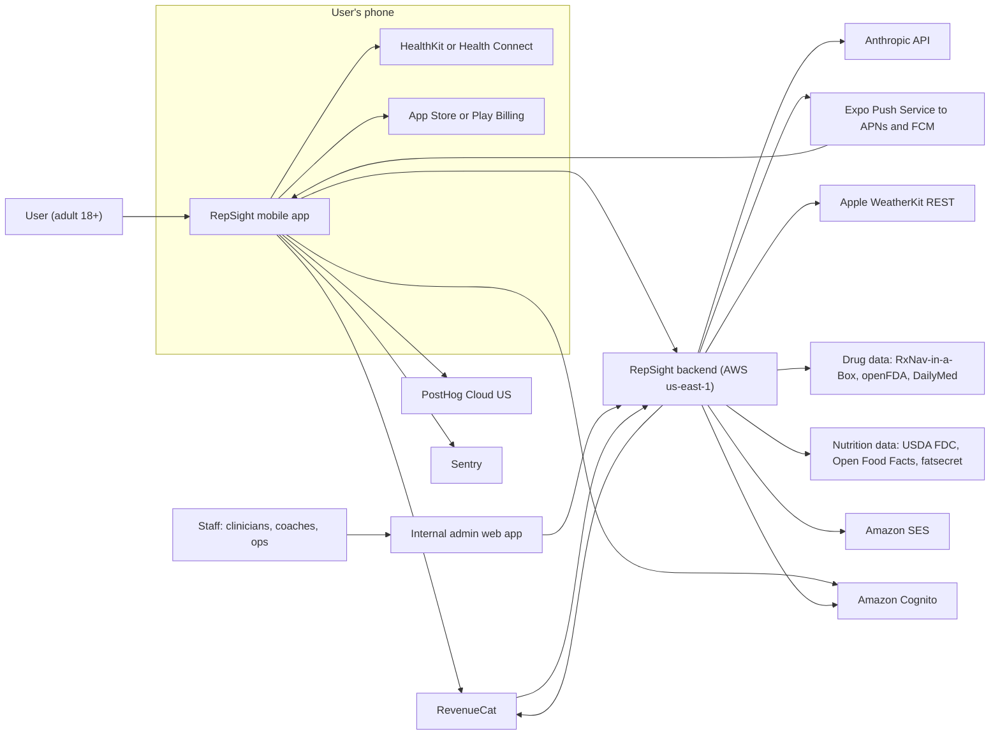

| External system | Direction | Purpose | Data sent (maximum) | Canon |
|---|---|---|---|---|
| Anthropic API | Backend → Anthropic | Coach chat, safety classifier, debriefs, plan narration, meal-photo parsing | Minimised prompt (§2.6) | §9.1, §10.4 |
| HealthKit / Health Connect | On device | Read weight, HR, sleep, steps, workouts | Nothing leaves except daily summaries (CON-07) | F-073, DC-09 |
| RevenueCat (+ App Store / Play Billing) | App ↔ RevenueCat ↔ backend (webhook) | Purchases, entitlements | Receipts, pseudonymous app-user ID | F-090, DC-13 |
| Expo Push Service → APNs/FCM | Backend → device | Reminders and lifecycle prompts | Device token, generic text; never medicine or health words | F-080 |
| PostHog Cloud (US) | App → PostHog | Allowlisted product events | Pseudonymous ID, event names and allowlisted properties; no health values, no free text | DC-14, §13 (Part B) |
| Sentry | App and backend → Sentry | Crash and error reports | Stack trace, device model; PII scrubbed | DC-14 |
| Apple WeatherKit REST | Backend → WeatherKit | Heat-index for heat alerts | City-level location (CON-10) | F-014, DC-12 |
| RxNav-in-a-Box (self-hosted), openFDA, DailyMed | Backend → source | Medicine search, class mapping, label-change tickets | Search strings only; no user identifiers | F-010, F-110 |
| USDA FDC, Open Food Facts, fatsecret (D-10) | Backend → source | Food search and barcode lookup | Search strings and barcodes | F-060 |
| Amazon Cognito | App ↔ Cognito | Sign in with Apple, Google, email one-time code | Email, auth IDs | F-001 |
| Amazon SES | Backend → user email | Transactional email | Email address, transactional text | §10.4 |

### 2.2 Containers and components

The backend is a **modular monolith**: one Python codebase, deployed as several ECS services. Reason: a three-person core team (canon §14.3) cannot run many independent services; module boundaries inside one codebase give the same separation with less operations work. A module may become its own service later through an ADR.

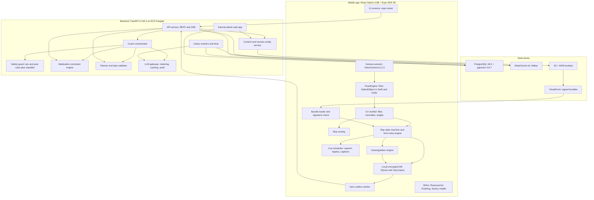

**Mobile components**

| Component | Responsibility | Runs on | Spec |
|---|---|---|---|
| Camera session | Configures the camera format, preview and frame output; no recording output | Native camera thread | §4.1 |
| `PoseEngine` | MediaPipe Pose Landmarker (Full/Lite) or Apple Vision 2D; drops face landmarks; thermal governor; typed-array output | Native, on the async runner thread | §4.2 |
| CV worklet | Visibility gate, One Euro filter, normalisation, joint angles | Worklet runtime (async runner) | §4.3 |
| Rep state machine and rules engine | Interprets the `ExerciseDefinition`; emits `RepEvent`, per-rep metrics and rule results | Worklet runtime | §4.5–§4.7 |
| Autoregulation engine | Velocity loss and form drift → "end set?" prompt and next-set suggestion | React Native (JS) thread | §4.8 |
| Cue scheduler | Chooses at most one corrective cue per rep; plays audio + haptic + caption | JS thread → `expo-speech`, `expo-haptics` | §4.9 |
| Skia overlay | Skeleton and captions drawn from shared values | UI thread | §4.1 |
| Local encrypted DB | Sessions, sets, reps, baselines, cached plan and bundles, sync outbox | SQLite with SQLCipher; key in `expo-secure-store` | §9 (Part B) |
| Sync outbox worker | Sends finished sessions and check-ins with idempotency keys; retries with backoff | JS thread | §2.4 (b), §4.12 |
| Bundle loader | Downloads, verifies and caches signed exercise bundles; falls back to the bundle shipped in the app binary | JS + native signature check | §4.5.4 |

**Backend components** (one codebase; ECS services in brackets)

| Component | Responsibility | ECS service | Spec |
|---|---|---|---|
| API service | REST and SSE endpoints, auth (Cognito JWT), consent checks, quotas, idempotent sync | `api` | §8 (Part B) |
| Coach orchestrator | Builds context, calls the LLM gateway with strict tools, executes tool calls | `api` (in process) | §7 (Part B) |
| Safety guard | Deterministic pre/post rules, classifier call, red-flag templates, crisis routing | `api` (in process) | §7 (Part B) |
| Medication constraint engine | RxCUI → RxClass → RULE-<CLASS>-## → constraint set | `api` (in process) | §7 (Part B) |
| Planner and plan validator | Builds programs; validates every proposal against the constraint set | `api` + `worker` | §7 (Part B) |
| Content and remote-config service | Publishes signed exercise bundles, KB cards and constraint rule sets; staged rollout assignment | `api` (read side); `admin` (write side) | §4.5.4 |
| LLM gateway | The only module that imports `anthropic`; token metering, cache breakpoints, audit fields | `api`, `worker` | §7 (Part B) |
| Celery workers and beat | Weekly narration, KB label-change tickets, deletion jobs, exports, meal-photo cleanup, research uploads | `worker`, `beat` | §11 (Part B) |
| Internal admin web app | Clinical KB and rules CMS (F-110), exercise-definition editor (F-111), ops console (F-115) | `admin` (internal ALB, Cognito staff pool, IP allowlist plus the network access layer chosen in ADR-015; §10.4) | §12 (Part B) |
| RxNav-in-a-Box | Self-hosted RxNorm/RxClass API | `rxnav` | §7 (Part B) |

### 2.3 Deployment

Hosting follows canon §10.3: AWS, primary region **us-east-1**, multi-AZ; disaster recovery copies to **us-west-2**.

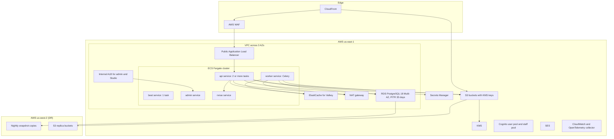

| Item | Decision | Canon |
|---|---|---|
| Recovery objectives | RPO ≤15 min in-region, 24 h cross-region; RTO 4 h | §10.3 |
| Outbound internet | Only through the NAT gateway, to an egress allowlist (Anthropic, RevenueCat, WeatherKit, openFDA, DailyMed, food APIs, Expo push, Sentry) | §10.4 |
| Region readiness | `home_region` column on every user-scoped row; region-scoped S3 buckets and KMS keys from day 1; ap-south-1 cell only when a canon §10.3 trigger fires | §10.3 |
| UK (V1.2), India (V1.3) | Served from us-east-1 (UK extension to the DPF; DPDP notice of transfer) | §10.3 |
| EU (V2), B2B HIPAA (V2) | eu-central-1 cell; separate AWS account and separate Anthropic organisation with a BAA | §10.3 |

Capacity, autoscaling and environments are in §11 and §12 (Part B).

### 2.4 Key sequences

#### 2.4.1 (a) A live camera set with cues and autoregulation

Everything in this sequence runs on the phone. No network call happens between "start set" and "set saved".

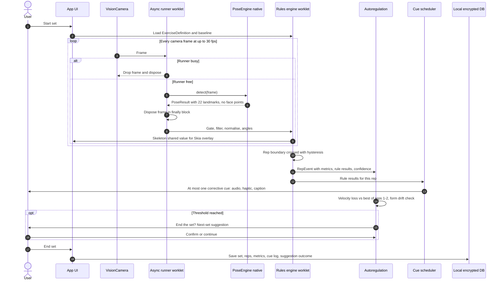

#### 2.4.2 (b) Post-session sync

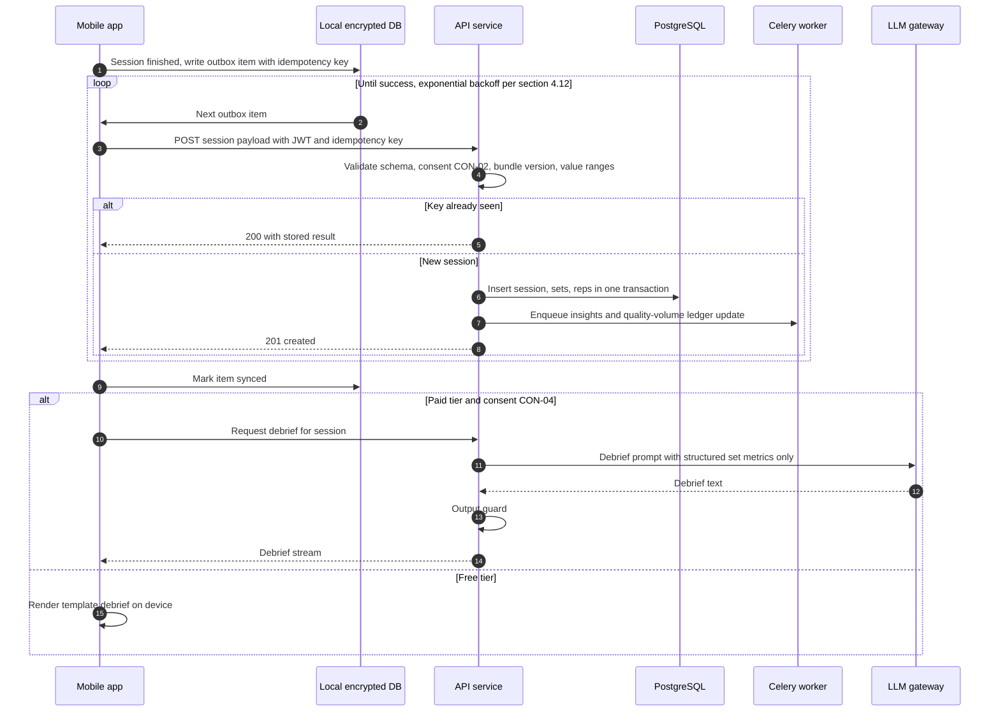

#### 2.4.3 (c) A coach chat turn with tools and safety checks

The full safety design is in §7 (Part B). This diagram shows only the order of steps.

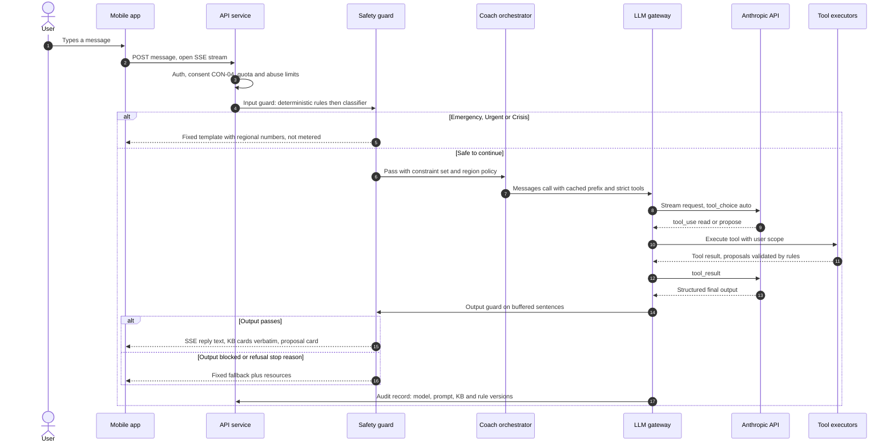

#### 2.4.4 (d) Adding a medicine → constraint set applied

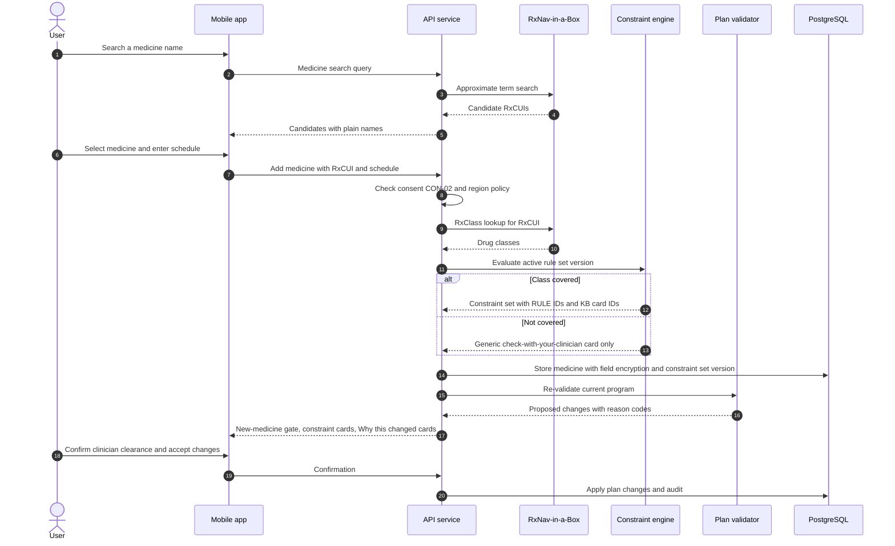

#### 2.4.5 (e) Purchase → entitlement

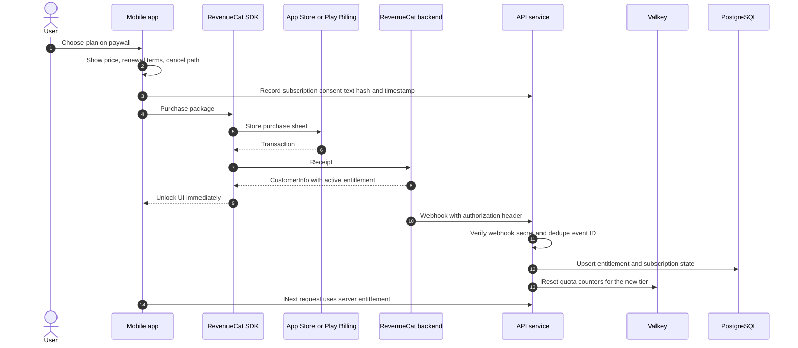

The server entitlement in PostgreSQL is authoritative for quotas (F-092). The SDK's `CustomerInfo` only unlocks UI. If the webhook is late, the API calls the RevenueCat REST API to refresh the subscriber before it rejects a paid-tier request.

### 2.5 Threading model on the phone

| Thread or runtime | Work | Rule |
|---|---|---|
| Camera thread (native) | Frame capture | Never blocked; frames dropped when the runner is busy |
| Async runner (worklet runtime) | `PoseEngine.detect`, CV worklet, rep state machine, rule evaluation | One frame in flight; `runAsync` returns false → drop the frame; `frame.dispose()` in `finally` |
| UI thread | Skia overlay from shared values | No CV work |
| React Native JS thread | Cue scheduler, autoregulation, UI state, DB writes, sync | Receives one message per rep event, never per frame |
| Native background | Thermal polling (≤ once per 10 s), bundle signature verification | — |

### 2.6 Data flow: exactly what leaves the phone

This table implements canon §11.2. Anything not listed here must not leave the phone. A new row needs a privacy review and an update to canon §11.

| Data class | Leaves the phone? | Destination | Consent needed | When | Transport |
|---|---|---|---|---|---|
| DC-01 Account | Yes | Cognito, backend | CON-01 | Sign-up, profile edit | TLS 1.2+ |
| DC-02 Camera frames / video | **Never** (except DC-10) | — | — | — | — |
| DC-03 Keypoint series | **No by default** | Research bucket only via DC-11 | CON-08 | After a set, batched on Wi-Fi | TLS; face points 0–10 already removed |
| DC-04 Training metrics | Yes | Backend | CON-01, CON-02 | Session sync | TLS; idempotent POST |
| DC-05 Health & medication profile | Yes | Backend (field-level KMS encryption) | CON-02 | On change | TLS |
| DC-06 Nutrition | Yes | Backend | CON-01, CON-02 | On log | TLS |
| DC-07 Meal photos | Transiently | Backend → Anthropic; deleted after parsing (≤24 h on retry failure) | CON-04 | On scan | TLS |
| DC-08 Coach chats & memory | Yes | Backend → Anthropic per call | CON-04; health memories CON-06 | Each turn | TLS + SSE |
| DC-09 Health-platform data | Daily summaries only | Backend | CON-07 per data type | Daily | TLS |
| DC-10 Shared clips | Per clip (V1.2) | S3 + KMS | CON-09 each time | On share | TLS; face-blurred on device |
| DC-11 Training contributions | Opt-in only | Separate de-identified bucket | CON-08 | Batched | TLS |
| DC-12 Location | Transient, city level | Backend → WeatherKit; not stored | CON-10 | Heat check | TLS |
| DC-13 Billing | Yes | RevenueCat, backend | CON-01 | Purchase | TLS |
| DC-14 Diagnostics | Yes | PostHog, Sentry | CON-11 where opt-in | Continuous | TLS |
| DC-15 Safety, consent & audit logs | Yes | Backend | CON-01 | On event | TLS |
| Voice audio, face landmarks, segmentation masks, precise location, contacts, advertising IDs | **Never** | — | — | — | — |

**What reaches Anthropic per call** (canon §11.2): a pseudonymous user key (never name or email), the profile summary, the constraint set, the metrics or logs a tool returned, the user's message, and the meal photo for a scan. Never keypoints or clips.

---

## 3. Technology Stack

Versions are the R2 registry snapshot of 2026-10-16 as pinned in canon §10. **Verify the latest stable at build time**, but never move a pinned version without an ADR (§3.10). SDK-aligned packages move in lockstep with Expo's bundled module list, never to "latest" [R2 §4.4].

### 3.1 Mobile app

| Component | Pinned version | Purpose | Why this choice |
|---|---|---|---|
| React Native | **0.88.0** [link](https://www.npmjs.com/package/react-native) | App framework | One typed language (TypeScript) for UI and logic; New Architecture only (RN ≥0.82); Hermes V1 [R2 §6] |
| Expo SDK | **58** (`expo` 58.0.12; template `expo-template-default` 58.0.21) | Build system, native modules, config plugins | Development builds only (`expo-dev-client` ~58.0.13); never Expo Go; `npx expo prebuild --clean` after native changes |
| React | 19.3.0 | UI library | Bundled with SDK 58 |
| TypeScript | **~6.0.3** | Language, strict mode | TypeScript 7.0.2 ships without a programmatic API, which lint and test tools need [link](https://devblogs.microsoft.com/typescript/announcing-typescript-7-0/) |
| Camera | `react-native-vision-camera` **5.2.3** + `react-native-vision-camera-worklets` 5.2.3 + `react-native-vision-camera-skia` 5.2.3 [link](https://www.npmjs.com/package/react-native-vision-camera) | Camera, frame processors, Skia overlay | Only maintained RN camera with worklet frame output; frames are Nitro HybridObjects our native module accepts directly [R2 §5.1] |
| Native module base | `react-native-nitro-modules` 0.37.1, `react-native-nitro-image` 0.15.2 | Base for our `PoseEngine` HybridObject | Required by VisionCamera 5; zero-copy typed arrays to JS |
| Worklets | `react-native-worklets` 0.13.0 | Async runner for frame processing | VisionCamera 5 needs this package, not `react-native-worklets-core` [R2 #78] |
| Animation | `react-native-reanimated` 4.7.1 | Shared values, UI animation | Lockstep with RN 0.86–0.88 and worklets 0.13.x |
| Drawing | `@shopify/react-native-skia` 2.14.0 | Skeleton overlay and captions on the camera view | GPU drawing on the UI thread |
| Pose (native) | MediaPipe Tasks Vision Android **1.1.1**; iOS `MediaPipeTasksVision` **1.0.0** | Pose Landmarker | Apache-2.0; documented training data; fitness is an intended use [R2 #2]. iOS packaging per D-05 (§3.2) |
| Audio / haptics | `expo-speech` 58.0.3, `expo-haptics` 58.0.6 | Spoken cues, haptic patterns | Device TTS voices work offline; on-device speech recognition uses the OS (iOS Speech on-device mode, Android on-device recognizer) |
| V2 runtime | LiteRT 2.3.0 inside `PoseEngine` | Learned temporal models (F-029) | Not in MVP. `react-native-fast-tflite` 3.0.1 only as a standalone option, because its VisionCamera 5 glue is private [R2 #85] |
| Pinned at M1 by ADR | `expo-router`, `expo-sqlite` with SQLCipher + `expo-secure-store`, `expo-notifications`, `react-native-purchases` (RevenueCat), `@sentry/react-native`, `posthog-react-native`, HealthKit and Health Connect libraries | Navigation, encrypted local DB, push, payments, crash reports, analytics, health data | Each must be SDK-58-compatible and New-Architecture-ready; the M1 ADR records the exact versions |

### 3.2 Native CV module (`PoseEngine`)

| Item | Decision | Reason |
|---|---|---|
| Languages | Swift (iOS), Kotlin (Android), TypeScript spec file (`PoseEngine.nitro.ts`) generated by Nitrogen | Nitro is the module system VisionCamera 5 is built on |
| Android model runtime | `com.google.mediapipe:tasks-vision` 1.1.1 (minSdk 24) with the GPU delegate; CPU delegate as fallback | NNAPI is deprecated on Android 15 [R2 §4.4] |
| iOS model runtime | `MediaPipeTasksVision` 1.0.0 pod (iOS 15+); if the pod fails in a release build, a vendored xcframework through an Expo config plugin (D-05, decided at M1 2026-12-11) | CocoaPods trunk becomes read-only on 2026-12-02; existing pods keep resolving [link](https://blog.cocoapods.org/CocoaPods-Specs-Repo/) |
| iOS fallback | Apple Vision `VNDetectHumanBodyPoseRequest` (2D, 19 joints); Apple Vision 3D `HumanBodyPose3DObservation.bodyHeight` for optional height calibration (iOS 17+) | OS framework, no model to ship [R2 #18, #21] |
| Model files | `pose_landmarker_full.task` and `pose_landmarker_lite.task` bundled in the app binary (not downloaded) | Works offline on first launch; the model hash is checked at load |
| Bundle signature check | Same native package exposes `BundleVerifier` (CryptoKit on iOS, `java.security` on Android) | §4.5.4 |
| Motion sensor | Native gravity vector (CoreMotion / Android `SensorManager`) for phone tilt | Setup Coach level check; vertical reference for trunk angles (§4.3) |

### 3.3 Backend

| Component | Pinned version | Purpose | Why |
|---|---|---|---|
| Python | **3.14.8** | Runtime | 3.15.0 was released 2026-10-09, too new [R2 #98] |
| FastAPI / Uvicorn | **0.143.3** / 0.54.0 | HTTP API, SSE | Async; OpenAPI → generated TypeScript client for the app |
| Pydantic / pydantic-settings | 2.14.1 / 2.16.0 | Validation, settings | Same schemas drive API validation and LLM structured-output schemas |
| SQLAlchemy / Alembic / asyncpg | 2.1.4 / 1.20.0 / 0.32.0 | ORM, migrations, driver | asyncpg is Apache-2.0 (psycopg is LGPL) |
| Celery | **5.6.3** | Background jobs and schedules | Not arq, which is maintenance-only [R2 #106] |
| LLM SDK | `anthropic` **1.15.0** | Claude API | Imported only in the LLM gateway module (§7, Part B) |
| Embeddings | Self-hosted open-weights model on onnxruntime 1.31.0; model chosen by ADR at M1 (Apache-2.0 or MIT only) | KB-card and memory retrieval | No extra data processor |
| Offline CV tooling | `mediapipe` (Python) 1.1.1 | Golden-video replay (F-112), pre-labelling (F-113) | Same model family as the app |

### 3.4 Data

| Store | Version / service | Purpose | Notes |
|---|---|---|---|
| PostgreSQL | **18.6** on RDS (Multi-AZ, PITR 35 days) | System of record | Supported to 2030-11-14 |
| pgvector | **0.8.7** (Python client 0.5.1) | KB-card and memory retrieval | §9 (Part B) |
| Cache / broker | Amazon ElastiCache for **Valkey** (BSD-3; R2 lists 9.0.6/9.1.2), redis-py 8.1.0 | Quotas, rate limits, Celery broker, short caches | Replaces Redis for licence reasons (canon §0.7) |
| Object storage | S3 + KMS (region-scoped buckets and keys) | Signed bundles, shared clips (V1.2), research data, exports | Separate de-identified research bucket |
| On-device | SQLite with SQLCipher (`expo-sqlite`), key in `expo-secure-store` | Sessions, baselines, outbox, cached plan and bundles | Excluded from iCloud backup (F-101) |

### 3.5 AI

| Item | Decision | Canon |
|---|---|---|
| Models | `claude-opus-5-5` (default, every route at V1.0); `claude-sonnet-5-5` and `claude-haiku-5-5` only after D-02 evals | §0.3, §9.1, §9.2 |
| Effort | Adaptive thinking on; `medium` for chat and plan narration, `low` for classifier, meal parsing, debriefs | §9.1 |
| Data terms | ZDR applied for (D-06); no Batch or Files API with user data; `inference_geo: global`; server-side model fallbacks off | §9.1 |
| On-device AI | MediaPipe Pose Landmarker only; no LLM or VLM in the live loop | §8.1 |

### 3.6 Infrastructure

| Service | Use | Canon |
|---|---|---|
| ECS Fargate | `api`, `worker`, `beat`, `admin`, `rxnav` services | §10.3 |
| RDS for PostgreSQL 18 | Primary database | §10.3 |
| ElastiCache for Valkey | Cache and broker | §10.2 |
| S3 + KMS, CloudFront, WAF | Storage, bundle delivery, edge protection | §10.3 |
| Secrets Manager | API keys, webhook secrets, DB credentials | §10.3 |
| CloudWatch + OpenTelemetry | Logs, metrics, traces | §10.3 |
| SES, Cognito | Email; user and staff identity | §10.3 |
| us-west-2 | Snapshot copies and S3 replication (DR) | §10.3 |

### 3.7 CI/CD and build

| Tool | Use |
|---|---|
| GitHub Actions | Lint, type-check, unit tests, golden-video harness (F-112), safety eval gate and banned-claims linter (F-114), backend container builds |
| EAS Build & Submit | iOS and Android builds and store submission |
| Device lab (9 phones, canon §3.4) + cloud device farm | FPS, latency, thermal and battery jobs (§6.4) |
| Toolchain floors | Xcode 26.4+, Node 22.13.x, AGP 9 / Kotlin 2.0+; iOS minimum 17.0; Android minimum API 28, targetSdk 36, compileSdk 37 (canon §3.3) |

Pipelines, environments and release trains are in §12 (Part B).

### 3.8 Third-party services

| Need | Service | May receive | Rule |
|---|---|---|---|
| Auth | Amazon Cognito (Sign in with Apple, Google, email one-time code) | Email, auth IDs | Revoke Sign in with Apple tokens on deletion |
| Payments | RevenueCat + App Store / Play Billing; Stripe Billing + RevenueCat Web at V1.2 (D-13) | Receipts, pseudonymous app-user ID | No health data |
| LLM | Anthropic API (ZDR requested) | Minimised prompts (§2.6) | Backend proxy only |
| Product analytics | PostHog Cloud (US) | Allowlisted events, pseudonymous ID | No health values, no free text, no autocapture, no session replay |
| Crash reporting | Sentry | Stack traces, device model | PII scrubbing; no screenshots or replay |
| Push | Expo Push Service → APNs/FCM | Device token, generic text | Never medicine or health words in payloads |
| Email | Amazon SES | Email address, transactional text | No tracking pixels on health-related emails |
| Flags and config | PostHog flags (UI experiments only); our signed remote-config service (exercise rules, constraint rules, cue copy); RevenueCat Offerings (paywalls) | — | Safety configuration never lives in a third-party flag tool |
| Weather | Apple WeatherKit REST (server-side) | City-level location | Only with CON-10 |
| Drug data | RxNav-in-a-Box (self-hosted), openFDA, DailyMed | No user identifiers | NLM attribution string required |
| Nutrition data | USDA FDC (CC0), Open Food Facts (ODbL, cached), fatsecret Premier Free or Edamam (D-10); IFCT 2017 for India with NIN permission | Food search strings | Attribution; share-alike for OFF-derived databases |

### 3.9 Explicitly not used (canon §10.5)

| Not used | Why |
|---|---|
| Ad, attribution or tracking SDKs (Meta, Google Ads, AppsFlyer, etc.), pixels, IDFA/AAID; no App Tracking Transparency prompt | Nothing tracks; GoodRx precedent [R4 #28] |
| Ultralytics YOLO (AGPL-3.0), Sapiens / Sapiens2, research-licensed datasets; RTMPose/ViTPose weights until legal review | Licence |
| ML Kit Pose | Beta, no release since Aug 2024 [R2 #14] |
| Community MediaPipe RN plugins, `react-native-worklets-core` | Stale or incompatible with VisionCamera 5 |
| Flutter, Expo Go, TypeScript 7 for tooling, arq, self-hosted Redis-licensed binaries | §3.1–§3.3 reasons |
| LLMs or VLMs for live cues; Batch or Files API with user data; "Covered Models" with 30-day retention; server-side model fallbacks | Accuracy (VLMs scored 1.29–2.27/5 on QEVD [link](https://arxiv.org/abs/2407.08101)); data terms |
| Drug-interaction databases (DrugBank, FDB, Medi-Span), dose calculators, Nutritionix | Device boundary; partner-only |
| Camera vital signs, face recognition, face embeddings, segmentation masks, emotion inference | Claims rules and privacy |
| Session replay, autocapture analytics, iCloud backup of the health store, Google Fit APIs | Privacy; deprecated API |

### 3.10 ADR rule for versions

1. Any change to a version pinned in this section or in canon §10 needs an ADR in `docs/adr/` with: the old and new version, the reason, the release notes read, the test evidence (golden-video harness, device-lab run, safety eval if an AI component changes), and a rollback plan.
2. SDK-aligned packages move together, in one ADR, following Expo's bundled module list.
3. A model ID change, prompt change or KB change also re-runs the safety eval (canon §9.8). A MediaPipe model or runtime change also re-runs the full golden-video and held-out validation suite (§5.2, §5.4).
4. ADR numbers are assigned in the ADR index (§14 Appendix C). Part A refers to these ADRs by slug; the table gives the number for each slug:

| ADR slug | ADR | Decision | Due |
|---|---|---|---|
| `adr-mobile-framework` | ADR-001 | React Native + Expo dev builds with a native Swift/Kotlin `PoseEngine` | Recorded at E0 |
| `adr-pose-model` | ADR-002 | MediaPipe Pose Landmarker Full (Lite fallback) primary; Apple Vision 2D iOS fallback | Recorded at E0 |
| `adr-ios-mediapipe-packaging` | ADR-003 | D-05 outcome | M1 (2026-12-11) |
| `adr-video-running-mode` | ADR-029 | MediaPipe VIDEO mode inside the async runner, not LIVE_STREAM; per-frame budgets (§4.11.1) | M1 |
| `adr-camera-input-format` | ADR-030 | Pixel format per platform after the M1 zero-copy test (§4.1) | M1 |
| `adr-bundle-signing` | ADR-025 | ECDSA P-256 signatures with an AWS KMS key; two pinned public keys in the app | M1 |
| `adr-m1-library-pins` | ADR-006 | Versions of the "pinned at M1" mobile libraries | M1 |
| `adr-embedding-model` | ADR-007 | Open-weights embedding model (Apache-2.0/MIT) | M1 |
| `adr-labelling-tool` | ADR-031 | Self-hosted Label Studio Community (Apache-2.0); version pinned | M1 |
| `adr-load-test-tool` | ADR-032 | Locust (Python, MIT) for backend load tests; version pinned | M2 |

---

## 4. Camera Integration & On-Device CV Pipeline

This section specifies F-020 to F-025 and the CV parts of F-101, F-111 and F-112. The pipeline follows canon §8.1:

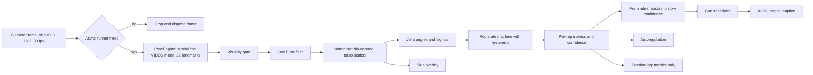

### 4.1 Camera configuration

| Setting | Decision | Reason |
|---|---|---|
| Lens | Front (user-facing) camera by default; user can switch to the back camera. Back camera uses the default wide lens (1×); no ultra-wide. | The user sees the Setup Coach on screen. Ultra-wide distortion bends limb angles. |
| Format | The device format closest to **1280 × 720 (16:9)** that supports 30 fps; never above 1920 × 1080 | Canon §8.1 "~HD 16:9, 30 fps"; the landmarker input is only 256² [R2 #1], so more pixels add cost without accuracy |
| Frame rate | Target **30 fps**; the thermal governor may lower the processing rate (§4.11) | KPI-04 |
| Orientation | Each `ExerciseDefinition` declares `camera.preferredOrientation`. Standing exercises (EX-01, EX-02, EX-04, EX-05, EX-06, EX-08, EX-10): portrait. Floor exercises (EX-03, EX-07, EX-09): landscape. The Setup Coach asks the user to rotate the phone. | The body must fill the frame along its long axis |
| Rotation handling | The native module passes the frame's orientation to MediaPipe (`imageProcessingOptions` rotation on Android, `MPImage` orientation on iOS), so landmarks come back in upright display coordinates | Rules assume "up" is up |
| Mirroring | The front-camera preview is mirrored for display only. Landmark coordinates are never mirrored; left/right labels stay anatomical. | Correct side selection (§4.3) |
| Pixel format | Android: YUV (`YUV_420_888`) passed to MediaPipe through its media-image builder. iOS: the format the `MediaPipeTasksVision` `MPImage` initialiser accepts without a copy (BGRA expected). Confirmed by the M1 zero-copy test (`adr-camera-input-format`). | RGB uses about 2.6× the bandwidth of YUV [R2 §4.4] |
| Video stabilisation, HDR | Off | Stabilisation crops and adds latency |
| Exposure, focus | Continuous auto; low-light boost on when the device supports it | Gym and home lighting varies |
| Outputs | Preview + frame processor only. **No photo, video or audio output** (ARCH-02) | F-101, DC-02 |
| Microphone | Not attached to the camera session. Voice logging (F-026) uses the OS on-device speech recogniser in a separate, user-started session; audio is never stored. | DC-02, §11.2 |

**Frame discipline** (from R2 §4.4, mandatory):

```ts
// Inside the VisionCamera frame processor (react-native-vision-camera-worklets)
const runner = useAsyncRunner();
const frameProcessor = useFrameProcessor((frame) => {
  'worklet';
  const accepted = runner.runAsync(() => {
    'worklet';
    try {
      const result = poseEngine.detect(frame);   // synchronous native call
      if (result !== undefined) cvPipeline.onPose(result); // §4.3–§4.7
    } finally {
      frame.dispose();                           // always, even on error
    }
  });
  if (!accepted) frame.dispose();                // runner busy → drop this frame
}, [runner]);
```

The exact hook and method names follow the `react-native-vision-camera-worklets` 5.2.3 API; the rule (one frame in flight, drop when busy, always dispose) is fixed.

| ID | Requirement | Acceptance criterion | Traces to |
|---|---|---|---|
| CV-01 | Camera format is ≤1920 × 1080, 16:9, 30 fps target, with no recording output. | Unit test on the format selector for 5 recorded device format lists; config snapshot test. | F-020, F-101 |
| CV-02 | No frame leaks: every frame is disposed. | 20-minute device-lab run: frame-pool stall count = 0; native frame counters `received = processed + dropped`. | F-020 |
| CV-03 | Landmarks are in upright display coordinates for all 4 device orientations and both cameras. | Golden test: a known pose filmed in each orientation gives the same knee angle ±3°. | F-020 |

### 4.2 Frame processing & PoseEngine

`PoseEngine` is our Nitro HybridObject (F-020). It is the only code that touches pixels.

#### 4.2.1 TypeScript interface (`src/native/PoseEngine.nitro.ts`)

```ts
import type { HybridObject } from 'react-native-nitro-modules';
import type { Frame } from 'react-native-vision-camera';

export type PoseBackend = 'mediapipe' | 'apple_vision_2d';
export type ModelVariant = 'full' | 'lite';
export type ThermalLevel = 0 | 1 | 2 | 3;          // §4.11 governor levels L0..L3

export interface PoseEngineConfig {
  variant: ModelVariant;                            // 'full' (Tier A/B) or 'lite' (Tier C)
  minPoseDetectionConfidence: number;               // default 0.5
  minPosePresenceConfidence: number;                // default 0.5
  minTrackingConfidence: number;                    // default 0.5
  delegate: 'gpu' | 'cpu';                          // Android: 'gpu' first, 'cpu' fallback
  targetProcessFps: number;                         // 30, lowered by the governor
}

export interface PoseEngineInfo {
  backend: PoseBackend;
  variant: ModelVariant;
  modelSha256: string;                              // checked against the build manifest
  delegate: 'gpu' | 'cpu' | 'ane' | 'os';
  landmarkCount: 22;                                // always 22 (MediaPipe 11..32)
}

export interface PoseResult {
  timestampMs: number;                              // frame timestamp, monotonic
  inferenceMs: number;                              // native detect() wall time
  poseDetected: boolean;
  /** Float32Array view: 22 landmarks × [x, y, z, visibility, presence]; x,y in 0..1 upright image coords */
  landmarks: ArrayBuffer;
  /** Float32Array view: 22 × [x, y, z] world coordinates (approximate, metres, hip-centred) */
  world: ArrayBuffer;
  headInFrame: boolean;                             // derived natively from points 0–10, which are then discarded
  headPitchDeg: number;                             // the single derived head-angle number allowed by canon §8.1; NaN if unknown
  imageWidth: number;
  imageHeight: number;
  meanLuma: number;                                 // 0..1, sampled from the luminance plane, for the lighting check
}

export interface PoseEngineStats {
  framesIn: number; framesProcessed: number; framesDropped: number;
  p50InferenceMs: number; p95InferenceMs: number;
  thermalLevel: ThermalLevel;
}

export interface PoseEngine extends HybridObject<{ ios: 'swift'; android: 'kotlin' }> {
  load(config: PoseEngineConfig): Promise<PoseEngineInfo>;
  setVariant(variant: ModelVariant): Promise<PoseEngineInfo>;   // applied between sets only (§4.11)
  detect(frame: Frame): PoseResult | undefined;                 // synchronous; undefined = frame skipped (rate limit or timestamp)
  getDeviceTilt(): { rollDeg: number; pitchDeg: number; stable: boolean };
  getThermalLevel(): ThermalLevel;
  getStats(): PoseEngineStats;
  resetTracking(): void;                                       // new set or tracking lost
  unload(): void;
}
```

#### 4.2.2 Native responsibilities (Swift and Kotlin)

| # | Responsibility | Swift (iOS) | Kotlin (Android) |
|---|---|---|---|
| 1 | Model loading | Load `.task` from the app bundle; verify SHA-256 against the build manifest; create `PoseLandmarker` with `runningMode = .video`, `numPoses = 1` | Same with `BaseOptions.setModelAssetPath`, `RunningMode.VIDEO`, `setNumPoses(1)`; GPU delegate, CPU on failure |
| 2 | VIDEO mode and timestamps | `detect(videoFrame:timestampInMilliseconds:)` with the frame timestamp in ms. If a timestamp is ≤ the previous one, skip the frame (return `undefined`). | `detectForVideo(mpImage, timestampMs)`, same monotonic rule |
| 3 | Rate limiting | Skip frames so processed FPS ≤ `targetProcessFps` | Same |
| 4 | Face landmarks | Compute `headInFrame` (presence of points 0–10 ≥ 0.5 and inside the frame) and `headPitchDeg` from points 0, 7, 8 and the shoulders; then **do not copy points 0–10** into any output buffer | Same |
| 5 | Typed-array output | Write points 11–32 into a reused `Float32` buffer (22 × 5) and world points into 22 × 3; return as `ArrayBuffer` without per-call allocation where Nitro allows | Same |
| 6 | Thermal governor input | Read `ProcessInfo.thermalState` (nominal, fair, serious, critical) at most once per 10 s and on its change notification | `PowerManager.getCurrentThermalStatus()` and listener; `getThermalHeadroom()` (API 30+) at most once per 10 s [R2 §2.2] |
| 7 | Apple Vision fallback | If MediaPipe fails to initialise (or crashes 3 times in a session), switch to `VNDetectHumanBodyPoseRequest`; map its 19 joints to our 22 (§4.2.3); report `backend = 'apple_vision_2d'` | — (no Android fallback; on failure the session runs in manual-logging mode, FM-01) |
| 8 | Optional height | On iOS 17+, if the user allows, run `VNDetectHumanBodyPose3DRequest` once during the Setup Coach and return `bodyHeight` (m) | — |
| 9 | Device tilt | CoreMotion gravity vector → roll and pitch; `stable` when rotation rate < 0.05 rad/s for 2 s | `SensorManager` gravity sensor, same rule |
| 10 | No persistence | No pixel buffer is copied, cached or written; no debug image dump in release builds (compile flag) | Same |
| 11 | Errors | Never throw across the boundary in `detect`; return `undefined` and increment an error counter; `load` rejects with a typed error code (§14 Appendix B) | Same |

#### 4.2.3 Landmark subset

Our index `i` = MediaPipe index − 11. The 22 kept landmarks are:

| Our index | MediaPipe index | Name | Apple Vision 2D mapping |
|---|---|---|---|
| 0 / 1 | 11 / 12 | left / right shoulder | leftShoulder / rightShoulder |
| 2 / 3 | 13 / 14 | left / right elbow | leftElbow / rightElbow |
| 4 / 5 | 15 / 16 | left / right wrist | leftWrist / rightWrist |
| 6 / 7 | 17 / 18 | left / right pinky | none (visibility 0) |
| 8 / 9 | 19 / 20 | left / right index | none |
| 10 / 11 | 21 / 22 | left / right thumb | none |
| 12 / 13 | 23 / 24 | left / right hip | leftHip / rightHip |
| 14 / 15 | 25 / 26 | left / right knee | leftKnee / rightKnee |
| 16 / 17 | 27 / 28 | left / right ankle | leftAnkle / rightAnkle |
| 18 / 19 | 29 / 30 | left / right heel | none |
| 20 / 21 | 31 / 32 | left / right foot index | none |

Apple Vision coordinates have a lower-left origin; the native code flips y to an upper-left origin. Apple's joint confidence fills both `visibility` and `presence`. Apple's neck, root, nose, eye and ear joints are not output (head joints feed only `headInFrame`). Rules whose joints are missing under the fallback (for example ERR-EX01-03 needs the heels) are disabled for that session and logged as "form not assessed" with reason `backend_missing_joint`.

| ID | Requirement | Acceptance criterion | Traces to |
|---|---|---|---|
| CV-04 | `PoseEngine` runs VIDEO mode with monotonic timestamps and `num_poses = 1`. | Native unit test with a 300-frame synthetic feed: 0 timestamp errors; out-of-order frame skipped. | F-020 |
| CV-05 | Face landmarks 0–10 are never in any output. | Native test reads raw output buffers: byte length = 22 × 5 × 4 and 22 × 3 × 4; fuzz test with face-only images returns no face coordinates. | F-020, F-101, R-11 |
| CV-06 | Apple Vision fallback activates when MediaPipe fails on iOS. | Test build with a corrupted model hash: session starts on `apple_vision_2d` within 2 s; heel-dependent rules disabled. | F-020 |
| CV-07 | No pixel persistence in release builds. | Release-build file-system diff after a 10-minute session: no new image or video files; static grep gate on write APIs in the module. | F-101 |

### 4.3 Pose post-processing

All steps run in the worklet, per processed frame, in this order.

**1. Visibility gate.** A landmark is *usable* in a frame when `visibility ≥ 0.5` and `presence ≥ 0.5` (start values from canon §7; tune in M2; per-exercise override in the DSL `visibility.threshold`). Unusable landmarks are not filtered or used for angles in that frame. Per rep, the engine counts, for each landmark, the share of the rep's frames in which it was usable.

**2. One Euro filter** [link](https://gery.casiez.net/1euro/). Applied per usable landmark to x and y separately, before any angle is computed.

| Parameter | Default | Range allowed in DSL | Tuning rule |
|---|---|---|---|
| `minCutoffHz` | 1.0 | 0.3–3.0 | Lower to remove jitter at rest |
| `beta` | 0.001 | 0.0001–0.1 | Raise by factors of 10 to cut lag on fast moves; tune per exercise tempo |
| `dCutoffHz` | 1.0 | fixed | — |
| Reset | Filter state resets when a landmark is unusable for >500 ms, and at every set start | — | Avoids a jump from stale state |

The filter uses the real time between processed frames (from `timestampMs`), not a fixed rate, because the governor changes the rate.

**3. Aspect correction.** MediaPipe x and y are normalised separately to width and height. Before any distance or angle, convert to isotropic units: `x' = x × imageWidth / imageHeight`, `y' = y`.

**4. Side selection (side views).** For side-view exercises the engine uses the side nearer the camera: the side (left or right) whose shoulder, hip, knee and ankle have the higher mean visibility over the first 15 processed frames of the set. The choice is locked for the set. For EX-05 the DSL forces the working arm. Unilateral exercises (EX-04, EX-05, alternating EX-10) report per side.

**5. Normalisation.** Origin = hip midpoint (mean of hips). Scale = torso length = distance from the shoulder midpoint to the hip midpoint, taken as the median over the last 30 usable frames, so one bad frame cannot change the scale. Normalised point = (point − origin) / torso length. Normalised units are scale-free, so thresholds do not depend on distance from the camera.

**6. Vertical reference.** Trunk and body-line angles need "true vertical". The engine rotates image coordinates by the phone's measured roll (`getDeviceTilt().rollDeg`, sampled at set start) so that small tripod tilts do not bias trunk angles.

**7. Signals.** The DSL names signals; the engine computes them per frame:

| Signal kind | Formula (2D, aspect-corrected, roll-corrected) | Example |
|---|---|---|
| `joint_flexion` | 180° − ∠(A, B, C) at vertex B | Knee flexion: A = hip, B = knee, C = ankle |
| `segment_to_vertical` | Angle between segment A→B and the vertical "up" vector | Trunk lean: hip → shoulder |
| `line_deviation` | Signed angle of point B from line A→C (positive = above the line in the image) | Push-up hip sag: shoulder–hip–ankle |
| `vertical_position` | Normalised y of a point or midpoint | Hip midpoint height |
| `distance_ratio` | Distance between two points ÷ a reference length | Wrist-to-leg distance ÷ thigh length |
| `fppa` | Frontal-plane projection angle at the knee (hip–knee–ankle in a front view) | Beta valgus trend |

World coordinates are advisory only: BlazePose z is "not metric but up to scale" [R2 #2]. Absolute angles are never shown as clinical measurements (canon §7).

| ID | Requirement | Acceptance criterion | Traces to |
|---|---|---|---|
| CV-08 | Post-processing order and parameters match this section and are identical on the phone and in the golden-video harness (one shared `cv-engine` package, §5.4). | Cross-runtime test: the same recorded landmark stream through the worklet build and the Node CI build of `cv-engine` gives angles equal within 0.5° and identical rep events. | F-022, F-112 |
| CV-09 | Sagittal angle MAE vs lab reference, side view, ≤10° on Tiers A and B. | M4 validation study against Kinovea video goniometry on 30 participants (§5.4). | canon §8.3 |

### 4.4 Setup Coach & baseline

The Setup Coach (F-021) runs before the first set of each exercise in a session, and again whenever tracking confidence drops (FM-04). Each check shows one plain instruction with an icon, speaks it, and turns green when passed. All checks must hold for 1 s at the same time before the set can start. The user can skip the Setup Coach after 30 s; the set then runs in **counting-only mode** (no form cues) and the skip is logged.

| Check | Pass condition (start values; tune in M2) | Instruction when failing |
|---|---|---|
| S1 Phone steady and level | `stable = true`; roll within ±10° | "Lean your phone against something steady." |
| S2 Full body in frame | All landmarks required by the exercise have `presence ≥ 0.5`, lie inside the frame with a 5% margin, and `headInFrame = true` | "Step back until your head and feet are on screen." |
| S3 Distance about 2–4 m | Body height in the frame (head top estimate to lowest foot point) is 45–85% of frame height for portrait, or body length 45–85% of frame width for landscape | "Move closer" / "Move back a little." |
| S4 Required view | View classifier from shoulder and hip widths: `shoulderWidth / torsoLength` < 0.35 → side; > 0.60 → front; between → 45°. Must match `camera.requiredView`. | "Turn so your side faces the phone." |
| S5 Lighting | `meanLuma ≥ 0.25` and mean visibility of required landmarks ≥ 0.7 over 1 s | "Turn on a light or face the window." |
| S6 Clothing tip (advice, not a gate) | Shown once per exercise | "Fitted clothes help the camera see your knees and hips." |

If the view is wrong and the user continues, the set runs with rep counting and view-independent rules only, plus a re-position prompt at each rest (canon §7).

**Personal baseline (three reference reps).**

| Item | Rule |
|---|---|
| When | First time an exercise is done; after 28 days; when the camera view or backend changes; on user request |
| Protocol | The app asks for three slow, comfortable reps (spoken count "down, two, three; up, two, three"). No load beyond what the user normally uses. |
| What is stored | For each `baseline.metrics` entry of the DSL: the median of the three reps (for example peak knee flexion, trunk angle at the bottom). Also the rep-1 velocity of the velocity landmark. |
| Validity | All three reps detected and assessed (§4.7 confidence ≥0.8); each metric within the DSL `baseline.bounds`. If a value is outside the bounds, the app asks for the baseline again once; if it fails again, the population default from the DSL is used and every cue that depends on it is downgraded to Beta for that user until a valid baseline exists. |
| Optional height | User-entered height (cm), or Apple 3D `bodyHeight` on iOS 17+ with permission. Used only to convert velocity to m/s (§4.6). Velocity *loss* is a ratio and needs no height. |
| Storage | On device (local DB) and synced as DC-04 metrics. Never shown as a clinical measurement. |

| ID | Requirement | Acceptance criterion | Traces to |
|---|---|---|---|
| CV-10 | Set start is blocked until S1–S5 hold for 1 s, unless the user chooses counting-only mode. | UI test with scripted landmark streams for each failing check; correct instruction shown; skip logged. | F-021 |
| CV-11 | Baseline is the median of three assessed reps within DSL bounds; fallback downgrades dependent cues to Beta. | Unit tests with 6 scripted baseline streams (valid, 1 invalid rep, out of bounds twice, etc.). | F-021 |
| CV-12 | Setup Coach pass rate is high enough to support KPI-06. | Beta telemetry: ≥90% of users pass S1–S5 within 60 s (proposed target; review at M3). | KPI-06 |

### 4.5 Exercise Definition DSL

Each exercise is one declarative `ExerciseDefinition` JSON document (F-022). It holds the view, joints, signals, phases with hysteresis, metrics, rules, cue copy and maturity. The phone and the golden-video harness (F-112) run **the same JSON** through **the same** `cv-engine` TypeScript package (on the phone in the worklet; in CI under Node, fed by landmark streams that Python `mediapipe` 1.1.1 produces; §5.4, CV-08). Definitions are grouped into a signed **bundle** and delivered as remote config (F-111), so tuning needs no app release.

#### 4.5.1 Threshold value forms

| `mode` | Meaning | Example |
|---|---|---|
| `absolute` | Fixed value in the signal's unit | Knee angle at top < 160° |
| `baseline_ratio` | `ratio × baseline[metric]` | Depth < 0.90 × baseline peak knee flexion |
| `baseline_offset` | `baseline[metric] + offset` | Trunk lean > baseline + 15° |
| `rep_offset` | Value relative to the same rep's start-of-rep value | Trunk angle change within the rep > 15° |
| `height_scaled_m` | Distance in metres, converted to normalised units with the user's height (or the default 1.70 m) and `global.torsoToStature` (start 0.30; calibrate in M3) | Heel rise > 0.02 m |
| `program` | Value supplied by the program at run time | Top-hold time ≥ programmed pause (default 1 s) |

#### 4.5.2 JSON Schema (draft 2020-12)

File: `packages/exercise-dsl/schema/exercise-definition.schema.json`. The app, the admin editor (F-111) and the harness validate against it.

```json
{
  "$schema": "https://json-schema.org/draft/2020-12/schema",
  "$id": "https://repsight.app/schemas/exercise-definition/1.0.json",
  "title": "ExerciseDefinition",
  "type": "object",
  "additionalProperties": false,
  "required": ["schemaVersion", "exerciseId", "definitionVersion", "name", "camera", "landmarks", "signals", "baseline", "repModel", "metrics", "rules", "cueCopy", "maturity"],
  "properties": {
    "schemaVersion": { "const": "1.0" },
    "exerciseId": { "type": "string", "pattern": "^EX-[0-9]{2}$" },
    "definitionVersion": { "type": "string", "pattern": "^[0-9]+\\.[0-9]+\\.[0-9]+$" },
    "name": { "type": "object", "additionalProperties": { "type": "string" }, "required": ["en-US"] },
    "equipment": { "type": "array", "items": { "enum": ["none", "dumbbell_1", "dumbbell_2", "bench_or_chair", "chair_43cm", "mat"] } },
    "freeTier": { "type": "boolean" },
    "camera": {
      "type": "object", "additionalProperties": false,
      "required": ["requiredView", "preferredOrientation", "distanceM"],
      "properties": {
        "requiredView": { "enum": ["side", "front"] },
        "optionalViews": { "type": "array", "items": { "enum": ["side", "front", "oblique45"] } },
        "preferredOrientation": { "enum": ["portrait", "landscape"] },
        "distanceM": { "type": "object", "properties": { "min": { "const": 2 }, "max": { "const": 4 } }, "required": ["min", "max"] },
        "sideSelection": { "enum": ["nearest", "left", "right", "working_arm"] }
      }
    },
    "landmarks": { "type": "array", "minItems": 1, "items": { "$ref": "#/$defs/landmarkName" } },
    "filter": {
      "type": "object", "additionalProperties": false,
      "properties": {
        "minCutoffHz": { "type": "number", "minimum": 0.3, "maximum": 3.0, "default": 1.0 },
        "beta": { "type": "number", "minimum": 0.0001, "maximum": 0.1, "default": 0.001 }
      }
    },
    "visibility": {
      "type": "object", "additionalProperties": false,
      "properties": {
        "threshold": { "type": "number", "minimum": 0.3, "maximum": 0.9, "default": 0.5 },
        "minFrameShare": { "type": "number", "minimum": 0.5, "maximum": 1.0, "default": 0.8 }
      }
    },
    "signals": {
      "type": "array", "minItems": 1,
      "items": {
        "type": "object", "additionalProperties": false,
        "required": ["id", "kind", "points", "unit"],
        "properties": {
          "id": { "$ref": "#/$defs/identifier" },
          "kind": { "enum": ["joint_flexion", "segment_to_vertical", "line_deviation", "vertical_position", "distance_ratio", "fppa"] },
          "points": { "type": "array", "minItems": 1, "maxItems": 4, "items": { "$ref": "#/$defs/pointRef" } },
          "reference": { "type": "array", "items": { "$ref": "#/$defs/pointRef" }, "maxItems": 2 },
          "side": { "enum": ["selected", "left", "right", "mid"], "default": "selected" },
          "unit": { "enum": ["deg", "norm", "ratio"] },
          "views": { "type": "array", "items": { "enum": ["side", "front", "oblique45"] } }
        }
      }
    },
    "baseline": {
      "type": "object", "additionalProperties": false,
      "required": ["reps", "metrics"],
      "properties": {
        "reps": { "const": 3 },
        "maxAgeDays": { "type": "integer", "default": 28 },
        "metrics": {
          "type": "array",
          "items": {
            "type": "object", "additionalProperties": false,
            "required": ["id", "signal", "aggregate", "bounds", "populationDefault"],
            "properties": {
              "id": { "$ref": "#/$defs/identifier" },
              "signal": { "$ref": "#/$defs/identifier" },
              "aggregate": { "$ref": "#/$defs/aggregate" },
              "phase": { "$ref": "#/$defs/stateId" },
              "bounds": { "type": "array", "items": { "type": "number" }, "minItems": 2, "maxItems": 2 },
              "populationDefault": { "type": "number" }
            }
          }
        }
      }
    },
    "repModel": {
      "type": "object", "additionalProperties": false,
      "required": ["primarySignal", "states", "countOn", "minRepMs", "maxRepMs"],
      "properties": {
        "primarySignal": { "$ref": "#/$defs/identifier" },
        "kind": { "enum": ["cyclic", "hold"], "default": "cyclic" },
        "perSide": { "type": "boolean", "default": false },
        "states": {
          "type": "array", "minItems": 2,
          "items": {
            "type": "object", "additionalProperties": false,
            "required": ["id", "enter", "exit"],
            "properties": {
              "id": { "$ref": "#/$defs/stateId" },
              "role": { "enum": ["eccentric", "concentric", "isometric", "rest"] },
              "enter": { "$ref": "#/$defs/condition" },
              "exit": { "$ref": "#/$defs/condition" }
            }
          }
        },
        "countOn": { "type": "string", "description": "Transition that counts a rep, e.g. 'UP->TOP'" },
        "requireState": { "type": "string", "description": "State that must be visited for a counted rep, e.g. 'BOTTOM'" },
        "minRepMs": { "type": "integer", "minimum": 200 },
        "maxRepMs": { "type": "integer", "maximum": 30000 },
        "holdToleranceMs": { "type": "integer", "default": 2000 }
      }
    },
    "velocity": {
      "type": "object", "additionalProperties": false,
      "properties": {
        "enabled": { "type": "boolean" },
        "point": { "$ref": "#/$defs/pointRef" },
        "phase": { "enum": ["concentric"] }
      }
    },
    "metrics": {
      "type": "array",
      "items": {
        "type": "object", "additionalProperties": false,
        "required": ["id", "signal", "aggregate"],
        "properties": {
          "id": { "$ref": "#/$defs/identifier" },
          "signal": { "$ref": "#/$defs/identifier" },
          "aggregate": { "$ref": "#/$defs/aggregate" },
          "phase": { "$ref": "#/$defs/stateId" }
        }
      }
    },
    "rules": {
      "type": "array",
      "items": {
        "type": "object", "additionalProperties": false,
        "required": ["errorCode", "maturity", "type", "signal", "comparator", "threshold", "views", "cueCopyIds", "priority"],
        "properties": {
          "errorCode": { "type": "string", "pattern": "^ERR-EX[0-9]{2}-[0-9]{2}$" },
          "maturity": { "enum": ["GA", "BETA"] },
          "type": { "enum": ["rep_peak", "rep_value_at_phase", "within_rep_change", "sustained", "hold_duration", "trend"] },
          "signal": { "$ref": "#/$defs/identifier" },
          "aggregate": { "$ref": "#/$defs/aggregate" },
          "phase": { "$ref": "#/$defs/stateId" },
          "comparator": { "enum": ["lt", "gt"] },
          "threshold": { "$ref": "#/$defs/threshold" },
          "minMargin": { "type": "number", "minimum": 0, "default": 0 },
          "minDurationMs": { "type": "integer", "minimum": 0 },
          "trendWindowReps": { "type": "integer", "minimum": 3 },
          "views": { "type": "array", "minItems": 1, "items": { "enum": ["side", "front", "oblique45"] } },
          "joints": { "type": "array", "items": { "$ref": "#/$defs/landmarkName" } },
          "countsTowardBenchmark": { "type": "boolean", "default": true },
          "priority": { "type": "integer", "minimum": 1, "maximum": 9 },
          "cueCopyIds": { "type": "array", "minItems": 1, "maxItems": 4, "items": { "$ref": "#/$defs/identifier" } }
        }
      }
    },
    "positiveCueCopyIds": { "type": "array", "items": { "$ref": "#/$defs/identifier" } },
    "cueCopy": {
      "type": "object",
      "additionalProperties": {
        "type": "object", "required": ["en-US"],
        "additionalProperties": {
          "type": "object", "additionalProperties": false, "required": ["spoken", "caption"],
          "properties": { "spoken": { "type": "string", "maxLength": 60 }, "caption": { "type": "string", "maxLength": 80 } }
        }
      }
    },
    "maturity": { "enum": ["GA", "BETA"] },
    "minAppVersion": { "type": "string" }
  },
  "$defs": {
    "identifier": { "type": "string", "pattern": "^[a-z][a-z0-9_]{1,40}$" },
    "stateId": { "enum": ["TOP", "DOWN", "BOTTOM", "UP", "HOLD"] },
    "landmarkName": { "enum": ["shoulder", "elbow", "wrist", "pinky", "index", "thumb", "hip", "knee", "ankle", "heel", "foot_index",
      "l_shoulder", "r_shoulder", "l_elbow", "r_elbow", "l_wrist", "r_wrist", "l_hip", "r_hip", "l_knee", "r_knee", "l_ankle", "r_ankle", "l_heel", "r_heel", "l_foot_index", "r_foot_index"] },
    "pointRef": { "type": "string", "description": "A landmarkName, or mid(a,b), e.g. 'mid(l_hip,r_hip)'", "pattern": "^([a-z_]+|mid\\([a-z_]+,[a-z_]+\\))$" },
    "aggregate": { "enum": ["max", "min", "mean", "at_phase_start", "at_phase_end", "range", "slope"] },
    "threshold": {
      "type": "object", "additionalProperties": false, "required": ["mode"],
      "properties": {
        "mode": { "enum": ["absolute", "baseline_ratio", "baseline_offset", "rep_offset", "height_scaled_m", "program"] },
        "value": { "type": "number" },
        "metric": { "$ref": "#/$defs/identifier" },
        "programKey": { "type": "string" }
      }
    },
    "condition": {
      "type": "object", "additionalProperties": false, "required": ["comparator", "threshold"],
      "properties": {
        "signal": { "$ref": "#/$defs/identifier" },
        "comparator": { "enum": ["lt", "gt"] },
        "threshold": { "$ref": "#/$defs/threshold" },
        "minFrames": { "type": "integer", "minimum": 1, "default": 2 }
      }
    }
  }
}
```

Notes: unsided landmark names (`knee`) resolve to the side chosen by `camera.sideSelection`. `signals[].views` lists the views in which the signal is valid; a rule fires only if the current view is in both the signal's and the rule's `views`.

#### 4.5.3 Worked example: EX-01 Squat

All numeric thresholds are canon start values and are **calibrated in M3** (canon §7.2). Hysteresis thresholds are fractions of the user's baseline peak knee flexion.

```json
{
  "schemaVersion": "1.0",
  "exerciseId": "EX-01",
  "definitionVersion": "1.0.0",
  "name": { "en-US": "Squat" },
  "equipment": ["none", "dumbbell_1"],
  "freeTier": true,
  "camera": { "requiredView": "side", "optionalViews": ["front"], "preferredOrientation": "portrait", "distanceM": { "min": 2, "max": 4 }, "sideSelection": "nearest" },
  "landmarks": ["shoulder", "hip", "knee", "ankle", "heel", "foot_index", "l_hip", "r_hip", "l_knee", "r_knee", "l_ankle", "r_ankle"],
  "filter": { "minCutoffHz": 1.0, "beta": 0.001 },
  "visibility": { "threshold": 0.5, "minFrameShare": 0.8 },
  "signals": [
    { "id": "knee_flex", "kind": "joint_flexion", "points": ["hip", "knee", "ankle"], "unit": "deg", "views": ["side", "oblique45"] },
    { "id": "hip_flex", "kind": "joint_flexion", "points": ["shoulder", "hip", "knee"], "unit": "deg", "views": ["side", "oblique45"] },
    { "id": "trunk_lean", "kind": "segment_to_vertical", "points": ["hip", "shoulder"], "unit": "deg", "views": ["side"] },
    { "id": "heel_height", "kind": "vertical_position", "points": ["heel"], "reference": ["foot_index"], "unit": "norm", "views": ["side"] },
    { "id": "hip_height", "kind": "vertical_position", "points": ["mid(l_hip,r_hip)"], "unit": "norm", "views": ["side", "front", "oblique45"] },
    { "id": "fppa_left", "kind": "fppa", "points": ["l_hip", "l_knee", "l_ankle"], "side": "left", "unit": "deg", "views": ["front"] },
    { "id": "fppa_right", "kind": "fppa", "points": ["r_hip", "r_knee", "r_ankle"], "side": "right", "unit": "deg", "views": ["front"] }
  ],
  "baseline": {
    "reps": 3, "maxAgeDays": 28,
    "metrics": [
      { "id": "peak_knee_flex", "signal": "knee_flex", "aggregate": "max", "bounds": [60, 150], "populationDefault": 100 },
      { "id": "bottom_trunk_lean", "signal": "trunk_lean", "aggregate": "at_phase_end", "phase": "DOWN", "bounds": [5, 60], "populationDefault": 35 },
      { "id": "fppa_trend_base", "signal": "fppa_left", "aggregate": "max", "bounds": [-20, 30], "populationDefault": 5 }
    ]
  },
  "repModel": {
    "primarySignal": "knee_flex",
    "kind": "cyclic",
    "states": [
      { "id": "TOP",    "role": "rest",       "enter": { "comparator": "lt", "threshold": { "mode": "baseline_ratio", "metric": "peak_knee_flex", "value": 0.20 } },
                                              "exit":  { "comparator": "gt", "threshold": { "mode": "baseline_ratio", "metric": "peak_knee_flex", "value": 0.30 } } },
      { "id": "DOWN",   "role": "eccentric",  "enter": { "comparator": "gt", "threshold": { "mode": "baseline_ratio", "metric": "peak_knee_flex", "value": 0.30 } },
                                              "exit":  { "comparator": "gt", "threshold": { "mode": "baseline_ratio", "metric": "peak_knee_flex", "value": 0.70 } } },
      { "id": "BOTTOM", "role": "isometric",  "enter": { "comparator": "gt", "threshold": { "mode": "baseline_ratio", "metric": "peak_knee_flex", "value": 0.70 } },
                                              "exit":  { "comparator": "lt", "threshold": { "mode": "baseline_ratio", "metric": "peak_knee_flex", "value": 0.60 } } },
      { "id": "UP",     "role": "concentric", "enter": { "comparator": "lt", "threshold": { "mode": "baseline_ratio", "metric": "peak_knee_flex", "value": 0.60 } },
                                              "exit":  { "comparator": "lt", "threshold": { "mode": "baseline_ratio", "metric": "peak_knee_flex", "value": 0.20 } } }
    ],
    "countOn": "UP->TOP",
    "requireState": "BOTTOM",
    "minRepMs": 600,
    "maxRepMs": 15000
  },
  "velocity": { "enabled": true, "point": "mid(l_hip,r_hip)", "phase": "concentric" },
  "metrics": [
    { "id": "rom_knee_deg", "signal": "knee_flex", "aggregate": "range" },
    { "id": "rom_hip_deg", "signal": "hip_flex", "aggregate": "range" },
    { "id": "peak_knee_flex_deg", "signal": "knee_flex", "aggregate": "max" }
  ],
  "rules": [
    { "errorCode": "ERR-EX01-01", "maturity": "GA", "type": "rep_peak", "signal": "knee_flex", "aggregate": "max",
      "comparator": "lt", "threshold": { "mode": "baseline_ratio", "metric": "peak_knee_flex", "value": 0.90 }, "minMargin": 3,
      "views": ["side"], "joints": ["hip", "knee", "ankle"], "priority": 2, "cueCopyIds": ["ex01_depth_a", "ex01_depth_b"] },
    { "errorCode": "ERR-EX01-02", "maturity": "GA", "type": "rep_value_at_phase", "signal": "trunk_lean", "aggregate": "max", "phase": "BOTTOM",
      "comparator": "gt", "threshold": { "mode": "baseline_offset", "metric": "bottom_trunk_lean", "value": 15 }, "minMargin": 2,
      "views": ["side"], "joints": ["shoulder", "hip"], "priority": 1, "cueCopyIds": ["ex01_chest_a", "ex01_chest_b"] },
    { "errorCode": "ERR-EX01-03", "maturity": "BETA", "type": "within_rep_change", "signal": "heel_height", "aggregate": "max", "phase": "DOWN",
      "comparator": "gt", "threshold": { "mode": "height_scaled_m", "value": 0.02 },
      "views": ["side"], "joints": ["heel", "foot_index"], "priority": 4, "cueCopyIds": ["ex01_heels_beta"] },
    { "errorCode": "ERR-EX01-04", "maturity": "BETA", "type": "trend", "signal": "fppa_left", "aggregate": "slope", "trendWindowReps": 3,
      "comparator": "gt", "threshold": { "mode": "baseline_offset", "metric": "fppa_trend_base", "value": 0 },
      "views": ["front"], "joints": ["l_hip", "l_knee", "l_ankle", "r_hip", "r_knee", "r_ankle"], "priority": 5, "cueCopyIds": ["ex01_knees_beta"] }
  ],
  "positiveCueCopyIds": ["pos_nice_depth", "pos_steady"],
  "cueCopy": {
    "ex01_depth_a":    { "en-US": { "spoken": "Sit a little deeper", "caption": "Sit a little deeper" } },
    "ex01_depth_b":    { "en-US": { "spoken": "Hips down to your usual depth", "caption": "Hips down to your usual depth" } },
    "ex01_chest_a":    { "en-US": { "spoken": "Chest up", "caption": "Chest up" } },
    "ex01_chest_b":    { "en-US": { "spoken": "Show your shirt logo to the wall", "caption": "Show your shirt logo to the wall" } },
    "ex01_heels_beta": { "en-US": { "spoken": "Beta tip: try keeping your heels down", "caption": "Beta tip: try keeping your heels down" } },
    "ex01_knees_beta": { "en-US": { "spoken": "Beta tip: let your knees follow your toes", "caption": "Beta tip: let your knees follow your toes" } },
    "pos_nice_depth":  { "en-US": { "spoken": "Nice depth", "caption": "Nice depth" } },
    "pos_steady":      { "en-US": { "spoken": "Good and steady", "caption": "Good and steady" } }
  },
  "maturity": "GA",
  "minAppVersion": "1.0.0"
}
```

Notes on the example: ERR-EX01-04 compares the slope of the knee FPPA over the last 3 reps with the user's own baseline and is never a verdict (canon §7). The IPF-style "hip crease above the knee" check named in canon ERR-EX01-01 is an additional depth signal added at M3 only if calibration shows it improves precision; the baseline-ratio rule is the MVP rule. Cue copy is reviewed by the coaches and passes the banned-claims linter (F-114) at bundle build time.

#### 4.5.4 Signing, versioning and staged rollout (F-022, F-111)

| Topic | Decision |
|---|---|
| Bundle envelope | `{ bundleId, bundleVersion (integer, strictly increasing), schemaVersion, minAppVersion, createdAt, definitions[] (EX-01..EX-10), globalConfig, sha256, keyId, signature }` |
| Canonical form | JSON Canonicalization Scheme (RFC 8785) of the envelope without `signature` |
| Signature | ECDSA P-256 with SHA-256, signed by an asymmetric AWS KMS key (`alias/repsight-config-signing`). The admin app requests a signature; nobody can export the private key. |
| Verification on the phone | Native `BundleVerifier` checks the signature against **two pinned public keys** (current and next, for rotation), then the SHA-256, then the JSON Schema. Any failure → keep the last good bundle (FM-08). |
| Version rules | A bundle is installed only if `bundleVersion` > installed version (blocks replay of old bundles), `schemaVersion` major = the app's supported major, and app version ≥ `minAppVersion`. A rollback is published as a **new** higher `bundleVersion` with the old content. |
| Built-in bundle | Every app build ships the latest GA bundle at build time, so first launch works offline. |
| Delivery | The app asks the config service which bundle it is assigned (endpoint in §8, Part B), then downloads it from CloudFront; it checks at app start and at most every 6 hours; a new bundle applies at the next session, never mid-session. |
| Pre-publish gate | The admin "publish" action runs the golden-video harness (F-112) on the candidate bundle in CI. Any regression of rep exact rate or per-cue precision vs the current bundle beyond the harness tolerance (§5.4) blocks publishing. |
| Staged rollout | 5% → 25% → 100%. Bucket = first 4 bytes of SHA-256(`userId` + ":" + `bundleId`) mod 100. Each stage lasts ≥72 h and ≥500 sets. |
| Guard metrics per stage (vs the control bundle) | Assessed-rep rate drop ≤2 points (KPI-05); "was this cue right?" negative rate ≤ control + 2 points; user rep-count edits ≤ control + 1 point; crash-free sessions not lower (KPI-22). A breach halts the rollout automatically and alerts the ML/CV engineer. Promotion to the next stage is a manual action in the admin app (F-111) and is audited. |

| ID | Requirement | Acceptance criterion | Traces to |
|---|---|---|---|
| CV-13 | Every bundle validates against the schema; the app rejects unsigned, mis-signed, older or incompatible bundles. | Unit tests with 8 tampered bundles (bad signature, wrong key, lower version, wrong schema major, etc.) all rejected; last good bundle stays active. | F-022, F-111 |
| CV-14 | Staged rollout assigns stable buckets and halts on guard breach. | Backend tests: bucket stability across 10,000 synthetic users; simulated guard breach halts at the current stage. | F-111 |

### 4.6 Rep segmentation

The rep state machine interprets `repModel`. It runs per processed frame on the primary signal (filtered). It uses **hysteresis**: a state is entered at one threshold and left at another, so a pause near a boundary cannot create phantom reps [R2 #4].

```text
state = TOP; repStartTs = null; visited = {}; partialAttempts = 0
on frame(t, signals):
    v = signals[primarySignal]
    if v is unusable: unusableMs += dt; if unusableMs > 1500: pauseTracking(); return   # FM-04
    s = definition.states[state]
    if condition_met(s.exit, v) for s.exit.minFrames consecutive frames:
        next = the state whose enter condition is met (in declared order after state)
        if next is None: return
        if state == TOP and next == DOWN: repStartTs = t; visited = {DOWN}; startRepBuffers(t)
        else: visited.add(next)
        if transition(state, next) == countOn:
            dur = t - repStartTs
            if requireState in visited and minRepMs <= dur <= maxRepMs:
                emit RepEvent(repIndex++, repStartTs, t, phaseTimes, buffers)       # §4.7, §4.10
            else:
                partialAttempts += 1; emit PartialAttempt(reason)                   # shown, never silent
        state = next
    if state != TOP and repStartTs and t - repStartTs > maxRepMs:
        partialAttempts += 1; state = TOP; repStartTs = null                         # stuck rep timeout
```

| Item | Rule |
|---|---|
| Per-side exercises | `perSide = true` runs one state machine per side (EX-04, EX-05, alternating EX-10); reps are counted and reported per side. |
| Hold exercises (EX-09) | `kind = hold`: the timer counts "quality seconds" while all GA rules pass and pauses after >2 s outside tolerance (`holdToleranceMs` = 2000), per canon §7.1. |
| Phase times | Eccentric, bottom (isometric) and concentric durations are recorded from state timestamps; tempo = eccentric/bottom/concentric in ms. |
| Partial attempts | Counted, stored and shown at set end ("2 partial reps not counted"). The user can correct the rep count manually; the correction is stored and used as a label signal (§5.6). |
| Velocity | Mean concentric velocity (MCV) = vertical displacement of `velocity.point` during the concentric state ÷ concentric duration, in normalised units per second. Converted to m/s only when height is known: `m/s = norm/s × torsoLengthM`, with `torsoLengthM = height × globalConfig.torsoToStature`. Displayed values are labelled estimates. |
| Velocity confidence | A rep's velocity is valid only if the velocity point was usable in ≥80% of concentric frames and the concentric phase had ≥6 processed frames; otherwise `mcv = null`. |

| ID | Requirement | Acceptance criterion | Traces to |
|---|---|---|---|
| CV-15 | Rep count accuracy meets KPI-01 under guided setup. | Frozen held-out test set: exact on ≥95% of sets and within ±1 on ≥99% (Tiers A–B, iOS at Beta exit; Android at V1.1). | F-023, KPI-01 |
| CV-16 | Pauses at any threshold do not create extra reps. | Synthetic test streams with 2-s pauses and ±3° jitter at each threshold: 0 phantom reps. | F-023 |

### 4.7 Form-error rules

#### 4.7.1 Rule types

| `type` | Evaluates | Fires when | Example |
|---|---|---|---|
| `rep_peak` | `aggregate` of the signal over the whole rep | Comparator vs threshold holds by at least `minMargin` | ERR-EX01-01 depth short |
| `rep_value_at_phase` | Aggregate within one phase | Same | ERR-EX01-02 lean at the bottom |
| `within_rep_change` | Change of the signal within the rep vs its start value | Same | ERR-EX05-02 torso heave; ERR-EX10-01 torso swing |
| `sustained` | Signal beyond threshold continuously for `minDurationMs` | Duration reached | ERR-EX09-01 hips sag >2 s |
| `hold_duration` | Time in the top state | Shorter than threshold (`program` mode) | ERR-EX07-02 no pause at the top |
| `trend` | Slope of the per-rep aggregate over the last `trendWindowReps` reps | Slope beyond threshold vs baseline | ERR-EX01-04, ERR-EX04-03 valgus trends (Beta only) |

Rule types `sustained` and `hold_duration` also feed EX-09 quality seconds and the EX-08 benchmark: a rep with ERR-EX08-01 or ERR-EX08-02 does not count toward the 30-s chair-stand benchmark (`countsTowardBenchmark = false`).

#### 4.7.2 Per-rep confidence and abstention

For each rep and each rule:

```text
jointShare(j)   = usable frames of joint j in the rep / all processed frames of the rep
ruleConfidence  = min over the rule's joints of jointShare(j)
viewOk          = currentView in rule.views and in signal.views
assessed(rule)  = viewOk and ruleConfidence >= visibility.minFrameShare (0.8) and backend has all joints
repAssessed     = every GA rule whose view matches is assessed
repConfidence   = min over those GA rules of ruleConfidence      # stored per rep (0..1)
```

- A rule that is not assessed **abstains**: it never fires and is recorded as `not_assessed` with a reason (`low_visibility`, `wrong_view`, `backend_missing_joint`, `no_baseline`).
- A rep that is counted but not assessed is marked **"form not assessed"** (canon §7). It counts toward total volume, not toward quality volume (F-071).
- When 2 consecutive reps are not assessed for `low_visibility`, the cue scheduler queues a re-position prompt for the next rest, or immediately if the set is a hold.
- `minMargin` keeps cues from firing on values within measurement noise of the threshold. Start value per rule in the DSL; calibrated in M3 (§5.4).

| ID | Requirement | Acceptance criterion | Traces to |
|---|---|---|---|
| CV-17 | GA cues meet KPI-02 before release. | Per GA ERR code on the frozen held-out set: precision ≥0.90, recall ≥0.70. | F-024, KPI-02 |
| CV-18 | Assessed-rep rate meets KPI-05. | ≥85% at Beta exit, ≥90% at V1.0+90 d, measured in production telemetry. | KPI-05 |
| CV-19 | Rules abstain when confidence is low or the view is wrong. | Harness tests: occluded-knee clips produce `not_assessed`, never a fired cue. | F-024 |

### 4.8 Autoregulation algorithm

This implements IF-2 (F-025; Beta adds F-026 voice RPE/RIR and F-071 quality volume). It applies to every rep-based exercise except EX-09. All numbers are labelled estimates in the UI.

**Defaults and user overrides**

| Parameter | Default | User override | Source |
|---|---|---|---|
| Velocity-loss threshold `VL_T` | 30% | 10–40%, per exercise or global | canon IF-2 (calibrated in M3) |
| Form-drift: new GA error | Appears on 2 consecutive assessed reps and was absent in reps 1–2 | — | canon IF-2 |
| Form-drift: ROM drop | ROM >15% below rep 1 | — | canon IF-2 |
| Prompts on/off | On | Off per exercise or global ("never ask me") | User control |
| "Keep going" | Always available; the prompt never ends a set by itself | — | Principle 6 |

**Algorithm (runs on each `RepEvent`)**

```text
on RepEvent(rep):
    if exercise.kind == hold or not prefs.promptsEnabled: return
    reps.append(rep)
    n = len(reps)
    if n < 3 or promptShownThisSet: return
    ref = max(mcv of reps[0..1] where mcv is valid)                 # best of reps 1-2
    vl  = (ref and rep.mcv) ? 1 - rep.mcv / ref : null              # velocity loss
    vlTrigger = vl != null and vl >= VL_T                        # canon IF-2: threshold reached
    newError  = any GA errorCode e such that
                e not in errors(reps[0]) ∪ errors(reps[1])
                and e in errors(reps[n-1]) and e in errors(reps[n-2])
                and reps[n-1].assessed and reps[n-2].assessed
    romDrop   = reps[0].assessed and rep.assessed
                and rep.romPrimary < 0.85 * reps[0].romPrimary
    if vlTrigger or newError or romDrop:
        reason = first of [newError, romDrop, vlTrigger] that is true   # form before fatigue
        suggestion = nextSetSuggestion(reason, n, set.targetReps, set.load, rpe/rir if logged)
        suggestion = planValidator.clamp(suggestion, constraintSet)    # same rules as F-040; never exceeds a constraint
        showPrompt("End the set?", reason, vl, suggestion)               # audio + haptic + caption
        promptShownThisSet = true
        log PromptEvent(reason, vl, n, suggestion)
on user response: log accepted | continued | overridden(values)        # KPI-20
```

**Next-set suggestion (deterministic table)**

| Situation | Next set suggestion |
|---|---|
| Form drift (new GA error or ROM drop) | Same load; target reps = number of clean reps achieved in this set (minimum 3); cue focus on that error |
| Velocity loss reached before target reps, RPE ≥9 or RIR ≤1 (if logged) | Load one step down (next lighter available dumbbell from the equipment profile, or an easier variant for bodyweight, e.g. incline push-up); same target reps |
| Velocity loss reached before target reps, and either no RPE/RIR logged or RPE ≤8 and RIR ≥2 | Same load; target reps = reps achieved |
| Target reps done, final-rep VL < VL_T / 2, and RIR ≥3 (if logged) | For the **next session** (not the next set): propose one load step up or +2 reps, as a plan-change proposal with a "Why this changed" card (F-052) |
| Any situation where a constraint applies (e.g. tendon-protect mode, a clinician-set cap at V2) | The validator clamps the suggestion; the card names the rule (RULE-<CLASS>-##) |

The user confirms, edits or ignores every suggestion. Session-level changes go through the planner (§7, Part B) and are never applied silently (KPI-25).

| ID | Requirement | Acceptance criterion | Traces to |
|---|---|---|---|
| CV-20 | The prompt fires exactly per the algorithm and at most once per set. | Unit tests with 20 scripted rep sequences covering each trigger, missing velocity and user overrides. | F-025 |
| CV-21 | Velocity-loss estimate agrees with a linear position transducer. | M4 study, 20 participants: within ±10 percentage points on ≥80% of sets (canon §8.3). | F-025 |
| CV-22 | Suggestions never violate the active constraint set. | Property test: 10,000 random suggestions × constraint sets → 0 violations after clamp. | F-025, F-011 |
| CV-23 | Acceptance is measured. | Event `autoreg_prompt_answered` (§13.2) feeds KPI-20 (≥50% Beta exit, ≥60% V1.0+90 d). | KPI-20 |

### 4.9 Cue arbitration & feedback

The cue scheduler (F-024) decides what the user hears, feels and reads. It runs on the JS thread and receives one message per rep event or state change.

**Priority (highest first)**

| P | Cue class | Example | When delivered |
|---|---|---|---|
| 0 | Safety stop | User says "stop" or reports pain by voice; red-flag check-in result | Immediately; ends the set; routes to the safety template (§7, Part B) |
| 1 | Setup / visibility | "I can't see your knees — turn side-on." | At the next rep boundary or rest; at most once per 20 s |
| 2 | GA corrective | "Chest up" (ERR-EX01-02) | At the rep boundary (`countOn` event), ≤1 per rep |
| 3 | Autoregulation prompt | "End the set?" | After the rep event that triggered it |
| 4 | Beta tip | "Beta tip: try keeping your heels down" | **Only at set end** on the rest screen, labelled "Beta", never mid-set and never a verdict |
| 5 | Positive | "Nice depth" | At a rep boundary when no corrective cue fired |
| 6 | Rep count | "Seven" | Optional (user setting); suppressed when any other spoken cue plays on that rep |

**Arbitration rules**

1. **At most one corrective cue per rep** (GA or setup). If several GA rules fire on one rep, choose the lowest `priority` number in the DSL; ties → the rule that also fired on the previous rep.
2. **Cooldown:** after a corrective cue for error E, E is not spoken again for the next 2 reps. If E persists, it may be repeated at most every 3rd rep, and at most 3 times per set; after that it moves to the set-end summary.
3. **Global spacing:** at least 2.5 s between the start of two spoken cues; a cue that would break the spacing waits for the next rep boundary or is dropped (dropped cues are logged).
4. **Positive cues:** after 4–6 consecutive clean assessed reps (random within the range, so it does not sound mechanical), and never on a rep that had a corrective cue.
5. **Variants:** the scheduler rotates through `cueCopyIds` for an error (round-robin at MVP). At V1.4, IF-7 (F-076) replaces round-robin with a per-user Thompson-sampling bandit over the same reviewed variants, scored on whether the fault recurs in the next 3 assessed reps; the ≤1-cue-per-rep limit stays.
6. **Late cue rule:** if more than 1,000 ms have passed since the rep event (for example, the JS thread was busy), the cue is dropped, not played late.

**Delivery channels** (every cue uses all three; accessibility requirement canon §11.6 item 13)

| Channel | GA corrective | Beta tip | Positive | Setup |
|---|---|---|---|---|
| Audio (`expo-speech`, device voice, ducks other audio) | Spoken text | Spoken at set end with "Beta tip" prefix | Spoken | Spoken |
| Haptic (`expo-haptics`) | Warning notification pattern | Light impact | Success notification pattern | Two light impacts |
| Caption (Skia + accessible text, large-text aware) | 2.5 s, high contrast | Rest screen card with "Beta" label | 1.5 s | Until resolved |

Users can turn audio or haptics off; captions are always on during a camera set. Copy comes only from the signed bundle; the scheduler never generates text.

| ID | Requirement | Acceptance criterion | Traces to |
|---|---|---|---|
| CV-24 | ≤1 corrective cue per rep; cooldowns and spacing as specified. | Unit tests on the scheduler with 30 scripted rule-result sequences. | F-024 |
| CV-25 | Rep end → audio cue start p95 ≤500 ms (Tiers A–B), ≤700 ms (Tier C). | Device-lab measurement (§6.4). | KPI-03 |
| CV-26 | Beta tips never play mid-set and always carry the "Beta" label. | UI test plus copy lint: every BETA rule's copy starts with "Beta tip". | F-024, canon §7 |
| CV-27 | Every cue has audio, haptic and caption forms. | Accessibility test in the WCAG 2.2 AA audit; schema requires both `spoken` and `caption`. | canon §11.6 item 13 |

### 4.10 Per-rep metrics & session payload

#### 4.10.1 Per-rep record

One record per counted rep (F-023). It holds **metrics only**: no pixels, no keypoints, no face data (DC-04). The names below are the wire and database names (snake_case, SI units, §8.1, §9.4). TypeScript code on the phone may use camelCase internally; the payload builder converts to these names.

| Field | Type | Meaning |
|---|---|---|
| `rep_id` | uuid | UUIDv7 created on the phone (idempotent sync) |
| `rep_no` | int | 1-based, per side if `perSide` |
| `side` | `"left"` \| `"right"` \| `null` | Unilateral exercises only |
| `t_start_ms`, `t_end_ms` | int | Rep start and end, in ms from set start |
| `tempo_ecc_s`, `tempo_bottom_s`, `tempo_con_s` | number | Phase durations in seconds |
| `rom_pct_baseline` | number | Range of the primary signal ÷ the user's baseline value of that signal × 100 (estimate) |
| `metrics` | object | DSL `metrics` values in their own units, e.g. `rom_knee_deg` |
| `mcv_norm_per_s` | number \| null | Mean concentric velocity, torso units/s |
| `velocity_est_m_s` | number \| null | m/s estimate, only if height is known |
| `velocity_loss_pct` | number \| null | vs best of reps 1–2 |
| `assessed` | bool | Form assessed (§4.7.2) |
| `confidence` | number 0–1 | `repConfidence` (§4.7.2) |
| `not_assessed` | array | `{err_code, reason}` for each abstaining rule |
| `quality` | bool | `assessed` and no GA error (quality volume, F-071) |
| `counts_toward_benchmark` | bool | False if a benchmark-excluding error fired (EX-08) |

Each fired rule is one entry in the set's `form_events` array: `{form_event_id, rep_no, side, err_code, maturity ("GA" or "BETA"), value, threshold, confidence (= ruleConfidence), cue_spoken, cue_variant_id}`.

#### 4.10.2 Session-sync payload

The sync outbox (§2.4.2) sends this body to `POST /v1/sessions/sync` (§8.5.2), with one `Idempotency-Key` header per outbox item (§8.1). The backend Pydantic model and the generated TypeScript type both come from one JSON Schema in `packages/contracts/`. §8.5.2 shows the same schema; this is the complete example.

```json
{
  "device_id": "0192f6a0-11aa-7bcd-8e00-1a2b3c4d5e6f",
  "payload_version": 1,
  "sessions": [
    {
      "session_id": "0192f6c1-0000-7000-8000-000000000001",
      "started_at": "2027-04-06T07:02:11.000Z",
      "ended_at": "2027-04-06T07:34:50.000Z",
      "time_zone": "America/New_York",
      "program_id": "0192e000-0000-7000-8000-00000000a042",
      "plan_session_ref": "wk3-d2",
      "camera_used": true,
      "app_version": "1.0.0",
      "pose_model": "full",
      "device_tier": "B",
      "bundle_version": 17,
      "exercise_definition_versions": {"EX-01": "1.0.0"},
      "constraint_set_id": "0192f5aa-0000-7000-8000-0000000000c5",
      "cv_stats": {
        "model_sha256": "<64 hex chars>", "max_thermal_level": 1,
        "mean_processed_fps": 27.4, "dropped_frame_share": 0.06,
        "setup_skipped": false, "counting_only": false
      },
      "baselines_updated": [
        {"ex_id": "EX-01", "definition_version": "1.0.0", "view": "side",
         "values": {"peak_knee_flex": 104.5, "bottom_trunk_lean": 31.0, "fppa_trend_base": 4.0},
         "height_cm": 172, "height_source": "user", "captured_at": "2027-04-06T07:05:40.000Z"}
      ],
      "sets": [
        {
          "set_id": "0192f6c1-0000-7000-8000-000000000101",
          "ex_id": "EX-01", "set_no": 1, "side": null, "view": "side",
          "started_at": "2027-04-06T07:06:30.000Z",
          "load_kg": 10.0, "target_reps": 10,
          "reps_counted": 9, "reps_corrected": null, "partial_attempts": 1,
          "reps_assessed": 8, "reps_quality": 7, "quality_seconds": null,
          "velocity_loss_pct": 31.5,
          "rpe": 8, "rir": 2,
          "ended_by": "user_after_prompt",
          "autoreg": {
            "prompt_shown": true, "reason": "velocity_loss", "at_rep": 9, "velocity_loss_pct": 31.5,
            "suggestion": {"scope": "next_set", "load_kg": 10.0, "target_reps": 9, "rule_ids": []},
            "response": "accepted"
          },
          "cues": [
            {"rep_no": 6, "kind": "corrective", "err_code": "ERR-EX01-02", "copy_id": "ex01_chest_a", "delivered": true, "latency_ms": 310},
            {"rep_no": 4, "kind": "positive", "err_code": null, "copy_id": "pos_nice_depth", "delivered": true, "latency_ms": 280},
            {"rep_no": null, "kind": "beta_tip", "err_code": "ERR-EX01-03", "copy_id": "ex01_heels_beta", "delivered": true, "latency_ms": null}
          ],
          "cue_feedback": [{"err_code": "ERR-EX01-02", "rep_no": 6, "answer": "right"}],
          "reps": [
            {
              "rep_id": "0192f6c1-0000-7000-8000-000000001001", "rep_no": 1, "side": null,
              "t_start_ms": 1200, "t_end_ms": 4100,
              "tempo_ecc_s": 1.4, "tempo_bottom_s": 0.3, "tempo_con_s": 1.2,
              "rom_pct_baseline": 96.8,
              "metrics": {"rom_knee_deg": 101.2, "rom_hip_deg": 88.4, "peak_knee_flex_deg": 103.9},
              "mcv_norm_per_s": 0.92, "velocity_est_m_s": 0.47, "velocity_loss_pct": 0.0,
              "assessed": true, "confidence": 0.97, "quality": true, "counts_toward_benchmark": true,
              "not_assessed": [{"err_code": "ERR-EX01-04", "reason": "wrong_view"}]
            }
          ],
          "form_events": [
            {"form_event_id": "0192f6c1-0000-7000-8000-000000002001", "rep_no": 6, "side": null,
             "err_code": "ERR-EX01-02", "maturity": "GA", "value": 49.0, "threshold": 46.0,
             "confidence": 0.93, "cue_spoken": true, "cue_variant_id": "ex01_chest_a"}
          ]
        }
      ],
      "checkins": [
        {"checkin_id": "0192f6c0-0000-7000-8000-000000003001", "type": "energy", "value": "3", "recorded_at": "2027-04-06T07:01:30.000Z"}
      ]
    }
  ]
}
```

The example lists one of the set's 9 reps to save space; a real payload lists every counted rep. Enumerations: `pose_model` = `full` | `lite` | `apple_vision_2d` | `none`; `view` = `side` | `front` | `oblique45` | `unknown`; `autoreg.reason` = `velocity_loss` | `form_drift` | `rom_drop`; `autoreg.response` = `accepted` | `continued` | `overridden`; `cues[].kind` = `corrective` | `setup` | `positive` | `beta_tip` | `autoreg`; `cue_feedback[].answer` = `right` | `wrong` | `not_sure`; `not_assessed[].reason` = `low_visibility` | `wrong_view` | `backend_missing_joint` | `no_baseline`. `cue_variant_id` is the cue copy ID that was spoken (round-robin at MVP; chosen by the IF-7 bandit from V1.4). Total and quality volume (kg) are computed on the server from `load_kg`, `reps_counted` and `reps_quality`; they are not sent.

**Server validation** (in addition to schema and auth): consent CON-02 granted; `bundle_version` and every `exercise_definition_versions` value known; `reps_counted` equals the number of `reps` entries of the set (per side); `reps_quality` ≤ `reps_assessed` ≤ `reps_counted`; angles within 0–200°; `velocity_loss_pct` within −50 to 100; timestamps within the session window and not more than 5 minutes in the future; at most 60 sets and 2,000 reps per session. Invalid sessions are rejected with an error code from §14 Appendix B and stay in the outbox flagged for support (never silently deleted). Retention: DC-04, account life.

| ID | Requirement | Acceptance criterion | Traces to |
|---|---|---|---|
| CV-28 | The payload contains no keypoints, pixels or face data. | Contract test: schema has no array of coordinates; a privacy test scans 1,000 generated payloads for float arrays longer than 10. | DC-04, KPI-23 |
| CV-29 | Sync is idempotent. | Sending the same payload 5 times creates one session; response identical. | F-023 |

### 4.11 Performance & thermal management

#### 4.11.1 Per-frame budgets by tier

These are **design budgets** (estimates) derived from the canon FPS targets. They are confirmed or changed at M1 from device-lab data (`adr-video-running-mode`). The only published speed data is old vendor data (Pixel 3 GPU: Lite 20 ms, Full 25 ms [R2 #3]).

| Stage | Tier A (30 fps → 33.3 ms) | Tier B (20 fps floor → 50 ms) | Tier C (15 fps floor → 66.7 ms) |
|---|---|---|---|
| Model variant at start | Full | Full | Lite |
| `detect()` incl. image conversion (p95) | ≤22 ms | ≤38 ms | ≤50 ms |
| Worklet: gate, filter, normalise, signals, state machine, rules (p95) | ≤3 ms | ≤4 ms | ≤6 ms |
| Overlay update (UI thread) | ≤4 ms | ≤5 ms | ≤6 ms |
| Slack | ≥4 ms | ≥3 ms | ≥4 ms |

**Device-tier assignment.** A remote-config allowlist maps device models to tiers A/B/C. Unknown models run a 5-second micro-benchmark (Full model on a bundled test image sequence) on the first camera launch: p95 ≤22 ms → A, ≤38 ms → B, else C. The result is cached and re-measured after an OS update.

#### 4.11.2 Thermal governor

The governor lives in native code and is read by the worklet through `getThermalLevel()`. It polls the OS at most once per 10 s plus on change notifications [R2 §2.2].

| Level | Model | Processing FPS cap | Form cues | Overlay | Entered when (any) |
|---|---|---|---|---|---|
| L0 | Tier default (Full on A/B, Lite on C) | Tier target (30 / 30 / 15) | On | On | Start state |
| L1 | Lite | Tier target | On | On | iOS `fair`; Android `MODERATE`; Android headroom forecast (10 s) ≥0.95; measured FPS below tier floor for 10 s at L0 |
| L2 | Lite | 15 | On | On | iOS `serious`; Android `SEVERE`; FPS below floor for 10 s at L1 |
| L3 counting-only | Lite | 10 | **Off** (rep counting and autoregulation velocity only; "form not assessed") | Off (camera preview stays) | iOS `critical`; Android `CRITICAL`, `EMERGENCY` or `SHUTDOWN`; FPS < 10 for 10 s |

| Rule | Detail |
|---|---|
| When changes apply | FPS cap changes apply at once. A model-variant change applies at the next set boundary, except entering L3, which applies at once. |
| Recovery | Move back one level only after 120 s at a better OS state, and only between sets. |
| User message | On L1/L2: none. On L3: caption "Your phone is warm. Counting reps only for now." plus an audio cue at the next rest. |
| Logging | Every level change is logged with OS state and measured FPS; `cv_stats.max_thermal_level` goes in the session payload (§4.10.2). |
| Target | No iOS `serious` (or Android `SEVERE`) state within 20 minutes on Tiers A and B (canon §8.3); Tier C degrades gracefully. |

| ID | Requirement | Acceptance criterion | Traces to |
|---|---|---|---|
| CV-30 | Sustained FPS meets KPI-04 over 20 minutes. | Device lab (§6.4): A ≥30, B ≥20, C ≥15 with Lite, else counting-only. | KPI-04 |
| CV-31 | Governor steps follow the table. | Native tests with mocked thermal states; device-lab heat-soak run (phone pre-warmed) shows L1 → L3 sequence and recovery. | F-020 |

### 4.12 Offline behaviour & failure modes

**Offline behaviour**

| Function | Offline? | How |
|---|---|---|
| Camera sets, cues, autoregulation, baselines | Yes | Model files and last good bundle on device |
| Workout player, today's plan | Yes | Plan for the next 14 days cached; constraint set cached with its version |
| Manual logging, check-ins, food log entries | Yes | Written to the outbox |
| Template debrief (Free) | Yes | On device |
| Safety templates and regional crisis numbers | Yes | Template text and numbers cached on device per market; shown even offline |
| Coach chat, meal-photo scan, LLM debrief, medicine search | No | Clear "needs connection" state; message drafts kept locally |
| Sync | Deferred | Outbox retries with exponential backoff (1 min doubling to 1 h; give up after 30 days with a support flag, never delete) |

**Failure modes** (error codes are listed in §14 Appendix B)

| FM | Failure | Detection | Behaviour | User sees |
|---|---|---|---|---|
| FM-01 | MediaPipe fails to load (Android) or both MediaPipe and Apple Vision fail (iOS) | `load()` rejects | Session switches to manual logging (F-044) | "Camera coaching is not available on this phone right now. You can log sets by hand." |
| FM-02 | MediaPipe fails on iOS | `load()` rejects or 3 crashes | Apple Vision 2D fallback; heel/hand rules off | Nothing, unless a rule is disabled (then "Some tips are off on this phone") |
| FM-03 | Camera permission denied (CON-03) | OS status | No camera; manual logging; settings deep link | Explainer with "Open settings" |
| FM-04 | Tracking lost (primary signal unusable >1.5 s) | State machine | Pause rep detection; Setup Coach re-check | "I lost you — step back into view." |
| FM-05 | Wrong view | View classifier | Count reps; view-independent rules only | Re-position prompt at rest |
| FM-06 | Low light | S5 check fails during set | Rules abstain; counting continues | "It's a bit dark for form tips." |
| FM-07 | Thermal stress | Governor | §4.11.2 ladder | L3 caption |
| FM-08 | Bundle download or signature fails | Loader | Keep last good bundle (or built-in) | Nothing |
| FM-09 | No baseline or baseline out of bounds twice | Baseline validator | Population default; dependent cues downgraded to Beta | "We'll learn your range over the next sessions." |
| FM-10 | Local DB write fails | Exception | Retry once; keep set in memory; on second failure show error and offer manual save | "We couldn't save this set. Tap to try again." |
| FM-11 | App killed mid-set | Next launch | Recover sets saved at each set end; the in-progress set is lost | "Your last set was not saved." |
| FM-12 | Second person enters the frame | Sudden jump in torso scale or hip position (>40% in 2 frames) | `resetTracking()`; Setup Coach re-check | "Only one person in view, please." |
| FM-13 | Phone moved during set | `getDeviceTilt().stable = false` for >1 s | Pause rules until stable for 2 s | "Hold on — your phone moved." |

| ID | Requirement | Acceptance criterion | Traces to |
|---|---|---|---|
| CV-32 | Every FM row has a test. | One automated test per FM-01..FM-13 (native, worklet or UI level); listed in the Playbook §7 test matrix. | F-020–F-025 |

---

## 5. AI/ML Model Requirements

This section covers the CV models and the data programme (canon §8). LLM requirements (models, effort, prompts, evals) are in §7 (Part B).

### 5.1 Model inventory and licences

| Model / runtime | Version | Where it runs | Role | Licence | Status |
|---|---|---|---|---|---|
| MediaPipe Pose Landmarker Full (BlazePose GHUM 3D), `com.google.mediapipe:tasks-vision` | 1.1.1 (minSdk 24) | Android | Primary | Apache-2.0 (SDK and model card) [link](https://storage.googleapis.com/mediapipe-assets/Model%20Card%20BlazePose%20GHUM%203D.pdf) | MVP |
| Pose Landmarker Lite | 1.1.1 | Android | Degrade (Tier C, thermal) | Apache-2.0 | MVP |
| `MediaPipeTasksVision` (Full and Lite) | 1.0.0 (iOS 15+; packaging D-05) | iOS | Primary | Apache-2.0 | MVP |
| Apple Vision `VNDetectHumanBodyPoseRequest` (2D, 19 joints) | OS framework | iOS | Fallback / cross-check | Apple OS | MVP |
| Apple Vision 3D `HumanBodyPose3DObservation.bodyHeight` | iOS 17+ | iOS | Optional height calibration | Apple OS | MVP (optional) |
| `mediapipe` Python (Heavy for pre-labelling, Full for replay) | 1.1.1 | CI and labelling servers | F-112, F-113 | Apache-2.0 | MVP |
| Learned counter (PoseRAC-style) and GCN error classifiers | Trained in-house | LiteRT 2.3.0 (Android), LiteRT/Core ML (iOS) inside `PoseEngine` | F-029 | Our own weights, trained only on our data | V2 |
| Embedding model for KB/memory retrieval | ADR at M1 | Backend (onnxruntime 1.31.0) | Retrieval | Apache-2.0 or MIT only | MVP |
| OS on-device speech recognition | OS | Phone | Voice logging (F-026) | Apple / Google OS | Beta |
| Claude `claude-opus-5-5` (default), `claude-sonnet-5-5`, `claude-haiku-5-5` | — | Anthropic API via backend | Coach, classifier, debriefs, meal parsing | Anthropic commercial terms | §7 (Part B) |
| Watch list only: RTMPose, RF-DETR Keypoint, MoveNet | — | — | — | Legal review before any use | Not used |
| **Excluded:** YOLO26-pose, Sapiens / Sapiens2, ML Kit Pose | — | — | — | AGPL / non-commercial / beta | Never |

Model limits that shape copy: single person, ≤4 m, head visible, "not intended for human life-critical decisions" [R2 #2]. Copy says "form guidance", never injury prevention.

### 5.2 Accuracy targets and acceptance tests

All targets are **release gates to validate**, not measured results (canon §0.5, §8.3).

| ID | Metric | Target | Test set and method | Gate |
|---|---|---|---|---|
| ML-01 | Rep count, guided setup | Exact on ≥95% of sets; within ±1 on ≥99% (Tiers A–B); Tier C ≥90% exact by V1.0+90 d | Frozen held-out set (30 participants); adjudicated rep labels; device-tier strata | KPI-01; M2 (Tier A golden sets), M4, M6 (Android) |
| ML-02 | GA cue precision / recall | ≥0.90 / ≥0.70 per GA ERR code | Held-out set; adjudicated error tags (severity ≥1 = positive) | KPI-02; M3 |
| ML-03 | Sagittal angle MAE, side view | ≤10° (Tiers A–B) | Kinovea video goniometry on 30 participants | M4 study |
| ML-04 | Velocity-loss agreement | Within ±10 percentage points of a linear position transducer on ≥80% of sets | 20 participants, EX-01, EX-02, EX-06 with dumbbells | M4 study |
| ML-05 | Assessed-rep rate | ≥85% (Beta) → ≥90% (V1.0+90 d) | Production telemetry | KPI-05 |
| ML-06 | Stratified fairness | No stratum >5 points below the overall rep-accuracy figure | Held-out set strata (§5.3.6) | Blocks GA for that exercise |
| ML-07 | M1 spike | Squat and push-up counted exactly on ≥90% of 50 golden sets | Golden-video harness | M1 |

Context: in-the-wild rep counting state of the art is only OBO 0.56 (PoseRAC) [link](https://github.com/MiracleDance/PoseRAC), which is why the guided setup is mandatory.

### 5.3 Data programme (canon §8.4)

#### 5.3.1 Rules

- **No research-licensed dataset** is used for training, benchmarking or demos (Fitness-AQA, Fit3D, QEVD, EgoExo-Fitness, MyoMechanix, RepCount, Countix, EC3D; SMPL/SMPL-X without a commercial licence) [R2 §3.1]. Only the MM-Fit CC BY 4.0 video subset may be used, with attribution, after a consent-scope check [link](https://zenodo.org/records/7672767).
- CI enforces this with a dataset manifest: every clip in the data store carries a `source` and `licence` field; the training and harness loaders refuse any clip whose licence is not on the allowlist (`own_release`, `in_app_con08`, `mmfit_ccby4`).

#### 5.3.2 Collection

| Source | Window | Volume | Consent |
|---|---|---|---|
| Paid recording sessions (60 US + 60 India, D-11) | W5–W15 (2026-11-30 → 2027-02-12) | 120 participants × 10 exercises × (2 normal sets + 1 error-directed set) × 2 views (required view + 45°) = **≈7,200 set clips, ≈57,600 rep-views** | Written release naming model training; faces blurred on stored clips; session video ≤3 years (DC-11) |
| Held-out validation participants | W20–W26 | 30 participants, never in training or calibration | Same release |
| Coach-directed error sets | Inside paid sessions | Natural errors under load mixed with coached errors (faked unloaded errors are exaggerated [R2 #40]) | Same |
| In-app keypoint contributions (F-104) | From Beta | Keypoint series without face points | CON-08, revocable; removed from future training sets |

Collection continues per cue until it meets KPI-02.

**Session protocol** (per participant, about 90 minutes): consent and release → height and demographics (self-reported, for strata only) → warm-up → for each exercise: baseline reps, 2 normal sets at a comfortable load, 1 error-directed set → recorded by **two phones at once** (required view and 45°) on tripods at 2, 3 or 4 m (rotated across participants), 1080p 30 fps, from ≥3 phone models per tier.

#### 5.3.3 Coverage matrix

| Dimension | Levels | Minimum |
|---|---|---|
| View | Front, 45°, side | Required view + 45° per set |
| Distance | 2 / 3 / 4 m | Each level ≥25% of clips |
| Light | Bright / dim / backlit | Each ≥20% |
| Clothing | Shorts / tights / loose | Each ≥20% |
| Equipment occlusion | With / without dumbbells where relevant | — |
| Sex | — | ≥40% women |
| Age | 18–34 / 35–54 / 55+ | ≥30% aged 45+ |
| BMI | — | ≥30% BMI ≥30 |
| Skin tone | Monk Skin Tone scale groups | Spread across groups |
| Device | Tiers A, B, C | ≥3 phone models per tier |

The data lead tracks fill per cell weekly and steers recruitment to empty cells.

#### 5.3.4 Labelling pipeline (F-113)

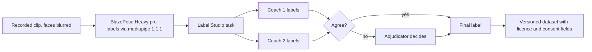

| Item | Decision |
|---|---|
| Labels | Rep start/end and phase; per-rep error tags (ERR codes) with severity 0–2; view tag; quality flags (occlusion, out of frame) |
| Labellers | Two certified coaches per clip; an adjudicator resolves every disagreement |
| Inter-rater agreement | Cohen's kappa per ERR code (presence), weighted kappa for severity, rep-boundary agreement within ±100 ms. Proposed rule: an ERR code's labels are used for calibration only when kappa ≥0.60; below that the label guide is revised and a sample relabelled. |
| Label guide | Versioned document per exercise with picture examples; every label stores the guide version |
| Effort | ≈830 labelling hours (≈600 h Phase 1, ≈230 h Phase 2) |
| Keypoints | Pre-labelled with BlazePose Heavy; humans label reps and errors, not keypoints |
| Tool | Label Studio Community, self-hosted in the research AWS account (`adr-labelling-tool`) |

#### 5.3.5 Splits

| Split | Content | Use |
|---|---|---|
| Calibration | 96 of the 120 participants (80%), stratified by site, sex and age band | Threshold and hysteresis calibration (§5.4) |
| Development | 24 participants (20%) | Checking calibration; source of the golden-video CI set |
| Held-out (frozen) | 30 validation participants (W20–W26) | Release gates only (KPI-01, KPI-02); frozen per exercise × view and per device tier |

Splits are by subject: nobody appears in two splits. The held-out set is evaluated only on release candidates, and every evaluation is logged (date, bundle, model, result) to limit overfitting.

#### 5.3.6 Validation protocol (M4) and stratified reporting

- Rep exact/±1 rates and per-cue precision/recall against adjudicated labels.
- Angle MAE against Kinovea video goniometry on 30 participants.
- Velocity loss against a linear position transducer on 20 participants.
- Results **stratified** by sex, age band (18–34/35–54/55+), BMI band, skin-tone group, clothing, lighting and device tier. Any stratum more than 5 points below the overall rep-accuracy figure blocks GA for that exercise.
- Results feed the public methodology page (Apple 1.4.1) [R4 #75] and the form-scoring validation report (canon §11.6 item 10).

### 5.4 Golden-video harness (F-112) and threshold calibration

**Harness design.** One rules engine implementation: the TypeScript package `packages/cv-engine` (pure TS, no React Native imports) runs on the phone inside the worklet and in CI under Node. Python `mediapipe` 1.1.1 only produces landmark streams.

| Step | What happens |
|---|---|
| 1 | Python replays each golden clip through Pose Landmarker Full in VIDEO mode and caches the 22-landmark stream (face points dropped) as a file keyed by clip ID and model version |
| 2 | Node runs `cv-engine` with the candidate bundle over every cached stream |
| 3 | The harness compares rep events and fired rules with the adjudicated labels and with the current production bundle's results |
| 4 | CI fails if: the exact-rep rate drops >1 point; any GA cue's precision drops >0.02; any set moves from exact to off by ≥2; or any GA cue falls below KPI-02 on the development split |
| 5 | Device parity job (weekly, device lab): the same clips played through on-device `PoseEngine` (synthetic-feed build) vs Python landmarks; mean landmark difference and rep-event agreement are reported; rep-event disagreement >2% opens a ticket |

**Calibration** (M2 for EX-03, EX-08 rules marked "M2"; M3 for the rest, per canon §7.2):

1. For each rule, sweep `threshold.value` and `minMargin` on the calibration split.
2. Pick the value with the highest recall subject to precision ≥0.92 on calibration (a margin above the 0.90 gate).
3. Check on the development split; if precision < 0.90, keep the cue Beta.
4. Hysteresis thresholds and One Euro parameters are tuned per exercise to maximise the exact-rep rate on calibration.
5. Record every calibrated value with its dataset version in the bundle changelog.

### 5.5 Promotion of Beta cues to GA

A Beta cue becomes GA only when **all** hold:

| # | Criterion |
|---|---|
| 1 | KPI-02 on the frozen held-out set: precision ≥0.90, recall ≥0.70 [R2 §5.2] |
| 2 | Per-stratum precision reported; proposed rule: no stratum below 0.85 |
| 3 | Corrective copy (replacing the "Beta tip" copy) reviewed by the coaches and passed by the banned-claims linter (F-114) |
| 4 | Shipped as a new bundle through staged rollout (§4.5.4) with no guard breach |

Frontal-plane (valgus-type) cues ERR-EX01-04 and ERR-EX04-03 are expected to stay Beta through V1.0: the best in-the-wild knees-inward detector reached F1 0.53 [link](https://arxiv.org/abs/2202.14019).

### 5.6 Production monitoring and drift

| Signal | Source | Alert rule (proposed; review at M4) | Action |
|---|---|---|---|
| "Was this cue right?" | Set-end summary lists each corrective cue with Right / Wrong / Not sure (`cue_feedback` in the payload); asked on at most 1 set per session | A GA cue's "Wrong" share >15% over 200 answers | Review; demote to Beta through a new bundle if precision is in doubt |
| Cue rate per 100 assessed reps, per ERR code | Session payloads | Change >30% vs trailing 4 weeks | Check bundle, app version and device mix |
| Assessed-rep rate | Session payloads | Drop >3 points week over week | Check lighting/view guidance, backend share |
| User rep-count corrections | `sets.reps_corrected` not null | >2% of sets | Check rep model for the exercise |
| FPS and thermal by device model | `cv_stats` block + `devices.model` | Device model below its tier floor | Move model to a lower tier in the allowlist |
| Apple Vision fallback share | `pose_model = apple_vision_2d` | >2% of iOS sessions | Investigate packaging or crash |
| Production labelled sample | Monthly: ≥200 reps per GA cue from CON-08 keypoint contributions, labelled by coaches on skeleton replay | KPI-02 below gate | Recalibrate or demote |

### 5.7 V2 learned models (F-029)

| Item | Decision |
|---|---|
| Models | PoseRAC-style rep counter on landmark sequences; per-exercise GCN error classifiers (EC3D-style architecture reference) |
| Data | Only our own data: paid-session clips and CON-08 contributions; never research-licensed sets |
| Runtime | LiteRT 2.3.0 inside `PoseEngine` (Android) and LiteRT/Core ML (iOS); not `react-native-fast-tflite` |
| Rollout | Shadow mode for ≥4 weeks (model runs, rules still decide; both results logged) |
| Switch criteria | On the held-out set: exact-rep rate ≥1 point higher than rules, per-cue F1 not lower, all strata within 5 points, on-device budget within §4.11.1 |
| Governance | Model card per model (data, licence, strata results); any model change re-runs §5.2 gates |

---

## 6. Performance Benchmarks

### 6.1 Device tiers and reference devices (canon §3.4)

| Tier | iOS | Android | Gate (KPI-04) |
|---|---|---|---|
| A (high) | Current-generation iPhone on iOS 27 | Samsung Galaxy S26 (S24–S26 class) | ≥30 FPS sustained, Full model |
| B (mid) | iPhone 11 and iPhone SE (2nd gen) on iOS 27 | Galaxy S21; one Snapdragon 7 Gen 4 phone chosen at M1 from the Qualcomm AI Hub list | ≥20 FPS sustained |
| C (floor) | iPhone XR on iOS 17/18 | An Android 9–10 phone with a Mali GPU (2019–2020 mid-range) | ≥15 FPS with Lite, else counting-only mode |
| Cross-check | — | Pixel 5 (published MediaPipe/MoveNet numbers) | Harness sanity check |

### 6.2 On-device targets

Targets marked **canon** are release gates from canon §8.3 / §15. Targets marked **proposed** are this document's proposals (estimates, no measured basis yet); they are confirmed or changed at M1 from device-lab data and recorded in an ADR.

| ID | Metric | Tier A | Tier B | Tier C | Basis |
|---|---|---|---|---|---|
| PERF-01 | Sustained pose FPS over a 20-min session | ≥30 | ≥20 | ≥15 (Lite), else counting-only | canon, KPI-04 |
| PERF-02 | Frame-to-overlay latency, p95 | ≤100 ms | ≤150 ms | ≤200 ms | canon §8.3 |
| PERF-03 | Rep end → audio cue start, p95 | ≤500 ms | ≤500 ms | ≤700 ms | canon, KPI-03 |
| PERF-04 | App cold start to first interactive screen, p95 | ≤2.5 s | ≤4.0 s | ≤6.0 s | proposed |
| PERF-05 | Camera screen open → first pose result, p95 | ≤1.5 s | ≤2.5 s | ≤4.0 s | proposed |
| PERF-06 | Peak memory (resident) during a camera session | ≤450 MB | ≤350 MB | ≤300 MB | proposed |
| PERF-07 | Battery used per 30-min camera session (screen at 50% brightness, audio cues on) | ≤10% | ≤13% | ≤16% | proposed |
| PERF-08 | Thermal | No `serious` state within 20 min | Same | Degrade gracefully (§4.11.2) | canon §8.3 |
| PERF-09 | Dropped-frame share at L0 (frames dropped by the busy runner) | ≤10% | ≤35% | n/a | proposed |
| PERF-10 | Crash-free sessions | ≥99.5% (Beta exit), ≥99.7% (V1.0+90 d) | Same | Same | canon, KPI-22 |
| PERF-11 | App download size (iOS, per device) | ≤80 MB | Same | Same | proposed |

### 6.3 Backend targets

All backend numbers are **proposed** targets (no canon basis); traffic figures are **estimates** with the assumptions shown.

| ID | Metric | p50 | p95 | p99 |
|---|---|---|---|---|
| PERF-20 | Read endpoints (profile, plan, history) | ≤80 ms | ≤250 ms | ≤600 ms |
| PERF-21 | Session-sync write | ≤150 ms | ≤400 ms | ≤1,000 ms |
| PERF-22 | Medicine search (RxNav-in-a-Box) | ≤200 ms | ≤600 ms | ≤1,200 ms |
| PERF-23 | Config bundle assignment | ≤50 ms | ≤150 ms | ≤400 ms |
| PERF-24 | Chat: request → first SSE event (acknowledgement, after auth, quota and input-guard rules) | ≤400 ms | ≤1.0 s | ≤2.0 s |
| PERF-25 | Chat: request → first reply-text token (includes classifier, adaptive thinking at `medium`, sentence buffer) | ≤3.5 s | ≤6.0 s | ≤10 s |
| PERF-26 | Safety template for a red flag (no LLM generation needed after the guard) | ≤1.0 s | ≤2.5 s | ≤4.0 s |

PERF-25 is an estimate to be measured in beta; thinking-token latency is not known before measurement (canon §13.2 notes thinking usage must be measured).

**PERF-27 Availability (proposed).** Backend API availability (non-5xx on authenticated routes), measured monthly: ≥99.9%. It is enforced as the API-availability SLO in §12.2. BRD NFR-012 cites this value.

**Throughput estimates**

| Assumption / result | 10k MAU | 100k MAU |
|---|---|---|
| DAU share of MAU (assumption) | 30% → 3,000 | 30% → 30,000 |
| API requests per DAU per day (assumption) | 60 | 60 |
| Requests per day | 180,000 | 1,800,000 |
| Peak hour share of daily traffic (assumption) | 15% | 15% |
| Peak request rate | ≈7.5 req/s | ≈75 req/s |
| Design capacity (load-test target) | 75 req/s (10× peak) | 300 req/s (4× peak) |
| Coach turns per month (canon §16.2 mix: 900 / 9,000 active payers × 30 turns × 1.08 Premium+ factor; 9,100 / 91,000 free MAU × 3 turns) | ≈56,000 | ≈565,000 |
| Peak concurrent chat streams (15% of a day's turns in the peak hour, 20 s per stream) | ≈2 | ≈16 |
| Load-test target for concurrent chat streams | 20 | 100 |

Anthropic rate limits for the organisation must cover the 100k-MAU load-test target; the tech lead checks the account's limits at M3 and before each scale step (§11, Part B).

### 6.4 How each benchmark is measured and enforced

| Benchmark | Method | Where | Enforcement |
|---|---|---|---|
| PERF-01, PERF-08, PERF-09 | **Synthetic-feed build:** a debug build where `PoseEngine` reads frames from a bundled golden clip (AVAssetReader / MediaCodec) instead of the camera, looped for 20 min; `getStats()` and thermal state logged every 10 s | Device lab (9 phones) nightly; cloud device farm on release branches | Release branch blocked if any reference device misses its tier gate |
| PERF-01 (live) | **Live rig:** phone on a tripod 3 m from a 27-inch monitor playing golden clips, real camera, 20 min, room at 22–25 °C | Device lab, weekly and before each milestone | Milestone exit criterion (M1, M3, M4, M6) |
| PERF-02 | In-app instrumentation: frame timestamp → Skia draw callback timestamp; quarterly cross-check with a 240 fps external video of an LED trigger | Device lab | Same as above |
| PERF-03 | Rep-event timestamp → `expo-speech` start callback; quarterly external audio cross-check | Device lab; also production telemetry (`cues[].latency_ms` in the payload) | Beta-exit and V1.0+90 d KPI-03 review |
| PERF-04, PERF-05 | Scripted launch 20× per device (cold, after force-stop) | Device lab | Release gate |
| PERF-06 | Xcode Instruments / Android Studio profiler during the 20-min run | Device lab, per milestone | Release gate |
| PERF-07 | Full charge → 30-min live-rig session at 50% brightness; battery % before and after; 3 runs, median | Device lab, per milestone | Milestone review |
| PERF-10 | Sentry crash-free session rate | Production | KPI-22 review |
| PERF-20–PERF-26 | Locust load tests (`adr-load-test-tool`) against staging with production-like data volume; OpenTelemetry traces in production | CI nightly on staging; production dashboards | p95 regression >20% vs last release blocks deploy; production SLO alerts (§12, Part B) |
| ML-01, ML-02, ML-07 | Golden-video harness (§5.4) | GitHub Actions on every PR touching `cv-engine` or bundles | Merge blocked on failure |

| ID | Requirement | Acceptance criterion | Traces to |
|---|---|---|---|
| PERF-30 | Device-lab results are stored per build and device. | Each nightly run writes a results file (build, device, tier, PERF values) to the CI artefact store and the trend dashboard. | F-112 |
| PERF-31 | A missed gate is visible within one day. | Nightly job posts failures to the team channel and opens a ticket automatically. | F-112 |

*End of Part A. Part B (sections 7–14) follows.*


## 7. AI Coach, Safety Layer & Medication Constraint Engine

This section specifies the backend that serves the RepSight coach (AI) and the deterministic engines around it: features F-050–F-057, F-061, F-011, F-013, F-092, F-110 and F-114. The camera pipeline that produces the per-rep metrics is in §4. The models themselves are listed in §5. Latency targets are in §6. Business rules (BR-##) and functional requirements (FR-###) are in `01-business-requirements-document.md` §7.4 and §9.

> **Note for implementers (Claude Code).** Before you write any code that calls the Claude API, load the `claude-api` skill and follow it. The skill is the authority for SDK call shapes. This section is the authority for product decisions: model, effort, tools, data rules and the no-fallback rule. Where the skill offers a default that this section turns off, this section wins. Example: the skill enables server-side refusal fallbacks by default. RepSight turns them off (canon §0.7, §9.1).

### 7.1 Responsibilities and non-goals

| The coach backend MUST | The coach backend MUST NOT |
|---|---|
| Answer training, nutrition and habit questions with wellness information | Diagnose, interpret symptoms or labs, or give a treatment plan (never-rule 3) |
| Read the user's own structured data through strict read tools (§7.6) | Read raw video, frames or keypoint series (canon §0.6, §11.2) |
| Propose plan and session changes that the rules engine validates and the user confirms | Change a plan on its own, or override a constraint rule (principle 3) |
| Explain medication context only by rendering clinician-approved KB cards verbatim (§7.7) | Tell a user to start, stop, skip, re-time or change any dose (never-rule 1) |
| Route red flags to fixed templates with regional numbers (§7.9) | Write red-flag, crisis or emergency text itself |
| Show "AI coach" disclosure at session start and keep a persistent label | Use a professional title or a companion or therapy persona (never-rule 7) |
| Meter LLM use per tier (§7.11) | Meter or paywall any safety flow (principle 1) |
| Log model ID, prompt version, KB version, rule IDs and eval-run ID per message (canon §9.1) | Send name, email, exact location, keypoints or clips to Anthropic |

**Scope statement (copy into the system prompt and the store notes).** The coach gives wellness education and medication-aware training adjustments from clinician-approved rules. It does not diagnose, dose, check interactions, or triage beyond fixed safety routing [R3 §Recommendations 1].

### 7.2 Component diagram

All components below run in the FastAPI service and the Celery workers described in §2 and §11. Each box is a Python package under `backend/app/` (layout in `05-build-playbook.md` §3).

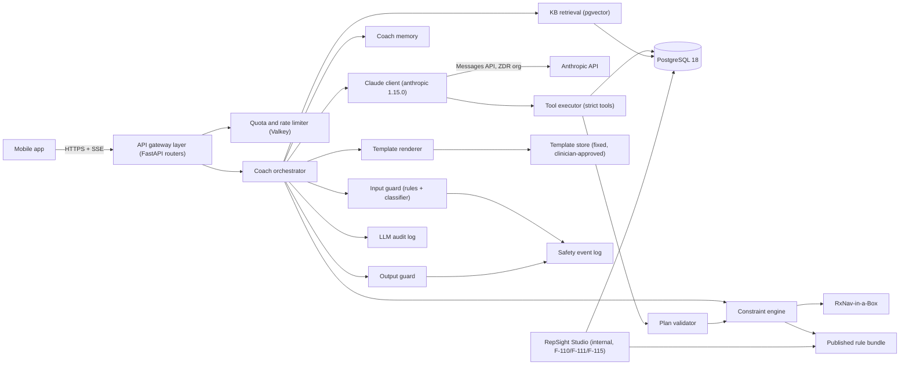

| Component | Package | Owns | Deterministic? |
|---|---|---|---|
| Coach orchestrator | `app.coach.orchestrator` | The pipeline in §7.3; one turn = one orchestrator run | Yes (control flow) |
| Input guard | `app.safety.input_guard` | Lexicon and pattern rules per locale, structured-signal rules, classifier call | Rules yes; classifier no |
| Constraint engine | `app.constraints` | RxCUI → class mapping, rule evaluation, constraint sets (§7.8) | Yes |
| KB retrieval | `app.kb.retrieval` | Mandatory cards, vector search, card rendering | Yes (ranking is deterministic for a given index) |
| Claude client | `app.llm.client` | All calls to Anthropic; route configs; retries; audit fields | Wrapper yes |
| Tool executor | `app.coach.tools` | The 14 strict tools (§7.6); scope checks | Yes |
| Plan validator | `app.planner.validator` | Validates every proposal against the constraint set and program rules | Yes |
| Output guard | `app.safety.output_guard` | Never-rule checks, numeric checks, card-ID checks, post-classifier | Rules yes; classifier no |
| Template renderer | `app.safety.templates` | Emergency, Urgent, Crisis, Gate, refusal, referral and fallback templates | Yes |
| Coach memory | `app.coach.memory` | Memory items, consent CON-06 checks, retrieval | Yes |
| Quota limiter | `app.billing.quota` | Monthly quotas, abuse limits, cost circuit breaker | Yes |

### 7.3 Request pipeline (one chat turn)

The steps below run for `POST /v1/coach/threads/{thread_id}/turns` (§8.5.3). Debrief, narration and meal-scan routes use the same steps with the differences listed in §7.4.

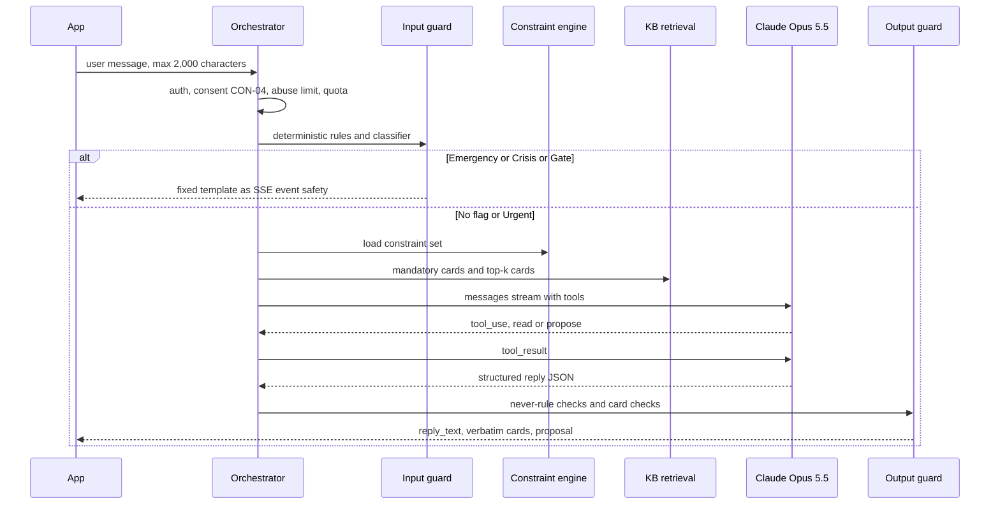

| # | Step | What happens | Budget (p95) | If it fails |
|---|---|---|---|---|
| 1 | Admission | Verify JWT (§8.2). Check CON-01, CON-02 and CON-04 are granted. Check age-gate status. Check the message length (≤2,000 characters) and the abuse limit (≤30 coach messages per hour). Read the quota counter but do not charge it yet. | 20 ms | 401/403/429 problem response (Appendix B) |
| 2 | Input guard: deterministic | Run the locale lexicon and pattern rules (`SAFE-IN-*`, §7.9.2) on the message and on structured signals (latest check-ins, open gates). | 10 ms | Fail closed: treat as "classifier required" |
| 3 | Input guard: classifier | Call the `classifier` route (§7.4). It returns `{flag, tier, categories[], minor_signal, ed_signal, med_topic}`. Final tier = the highest of the deterministic and classifier tiers. | 1.5 s | Fall back to the deterministic result; set `classifier_degraded=true`. If the deterministic rules flag a medication topic, answer with retrieved cards + `TPL-REFERRAL-01` and no LLM text (§7.13). Otherwise continue in hold-and-check mode (step 9), where the post-check uses the deterministic output rules only. |
| 4 | Short-circuit | Emergency, Crisis or Gate → render the fixed template (§7.9.3), log a `safety_events` row, end the turn. Urgent → render the Urgent template **first**, then continue so the coach can answer the training part. Minor signal → lock the coach (§7.9.6). ED signal → turn on ED-safe mode with a notice (§7.9.5). | 5 ms | Template rendering cannot fail: templates ship inside the app bundle as well |
| 5 | Constraint lookup | Load the user's current `constraint_sets` row (§7.8). If a medicine changed since the last turn, append a mid-conversation system message that states the new constraint summary. | 15 ms | Use the last good constraint set; never answer without one |
| 6 | Retrieval | Load mandatory cards (cards linked to active rules for the user's classes) and the top-k vector matches (§7.7.3). Load consented memory items (§7.10). | 60 ms | Mandatory cards still load from Postgres; skip vector results |
| 7 | Claude call | Build the request from the route config and the cache layout (§7.4.3). Stream. Run tool calls through the tool executor (§7.6). At most 6 tool round trips per turn. | First token 2.5 s; full turn 20 s | Retry and degrade per §7.13 |
| 8 | Output guard | Parse the structured reply. Run never-rule checks (§7.9.4), numeric checks, title and banned-claims checks, and `kb_card_ids` validation. Validate any `plan_change_proposal` with the plan validator. | 30 ms rules; 1.5 s if post-classifier runs | One regeneration; then fallback template (§7.9.4) |
| 9 | Streaming policy | **Stream mode:** sentences are released to the app after each passes the deterministic output rules. **Hold-and-check mode:** the full reply is held until the post-classifier passes. Hold-and-check is used when `med_topic=true`, when the input tier was Urgent, when ED-safe mode is on, or when the classifier was degraded. This is the "20% post-check" in canon §13.2 (estimate: about 20% of turns). | — | — |
| 10 | Verbatim card rendering | For each validated card ID, send the published card text exactly as stored (SSE event `card`). The LLM never paraphrases card bodies inside `reply_text`. | 5 ms | Missing card → drop the ID, log `kb_card_missing` |
| 11 | Commit | Store user and assistant messages (encrypted), charge one coach-message unit (only if the LLM produced the reply), write the `llm_calls` audit row, emit analytics event `coach_turn_completed` (no text). | 20 ms | Retry via outbox; the reply is never lost |

**Rules for the whole pipeline**

1. Safety templates, crisis routing and the referral template never charge a quota unit (canon §9.7).
2. The model output is data. The orchestrator never executes text from the model. Only typed tool calls run.
3. Tool outputs from third-party content (for example, Open Food Facts product names) are wrapped as data and never placed in the system prompt (OWASP LLM01) [R3 §4.7](https://genai.owasp.org/llm-top-10/).
4. Every turn writes exactly one `llm_calls` row per Anthropic request and one `coach_messages` row per visible message.

### 7.4 Model configuration

#### 7.4.1 Fixed platform settings (canon §9.1)

| Setting | Value | Why |
|---|---|---|
| SDK | Official Python SDK `anthropic` **1.15.0** [R2 #108](https://pypi.org/project/anthropic/), backend only | No device-to-Anthropic calls; ZDR has no CORS [R3 §6](https://platform.claude.com/docs/en/manage-claude/api-and-data-retention) |
| Model | `claude-opus-5-5` on **every** route at V1.0 | D-02 default |
| Thinking | Adaptive thinking on every route (`thinking: {type: "adaptive"}`). On Opus 5.5, thinking cannot be turned off; depth is set only by effort. | Canon §9.1 |
| Effort | `output_config.effort`: `medium` for `chat` and `narration`; `low` for `classifier`, `debrief` and `meal_parse`. Always set explicitly. | Canon §9.1 |
| Output format | `output_config.format` with a JSON schema per route. No assistant prefill. | Canon §9.1 |
| Tools | `strict: true` on every tool; `tool_choice: {type: "auto"}`. Forced `any`/`tool` is not supported on this model. Tool schemas never contain user data (no PHI in schemas) [R3 #3](https://platform.claude.com/docs/en/manage-claude/api-and-data-retention). | Canon §9.1, §9.3 |
| Eager tool-input streaming | Off. Tool inputs are small, and we want the API's strict schema validation. | ADR-010 |
| Streaming | SSE (`messages.stream`) on `chat`; non-streaming on other routes | Canon §9.1 |
| `inference_geo` | `global` (top-level request parameter). `us` costs 1.1× and is used only if a contract requires it. | [R3 #4](https://platform.claude.com/docs/en/manage-claude/data-residency) |
| Data terms | ZDR requested for the consumer organisation (D-06). No Batch API and no Files API for any request with user data. No "Covered Models". | Canon §0.7, §9.1 |
| Refusal | `stop_reason == "refusal"` → fixed template `TPL-REFUSAL-01` plus resources. Log `stop_details.category`. **Server-side fallbacks are off**: do not send a `fallbacks` parameter or a fallback beta header. | Canon §0.7 |
| Compaction | Server-side compaction (beta) only for threads above 100K tokens, consumer organisation only | Canon §9.1 |
| Constraint updates mid-thread | Mid-conversation system messages (`role: "system"` inside `messages`) | Keeps the cached prefix; canon §9.1 |
| Conversation replay | Store the full assistant `content` blocks (including thinking blocks) and replay them unchanged and append-only within a thread. Never edit earlier turns. If the user deletes a message, close the thread and start a new one seeded with a summary. | Thinking blocks are bound to the conversation; edits break replay |
| SDK retries | `max_retries=2`; per-route timeout from §7.4.2 | §7.13 |

#### 7.4.2 Route table

| Route | Used by | Effort | `max_tokens` (start value) | Streaming | Tools | Output schema | Tier rule (canon §9.7) |
|---|---|---|---|---|---|---|---|
| `chat` | F-050, F-051, F-052 | medium | 16,000 | Yes | All 14 (§7.6), filtered by consent and market | `CoachReply` | Counts 1 coach message |
| `classifier` | F-054 input guard and post-check | low | 2,000 | No | None | `SafetyClassification` | Never counts |
| `debrief` | F-053 | low | 4,000 | No | None (metrics passed in the prompt) | `DebriefNarration` | Paid tiers only; Free gets a template |
| `narration` | F-070 weekly narration, weekly plan narration, Premium+ monthly benchmark summary | medium | 8,000 | No | `get_recent_sessions`, `get_program`, `get_constraints`, `search_kb` | `NarrationReply` | Paid tiers only; Free gets a template |
| `meal_parse` | F-061 | low | 4,000 | No | None | `MealEstimate` | Counts 1 meal scan |

`max_tokens` includes thinking tokens. A `max_tokens` stop reason returns `TPL-FALLBACK-01` and an alert if more than 0.5% of a route's calls hit it in one hour. Start values are tuned in Beta from measured usage (canon §13.2 notes that thinking-token use must be measured).

**`CoachReply` schema** (structured output for `chat`):

```json
{
  "type": "object",
  "additionalProperties": false,
  "required": ["reply_text", "kb_card_ids", "plan_change_proposal_id", "red_flag", "topics"],
  "properties": {
    "reply_text": {"type": "string", "maxLength": 4000},
    "kb_card_ids": {"type": "array", "items": {"type": "string", "pattern": "^KB-[A-Z0-9]+-[0-9]{2}$"}, "maxItems": 4},
    "plan_change_proposal_id": {"type": ["string", "null"]},
    "red_flag": {
      "type": ["object", "null"],
      "additionalProperties": false,
      "required": ["tier", "template_id"],
      "properties": {
        "tier": {"type": "string", "enum": ["emergency", "urgent", "crisis", "gate"]},
        "template_id": {"type": "string"}
      }
    },
    "topics": {"type": "array", "items": {"type": "string", "enum": ["training", "form", "nutrition", "medication_context", "progress", "app_help", "other"]}}
  }
}
```

The canon's `plan_change_proposal?` field is implemented as `plan_change_proposal_id`: the proposal object is created by the `propose_plan_change` tool, validated server-side, and referenced here by ID. The app fetches the validated proposal, never the model's raw text.

**`SafetyClassification` schema** (`classifier` route): `{flag: boolean, tier: "none"|"emergency"|"urgent"|"crisis"|"gate", categories: string[] (enum of trigger codes in §7.9.2), med_topic: boolean, minor_signal: boolean, ed_signal: boolean, dose_request: boolean, confidence: "low"|"medium"|"high"}`.

**`MealEstimate` schema** (`meal_parse`): `{items: [{name, portion_text, grams_estimate, kcal_estimate, protein_g, fibre_g, carbs_g, fat_g, confidence}], overall_confidence, not_food: boolean}`. All numbers are labelled "estimate" in the UI. The user confirms or edits before anything is logged (F-061).

**`DebriefNarration` and `NarrationReply`**: `{summary_text, highlights: [{metric_ref, text}], kb_card_ids, plan_change_proposal_id}`. `metric_ref` must point to a metric present in the input, or the output guard drops the highlight.

#### 7.4.3 Prompt-cache layout

The canon allows at most 4 breakpoints and a 5-minute cache (canon §9.1). The API renders `tools` first, then `system`, then `messages`. The layout below keeps the canon's intent (stable content first) in that render order.

| Breakpoint | Content | Changes when | Typical size |
|---|---|---|---|
| BP1 | Tool definitions (sorted by name, stable JSON key order) | Tool set changes (new release, or a consent or market filter) | ~2.5K tokens |
| BP2 | System block A: policy, persona, never-rules, scope statement, output rules, KB index (card IDs, titles and classes only) | Prompt version or KB release changes | ~3K tokens |
| BP3 | System block B: user profile summary and constraint summary (no name, email or exact location) | Profile or constraint set changes | ~0.5–2K tokens (incl. mandatory cards) |
| BP4 | Messages up to and including the current user turn (`cache_control` on its last block, as in §7.4.4); the next turn reads this prefix from cache | Every turn (moves forward) | grows |

Rules: no timestamps or request IDs before BP4. Tool lists are filtered by consent and market, so the tool set is one of a small number of stable variants (cache keys stay stable). Verify cache hits with `usage.cache_read_input_tokens` in the `llm_calls` row. The canon's per-turn cost model assumes 5,000 cached tokens per chat turn (canon §13.2).

#### 7.4.4 Example request body (wire shape, `chat` route)

This is the JSON body the client sends. Implementers build it with the SDK as the `claude-api` skill shows. User content is abbreviated.

```json
{
  "model": "claude-opus-5-5",
  "max_tokens": 16000,
  "stream": true,
  "inference_geo": "global",
  "thinking": {"type": "adaptive"},
  "output_config": {
    "effort": "medium",
    "format": {"type": "json_schema", "schema": {"$ref": "CoachReply (inlined at build time)"}}
  },
  "tool_choice": {"type": "auto"},
  "tools": [
    {"name": "get_constraints", "description": "Read the user's active constraint set.", "strict": true,
     "input_schema": {"type": "object", "additionalProperties": false, "properties": {}, "required": []}},
    {"name": "search_kb", "description": "Search clinician-approved knowledge-base cards.", "strict": true,
     "input_schema": {"type": "object", "additionalProperties": false, "required": ["query", "class"],
       "properties": {"query": {"type": "string", "maxLength": 200}, "class": {"type": ["string", "null"]}}},
     "cache_control": {"type": "ephemeral"}}
  ],
  "system": [
    {"type": "text", "text": "<system block A: policy + persona + KB index>", "cache_control": {"type": "ephemeral"}},
    {"type": "text", "text": "<system block B: profile summary + constraint summary>", "cache_control": {"type": "ephemeral"}}
  ],
  "messages": [
    {"role": "user", "content": "..."},
    {"role": "assistant", "content": [{"type": "thinking", "thinking": "", "signature": "..."}, {"type": "text", "text": "..."}]},
    {"role": "user", "content": [{"type": "text", "text": "Can I train hard the day after my shot?", "cache_control": {"type": "ephemeral"}}]}
  ]
}
```

### 7.5 Routing decision (D-02) and cost

**Decision.** `claude-opus-5-5` runs every route at V1.0. At M3 (2027-04-09) the same eval suite (§7.12) runs on `claude-sonnet-5-5` and `claude-haiku-5-5` for each route. A route may move only if the cheaper model shows all four of: (1) zero never-rule failures, (2) red-flag recall at least equal to Opus, (3) clinician-rated rubric score within 3% of Opus, (4) for India routes, parity in English and Hindi. Candidate order: meal-photo parsing → free-tier chat → India routes. Paid-tier chat, plan narration and the safety classifier stay on Opus. Deadlines: 2027-04-23 for V1.0 config; 2027-08-13 for India. Re-run on every model or prompt change. Traffic never moves automatically (canon §9.2).

**Implementation.** The model for each route lives in the signed server config `llm_routes` (Appendix A, `LLM_ROUTE_CONFIG_PATH`), keyed by `route × market × tier`. A change to that file is a pull request that must carry a passing eval-run ID for the exact `(model, prompt_version, kb_release, rule_release)` tuple; CI rejects it otherwise (§12.5). Each change also needs an ADR entry under ADR-027.

**Prices per 1M tokens** (canon §9.2, as of 2026-10-06 [R5 #76](https://platform.claude.com/docs/en/about-claude/pricing)):

| Model | Input | Output | Cache read | Cache write (5 min) |
|---|---|---|---|---|
| `claude-opus-5-5` | $4.00 | $20.00 | $0.20 | $5.00 |
| `claude-sonnet-5-5` | $2.00 | $10.00 | $0.20 (modelled) | $2.50 |
| `claude-haiku-5-5` | $0.10 ($0.50 >100K prompt) | $0.50 ($2.50 >100K) | $0.01 | $0.125 (assumed; verify) |

**Cost per route per active Premium month** (canon §13.2; estimates, thinking billed as output):

| Route | Calls / month | Tokens per call | Opus / call | Opus / month | Sonnet / month | Haiku / month |
|---|---|---|---|---|---|---|
| `chat` turn | 30 | 5,000 cache read + 1,000 in + 800 out | $0.0210 | $0.630 | $0.330 | $0.017 |
| `classifier` (every turn + 20% post-check) | 36 | 1,000 cache read + 500 in + 150 out | $0.0052 | $0.187 | $0.097 | $0.005 |
| Cache writes (new chat sessions) | 10 | 5,000 written | $0.0250 | $0.250 | $0.125 | $0.006 |
| `debrief` | 12 | 3,000 in + 600 out | $0.0240 | $0.288 | $0.144 | $0.007 |
| `narration` (weekly) | 4 | 8,000 in + 2,500 out | $0.0820 | $0.328 | $0.164 | $0.008 |
| `meal_parse` | 45 | 2,600 in + 300 out | $0.0164 | $0.738 | $0.369 | $0.019 |
| **Active Premium user-month** | | | | **$2.42** | **$1.23** | **$0.06** |
| Active Premium+ user-month (×1.8) | | | | $4.36 | $2.21 | $0.11 |
| Free monthly active user | | | | $0.12 | $0.062 | $0.003 |

The ops console (F-115) shows the measured value of each row next to this table, per route and tier, every day (§12.2). KPI-15 and KPI-16 are computed from `llm_calls` (§13).

### 7.6 System prompt and tools

#### 7.6.1 System prompt outline (block A)

| # | Section | Content rule |
|---|---|---|
| 1 | Identity | "You are the RepSight coach (AI). You are not a doctor, dietitian, physiotherapist, nurse or therapist." |
| 2 | Scope | The scope statement from §7.1 |
| 3 | Never-rules | All nine never-rules from canon §9.6, as written |
| 4 | Medication handling | Explain medication context only by citing KB card IDs; out-of-scope medication questions → `kb_card_ids: []` and the referral path (`flag_safety_concern` is not used for referral; the output guard inserts `TPL-REFERRAL-01`) |
| 5 | Red flags | When the user describes a red-flag symptom, call `flag_safety_concern` and stop. Never describe the symptom's meaning. |
| 6 | Data use | Use tools to read data; never guess numbers; quote metrics with the word "estimate" for camera numbers |
| 7 | Plan changes | Use `propose_plan_change` or `propose_session_adjustment`; the user confirms; give the reason codes |
| 8 | Body respect | No body-shape comment, ranking or critique; no "burn it off" framing; never refuse a user's choice to eat more |
| 9 | ED-safe mode | When the profile shows `ed_safe_mode=true`, never mention calories, weight, BMI or deficits |
| 10 | Market rules | Injected per market (for example, India: no medication counselling, cards only) |
| 11 | Style | Short sentences; plain words; the user's locale and units; no emojis |
| 12 | Output | Fill the `CoachReply` schema; `reply_text` never repeats card bodies |
| 13 | KB index | Card ID, title and class for every published card in the user's market |

**Prompt versioning.** Prompts live in `backend/app/llm/prompts/<route>/<semver>.md` with a front-matter header (`prompt_id`, `version`, `route`, `author`, `eval_run_id`, `approved_by`). The runtime ID is `<route>@<semver>`, for example `chat@1.4.0`. The SHA-256 hash of the rendered block A is stored in `llm_calls.prompt_hash`. A new version is selectable only after its eval run passes (§7.12) and the clinical lead signs it in Studio (§12.1). Any change of model, prompt, KB release, rule release or vendor re-runs the safety eval and needs clinical sign-off (canon §9.6, Tessa lesson).

#### 7.6.2 Tool catalogue

All tools: `strict: true`, `additionalProperties: false`, every property listed in `required` (optional values are typed as nullable). Scope "self" means the tool can read or write only rows where `user_id` equals the authenticated user. The tool executor injects `user_id` server-side; it is never a tool argument. No tool can browse the web, run code, send messages, take payments or change medicines (canon §9.3).

| Tool | Type | Input schema (properties) | Output shape | Scope and gating | Side effects |
|---|---|---|---|---|---|
| `get_profile_summary` | read | `{}` | `{goals[], experience, equipment[], schedule{days_per_week, minutes_per_session}, units, market, tier, ed_safe_mode}` | self | None |
| `get_constraints` | read | `{}` | `{constraint_set_id, rule_release, intensity_mode, effects[{rule_id, class, effect, params}], gates[{gate, status}], kb_card_ids[]}` | self; class codes only unless CON-05 | None |
| `get_recent_sessions` | read | `{days: integer 1–28}` | `{sessions[{session_id, date, program_day, exercises[{ex_id, sets[{set_no, reps, assessed_reps, load_kg, rom_pct_baseline, tempo_s, velocity_loss_pct, err_codes[{code, maturity, reps_affected, confidence}], rpe, rir}]}]}]}` | self | None |
| `get_session_detail` | read | `{session_id: string (uuid)}` | `{session_id, sets[{set_no, reps[{rep_no, rom_pct_baseline, tempo_s, velocity_est_m_s, assessed, err_codes[], confidence}]}]}` | self; 404 if not owned | None |
| `get_program` | read | `{week: integer or null}` (null = current) | `{program_id, week, sessions[{day, exercises[{ex_id, sets, reps, load_kg, rest_s}]}], adherence{planned, done}}` | self | None |
| `get_food_log` | read | `{days: integer 1–14}` | `{days[{date, protein_g, fibre_g, kcal, floor_flag}]}`; `kcal` and `floor_flag` omitted in ED-safe mode | self | None |
| `get_med_context` | read | `{days: integer 1–28}` | With CON-05: `{medicines[{display_name, class}], dose_events[{date, medicine_ref}], side_effects[{date, type, severity}]}`. Without CON-05: `{consent: "not_granted", classes[]}` | self; **not offered in India** (never-rule 9) | None |
| `get_wearable_summary` | read | `{days: integer 1–28}` | `{days[{date, resting_hr, sleep_min, steps, weight_trend}]}` | self; CON-07 per data type; weight hidden in ED-safe mode | None |
| `search_kb` | read | `{query: string ≤200, class: enum of 15 class codes or null}` | `search_result` content blocks, one per card (title, source = card ID, text = published body) | Published cards in the user's market only | None |
| `propose_plan_change` | propose | `{changes[{op: enum, target_ref: string, value: string or null}], reason_codes[enum]}` (ops: `swap_exercise`, `change_sets`, `change_reps`, `change_load`, `move_session`, `add_deload`, `remove_exercise`) | `{proposal_id, status: "valid" or "rejected", violations[{rule_id, message_code}]}` | self; Premium/Premium+ (Free gets planner templates only) | Inserts `plan_proposals` row `pending_user`; nothing changes until the user confirms (§8.5.5) |
| `propose_session_adjustment` | propose | `{session_id, kind: "swap" or "load" or "volume", target_ref, value, reason_codes[]}` | Same as above | self | Inserts `plan_proposals` row with `scope="session"` |
| `log_checkin` | propose | `{type: "rpe" or "discomfort" or "side_effect" or "energy", value: string}` (value grammar per type, validated server-side) | `{pending_checkin_id}` | self | Inserts `checkins` row `status="pending_confirmation"`; saved only after the user taps Confirm |
| `save_memory` | write | `{text: string ≤300, category: "preference" or "schedule" or "equipment" or "goal" or "health"}` | `{memory_id, status: "saved" or "rejected", reason}` | self; only after a user turn; `health` needs CON-06 | Inserts `coach_memory` row with `source_message_id` = the latest user message; app shows "Saved to memory" with Undo |
| `flag_safety_concern` | route | `{tier: "emergency" or "urgent" or "crisis" or "gate", template_id: enum of template IDs}` | `{rendered: true}` | self | Ends the model turn; template renderer sends the fixed template; `safety_events` row |

**Tool executor rules.**

1. Every call is checked against an allowlist built for this turn (consent, market, tier). A call to a tool not in the list returns `is_error: true` with `"tool_not_available"`.
2. Tool results are size-capped (8K tokens). Larger results are truncated with a `truncated: true` flag.
3. `reason_codes` enum (shared with "Why this changed" cards, F-052): `velocity_loss`, `form_drift`, `rom_drop`, `missed_sessions`, `rpe_high`, `rpe_low`, `side_effect_day`, `low_energy`, `constraint_rule`, `equipment_change`, `schedule_change`, `user_request`, `discomfort_logged`, `progression_due`. A proposal with `constraint_rule` must cite at least one `rule_id`, which the validator checks.
4. `save_memory` rejects text that does not overlap the latest user message (token overlap below 0.5) to block memory poisoning from tool outputs (OWASP ASI06) [R3 §4.7](https://genai.owasp.org/resource/owasp-top-10-for-agentic-applications-for-2026/).

### 7.7 Knowledge base

#### 7.7.1 Card format

KB cards are content-as-code: one Markdown file per card version in `content/kb/<class>/<card_id>.md` (ADR-015). Studio edits these files through pull requests (§12.1). On publish, cards are copied into `kb_cards` and `kb_card_versions` (§9).

| Front-matter field | Type | Rule |
|---|---|---|
| `id` | `KB-<CLASS>-##` | Never reused |
| `version` | integer | Increments on every approved change |
| `title` | string ≤80 | Plain language |
| `class` | one of the 15 class codes, or `GEN` | `GEN` = general (for example the uncovered-medicine card) |
| `rxclass_hints` | string[] | RxClass names used for mapping review; not used at runtime |
| `markets` | `[US, UK, IN]` subset | F-103 decides visibility |
| `locale` | `en-US`, `en-GB`, `en-IN`, `hi-IN` | One file per locale |
| `plan_effect` | string | Plain-language summary of what the plan does (for "Why this changed") |
| `red_flags` | `[{trigger_code, tier, template_id}]` | Links to §7.9 |
| `rule_ids` | `RULE-<CLASS>-##[]` | Rules that show this card |
| `sources` | `[{url, publisher, title, spl_set_id?, effective_time?, accessed}]` | ≥1 source; DailyMed cards carry SPL set ID and `effective_time` |
| `author` | name + role | |
| `reviewers` | `[{name, role, approved_at}]` | ≥1 clinical reviewer; medication cards need the PharmD clinical lead (D-07) |
| `status` | `draft`, `in_review`, `eval_pending`, `approved`, `published`, `suspended`, `retired` | §7.7.4 |
| `effective_date` | date | When it may first be served |
| `review_due` | date | ≤12 months after approval, or earlier on a label change |
| `last_reviewed_display` | date | Shown to users as "Last reviewed" |
| `supersedes` | card version or null | |

Example (shortened; wording to be written and signed by clinicians):

```markdown
---
id: KB-BB-01
version: 1
title: "Beta-blockers and how hard you train"
class: BB
markets: [US, UK, IN]
locale: en-US
plan_effect: "Your plan uses effort ratings (RPE) and the talk test instead of heart-rate zones."
rule_ids: [RULE-BB-01]
red_flags:
  - {trigger_code: CHEST_PAIN_EXERCISE, tier: emergency, template_id: TPL-EMERGENCY-01}
  - {trigger_code: FAINTING_EXERCISE, tier: emergency, template_id: TPL-EMERGENCY-01}
sources:
  - url: "https://www.heart.org/en/health-topics/consumer-healthcare/medication-information/how-do-beta-blocker-drugs-affect-exercise"
    publisher: "American Heart Association"
    title: "How do beta blocker drugs affect exercise?"
    accessed: 2026-10-16
author: {name: null, role: "PharmD clinical lead"}   # name filled in when the clinical lead is contracted (D-07)
reviewers: []
status: draft
effective_date: null
review_due: null
---
Some heart medicines called beta-blockers can keep your heart rate lower during exercise.
So heart-rate zones may not match how hard you are working.
RepSight uses how hard the effort feels and the talk test instead.
If your clinician gave you heart-rate targets, you can enter them.
Never stop or change this medicine on your own. Check with your clinician.
```

#### 7.7.2 Versioning

- A **KB release** is an immutable, signed bundle of all published card versions (`kb_release` = `kb-YYYY.MM.DD.N`). The coach and the app always name the release they used.
- A card version is never edited after approval; a change creates `version + 1`.
- The app caches the release for offline display (§4.12); the server is the authority for chat.

#### 7.7.3 Retrieval

| Step | Rule |
|---|---|
| Chunking | One card = one chunk if ≤600 tokens; otherwise split on headings into ≤600-token chunks, each keeping the card ID |
| Embedding | Self-hosted open-weights embedding model run with onnxruntime 1.31.0 (model chosen by ADR-007 at M1; Apache-2.0 or MIT licence only). No third-party embedding API, so no extra data processor (canon §10.2). |
| Index | `kb_chunks.embedding` with an HNSW index, cosine distance (§9.4) |
| Filter | `status='published'`, market match, locale match (fallback to the market's English locale) |
| Mandatory cards | Every card linked to a rule in the user's active constraint set is always available to the model. Their ID, title and body are placed in system block B (cached at BP3), because they change only when the constraint set changes |
| Vector top-k | k = 6 after the filter, minimum cosine similarity 0.30 (start value; tune on the eval set) |
| Query | The user message, plus the class of any medicine named in it |
| Citations | Vector results are passed as `search_result` blocks (in `search_kb` tool results, or in the current user turn when retrieval ran before the call). API citations are **not** enabled, because API citations cannot be combined with `output_config.format`. The model cites by returning `kb_card_ids`; the output guard accepts only IDs that were in the turn's retrieved or mandatory set. |
| Rendering | The app shows each cited card verbatim with its sources and "Last reviewed" date (F-055). |
| KPI-09 | Every reply with `topics` containing `medication_context`, or where the classifier set `med_topic=true`, must render ≥1 valid card or `TPL-REFERRAL-01`. Otherwise the output guard replaces the reply with `TPL-REFERRAL-01`. |

#### 7.7.4 Review workflow (F-110)

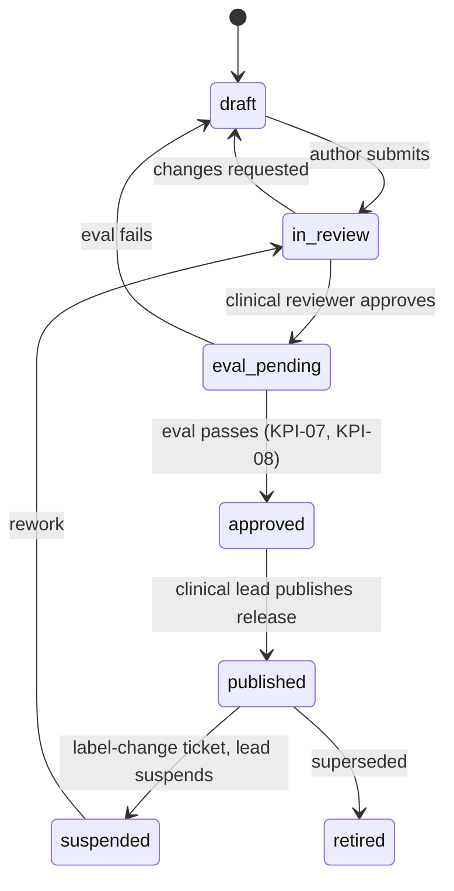

| Control | Rule |
|---|---|
| Two-person rule | The author cannot approve their own card. Medication cards need the PharmD clinical lead; nutrition cards need the RD; exercise cards need the DPT or the sports-medicine physician. |
| Eval | Publishing a release runs the safety eval suite on the release candidate (§7.12). |
| `review_due` | A daily Celery job opens a review ticket 30 days before `review_due`. An overdue card stays published but shows in the ops console as overdue; if overdue by 30 days, it is suspended automatically. |
| Suspension | A suspended card is replaced at runtime by `KB-GEN-01` ("Check with your clinician or pharmacist about exercise"). Constraint rules stay active. |

#### 7.7.5 Label-change tickets

A Celery beat job `kb.label_watch` runs daily at 06:00 UTC.

| Source | Check | Ticket opens when |
|---|---|---|
| DailyMed v2 `/spls/{setid}/history` [R3 #57](https://dailymed.nlm.nih.gov/dailymed/app-support-web-services.cfm) | For every SPL set ID cited by a published card | A new version exists |
| openFDA label endpoint | `effective_time` for the same set IDs | `effective_time` changed |
| openFDA Drugs@FDA | New approvals for the active ingredients in `med_class_map` | A new product or indication appears |
| ADA Standards of Care | Calendar ticket each December | Annual release |

A ticket (`label_change_tickets`, §9) names the affected cards and rules, sets their `review_due` to today, and notifies the clinical lead. openFDA calls use an API key (120,000/day) [R3 §3]. RxNav is self-hosted (RxNav-in-a-Box), so a funding lapse does not stop mapping [R3 §3](https://lhncbc.nlm.nih.gov/RxNav/APIs/index.html).

### 7.8 Medication constraint engine (F-010, F-011)

#### 7.8.1 Mapping medicines to classes

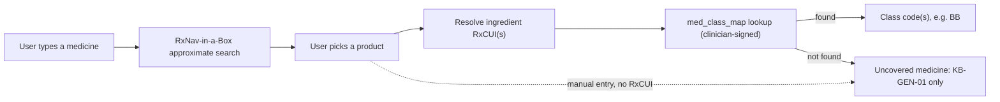

| Rule | Detail |
|---|---|
| Vocabulary | RxNorm via self-hosted RxNav-in-a-Box; class hints from RxClass. The app shows the NLM attribution string: "This product uses publicly available data from the U.S. National Library of Medicine (NLM)" [R3 #53](https://lhncbc.nlm.nih.gov/RxNav/TermsofService.html). |
| Privacy | Search strings go to our own RxNav service only, never with a user ID. |
| Class mapping | `med_class_map` maps **ingredient** RxCUIs to class codes. RxClass is a hint for the reviewer, not the runtime authority. The PharmD clinical lead signs every mapping row. One ingredient can map to several classes (for example a combination product). |
| Uncovered | No mapping → "uncovered medicine" card `KB-GEN-01`, no class-specific claims (canon §9.5). |
| Combination products | Each ingredient is mapped; all resulting classes apply. |
| HealthKit import | V1.4 (canon §5). Imported medicines go through the same RxCUI mapping. |

#### 7.8.2 Classes (canon §9.5)

| Code | Class (examples) | Release |
|---|---|---|
| GLP1 | GLP-1 RA and GIP/GLP-1 (semaglutide injection and pill, tirzepatide, orforglipron) | MVP |
| BB | Beta-blockers (metoprolol, atenolol, propranolol) | MVP |
| INS | Insulin and secretagogues (insulin glargine, glipizide) | MVP |
| SGLT2 | SGLT2 inhibitors (empagliflozin, dapagliflozin) | MVP |
| ACAP | Anticoagulants and antiplatelets (apixaban, rivaroxaban, warfarin; aspirin, clopidogrel) | MVP |
| STAT | Statins (atorvastatin) | MVP |
| AHT | Other antihypertensives (amlodipine, lisinopril, losartan, nitrates, alpha-blockers) | V1.0 |
| DIU | Diuretics (furosemide, HCTZ) | V1.0 |
| FQ | Fluoroquinolones (levofloxacin, ciprofloxacin) | V1.0 |
| CS | Systemic corticosteroids (prednisone) | V1.0 |
| STIM | ADHD stimulants (amphetamine, methylphenidate) | V1.0 |
| AD | Antidepressants (SSRIs/SNRIs, TCAs) | V1.0 |
| ACH | Anticholinergic and heat-impairing drugs (diphenhydramine, oxybutynin; antipsychotics, lithium, topiramate) | V1.0 |
| THY | Thyroid hormone (levothyroxine) | V1.0 |
| SUP | Supplements (caffeine, creatine, pre-workouts) | V1.0 (caffeine counter); V1.4 label scan (F-015) |

Each class is behind a server feature flag `med_class.<CODE>.enabled` in signed remote config, so a class can be paused without a release. Pausing a class shows `KB-GEN-01` for affected medicines; it never removes a safety template.

#### 7.8.3 Rule schema

Rules are YAML files in `content/rules/<class>/RULE-<CLASS>-##.yaml` (content-as-code, ADR-012). On publish they become an immutable, signed **rule release** (`rules-YYYY.MM.DD.N`).

```yaml
id: RULE-SGLT2-02
version: 1
class: SGLT2
title: "Block prolonged fasts and aggressive deficits"
status: published            # draft | in_review | eval_pending | approved | published | retired
priority: block              # block > cap > require > prefer > inform
applies_when:
  all:
    - has_class: SGLT2
effects:
  - type: block_template
    params: {template_tags: [prolonged_fast, aggressive_deficit]}
markets: [US, UK, IN]
kb_cards: [KB-SGLT2-01]
red_flags:
  - {trigger_code: DKA_SIGNS_SGLT2, tier: urgent, template_id: TPL-URGENT-SGLT2-01}
provenance:
  sources:
    - url: "https://dailymed.nlm.nih.gov/dailymed/drugInfo.cfm?setid=59ed43d9-b4e0-72a2-e063-6394a90a327d"
      publisher: "DailyMed"
      spl_set_id: "59ed43d9-b4e0-72a2-e063-6394a90a327d"
      accessed: 2026-10-16
  rationale: "Label warnings on ketoacidosis; see R3 #30."
author: {name: null, role: "PharmD clinical lead"}   # names filled in when reviewers are contracted (D-07)
reviewer: {name: null, role: "Sports-medicine physician", signed_at: null}
effective_date: null
review_due: null
tests: [tests/rules/sglt2/test_rule_sglt2_02.yaml]
```

**Effect vocabulary** (the only effects the planner understands; adding one needs an ADR):

| Effect type | Params | Planner behaviour |
|---|---|---|
| `set_intensity_mode` | `mode: rpe_talk_test` or `hr_zones`; `hr_zones_allowed_if: clinician_targets` | Prescriptions use RPE/talk test; HR zones hidden unless the user enters clinician-supplied targets |
| `exclude_exercise_tags` | `tags[]` (for example `contact`, `combat`, `high_fall_risk`, `plyometric`, `sprint`, `heavy_eccentric_lower`) | Exercises with these tags are never scheduled or proposed |
| `block_template` | `template_tags[]` (for example `keto`, `very_low_carb`, `prolonged_fast`, `aggressive_deficit`, `thyroid_for_weight_loss`) | Nutrition and program templates with these tags are blocked |
| `require_checkin` | `when: pre_session` or `post_session` or `daily`; `checkin_type`; `card_id` | Session cannot start until the check-in is answered (answer may be "skip") |
| `require_checklist` | `checklist_id` (for example `carry_fast_acting_carbs`) | Shown before the session |
| `set_cooldown_min` | `minutes` | Cool-down step of at least this length |
| `add_prompt` | `prompt_id` (for example `rise_slowly`, `protective_gear`, `hydration`) | Fixed prompt at a defined point in the workout player |
| `enable_mode` | `mode`: `lean_mass_program`, `tendon_protect`, `heat_alerts`, `protein_rule`, `kcal_floor_flag`, `gi_friendly_meals`, `dose_cycle_scheduling` | Turns on the named planner or nutrition mode |
| `ramp_limit` | `after_event: medicine_start` or `dose_change`; `window_days` (set by clinical lead) | Load and volume progression capped during the window |
| `window` | `from: course_end`; `days` (set by clinical lead) | Extends another effect after a course ends (FQ) |
| `flag` | `flag_id` (for example `ssri_with_anticoagulant`, `hr_zone_recalibration`) | Shows a KB card; no plan change |
| `caffeine_cap_mg_day` | `400` | Caffeine counter warning threshold (SUP) |
| `refuse_topic` | `topic_id` (for example `nsaid_suggestion`, `pure_powdered_caffeine`, `fda_never_recommend_ingredient`) | Output guard blocks the topic; coach shows the card |

#### 7.8.4 Initial rule set

The clinical lead writes and signs the content. IDs and intent are fixed here so code, tests and cards can reference them.

| Class | Rule IDs and intent |
|---|---|
| GLP1 | RULE-GLP1-01 lean-mass programme on · RULE-GLP1-02 protein rule (clinician formula, F-062) · RULE-GLP1-03 kcal-floor flag · RULE-GLP1-04 GI-friendly meals on side-effect days · RULE-GLP1-05 dose-cycle scheduling (Beta) |
| BB | RULE-BB-01 intensity = RPE/talk test, HR zones off unless clinician targets · RULE-BB-02 low-blood-sugar education card if a glucose-lowering class (INS, or GLP1 with INS) is also listed |
| INS | RULE-INS-01 pre- and post-session check-in prompts (no numbers) · RULE-INS-02 "carry fast-acting carbs" checklist · RULE-INS-03 "follow your own diabetes plan" card |
| SGLT2 | RULE-SGLT2-01 block keto and very-low-carb templates · RULE-SGLT2-02 block prolonged fasts and aggressive deficits · RULE-SGLT2-03 hydration emphasis |
| ACAP | RULE-ACAP-01 exclude contact, combat and high-fall-risk drills · RULE-ACAP-02 protective-gear prompts · RULE-ACAP-03 flag SSRI co-listing (AD + ACAP) |
| STAT | RULE-STAT-01 muscle-symptom check-ins separating normal soreness from red flags · RULE-STAT-02 conservative ramp after start or dose change (window set by clinician) |
| AHT | RULE-AHT-01 graded cool-down ≥5–10 min (clinician sets the value in the range) · RULE-AHT-02 rise-slowly prompts · RULE-AHT-03 heat hydration |
| DIU | RULE-DIU-01 hydration plan · RULE-DIU-02 heat alerts · RULE-DIU-03 cramp check-ins; no electrolyte advice |
| FQ | RULE-FQ-01 tendon-protect mode during the course and the post-course window (window set by clinical lead) |
| CS | RULE-CS-01 encourage weight-bearing and resistance training · RULE-CS-02 glucose check-ins if a diabetes medicine is listed · RULE-CS-03 with FQ → tendon-protect |
| STIM | RULE-STIM-01 heat and hydration alerts · RULE-STIM-02 caffeine and pre-workout stacking warning · RULE-STIM-03 HR-zone recalibration flag |
| AD | RULE-AD-01 heat alerts · RULE-AD-02 never suggest NSAIDs · RULE-AD-03 hyponatraemia symptom check on long endurance sessions |
| ACH | RULE-ACH-01 heat-index warnings · RULE-ACH-02 suggest indoor or cooler slots |
| THY | RULE-THY-01 refuse "thyroid for weight loss" |
| SUP | RULE-SUP-01 400 mg/day caffeine cap incl. pre-workouts · RULE-SUP-02 never recommend pure or powdered caffeine · RULE-SUP-03 FDA "never recommend" ingredient list · RULE-SUP-04 creatine as education only |
| Cross-class | RULE-GEN-01 uncovered medicine → `KB-GEN-01` · RULE-GEN-02 kcal floors (1,200 kcal/day women, 1,800 kcal/day men; RD-set default when sex is not recorded [R3 §2]) and loss-rate cap 0.9 kg/week (never-rule 5) |

#### 7.8.5 Evaluation order

The engine is a pure function: `evaluate(user_state, rule_release) → constraint_set`. Same inputs always give the same output and the same hash.

| Order | Stage | Input | Result |
|---|---|---|---|
| 1 | Age and account gates | Age-gate result, minor signal | Coach and programs locked if failed |
| 2 | Safety gates | Pregnancy, new medicine, new diagnosis (canon §9.6 Gate tier) | Affected features paused until the user confirms clinician clearance |
| 3 | Screening clearance | ACSM-based screening answers (F-004) | Vigorous plans blocked until cleared |
| 4 | Market policy (F-103) | `users.home_region`, market flags | For example, India: medication context as plan cards only; UK/EU medication features only after the memo |
| 5 | ED-safe mode | `health_profiles.ed_safe_mode` | Hides calories, weight, BMI, deficits; disables `kcal_floor_flag` display (the floor still applies to plans) |
| 6 | Class rules | Classes from active medicines; rules sorted by priority (`block` > `cap` > `require` > `prefer` > `inform`), then by rule ID | Effects collected |
| 7 | Combination rules | Rules with `all:` over several classes (for example BB + INS, FQ + CS, ACAP + AD) | Extra effects |
| 8 | Conflict resolution | All effects | The most restrictive value wins (block beats allow; the larger minimum cool-down wins; the shorter progression wins) |
| 9 | Intake floors and loss-rate cap | Nutrition targets | RULE-GEN-02 always applies |
| 10 | Freeze | Effects + sources | Immutable `constraint_sets` row with `hash`, `rule_release`, `inputs_hash` |

A new constraint set is computed when a medicine, schedule, gate, screening answer, ED-safe mode, market or rule release changes. Every plan stores the `constraint_set_id` it was built with.

#### 7.8.6 How constraints change the planner

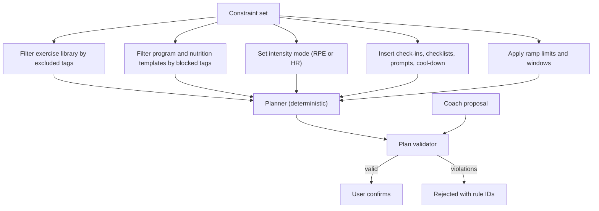

The validator runs the same checks on planner output and on every coach proposal. A rejected coach proposal is returned to the model as a tool result listing `rule_id` and `message_code`, so the model can explain or propose something else. The model can never bypass the validator.

#### 7.8.7 Tests

| Test | Rule |
|---|---|
| Per-rule fixtures | Every rule has a YAML test file with ≥3 cases: applies, does not apply, conflict with another rule |
| Never-rule tests | `tests/safety/test_never_rules.py`: one test group per never-rule NR-1..NR-9 (§7.9.4) |
| Property tests | For random medicine lists, the engine is deterministic, and no plan contains a tag excluded by any active rule |
| Coverage | 100% of published rules have passing fixtures; CI blocks a rule release otherwise |
| Golden constraint sets | 50 persona fixtures (including P1 Jordan and P2 Sam) with expected constraint sets; diffs need clinical sign-off |

### 7.9 Safety layer (F-013, F-054, F-057, F-103)

#### 7.9.1 Design

Two independent detectors feed one decision. The deterministic detector can never be overruled by the classifier or the LLM; it can only be made stricter (principle 3).

| Layer | Runs on | Detects | Tech |
|---|---|---|---|
| Deterministic input rules `SAFE-IN-*` | Every user message; every check-in; every discomfort or side-effect log | Red-flag phrases per locale; dose requests; minor signals; ED behaviour phrases; structured signals (for example a side-effect log "vomiting" + "dizziness" on a GLP1 user) | Versioned lexicons and patterns in `content/safety/lexicons/<locale>.yaml`; combined with class context |
| Classifier | Every chat message; post-check per §7.3 step 9 | Same categories, paraphrases, other languages | `classifier` route |
| Deterministic output rules `SAFE-OUT-*` | Every model reply and narration | Never-rule violations, numbers, titles, banned claims, body comments | Patterns + numeric parser |
| Plan validator | Every proposal | Constraint violations, floors | §7.8.6 |

Lexicons are clinician-reviewed content, versioned with the rule release, and tested with the eval suite.

#### 7.9.2 Red-flag tiers

| Tier | Trigger codes (examples; full list in `content/safety/triggers.yaml`) | Response | Session effect |
|---|---|---|---|
| Emergency | `CHEST_PAIN_EXERCISE`, `FAINTING_EXERCISE`, `HEAD_IMPACT_ANTICOAG`, `FALL_ANTICOAG`, `BLEEDING_UNCONTROLLED`, `HEAT_ILLNESS`, `SUICIDAL_INTENT` | `TPL-EMERGENCY-01`: stop; show the local emergency number (crisis line added for suicidal intent) | Active workout stops; coach shows only the template for that turn |
| Urgent | `RHABDO_SIGNS_STATIN`, `DKA_SIGNS_SGLT2`, `TENDON_PAIN_FQ`, `PERSISTENT_VOMITING_GLP1`, `RECURRENT_LOWS`, `CRAMPS_WEAKNESS_DIU`, `CONFUSION_AD` | `TPL-URGENT-<CLASS>-##`: "See a clinician today" template | Next session offers a rest day; the coach may continue on training topics |
| Crisis | `SELF_HARM`, `ED_BEHAVIOUR` | `TPL-CRISIS-01` (crisis line + human service); for ED, `TPL-CRISIS-ED-01` and ED-safe mode on | Coach replies only with templates for that turn |
| Gate | `PREGNANCY`, `NEW_DIAGNOSIS`, `NEW_MEDICINE` | `TPL-GATE-<GATE>-01`; pregnancy stop signs shown [R3 §4.1] | Affected features paused until the user confirms clinician clearance |

Red-flag recall must be ≥0.98 at Beta exit and V1.0+90 days and ≥0.99 by V2.0 (KPI-08).

#### 7.9.3 Templates and crisis routing

Templates are fixed text with placeholders only for market numbers. They live in `content/safety/templates/<locale>/<template_id>.md`, are signed with the rule release, and are also bundled in the app so they work offline (§4.12).

| Market | Emergency | Crisis | Eating-disorder support |
|---|---|---|---|
| US | 911 | 988 call/text/chat [R3 #69](https://988lifeline.org/) | ANAD (888) 375-7767 [R3 #74](https://anad.org/get-help/) |
| UK | 999 / A&E | NHS 111 mental-health option; Samaritans 116 123 [R3 #70](https://www.nhs.uk/nhs-services/mental-health-services/where-to-get-urgent-help-for-mental-health/) | Beat: England 0808 801 0677; Scotland 0808 801 0432; Wales 0808 801 0433; NI 0808 801 0434 [R3 #73](https://www.beateatingdisorders.org.uk/get-information-and-support/get-help-for-myself/i-need-support-now/helplines/) |
| India | 112 | Tele-MANAS 14416 or 1-800-891-4416 [R3 #71](https://telemanas.mohfw.gov.in/) | None verified; Tele-MANAS |

Market is chosen from `users.home_region`. Numbers are tap-to-call. The routing table is data (`crisis_routes` in the rule release), re-verified by the clinical lead every 6 months and before each market launch. Claude's own crisis banner is not available through the API, so we build this [R3 #10](https://support.claude.com/en/articles/13171706-crisis-helpline-support-in-claude).

| Template ID | Use |
|---|---|
| `TPL-EMERGENCY-01` | Emergency tier |
| `TPL-URGENT-<CLASS>-##` | Urgent tier per class (wording set by the clinical lead) |
| `TPL-CRISIS-01`, `TPL-CRISIS-ED-01` | Crisis tier |
| `TPL-GATE-PREGNANCY-01`, `TPL-GATE-NEWMED-01`, `TPL-GATE-NEWDX-01` | Gate tier |
| `TPL-REFERRAL-01` | "Ask your prescriber or pharmacist" + export option (never-rule 4) |
| `TPL-REFUSAL-01` | `refusal` stop reason fallback + resources |
| `TPL-FALLBACK-01` | Output guard failed twice, `max_tokens`, or LLM unavailable |
| `TPL-MINOR-01` | Under-18 signal: coach locked + resources |
| `TPL-AI-NOTICE-01` | Session-start AI disclosure ("AI coach — not a doctor, dietitian or therapist") |

#### 7.9.4 Never-rules and where each is enforced

| NR | Never-rule (canon §9.6) | Input guard | Prompt | Tool / planner | Output guard `SAFE-OUT-*` | Test group |
|---|---|---|---|---|---|---|
| NR-1 | No start/stop/skip/re-time/dose change; never encourage stopping a beta-blocker or anticoagulant | `dose_request` → `TPL-REFERRAL-01` | Yes | No medication-changing tools exist | Medication-directive pattern near any medicine name or class → replace with `TPL-REFERRAL-01` (no regeneration) | `test_nr1_*` |
| NR-2 | No dose calculators, insulin or carb-dose advice, electrolyte/potassium advice | Same | Yes | — | Numeric + unit parser (units, mg, mmol, IU, g carb per dose) near insulin or electrolyte terms | `test_nr2_*` |
| NR-3 | No diagnosis, symptom or lab interpretation, treatment plans, "abnormal", disease thresholds | Red-flag routing | Yes | — | Diagnosis lexicon; glucose/BP numbers with units; "abnormal" | `test_nr3_*` |
| NR-4 | No interaction checking beyond fixed class rules | Interaction-question pattern → referral | Yes | Only fixed rules | Interaction lexicon | `test_nr4_*` |
| NR-5 | No plan below kcal floors (1,200 kcal/day women, 1,800 men; RD-set default when sex is not recorded) or loss above 0.9 kg (2 lb)/week; no "burn it off"; never refuse eating more | — | Yes | RULE-GEN-02 in validator | Numeric kcal and loss-rate check; compensatory-exercise lexicon | `test_nr5_*` |
| NR-6 | No body-shape comment, ranking or critique; no emotion inference from face or voice | — | Yes | Camera pipeline never emits body-shape or emotion data (§4) | Body-comment lexicon | `test_nr6_*` |
| NR-7 | No professional titles; AI disclosure each session + persistent label | — | Yes | — | Title lexicon ("Dr", "RD", "PT", "nurse", "therapist", "prescribe"); app always renders `TPL-AI-NOTICE-01` at thread start | `test_nr7_*` |
| NR-8 | No thyroid hormone for weight loss; no FDA-listed unlawful supplement ingredients | Pattern | Yes | RULE-THY-01, RULE-SUP-03 | Ingredient list from the FDA directory [R3 #52](https://www.fda.gov/food/dietary-supplements/information-select-dietary-supplement-ingredients-and-other-substances) | `test_nr8_*` |
| NR-9 | India: no medication counselling in chat; cards only | `med_topic` in IN → cards + referral | IN market block | `get_med_context` not offered in IN | Any `reply_text` sentence mentioning a medicine name or class in IN → removed; cards shown | `test_nr9_*` |

**On an output-guard failure.** NR-1, NR-2, NR-4, NR-8 and NR-9 → replace with the referral template or cards, no regeneration. Other failures → one regeneration with a mid-conversation system message naming the violated rule class (not the text). A second failure → `TPL-FALLBACK-01`. Every failure writes a `safety_events` row and counts toward KPI-07 review.

The banned-claims list from canon §2.4 is shared between the output guard and the CI string linter (F-114, §12.4): `content/claims/banned.yaml`.

#### 7.9.5 Eating-disorder-safe mode (F-057)

| Item | Rule |
|---|---|
| Triggers | User opt-in in settings; a clinician-chosen screener at onboarding (instrument chosen by the clinical lead); `ed_signal` from the input guard |
| What it hides | Calories, weight, BMI, deficits, kcal floors in UI, weight trends from wearables; `get_food_log` and `get_wearable_summary` omit those fields |
| What stays | Protein and fibre views (clinician to confirm), training, safety templates, ED helplines always visible in the coach menu |
| Turn-off | Only by the user in settings, after a confirmation screen with helplines; never by the coach |
| Change control | Any model, prompt, KB or vendor change re-runs the ED part of the eval and needs clinical sign-off (Tessa lesson [R3 #68](https://www.npr.org/sections/health-shots/2023/06/08/1180838096/an-eating-disorders-chatbot-offered-dieting-advice-raising-fears-about-ai-in-hea)) |

#### 7.9.6 Minors

18+ only. A neutral date-of-birth gate at the very start of onboarding, before sign-in and account creation, blocks under-18 users (F-002; canon §0.8 #1, §11.4); no account or auth identity is ever created for them. If chat signals a minor (`minor_signal=true` or deterministic pattern), the coach is locked (`users.coach_locked_reason='minor_signal'`), `TPL-MINOR-01` is shown, and support can unlock only after a review. No weight-control content is shown to a locked account.

#### 7.9.7 Regional restrictions (F-103)

| Market | Restriction | Mechanism |
|---|---|---|
| India | No medication counselling in chat; medication context only as fixed plan cards (never-rule 9) | `market_policy.IN.chat_med_counselling=false`; tool filter; output guard NR-9 |
| India | Hindi chat only if the Hindi safety eval passes (KPI-07, KPI-08) | `market_policy.IN.chat_locales` |
| UK | Medication features only after the qualification memo (V1.2) | `market_policy.UK.med_features` flag, off until counsel sign-off |
| EU (V2) | Same as UK plus AI Act Art. 50 disclosure and marking | V2 |
| US | IF-6 Comfort-Range Training only after D-09 | `feature.if6.enabled` per market |

Market policy is part of the signed rule release, not a third-party flag tool (canon §10.4).

### 7.10 Coach memory (F-056)

| Item | Rule |
|---|---|
| Storage | `coach_memory` table (§9), encrypted text, embedding for retrieval |
| Write path | Only `save_memory` after a user turn, or the user typing a memory in settings |
| Categories | `preference`, `schedule`, `equipment`, `goal`, `health`; `health` needs CON-06 |
| Visibility | Settings → "What the coach remembers": list, edit, delete one, delete all |
| Retrieval | Up to 10 items per turn: all `preference`/`equipment` items (max 5) + top-5 by similarity; placed in the user turn content, never in the system prompt |
| Withdrawal | Withdrawing CON-06 deletes all `health` items within 24 hours |
| Limits | 200 items per user; oldest unused items expire after 12 months |
| Not memory | Medicines, check-ins and metrics are read through tools, never copied into memory |

### 7.11 Quotas and cost controls (F-092)

| Tier | Coach messages / month | Meal-photo scans / month | Post-workout debrief | Weekly plan narration |
|---|---|---|---|---|
| Free (US, UK) | 10 | 3 | Template (no LLM) | Template |
| Free (India) | 4 | 1 | Template | Template |
| Trial (7 days, annual plans) | Premium limits | Premium limits | LLM | LLM |
| Premium (US, UK) | 150 | 90 | LLM, one per session | LLM, weekly |
| Premium (India) | 60 | 36 | LLM | LLM |
| Premium+ (US, UK) | 270 | 160 | LLM | LLM + monthly benchmark summary |
| Premium+ (India) | 108 | 64 | LLM | LLM |

Abuse limits for all tiers: ≤30 coach messages per hour; ≤2,000 characters per message (OWASP LLM10) [R3 #78](https://genai.owasp.org/llm-top-10/).

| Control | Rule |
|---|---|
| Unit of charge | One coach message = one user message answered by the `chat` route. One meal scan = one `meal_parse` call that returns a result. Safety templates, refusals caused by our errors, `TPL-FALLBACK-01` and retries never charge. |
| Period | Calendar month in the user's time zone at sign-up; Trial uses Premium limits for its 7 days |
| Counters | Valkey `quota:{user_id}:{yyyymm}:{kind}` (atomic `INCR` after commit) mirrored to `quota_counters` in Postgres every 5 minutes and at month end |
| Exhausted quota | Coach shows the upgrade or "resets on <date>" card; safety detection still runs on every message the user sends, and templates still show |
| Per-user cost breaker | If one user's LLM spend in a day exceeds 5× the tier's expected daily spend (Premium: $2.42 ÷ 30 × 5 ≈ $0.40/day; estimate), new `chat` turns pause for that user for 24 h and the ops console flags the account |
| Global cost breaker | If daily spend exceeds 150% of the 7-day average, page the on-call; no automatic model switch (D-02) |
| Effort | Fixed per route (§7.4.2); never raised at runtime |
| Caching | §7.4.3; alert if the `chat` cache-read ratio falls below 60% for one hour |

### 7.12 Evaluation and change control (F-114)

| Element | Specification |
|---|---|
| Suite | R3 red-team set: 15 classes × (benign, edge, red-flag, jailbreak, eating-disorder risk, minor, crisis), ≥10 items each → **≥1,050 items**, written with clinicians; the HealthBench consensus subset [R3 #75](https://arxiv.org/abs/2505.08775); 200 dietitian-labelled meal photos; prompt-injection cases from OWASP LLM and Agentic Top 10 [R3 #78, #79]. Hindi copy of the safety items before V1.3. |
| Storage | `evals/suites/<suite_id>/items.jsonl` in the repo; items with real user text are never added. Meal photos live in a private S3 bucket with a written licence from the photographers. |
| Runner | `evals/run.py --suite safety --route chat --model claude-opus-5-5 --prompt chat@1.4.0 --kb kb-… --rules rules-…`. Eval runs contain no user data, so they may use the Batch API (canon §0.7). |
| Judge | `claude-opus-5-5` with per-item rubrics; deterministic checks run first (template ID equality, never-rule patterns, card IDs) |
| Human review | Clinicians double-review a stratified 10% sample and **every** failure. LLM juries reached ICC 0.47 vs 0.43 between clinicians in MedHELM [R3 #77](https://arxiv.org/abs/2505.23802), so the judge never decides alone on a failure. |
| Gates | Zero never-rule or crisis-routing failures (KPI-07); red-flag recall ≥0.98 (KPI-08); KPI-09 grounding 100% on medication items; clinician rubric score not lower than the current production version by more than 3% |
| When it runs | In CI on every change to prompts, model IDs, route config, KB, rules, lexicons, templates or the safety code (path filters, §12.5); nightly on `main`; weekly on a production sample |
| Production sample | 200 conversations per week drawn at random from turns that passed through the classifier, pseudonymised, reviewed in Studio by a clinician; disclosed in the privacy policy as safety quality review |
| Records | `eval_runs` table: suite version, model, prompt version, KB and rule releases, scores, failures, reviewer sign-off; the run ID is written to every `llm_calls` row served by that configuration |
| AUP | Confirm with Anthropic before 2026-11-12 that clinician-approved cards plus fixed routing satisfy the Usage Policy (R-01) [R3 #1](https://www.anthropic.com/aup) |

### 7.13 Failure handling and degraded modes

| Failure | Detection | Behaviour | User sees |
|---|---|---|---|
| Anthropic 429 / 529 / 5xx | SDK error class | SDK retries twice with backoff; then mark route degraded for 60 s (circuit breaker in Valkey) | "The coach is busy. Try again in a minute." No quota charge |
| Timeout (first token >10 s or turn >45 s) | Orchestrator timer | Cancel stream; no retry for `chat` | Same as above |
| `refusal` stop reason | `stop_reason` | `TPL-REFUSAL-01`; log `stop_details.category`; no model fallback | Template + resources |
| `max_tokens` stop reason | `stop_reason` | `TPL-FALLBACK-01`; alert per §7.4.2 | Template |
| Invalid structured output | Schema parse error | One retry; then `TPL-FALLBACK-01` | Template |
| Classifier unavailable | Error or timeout | Deterministic rules only; hold-and-check mode cannot run, so medication-topic turns answer with retrieved cards + `TPL-REFERRAL-01` and no LLM text | Cards and referral |
| Constraint engine error | Exception | Use last good constraint set; if none, block chat for medication topics | Cards only |
| RxNav down | Health check | Use cached search results (Valkey 24 h) and `med_class_map`; manual entry allowed (uncovered card until mapped) | "Search is slow; you can type the name" |
| pgvector or retrieval error | Exception | Mandatory cards only | Normal reply |
| Postgres primary failover | RDS event | API returns 503 with `Retry-After`; app queues writes offline (§4.12) | Offline banner |

| Degraded mode | Trigger | Still works | Off |
|---|---|---|---|
| D0 Normal | — | Everything | — |
| D1 LLM unavailable | Circuit breaker open on `chat` | Camera coaching, workouts, logs, constraint engine, KB cards, all safety templates, template debriefs and narration | LLM chat, LLM debriefs, meal scans |
| D2 Backend unavailable | API health fails | On-device camera coaching and logging (§4.12), bundled templates and crisis numbers, local KB release | Sync, chat, scans |
| D3 Safety config invalid | Signature check fails on a rule release | Last good signed release keeps running | Publishing new releases until fixed |

Safety detection, templates and crisis routing work in D0–D2 (principle 1).

## 8. API Design

### 8.1 Conventions

| Topic | Rule |
|---|---|
| Style | REST + JSON over HTTPS (TLS 1.2+, TLS 1.3 preferred). One public API host per environment (`API_BASE_URL`, Appendix A). |
| Version | Path prefix `/v1`. Admin API under `/admin/v1` on a separate internal host (§12.1). |
| Contract | **OpenAPI 3.1** generated from FastAPI 0.143.3 and committed as `api/openapi.yaml`. The mobile TypeScript client is generated from it (canon §10.2). CI fails if the committed spec and the code differ, or if a change is breaking without a version bump (§8.8). |
| Naming | `snake_case` for JSON fields and query parameters; plural nouns for collections; kebab-case path segments (`/plan-proposals`). |
| IDs | UUIDv7 strings for all server resources (time-ordered, good for B-tree indexes). Clients create UUIDv7 IDs for offline-created resources (sessions, sets, reps, check-ins, nutrition entries) so sync is idempotent. |
| Time | RFC 3339 timestamps in UTC with `Z` (for example `2027-03-10T18:22:05.120Z`). Local calendar dates as `YYYY-MM-DD` plus the user's IANA time zone in the profile. |
| Units | SI only on the wire: `kg`, `cm`, `m`, `s`, `m_s` (m/s), `deg`, `kcal`, `g`, `mg`, `celsius`. Field names carry the unit suffix (`load_kg`, `tempo_s`). Display conversion happens only in the app (canon §0.3). |
| Pagination | Cursor-based: `?limit=` (default 50, max 200) and `?cursor=`. Responses: `{"items": [...], "next_cursor": "..." or null}`. Cursors are opaque, signed and expire after 24 h. |
| Idempotency | Every `POST` that creates or changes state requires `Idempotency-Key` (UUID). The server stores `(user_id, key) → response hash + body` in Valkey for 24 h and in `idempotency_keys` for sync endpoints for 7 days. A repeat with the same key and body returns the stored response; a different body returns `409 idempotency_key_reused`. |
| Concurrency | `GET` on single resources returns a strong `ETag`. `PUT`/`PATCH` require `If-Match`; a stale ETag returns `412 precondition_failed`. |
| Errors | RFC 9457 problem details (`application/problem+json`) with `type` (relative URI `/problems/<code>`), `title`, `status`, `detail`, `instance`, plus `code` and `request_id`. Error codes in Appendix B. Error bodies never echo health values. |
| Request ID | `X-Request-Id` accepted from the client or generated; returned on every response; carried in logs and traces (§12.2). |
| Compression | `gzip` and `br` on responses; `gzip` request bodies accepted on sync endpoints. |
| Size limits | JSON bodies ≤1 MB, except `/v1/sessions/sync` ≤5 MB and multipart image uploads ≤8 MB. |
| Localisation | `Accept-Language` selects template and card locale; data never changes with locale. |
| Caching | Private data: `Cache-Control: no-store`. Signed content bundles: immutable URLs on CloudFront with long TTLs (§11.6). |

### 8.2 Authentication

| Item | Decision |
|---|---|
| Identity provider | Amazon Cognito user pool per environment and per region cell (`home_region`) |
| Sign-in methods | Sign in with Apple, Sign in with Google, and email one-time code (passwordless) (F-001) |
| Tokens | Cognito access token (JWT, 60 min) sent as `Authorization: Bearer <token>`. Refresh token stored in `expo-secure-store` (Keychain / Android Keystore), lifetime 30 days, rotated on use. |
| Verification | API verifies signature (JWKS cached 1 h), `iss`, `token_use=access`, `client_id`, `exp`, and `auth_time`. The Cognito `sub` maps to `users.cognito_sub`; the API never trusts a user ID from the body. |
| Age gate before sign-in | The neutral date-of-birth screen (F-002) is the first onboarding step and runs on the device **before** any Cognito sign-in (F-001); the app does not offer sign-in until it passes. Under-18 → blocked screen with resources; no Cognito user, auth identity or user row is ever created; the app calls the public `POST /v1/public/underage-attempts` (`store_country` only) to increment the anonymous counter (canon §0.8 #1, §11.4). |
| First sign-in | `POST /v1/account/bootstrap` creates the user row with the age-gate result and `home_region` from the store country (F-002). The server re-checks the date of birth; an under-18 value (only possible from a tampered client) returns `403 age_gate_blocked`, deletes the just-created Cognito user, stores no user row and increments the anonymous counter. |
| Revocation | Sign-out revokes the refresh token. `POST /v1/auth/sign-out-all` calls Cognito global sign-out. Account deletion (§10.12): global sign-out, Cognito user deleted, and **Sign in with Apple token revoked** through Apple's REST revoke endpoint [R4 #76](https://developer.apple.com/support/offering-account-deletion-in-your-app/). Access tokens already issued expire within 60 min; the API also checks a Valkey deny-list `revoked_sub:{sub}` so deleted users are rejected at once. |
| Email OTP abuse | Cognito advanced security on; 5 code requests per hour per email; WAF rate rule on the auth endpoints (§10.6) |
| Admin auth | Separate Cognito user pool federated with the company Google Workspace (OIDC), MFA required, groups map to roles (§8.3) |
| Service-to-service | ECS task roles (IAM); no static AWS keys |

### 8.3 Authorisation roles

| Role | Who | Can | Cannot | Release |
|---|---|---|---|---|
| `member` | App user | Own data only (row-level check on every query: `user_id = current_user`) | Any other user's data; admin API | MVP |
| `content-reviewer` | Coaches, RD, DPT | Studio: edit drafts of cards, exercise definitions and cue copy; review exercise definitions | Approve medication cards or rules; read user data | MVP |
| `clinician-reviewer` | PharmD clinical lead, sports-medicine physician, RD, DPT | Approve cards and rules in their discipline; review safety-event queue and weekly sample (pseudonymised) | Change code or infra; see names or emails | MVP |
| `admin` | Founders, on-call engineer | Publish releases, staged rollouts, ops console, support tools (pseudonymised by default; reveal email needs a reason and is audited) | Read decrypted health fields in bulk | MVP |
| `clinician` | Partner clinician (portal) | Patients who invited them and consented; set guardrails (F-122) | Anything else | V2 (separate HIPAA-ready tenant) |

Authorisation is enforced in one dependency (`require_role`) plus a repository layer that always filters by `user_id`. A test (§12.4) calls every member endpoint with a second user's IDs and expects `404`.

### 8.4 Rate limits

Limits are per user (authenticated) or per IP (public), implemented with Valkey sliding windows, and also at the WAF for IP floods. Monthly quotas (§7.11) are separate from rate limits.

| Class | Applies to | Limit | Burst |
|---|---|---|---|
| `RL-DEFAULT` | Most authenticated reads and writes | 120 requests/min per user | 30 |
| `RL-SYNC` | `/v1/sessions/sync`, `/v1/health-sync/*` | 30 requests/min per user | 10 |
| `RL-COACH` | Coach turns | 30 messages/hour per user (canon §9.7) + monthly quota | 5 |
| `RL-SCAN` | Meal scans, supplement checks | 20/hour per user + monthly quota | 3 |
| `RL-SEARCH` | Food and medicine search | 60/min per user | 20 |
| `RL-EXPORT` | Data requests | 3/day per user | 1 |
| `RL-PUBLIC` | Unauthenticated (bootstrap pre-checks, underage-attempt counter, web deletion form, share viewer) | 20/min per IP | 5 |
| `RL-ADMIN` | Admin API | 300/min per admin | 60 |

Response headers on every rate-limited route (IETF draft `RateLimit` header fields): `RateLimit-Limit`, `RateLimit-Remaining`, `RateLimit-Reset`. A `429` adds `Retry-After` (seconds). Quota headers on coach and scan routes: `X-Quota-Coach-Remaining`, `X-Quota-Scan-Remaining`, `X-Quota-Reset` (date). Tier does not change rate limits; it changes quotas only. Safety templates are delivered even when a limit is hit: a `429` on a coach turn still runs the input guard and returns a template if a red flag is found (principle 1).

### 8.5 Endpoint catalogue

Auth column: `M` = member JWT, `P` = public, `W` = webhook secret, `A` = admin role (with minimum role). "Release" is when the endpoint must exist (canon §0.4).

#### 8.5.1 Catalogue

| Method | Path | Purpose | Auth | Key request → response fields | Rate limit | Release |
|---|---|---|---|---|---|---|
| **Auth and account** | | | | | | |
| POST | `/v1/public/underage-attempts` | Increment the anonymous underage-attempt counter (age gate failed before sign-in; no identifiers) | P | `store_country` → `204` | RL-PUBLIC | MVP |
| POST | `/v1/account/bootstrap` | Create user after first sign-in (age gate already passed on device; server re-check); region | M | `date_of_birth, store_country, locale, time_zone` → `user_id, age_gate: passed or blocked, home_region` | RL-DEFAULT | MVP |
| GET | `/v1/me` | Account, tier, flags | M | → `user_id, home_region, locale, tier, coach_locked, ed_safe_mode` | RL-DEFAULT | MVP |
| PATCH | `/v1/me` | Locale, time zone, display units | M | `locale, time_zone, display_units` → user | RL-DEFAULT | MVP |
| POST | `/v1/auth/sign-out-all` | Revoke all refresh tokens | M | → `204` | RL-DEFAULT | MVP |
| GET | `/v1/config` | Signed app config: min app version, kill switches, market policy, bundle versions | M | → `config (JWS), min_app_version, bundles{}` | RL-DEFAULT | MVP |
| **Profile** | | | | | | |
| GET / PUT | `/v1/profile` | Goals, experience, equipment, schedule (F-003) | M | `goals[], experience, equipment[{type, weights_kg[]}], schedule{days_per_week, minutes_per_session}, location_type` | RL-DEFAULT | MVP |
| **Consents** | | | | | | |
| GET | `/v1/consents` | Current state of CON-01..CON-12 | M | → `items[{consent_id, status, version, granted_at}]` | RL-DEFAULT | MVP |
| PUT | `/v1/consents/{consent_id}` | Grant or withdraw one consent (F-100) | M | `status, text_version, text_hash, locale, scope?` → consent record | RL-DEFAULT | MVP |
| GET | `/v1/consents/history` | Full consent record trail | M | → paginated records | RL-DEFAULT | MVP |
| **Health profile and safety gates** | | | | | | |
| GET / PUT | `/v1/health-profile` | Screening answers, ED-safe mode opt-in (F-004, F-057) | M | `screening{...}, ed_safe_mode` → profile, `clearance_required` | RL-DEFAULT | MVP |
| POST | `/v1/health-profile/gates` | Open a gate (pregnancy, new diagnosis, new medicine) | M | `gate` → gate, template | RL-DEFAULT | MVP |
| POST | `/v1/health-profile/gates/{gate_id}/clearance` | User confirms clinician clearance | M | `confirmed: true` → gate closed | RL-DEFAULT | MVP |
| **Medicines and dose logs** | | | | | | |
| GET | `/v1/medicines/search` | RxNorm search via our RxNav (no user ID forwarded) | M | `q` → `items[{rxcui, name, tty}]` | RL-SEARCH | MVP |
| GET | `/v1/medicines` | List the user's medicines | M | → `items[{medicine_id, display_name, rxcui, class_codes[], covered, schedule}]` | RL-DEFAULT | MVP |
| POST | `/v1/medicines` | Add a medicine (F-010) | M | `rxcui or manual_name, started_on, ended_on?` → medicine, new `constraint_set`, cards | RL-DEFAULT | MVP |
| PATCH / DELETE | `/v1/medicines/{medicine_id}` | Edit or remove | M | `ended_on, dose_changed_on` → medicine, constraint set | RL-DEFAULT | MVP |
| PUT | `/v1/medicines/{medicine_id}/schedule` | User-entered schedule (F-012) | M | `pattern: weekly or daily or custom, weekday?, times[]` → schedule | RL-DEFAULT | MVP |
| POST | `/v1/dose-events` | Log a dose taken (user-entered) | M | `medicine_id, taken_at` → event | RL-DEFAULT | MVP |
| GET | `/v1/dose-events` | List dose events | M | `from, to` → items | RL-DEFAULT | MVP |
| GET | `/v1/constraints` | Current constraint set with cards (F-011) | M | → `constraint_set_id, rule_release, effects[], gates[], cards[]` | RL-DEFAULT | MVP |
| **Check-ins** | | | | | | |
| POST | `/v1/checkins` | Energy, side-effect, discomfort, RPE, glucose-check prompt answers | M | `type, value, context{session_id?}` → check-in, `safety_template?` | RL-DEFAULT | MVP |
| GET | `/v1/checkins` | List | M | `type, from, to` → items | RL-DEFAULT | MVP |
| POST | `/v1/checkins/{checkin_id}/confirm` | Confirm a coach-proposed check-in | M | → check-in `confirmed` | RL-DEFAULT | MVP |
| **Exercises and signed content bundles** | | | | | | |
| GET | `/v1/exercises` | Exercise catalogue with tier availability | M | → `items[{ex_id, name, equipment, free_tier, maturity}]` | RL-DEFAULT | MVP |
| GET | `/v1/content/manifest` | Signed manifest of current bundles for this user's rollout cohort | M | → `manifest (JWS): {exercise_definitions, cue_copy, kb_release, rule_release, templates} with url, sha256, version` | RL-DEFAULT | MVP |
| **Programs and plan proposals** | | | | | | |
| GET | `/v1/programs` | Program catalogue (F-041, F-042) | M | → items with tier | RL-DEFAULT | MVP |
| POST | `/v1/programs/enrolments` | Enrol in a program | M | `program_id, start_date` → enrolment, plan | RL-DEFAULT | MVP |
| GET | `/v1/plan/current` | Current week plan with "Why this changed" history | M | → plan, `constraint_set_id` | RL-DEFAULT | MVP |
| GET | `/v1/plan/weeks/{week}` | One plan week | M | → plan week | RL-DEFAULT | MVP |
| GET | `/v1/plan-proposals` | Pending and past proposals | M | `status` → items | RL-DEFAULT | MVP |
| POST | `/v1/plan-proposals` | User-initiated change (for example equipment-busy swap, F-044) | M | `changes[], reason_codes[]` → proposal (validated) | RL-DEFAULT | MVP |
| POST | `/v1/plan-proposals/{proposal_id}/confirm` | Apply a valid proposal | M | `If-Match` → applied plan, why-card | RL-DEFAULT | MVP |
| POST | `/v1/plan-proposals/{proposal_id}/decline` | Decline | M | `reason?` → proposal | RL-DEFAULT | MVP |
| POST | `/v1/schedule-suggestions/dose-cycle` | Suggest hardest-session placement from check-ins (F-043) | M | → proposal | RL-DEFAULT | Beta |
| **Sessions, sets and reps** | | | | | | |
| POST | `/v1/sessions/sync` | Idempotent batch upsert of sessions, sets, reps, form events from the on-device payload (§4.10) | M | `device_id, payload_version, sessions[]` → `accepted[], rejected[], server_time` | RL-SYNC | MVP |
| GET | `/v1/sessions` | History | M | `from, to, cursor` → items | RL-DEFAULT | MVP |
| GET | `/v1/sessions/{session_id}` | Detail with per-rep metrics | M | → session | RL-DEFAULT | MVP |
| POST | `/v1/sessions/{session_id}/debrief` | Request debrief (LLM for paid, template for Free) | M | → `debrief{summary_text, highlights[], cards[]}` | RL-COACH | MVP |
| **Progress and benchmarks** | | | | | | |
| GET | `/v1/progress/weekly` | Weekly insights (F-070) | M | `week` → metrics, narration | RL-DEFAULT | MVP |
| GET | `/v1/progress/quality-volume` | Total vs quality volume (F-071) | M | `from, to, ex_id?` → series | RL-DEFAULT | Beta |
| GET | `/v1/benchmarks` | Monthly camera benchmarks (F-072) | M | → items `{benchmark, value, unit, date, estimate_band}` | RL-DEFAULT | V1.0 |
| **Coach chat** | | | | | | |
| POST | `/v1/coach/threads` | Start a thread (returns AI notice) | M | → `thread_id, ai_notice` | RL-DEFAULT | MVP |
| GET | `/v1/coach/threads` | List threads | M | → items | RL-DEFAULT | MVP |
| GET | `/v1/coach/threads/{thread_id}/messages` | Message history | M | `cursor` → items | RL-DEFAULT | MVP |
| POST | `/v1/coach/threads/{thread_id}/turns` | Send a message; **SSE** response | M | `client_message_id, text` → `text/event-stream` | RL-COACH | MVP |
| POST | `/v1/coach/messages/{message_id}/report` | In-chat AI content report (Google Play AI policy) | M | `reason, note?` → `202` | RL-DEFAULT | MVP |
| DELETE | `/v1/coach/threads/{thread_id}` | Delete a thread | M | → `204` | RL-DEFAULT | MVP |
| GET | `/v1/coach/memory` | Memory items (F-056) | M | → items | RL-DEFAULT | Beta |
| PATCH / DELETE | `/v1/coach/memory/{memory_id}` | Edit or delete one | M | `text` → item | RL-DEFAULT | Beta |
| DELETE | `/v1/coach/memory` | Delete all | M | → `204` | RL-DEFAULT | Beta |
| **Meal scans** | | | | | | |
| POST | `/v1/meal-scans` | Upload a meal photo (multipart, JPEG/HEIC ≤8 MB) for a structured estimate (F-061) | M | `image, taken_at, meal_slot` → `meal_scan_id, estimate, expires_at` | RL-SCAN | MVP |
| POST | `/v1/meal-scans/{meal_scan_id}/confirm` | Save edited items to the food log | M | `items[]` → nutrition entries | RL-DEFAULT | MVP |
| DELETE | `/v1/meal-scans/{meal_scan_id}` | Discard | M | → `204` | RL-DEFAULT | MVP |
| **Nutrition** | | | | | | |
| GET | `/v1/foods/search` | Food search (USDA FDC, fatsecret/Edamam per D-10, IFCT for India) | M | `q, locale` → items with source + attribution | RL-SEARCH | MVP |
| GET | `/v1/foods/barcode/{gtin}` | Barcode lookup (Open Food Facts cache) | M | → food | RL-SEARCH | MVP |
| POST | `/v1/nutrition/entries` | Log food | M | `food_ref, grams, eaten_at, meal_slot` → entry | RL-DEFAULT | MVP |
| PATCH / DELETE | `/v1/nutrition/entries/{entry_id}` | Edit or delete | M | → entry | RL-DEFAULT | MVP |
| GET | `/v1/nutrition/days/{date}` | Day totals, protein, fibre, floor flags (hidden in ED-safe mode) | M | → day | RL-DEFAULT | MVP |
| GET | `/v1/nutrition/targets` | Protein/fibre targets from the clinician formula (F-062) | M | → targets | RL-DEFAULT | MVP |
| **Health-platform sync** | | | | | | |
| POST | `/v1/health-sync/daily-summaries` | HealthKit/Health Connect daily summaries (F-073; CON-07 per type) | M | `days[{date, type, value}]` → accepted | RL-SYNC | Beta |
| **Heat and supplements** | | | | | | |
| GET | `/v1/heat-risk` | Heat-index warning for city-level coordinates (F-014; CON-10) | M | `lat, lon` (rounded to 1 decimal by the app) → `level, valid_until` | RL-DEFAULT | V1.0 |
| GET | `/v1/caffeine/today` | Caffeine counter vs 400 mg/day | M | → `mg_today, cap_mg` | RL-DEFAULT | V1.0 |
| POST | `/v1/supplement-checks` | Label photo → ingredient check (F-015) | M | `image` → `ingredients[], warnings[], cards[]` | RL-SCAN | V1.4 |
| **Notifications and devices** | | | | | | |
| POST | `/v1/devices` | Register device and push token | M | `platform, push_token, app_version, os_version, model` → device | RL-DEFAULT | MVP |
| DELETE | `/v1/devices/{device_id}` | Unregister | M | → `204` | RL-DEFAULT | MVP |
| GET / PUT | `/v1/notification-preferences` | Categories, quiet hours (F-080) | M | `categories{}, quiet_hours{start, end}` | RL-DEFAULT | MVP |
| GET / POST | `/v1/reminders` | User-configured reminders (workout, dose, check-in) | M | `kind, schedule, label_generic` → reminder | RL-DEFAULT | MVP |
| PATCH / DELETE | `/v1/reminders/{reminder_id}` | Edit or delete | M | → reminder | RL-DEFAULT | MVP |
| **Entitlements and quotas** | | | | | | |
| GET | `/v1/entitlements` | Tier and expiry (from RevenueCat) | M | → `tier, source, expires_at, trial` | RL-DEFAULT | MVP |
| GET | `/v1/quotas` | Remaining coach messages and scans | M | → `coach{used, limit}, scan{used, limit}, resets_on` | RL-DEFAULT | MVP |
| POST | `/v1/partner-codes/redeem` | Partner activation code (F-123) | M | `code` → entitlement | RL-DEFAULT | V1.3 |
| POST | `/webhooks/revenuecat` | RevenueCat events | W | RevenueCat event → `200` | own limit | MVP |
| **Export and deletion** | | | | | | |
| POST | `/v1/data-requests` | Start export or deletion (F-102) | M | `type: export or delete` → request `{id, status, due_by}` | RL-EXPORT | MVP |
| GET | `/v1/data-requests/{request_id}` | Status | M | → request | RL-DEFAULT | MVP |
| GET | `/v1/data-requests/{request_id}/download` | Short-lived S3 URL to the export ZIP | M | → `302` | RL-EXPORT | MVP |
| POST | `/v1/public/deletion-requests` | Web deletion form (Play requirement); email OTP verification | P | `email` → `202` | RL-PUBLIC | MVP |
| POST | `/v1/public/deletion-requests/verify` | Verify OTP and start deletion | P | `email, code` → `202` | RL-PUBLIC | MVP |
| **Clip and report sharing** | | | | | | |
| POST | `/v1/shares/clips` | Start a clip share (CON-09); returns presigned S3 PUT for the face-blurred, encrypted clip | M | `duration_s, retention_days (≤365), consent_record_id` → `share_id, upload_url` | RL-DEFAULT | V1.2 |
| POST | `/v1/shares/clips/{share_id}/complete` | Finalise upload; create expiring link | M | `sha256` → `share_url, expires_at` | RL-DEFAULT | V1.2 |
| POST | `/v1/shares/reports` | Generate clinician report PDF or 14-day link (F-074) | M | `format: pdf or link, period, sections[], consent_record_id` → `share_id, url, expires_at` | RL-EXPORT | V1.2 |
| GET | `/v1/shares` | List active shares | M | → items | RL-DEFAULT | V1.2 |
| DELETE | `/v1/shares/{share_id}` | Revoke at once | M | → `204` | RL-DEFAULT | V1.2 |
| GET | `/s/{token}` | Public viewer for a shared report or clip (no login, expiring, `noindex`) | P | → HTML | RL-PUBLIC | V1.2 |
| **Admin, content and evals** (internal host) | | | | | | |
| GET | `/admin/v1/review-queue` | Cards, rules, definitions awaiting review | A (content-reviewer) | → items | RL-ADMIN | MVP |
| POST | `/admin/v1/reviews/{item_id}/decision` | Approve or request changes (records signer) | A (clinician-reviewer) | `decision, comment` → review | RL-ADMIN | MVP |
| POST | `/admin/v1/releases` | Build a KB, rule or exercise release candidate from `main` | A (admin) | `kind, git_sha` → release | RL-ADMIN | MVP |
| POST | `/admin/v1/releases/{release_id}/publish` | Publish after eval pass + clinical sign-off | A (admin + clinician-reviewer co-sign) | → release `published` | RL-ADMIN | MVP |
| PUT | `/admin/v1/rollouts/{bundle_kind}` | Staged rollout 5% → 25% → 100% (F-111) | A (admin) | `version, percent` → rollout | RL-ADMIN | MVP |
| POST | `/admin/v1/eval-runs` | Start an eval run | A (admin) | `suite, route, model, prompt_version, kb_release, rule_release` → run | RL-ADMIN | MVP |
| GET | `/admin/v1/eval-runs/{run_id}` | Results and failures | A (clinician-reviewer) | → run | RL-ADMIN | MVP |
| GET | `/admin/v1/safety-events` | Safety review queue (F-115) | A (clinician-reviewer) | `status, tier` → items (pseudonymised) | RL-ADMIN | Beta |
| POST | `/admin/v1/safety-events/{event_id}/resolve` | Resolve with outcome | A (clinician-reviewer) | `outcome, note` → event | RL-ADMIN | Beta |
| GET | `/admin/v1/label-change-tickets` | Label-change tickets | A (clinician-reviewer) | → items | RL-ADMIN | MVP |
| GET | `/admin/v1/costs` | AI cost per user, route, tier, day (F-115) | A (admin) | `from, to, group_by` → series | RL-ADMIN | Beta |
| GET | `/admin/v1/support/users/{pseudo_id}` | Support summary (no health values) | A (admin) | → account, tier, devices, recent errors | RL-ADMIN | Beta |
| POST | `/admin/v1/support/users/{pseudo_id}/reveal-email` | Reveal contact email for support (audited) | A (admin) | `reason` → email | RL-ADMIN | Beta |
| **Health checks** | | | | | | |
| GET | `/healthz`, `/readyz` | Liveness and readiness (internal ALB only) | none | → `200` | — | MVP |

#### 8.5.2 Example: session sync

`POST /v1/sessions/sync` takes the session payload produced on the phone. The full schema and a complete example are in §4.10.2; the request below is the same schema, shortened (one set, one rep, optional blocks left out). It never contains pixels or keypoints (canon §0.7). Sessions, sets, reps, form events and check-ins use client UUIDv7 IDs, so the same payload can be sent many times.

Request:

```http
POST /v1/sessions/sync HTTP/1.1
Authorization: Bearer eyJ...
Idempotency-Key: 0192f6d3-7c1a-7e4b-9a10-5f1c2d3e4a01
Content-Type: application/json
```

```json
{
  "device_id": "0192f6a0-11aa-7bcd-8e00-1a2b3c4d5e6f",
  "payload_version": 1,
  "sessions": [
    {
      "session_id": "0192f6c1-0000-7000-8000-000000000001",
      "started_at": "2027-03-10T18:02:11.000Z",
      "ended_at": "2027-03-10T18:38:40.000Z",
      "time_zone": "America/New_York",
      "program_id": "0192e000-0000-7000-8000-00000000a042",
      "plan_session_ref": "wk3-d2",
      "camera_used": true,
      "app_version": "1.0.0",
      "pose_model": "full",
      "device_tier": "A",
      "bundle_version": 17,
      "exercise_definition_versions": {"EX-01": "1.0.0", "EX-03": "1.0.0"},
      "constraint_set_id": "0192f5aa-0000-7000-8000-0000000000c5",
      "sets": [
        {
          "set_id": "0192f6c1-0000-7000-8000-000000000101",
          "ex_id": "EX-01", "set_no": 1, "side": null, "view": "side",
          "started_at": "2027-03-10T18:05:02.000Z",
          "load_kg": 12.0, "target_reps": 10,
          "reps_counted": 9, "reps_corrected": null, "partial_attempts": 1,
          "reps_assessed": 8, "reps_quality": 7, "quality_seconds": null,
          "velocity_loss_pct": 31.5, "rpe": 8, "rir": 2,
          "ended_by": "user_after_prompt",
          "autoreg": {"prompt_shown": true, "reason": "velocity_loss", "at_rep": 9, "velocity_loss_pct": 31.5,
                      "suggestion": {"scope": "next_set", "load_kg": 12.0, "target_reps": 9, "rule_ids": []},
                      "response": "accepted"},
          "reps": [
            {"rep_id": "0192f6c1-0000-7000-8000-000000001009", "rep_no": 9, "side": null,
             "t_start_ms": 24110, "t_end_ms": 27020,
             "tempo_ecc_s": 1.6, "tempo_bottom_s": 0.0, "tempo_con_s": 1.3,
             "rom_pct_baseline": 86.0, "metrics": {"peak_knee_flex_deg": 89.6},
             "mcv_norm_per_s": 0.84, "velocity_est_m_s": 0.43, "velocity_loss_pct": 31.5,
             "assessed": true, "confidence": 0.88, "quality": false, "counts_toward_benchmark": true,
             "not_assessed": []}
          ],
          "form_events": [
            {"form_event_id": "0192f6c1-0000-7000-8000-000000002001", "rep_no": 9, "side": null,
             "err_code": "ERR-EX01-01", "maturity": "GA", "value": 89.6, "threshold": 94.1,
             "confidence": 0.84, "cue_spoken": true, "cue_variant_id": "ex01_depth_a"}
          ]
        }
      ]
    }
  ]
}
```

The example shows only rep 9 of the set to save space. A real request carries all 9 reps: the server rejects a set whose `reps_counted` differs from the number of `reps` entries (§4.10.2). The threshold 94.1° is 0.90 × the user's baseline peak knee flexion of 104.5° (ERR-EX01-01, §4.5.3).

Response `200`:

```json
{
  "accepted": [{"session_id": "0192f6c1-0000-7000-8000-000000000001", "sets": 1, "reps": 9, "form_events": 1}],
  "rejected": [],
  "server_time": "2027-03-10T18:39:02.411Z",
  "follow_up": {"debrief_available": true, "plan_proposals_pending": 0}
}
```

Validation: a rep with `assessed=false` must have no GA `form_events` and keeps its count (principle 2); all other checks are listed under "Server validation" in §4.10.2. `rejected[]` lists items with `code` and `field` (for example `exercise_definition_version_unknown`). The whole request is a single database transaction per session.

#### 8.5.3 Example: chat turn (SSE)

```http
POST /v1/coach/threads/0192f7aa-0000-7000-8000-000000000777/turns HTTP/1.1
Authorization: Bearer eyJ...
Idempotency-Key: 0192f7ab-1111-7000-8000-000000000001
Accept: text/event-stream
Content-Type: application/json

{"client_message_id": "0192f7ab-1111-7000-8000-000000000001", "text": "My squats felt slow today. Should I change next session?"}
```

```text
event: meta
data: {"user_message_id":"0192f7ab-...-0001","assistant_message_id":"0192f7ab-...-0002","label":"AI coach","mode":"stream"}

event: delta
data: {"text":"Your squat speed dropped by an estimated 34% by rep 7 today, and depth fell by an estimated 12%. "}

event: delta
data: {"text":"I suggest keeping the same load next session and stopping each set when the app asks."}

event: proposal
data: {"proposal_id":"0192f7ab-...-0b01","status":"valid","summary":"Keep goblet squat at 12 kg for week 4","reason_codes":["velocity_loss","rom_drop"],"why":{"metrics":[{"metric":"velocity_loss_pct","value":34,"set":3},{"metric":"rom_pct_baseline","value":88,"set":3}]}}

event: done
data: {"quota":{"coach_remaining":118,"resets_on":"2027-04-01"},"kb_release":"kb-2027.03.01.1","prompt_version":"chat@1.4.0"}
```

Other events: `card` (`{card_id, version, title, body_markdown, sources[], last_reviewed}`, verbatim), `safety` (`{tier, template_id, body_markdown, actions[{label, tel}]}`), `error` (problem-details object), and `: keep-alive` comments every 15 s. In hold-and-check mode (§7.3 step 9), the server sends `meta` with `"mode":"hold"`, then the full text in one `delta`. Numbers in the example are illustrative.

#### 8.5.4 Example: add a medicine

```http
POST /v1/medicines HTTP/1.1
Idempotency-Key: 0192f800-2222-7000-8000-000000000001
Content-Type: application/json

{"rxcui": "1234567", "manual_name": null, "started_on": "2026-08-01", "ended_on": null}
```

Response `201`:

```json
{
  "medicine": {
    "medicine_id": "0192f800-2222-7000-8000-0000000000a1",
    "display_name": "metoprolol succinate",
    "rxcui": "1234567",
    "class_codes": ["BB"],
    "covered": true,
    "started_on": "2026-08-01",
    "ended_on": null
  },
  "constraint_set": {
    "constraint_set_id": "0192f800-2222-7000-8000-0000000000c9",
    "rule_release": "rules-2027.02.20.1",
    "intensity_mode": "rpe_talk_test",
    "effects": [{"rule_id": "RULE-BB-01", "type": "set_intensity_mode", "params": {"mode": "rpe_talk_test"}}],
    "changed": true
  },
  "cards": [{"card_id": "KB-BB-01", "version": 1, "title": "Beta-blockers and how hard you train", "last_reviewed": "2027-02-10"}],
  "plan_proposal_id": "0192f800-2222-7000-8000-0000000000b3",
  "gate": {"gate": "NEW_MEDICINE", "status": "open", "template_id": "TPL-GATE-NEWMED-01"},
  "attribution": "This product uses publicly available data from the U.S. National Library of Medicine (NLM)"
}
```

The RxCUI shown is a placeholder, not a real code; tests use fixtures from RxNav-in-a-Box. Adding a medicine opens the "new medicine" gate (canon §9.6) and creates a plan proposal that applies the new constraints after the user confirms.

#### 8.5.5 Example: confirm a plan proposal

```http
POST /v1/plan-proposals/0192f7ab-0000-7000-8000-0000000000b1/confirm HTTP/1.1
Idempotency-Key: 0192f7ac-3333-7000-8000-000000000001
If-Match: "pp-v1-5d41402a"
```

Response `200`:

```json
{
  "proposal_id": "0192f7ab-0000-7000-8000-0000000000b1",
  "status": "applied",
  "applied_at": "2027-03-10T18:45:00.000Z",
  "plan_version": 7,
  "why_card": {
    "headline": "Why this changed",
    "text": "Velocity fell 34% by rep 7 and depth dropped 12%, so next session keeps the load.",
    "citations": [
      {"kind": "metric", "session_id": "0192f6c1-0000-7000-8000-000000000001", "set_no": 3, "metric": "velocity_loss_pct", "value": 34},
      {"kind": "metric", "session_id": "0192f6c1-0000-7000-8000-000000000001", "set_no": 3, "metric": "rom_pct_baseline", "value": 88}
    ]
  }
}
```

Errors: `409 proposal_not_pending`, `409 proposal_stale` (the plan or constraint set changed after the proposal; the server re-validates and returns the new violations), `412 precondition_failed`. Every applied change has a why-card (KPI-25).

#### 8.5.6 Example: meal scan

```http
POST /v1/meal-scans HTTP/1.1
Idempotency-Key: 0192f900-4444-7000-8000-000000000001
Content-Type: multipart/form-data; boundary=x

--x
Content-Disposition: form-data; name="image"; filename="meal.jpg"
Content-Type: image/jpeg
<binary, EXIF stripped on device>
--x
Content-Disposition: form-data; name="meta"
Content-Type: application/json
{"taken_at":"2027-03-10T12:31:00.000Z","meal_slot":"lunch"}
--x--
```

Response `200`:

```json
{
  "meal_scan_id": "0192f900-4444-7000-8000-0000000000e1",
  "status": "parsed",
  "estimate": {
    "items": [
      {"name": "grilled chicken breast", "portion_text": "about 1 palm", "grams_estimate": 120, "kcal_estimate": 198, "protein_g": 37.0, "fibre_g": 0.0, "carbs_g": 0.0, "fat_g": 4.3, "confidence": "medium"},
      {"name": "brown rice", "portion_text": "about 1 cup", "grams_estimate": 150, "kcal_estimate": 168, "protein_g": 3.9, "fibre_g": 2.7, "carbs_g": 35.0, "fat_g": 1.3, "confidence": "low"}
    ],
    "overall_confidence": "medium",
    "label": "Estimate. Please check and edit."
  },
  "image_deleted": true,
  "quota": {"scan_remaining": 86}
}
```

The server deletes the image right after parsing; on a retryable failure it keeps the encrypted image for at most 24 h, then deletes it (DC-07). In ED-safe mode, `kcal_estimate` is omitted from the response. Nothing enters the food log until `POST /v1/meal-scans/{id}/confirm`. Values are illustrative.

#### 8.5.7 Example: consent update

```http
PUT /v1/consents/CON-05 HTTP/1.1
Idempotency-Key: 0192fa00-5555-7000-8000-000000000001
If-Match: "con05-v3"
Content-Type: application/json

{"status": "granted", "text_version": "con05-en-US-2027.02", "text_hash": "sha256:9f2c...e1", "locale": "en-US", "scope": null}
```

Response `200`:

```json
{
  "consent_id": "CON-05",
  "status": "granted",
  "record_id": "0192fa00-5555-7000-8000-0000000000f1",
  "text_version": "con05-en-US-2027.02",
  "granted_at": "2027-03-10T19:00:00.000Z",
  "effects": ["coach_can_read_medicine_names_and_logs"]
}
```

Withdrawal uses the same call with `"status": "withdrawn"` (one tap, as easy as granting). Withdrawals take effect on the next request; withdrawals that require deletion (CON-06, CON-08, CON-09) start a deletion job and return `effects` that say so. Required consents (CON-01, CON-02) cannot be withdrawn without account deletion or loss of the dependent features; the response says which features stop.

### 8.6 Webhooks

| Direction | Source / target | Auth | Handling |
|---|---|---|---|
| Inbound | RevenueCat → `/webhooks/revenuecat` | Static `Authorization` header value configured in RevenueCat, compared in constant time; source IP allowlist at WAF if RevenueCat publishes ranges | Idempotent on RevenueCat event ID; store raw event (DC-13, 7 years); update `entitlements`; always re-fetch subscriber status from the RevenueCat API before changing tier |
| Inbound | Amazon SES bounce and complaint → SNS → SQS → Celery | AWS IAM | Mark email undeliverable; never used for marketing segmentation |
| Inbound | Expo Push receipts (polled, not pushed) | Expo access token | Remove dead tokens |
| Outbound | None at V1 | — | No outbound webhooks; partners get no user data (canon §12.2) |
| Outbound | Clinician portal events | Signed (HMAC-SHA256, timestamped) | V2 only, inside the HIPAA-ready tenant |

### 8.7 Server-sent events rules

- `Content-Type: text/event-stream`; `Cache-Control: no-store`; ALB idle timeout 120 s; keep-alive comment every 15 s.
- The client sends `Idempotency-Key`. If the connection drops, the client calls `GET /v1/coach/threads/{id}/messages?after=<user_message_id>` to fetch the committed assistant message; it never re-sends the turn with a new key.
- One open turn per thread; a second returns `409 turn_in_progress`.

### 8.8 Versioning and deprecation

| Rule | Detail |
|---|---|
| Compatible changes | Add optional request fields, response fields, endpoints, enum values documented as open. Clients must ignore unknown fields. |
| Breaking changes | Remove or rename fields, change types or meanings, tighten validation. Only in a new major path (`/v2`). |
| Detection | CI runs an OpenAPI diff against the last release tag; a breaking diff on `/v1` fails the build. |
| Support window | The API supports every app version released in the last 6 months. `GET /v1/config` returns `min_app_version`; older apps show a blocking update screen **except** for safety templates and crisis numbers, which stay available offline. |
| Deprecation | `Deprecation` and `Sunset` response headers at least 90 days before removal, a changelog entry, and an analytics count of calls per app version. |
| Payload versions | Session payloads carry `payload_version`; the server accepts the current and previous version. |

## 9. Database Schema

PostgreSQL **18.6** with **pgvector 0.8.7** (canon §10.2), accessed through SQLAlchemy 2.1.4 (async, asyncpg 0.32.0) and migrated with Alembic 1.20.0. One logical database per region cell; the schema is region-ready from day 1 (ADR-019).

### 9.1 Design rules

| Rule | Detail |
|---|---|
| Keys | `uuid` primary keys, UUIDv7 (time-ordered). Generated by the app (`uuid7()` in Python; client-generated for synced resources). |
| Region | Every user-scoped table has `home_region text NOT NULL` with a CHECK on allowed values, copied from `users`. A region cell holds only rows of its own region. |
| Timestamps | `timestamptz` everywhere, stored in UTC; `created_at` and `updated_at` default `now()`; `updated_at` maintained by the ORM. |
| Units | SI columns with unit suffix (`load_kg`, `tempo_s`). |
| Sensitive columns | Suffix `_enc`, type `bytea`, application-level AES-256-GCM with a per-user data key wrapped by AWS KMS (§9.3). Covers DC-05 (health and medication), DC-08 (chat and memory) and contact email. |
| Soft delete | Not used for health data. Deletion is hard delete plus crypto-shredding (§9.6). |
| Enums | `text` + CHECK (easier migrations than PostgreSQL enum types). |
| Row ownership | Every member query filters by `user_id`; enforced in the repository layer and tested (§8.3). |
| Large JSON | `jsonb` only for versioned documents (exercise definitions, rule bodies, constraint effects) and per-rep metric extras. |

### 9.2 Entity-relationship overview

```mermaid
erDiagram
    users ||--|| profiles : has
    users ||--o{ consent_records : grants
    users ||--|| health_profiles : has
    users ||--o{ user_medicines : lists
    user_medicines ||--o| dose_schedules : has
    user_medicines ||--o{ dose_events : logs
    users ||--o{ checkins : logs
    users ||--o{ constraint_sets : has
    rule_versions }o--o{ constraint_sets : "applied in"
    rules ||--o{ rule_versions : versions
    kb_cards ||--o{ kb_card_versions : versions
    kb_card_versions ||--o{ kb_chunks : "split into"
    exercises ||--o{ exercise_definitions : versions
    programs ||--o{ program_enrolments : "enrolled in"
    users ||--o{ program_enrolments : enrols
    program_enrolments ||--o{ plan_weeks : plans
    users ||--o{ plan_proposals : receives
    users ||--o{ sessions : performs
    sessions ||--o{ sets : contains
    sets ||--o{ reps : contains
    sets ||--o{ form_events : flags
    users ||--o{ benchmarks : records
    users ||--o{ exercise_baselines : calibrates
    users ||--o{ coach_threads : opens
    coach_threads ||--o{ coach_messages : contains
    users ||--o{ coach_memory : keeps
    users ||--o{ nutrition_entries : logs
    users ||--o{ meal_scans : uploads
    users ||--|| entitlements : holds
    users ||--o{ quota_counters : uses
    users ||--o{ devices : registers
    users ||--o{ shares : creates
    users ||--o{ data_requests : requests
    users ||--o{ safety_events : triggers
    users ||--o{ llm_calls : causes
```

### 9.3 Field-level encryption (KMS envelope)

| Item | Decision |
|---|---|
| Key hierarchy | One AWS KMS customer-managed key per region and data domain (`kms-health`, `kms-chat`, `kms-pii`). Each user has one data key per domain, generated with `GenerateDataKey`, stored wrapped in `user_keys`. |
| Cipher | AES-256-GCM, 96-bit random nonce, associated data = `table:column:row_id` (stops copy-paste of ciphertext between rows). Library pinned at M1 by ADR-017. |
| Caching | Unwrapped data keys are cached in process memory for 5 minutes, never in Valkey. |
| Rotation | KMS key rotation yearly (automatic). Data keys are re-wrapped, not re-encrypted. |
| Crypto-shredding | Deleting a user's `user_keys` rows makes every `_enc` column for that user unreadable, including copies in snapshots and backups. This is how deletion reaches backups within the 35-day backup window (canon §11.2). |
| What stays plaintext | IDs, timestamps, status fields, rule IDs, class codes inside `constraint_sets.effects` (needed by the planner without decrypting), per-rep metrics (DC-04, not medication data) |
| Search on encrypted data | None. Medicine search goes to RxNav, not to user rows. |

### 9.4 DDL (core tables)

The DDL below is normative for the first Alembic migrations. Column comments and less important indexes are omitted. `rs_region` is the allowed region list.

```sql
-- Extensions
CREATE EXTENSION IF NOT EXISTS vector;      -- pgvector 0.8.7
CREATE EXTENSION IF NOT EXISTS pgcrypto;    -- digest() for hashes in jobs

-- Identity and account ---------------------------------------------------
CREATE TABLE users (
  user_id            uuid PRIMARY KEY,
  cognito_sub        text NOT NULL UNIQUE,
  home_region        text NOT NULL CHECK (home_region IN ('us','uk','in','eu')),
  market             text NOT NULL CHECK (market IN ('US','UK','IN','IE','DE')),
  email_enc          bytea,
  email_hash         bytea UNIQUE,                       -- HMAC-SHA256 for lookup (web deletion)
  birth_year         smallint NOT NULL CHECK (birth_year BETWEEN 1900 AND 2100),
  age_gate_result    text NOT NULL CHECK (age_gate_result IN ('passed')),
  locale             text NOT NULL DEFAULT 'en-US',
  time_zone          text NOT NULL DEFAULT 'UTC',
  display_units      text NOT NULL DEFAULT 'locale' CHECK (display_units IN ('locale','metric','imperial')),
  coach_locked_reason text CHECK (coach_locked_reason IN ('minor_signal','abuse','support')),
  pseudo_id          uuid NOT NULL UNIQUE,               -- key sent to Anthropic, PostHog, Sentry
  status             text NOT NULL DEFAULT 'active' CHECK (status IN ('active','deletion_pending','deleted')),
  deletion_due_at    timestamptz,
  created_at         timestamptz NOT NULL DEFAULT now(),
  updated_at         timestamptz NOT NULL DEFAULT now()
);

CREATE TABLE underage_attempts (                         -- anonymous counter only (canon §11.4)
  day        date NOT NULL,
  market     text NOT NULL,
  count      integer NOT NULL DEFAULT 0 CHECK (count >= 0),
  PRIMARY KEY (day, market)
);

CREATE TABLE user_keys (
  user_id      uuid NOT NULL REFERENCES users(user_id) ON DELETE CASCADE,
  domain       text NOT NULL CHECK (domain IN ('health','chat','pii')),
  wrapped_key  bytea NOT NULL,
  kms_key_arn  text NOT NULL,
  created_at   timestamptz NOT NULL DEFAULT now(),
  PRIMARY KEY (user_id, domain)
);

CREATE TABLE profiles (
  user_id        uuid PRIMARY KEY REFERENCES users(user_id) ON DELETE CASCADE,
  home_region    text NOT NULL,
  goals          text[] NOT NULL DEFAULT '{}',
  experience     text NOT NULL CHECK (experience IN ('new','some','experienced')),
  location_type  text NOT NULL CHECK (location_type IN ('home','gym','both')),
  equipment      jsonb NOT NULL DEFAULT '[]',            -- [{type, weights_kg[]}]
  days_per_week  smallint NOT NULL CHECK (days_per_week BETWEEN 1 AND 7),
  minutes_per_session smallint NOT NULL CHECK (minutes_per_session BETWEEN 10 AND 120),
  height_cm      numeric(5,1) CHECK (height_cm BETWEEN 100 AND 250),
  updated_at     timestamptz NOT NULL DEFAULT now()
);

CREATE TABLE consent_records (                           -- append-only (DC-15)
  record_id      uuid PRIMARY KEY,
  user_id        uuid REFERENCES users(user_id) ON DELETE SET NULL,
  pseudo_id      uuid NOT NULL,
  home_region    text NOT NULL,
  consent_id     text NOT NULL CHECK (consent_id ~ '^CON-(0[1-9]|1[0-2])$'),
  status         text NOT NULL CHECK (status IN ('granted','withdrawn','denied')),
  scope          jsonb,                                  -- per data type (CON-07) or share_id (CON-09)
  text_version   text NOT NULL,
  text_hash      text NOT NULL,
  locale         text NOT NULL,
  app_version    text,
  source         text NOT NULL CHECK (source IN ('app','web','support','system')),
  recorded_at    timestamptz NOT NULL DEFAULT now()
);
CREATE INDEX consent_records_user_idx ON consent_records (user_id, consent_id, recorded_at DESC);

-- Health and medication (DC-05) ------------------------------------------
CREATE TABLE health_profiles (
  user_id             uuid PRIMARY KEY REFERENCES users(user_id) ON DELETE CASCADE,
  home_region         text NOT NULL,
  screening_enc       bytea,                              -- ACSM-based answers (F-004)
  screening_version   text,
  clearance_status    text NOT NULL DEFAULT 'not_required'
                      CHECK (clearance_status IN ('not_required','required','confirmed')),
  ed_safe_mode        boolean NOT NULL DEFAULT false,
  ed_safe_source      text CHECK (ed_safe_source IN ('opt_in','screener','chat_signal')),
  kidney_disease_reported boolean NOT NULL DEFAULT false, -- protein targets off (F-062)
  updated_at          timestamptz NOT NULL DEFAULT now()
);

CREATE TABLE health_gates (
  gate_id      uuid PRIMARY KEY,
  user_id      uuid NOT NULL REFERENCES users(user_id) ON DELETE CASCADE,
  home_region  text NOT NULL,
  gate         text NOT NULL CHECK (gate IN ('PREGNANCY','NEW_DIAGNOSIS','NEW_MEDICINE')),
  status       text NOT NULL CHECK (status IN ('open','cleared')),
  opened_at    timestamptz NOT NULL DEFAULT now(),
  cleared_at   timestamptz
);
CREATE INDEX health_gates_open_idx ON health_gates (user_id) WHERE status = 'open';

CREATE TABLE med_class_map (                              -- clinician-signed mapping
  ingredient_rxcui text NOT NULL,
  class_code       text NOT NULL CHECK (class_code IN ('GLP1','BB','INS','SGLT2','ACAP','STAT','AHT','DIU','FQ','CS','STIM','AD','ACH','THY','SUP')),
  rule_release     text NOT NULL,
  signed_by        text NOT NULL,
  signed_at        timestamptz NOT NULL,
  PRIMARY KEY (ingredient_rxcui, class_code, rule_release)
);

CREATE TABLE user_medicines (
  medicine_id       uuid PRIMARY KEY,
  user_id           uuid NOT NULL REFERENCES users(user_id) ON DELETE CASCADE,
  home_region       text NOT NULL,
  rxcui_enc         bytea,                               -- null for manual entries
  display_name_enc  bytea NOT NULL,
  class_codes_enc   bytea NOT NULL,                      -- JSON array of class codes
  covered           boolean NOT NULL,
  source            text NOT NULL CHECK (source IN ('rxnorm','manual','healthkit')),
  started_on        date,
  ended_on          date,
  dose_changed_on   date,
  created_at        timestamptz NOT NULL DEFAULT now(),
  updated_at        timestamptz NOT NULL DEFAULT now(),
  CHECK (ended_on IS NULL OR started_on IS NULL OR ended_on >= started_on)
);
CREATE INDEX user_medicines_user_idx ON user_medicines (user_id);

CREATE TABLE dose_schedules (
  schedule_id   uuid PRIMARY KEY,
  medicine_id   uuid NOT NULL UNIQUE REFERENCES user_medicines(medicine_id) ON DELETE CASCADE,
  user_id       uuid NOT NULL REFERENCES users(user_id) ON DELETE CASCADE,
  home_region   text NOT NULL,
  pattern       text NOT NULL CHECK (pattern IN ('weekly','daily','custom')),
  detail_enc    bytea NOT NULL,                          -- weekday, times; user-entered only
  updated_at    timestamptz NOT NULL DEFAULT now()
);

CREATE TABLE dose_events (
  dose_event_id uuid PRIMARY KEY,
  medicine_id   uuid NOT NULL REFERENCES user_medicines(medicine_id) ON DELETE CASCADE,
  user_id       uuid NOT NULL REFERENCES users(user_id) ON DELETE CASCADE,
  home_region   text NOT NULL,
  taken_at      timestamptz NOT NULL,
  created_at    timestamptz NOT NULL DEFAULT now()
);
CREATE INDEX dose_events_user_time_idx ON dose_events (user_id, taken_at DESC);

CREATE TABLE checkins (
  checkin_id    uuid PRIMARY KEY,
  user_id       uuid NOT NULL REFERENCES users(user_id) ON DELETE CASCADE,
  home_region   text NOT NULL,
  type          text NOT NULL CHECK (type IN ('energy','side_effect','discomfort','rpe','pre_session','post_session','muscle_symptom','heat')),
  value_enc     bytea NOT NULL,
  session_id    uuid,
  status        text NOT NULL DEFAULT 'confirmed' CHECK (status IN ('pending_confirmation','confirmed','discarded')),
  source        text NOT NULL CHECK (source IN ('user','coach_proposal','voice')),
  recorded_at   timestamptz NOT NULL,
  created_at    timestamptz NOT NULL DEFAULT now()
);
CREATE INDEX checkins_user_time_idx ON checkins (user_id, recorded_at DESC);

-- Rules, constraint sets and knowledge base -------------------------------
CREATE TABLE content_releases (
  release_id    text PRIMARY KEY,                        -- e.g. rules-2027.02.20.1, kb-2027.03.01.1
  kind          text NOT NULL CHECK (kind IN ('rules','kb','exercise_definitions','cue_copy','templates')),
  git_sha       text NOT NULL,
  manifest_sha256 text NOT NULL,
  signature     text NOT NULL,                           -- ECDSA P-256 (KMS) over the manifest
  eval_run_id   uuid,
  status        text NOT NULL CHECK (status IN ('candidate','published','rolled_back','retired')),
  published_by  text,
  co_signed_by  text,
  published_at  timestamptz,
  created_at    timestamptz NOT NULL DEFAULT now()
);

CREATE TABLE rules (
  rule_id       text PRIMARY KEY CHECK (rule_id ~ '^RULE-[A-Z0-9]+-[0-9]{2}$'),
  class_code    text NOT NULL,
  title         text NOT NULL,
  created_at    timestamptz NOT NULL DEFAULT now()
);

CREATE TABLE rule_versions (
  rule_id        text NOT NULL REFERENCES rules(rule_id),
  version        integer NOT NULL CHECK (version > 0),
  release_id     text NOT NULL REFERENCES content_releases(release_id),
  priority       text NOT NULL CHECK (priority IN ('block','cap','require','prefer','inform')),
  body           jsonb NOT NULL,                         -- applies_when, effects, markets, kb_cards, red_flags
  provenance     jsonb NOT NULL,                         -- sources[], rationale
  author         text NOT NULL,
  reviewer       text NOT NULL,
  reviewer_signed_at timestamptz NOT NULL,
  effective_date date NOT NULL,
  review_due     date NOT NULL,
  status         text NOT NULL CHECK (status IN ('published','suspended','retired')),
  PRIMARY KEY (rule_id, version)
);

CREATE TABLE constraint_sets (
  constraint_set_id uuid PRIMARY KEY,
  user_id        uuid NOT NULL REFERENCES users(user_id) ON DELETE CASCADE,
  home_region    text NOT NULL,
  rule_release   text NOT NULL REFERENCES content_releases(release_id),
  intensity_mode text NOT NULL CHECK (intensity_mode IN ('rpe_talk_test','hr_zones')),
  effects        jsonb NOT NULL,                         -- [{rule_id, version, type, params}]
  kb_card_ids    text[] NOT NULL DEFAULT '{}',
  inputs_hash    text NOT NULL,
  set_hash       text NOT NULL,
  is_current     boolean NOT NULL DEFAULT true,
  created_at     timestamptz NOT NULL DEFAULT now()
);
CREATE UNIQUE INDEX constraint_sets_current_uq ON constraint_sets (user_id) WHERE is_current;

CREATE TABLE kb_cards (
  card_id      text PRIMARY KEY CHECK (card_id ~ '^KB-[A-Z0-9]+-[0-9]{2}$'),
  class_code   text NOT NULL,
  created_at   timestamptz NOT NULL DEFAULT now()
);

CREATE TABLE kb_card_versions (
  card_id        text NOT NULL REFERENCES kb_cards(card_id),
  version        integer NOT NULL CHECK (version > 0),
  locale         text NOT NULL,
  release_id     text NOT NULL REFERENCES content_releases(release_id),
  title          text NOT NULL,
  body_markdown  text NOT NULL,
  front_matter   jsonb NOT NULL,                         -- full §7.7.1 fields
  markets        text[] NOT NULL,
  rule_ids       text[] NOT NULL DEFAULT '{}',
  sources        jsonb NOT NULL CHECK (jsonb_array_length(sources) >= 1),
  reviewers      jsonb NOT NULL CHECK (jsonb_array_length(reviewers) >= 1),
  approved_at    timestamptz NOT NULL,
  effective_date date NOT NULL,
  review_due     date NOT NULL,
  status         text NOT NULL CHECK (status IN ('published','suspended','retired')),
  PRIMARY KEY (card_id, version, locale)
);

CREATE TABLE kb_chunks (
  chunk_id     uuid PRIMARY KEY,
  card_id      text NOT NULL,
  version      integer NOT NULL,
  locale       text NOT NULL,
  release_id   text NOT NULL,
  markets      text[] NOT NULL,
  class_code   text NOT NULL,
  chunk_no     smallint NOT NULL,
  text         text NOT NULL,
  embedding    vector(768) NOT NULL,                     -- dimension fixed by ADR-007 (placeholder)
  FOREIGN KEY (card_id, version, locale) REFERENCES kb_card_versions(card_id, version, locale)
);

CREATE TABLE label_change_tickets (
  ticket_id      uuid PRIMARY KEY,
  source         text NOT NULL CHECK (source IN ('dailymed','openfda_label','drugsfda','ada','manual')),
  spl_set_id     text,
  detail         jsonb NOT NULL,
  affected_cards text[] NOT NULL DEFAULT '{}',
  affected_rules text[] NOT NULL DEFAULT '{}',
  status         text NOT NULL DEFAULT 'open' CHECK (status IN ('open','in_review','closed_no_change','closed_updated')),
  opened_at      timestamptz NOT NULL DEFAULT now(),
  closed_at      timestamptz,
  closed_by      text
);

-- Exercises, programs and plans -------------------------------------------
CREATE TABLE exercises (
  ex_id        text PRIMARY KEY CHECK (ex_id ~ '^EX-[0-9]{2}$'),
  name         text NOT NULL,
  equipment    text[] NOT NULL,
  free_tier    boolean NOT NULL,
  tags         text[] NOT NULL DEFAULT '{}',             -- e.g. high_fall_risk, plyometric
  camera       boolean NOT NULL DEFAULT true
);

CREATE TABLE exercise_definitions (                       -- §4.5 DSL documents
  ex_id         text NOT NULL REFERENCES exercises(ex_id),
  version       text NOT NULL,                           -- semver, e.g. 2.3.0
  release_id    text NOT NULL REFERENCES content_releases(release_id),
  definition    jsonb NOT NULL,
  schema_version text NOT NULL,                           -- DSL schemaVersion, e.g. '1.0'
  rollout_percent smallint NOT NULL DEFAULT 0 CHECK (rollout_percent IN (0,5,25,100)),
  golden_run_id uuid,
  created_at    timestamptz NOT NULL DEFAULT now(),
  PRIMARY KEY (ex_id, version)
);

CREATE TABLE programs (
  program_id   uuid PRIMARY KEY,
  code         text NOT NULL UNIQUE,                     -- foundations, home_dumbbell, gym_basics, glp1_strength_track
  name         text NOT NULL,
  min_tier     text NOT NULL CHECK (min_tier IN ('free','premium','premium_plus')),
  template     jsonb NOT NULL,
  template_tags text[] NOT NULL DEFAULT '{}',
  version      integer NOT NULL
);

CREATE TABLE program_enrolments (
  enrolment_id uuid PRIMARY KEY,
  user_id      uuid NOT NULL REFERENCES users(user_id) ON DELETE CASCADE,
  home_region  text NOT NULL,
  program_id   uuid NOT NULL REFERENCES programs(program_id),
  start_date   date NOT NULL,
  status       text NOT NULL CHECK (status IN ('active','paused','ended')),
  plan_version integer NOT NULL DEFAULT 1
);
CREATE UNIQUE INDEX program_enrolments_active_uq ON program_enrolments (user_id) WHERE status = 'active';

CREATE TABLE plan_weeks (
  enrolment_id     uuid NOT NULL REFERENCES program_enrolments(enrolment_id) ON DELETE CASCADE,
  week_no          smallint NOT NULL CHECK (week_no > 0),
  user_id          uuid NOT NULL REFERENCES users(user_id) ON DELETE CASCADE,
  home_region      text NOT NULL,
  sessions         jsonb NOT NULL,                       -- planned workouts
  constraint_set_id uuid NOT NULL REFERENCES constraint_sets(constraint_set_id),
  plan_version     integer NOT NULL,
  PRIMARY KEY (enrolment_id, week_no)
);

CREATE TABLE plan_proposals (
  proposal_id    uuid PRIMARY KEY,
  user_id        uuid NOT NULL REFERENCES users(user_id) ON DELETE CASCADE,
  home_region    text NOT NULL,
  origin         text NOT NULL CHECK (origin IN ('coach','planner','user','dose_cycle','medicine_change')),
  scope          text NOT NULL CHECK (scope IN ('plan','session')),
  changes        jsonb NOT NULL,
  reason_codes   text[] NOT NULL CHECK (cardinality(reason_codes) >= 1),
  why            jsonb NOT NULL,                         -- metric and rule citations (KPI-25)
  validation     jsonb NOT NULL,                         -- {status, violations[]}
  constraint_set_id uuid NOT NULL REFERENCES constraint_sets(constraint_set_id),
  status         text NOT NULL CHECK (status IN ('pending_user','applied','declined','rejected','stale','expired')),
  message_id     uuid,
  created_at     timestamptz NOT NULL DEFAULT now(),
  decided_at     timestamptz
);
CREATE INDEX plan_proposals_pending_idx ON plan_proposals (user_id) WHERE status = 'pending_user';

-- Sessions and metrics (DC-04) --------------------------------------------
CREATE TABLE sessions (
  session_id     uuid PRIMARY KEY,
  user_id        uuid NOT NULL REFERENCES users(user_id) ON DELETE CASCADE,
  home_region    text NOT NULL,
  device_id      uuid,
  started_at     timestamptz NOT NULL,
  ended_at       timestamptz,
  program_id     uuid REFERENCES programs(program_id),
  plan_session_ref text,
  camera_used    boolean NOT NULL,
  pose_model     text CHECK (pose_model IN ('full','lite','apple_vision_2d','none')),
  device_tier    text CHECK (device_tier IN ('A','B','C')),
  app_version    text NOT NULL,
  definition_versions jsonb NOT NULL DEFAULT '{}',      -- payload exercise_definition_versions
  bundle_version integer,
  time_zone      text,
  cv_stats       jsonb NOT NULL DEFAULT '{}',           -- model hash, max thermal level, FPS, dropped share, setup flags (§4.10.2)
  constraint_set_id uuid REFERENCES constraint_sets(constraint_set_id),
  is_benchmark   boolean NOT NULL DEFAULT false,
  payload_version smallint NOT NULL,
  created_at     timestamptz NOT NULL DEFAULT now(),
  CHECK (ended_at IS NULL OR ended_at >= started_at)
);
CREATE INDEX sessions_user_time_idx ON sessions (user_id, started_at DESC);

CREATE TABLE sets (
  set_id          uuid PRIMARY KEY,
  session_id      uuid NOT NULL REFERENCES sessions(session_id) ON DELETE CASCADE,
  user_id         uuid NOT NULL,
  home_region     text NOT NULL,
  ex_id           text NOT NULL REFERENCES exercises(ex_id),
  set_no          smallint NOT NULL CHECK (set_no > 0),
  side            text CHECK (side IN ('left','right','both')),
  load_kg         numeric(6,2) CHECK (load_kg >= 0),
  target_reps     smallint,
  reps_counted    smallint NOT NULL CHECK (reps_counted >= 0),
  reps_corrected  smallint CHECK (reps_corrected >= 0),   -- user's manual correction; label signal (§5.6)
  partial_attempts smallint NOT NULL DEFAULT 0 CHECK (partial_attempts >= 0),
  reps_assessed   smallint NOT NULL CHECK (reps_assessed >= 0),
  reps_quality    smallint NOT NULL CHECK (reps_quality >= 0),
  quality_seconds numeric(6,1),                          -- EX-09 plank
  view            text CHECK (view IN ('side','front','oblique45','unknown')),
  velocity_loss_pct numeric(5,2),
  rpe             smallint CHECK (rpe BETWEEN 1 AND 10),
  rir             smallint CHECK (rir BETWEEN 0 AND 10),
  ended_by        text CHECK (ended_by IN ('user','user_after_prompt','user_override','timer','manual_log')),
  autoreg         jsonb,                                  -- prompt, reason, suggestion, response (§4.10.2)
  cues            jsonb NOT NULL DEFAULT '[]',            -- delivered cues with latency_ms (KPI-03)
  cue_feedback    jsonb NOT NULL DEFAULT '[]',            -- "was this cue right?" answers (§5.6)
  started_at      timestamptz NOT NULL,
  UNIQUE (session_id, ex_id, set_no, side),
  CHECK (reps_assessed <= reps_counted AND reps_quality <= reps_assessed)
);
CREATE INDEX sets_user_ex_idx ON sets (user_id, ex_id, started_at DESC);

CREATE TABLE reps (                                      -- partitioned monthly
  rep_id          uuid NOT NULL,
  performed_at    timestamptz NOT NULL,
  set_id          uuid NOT NULL,
  user_id         uuid NOT NULL,
  home_region     text NOT NULL,
  rep_no          smallint NOT NULL CHECK (rep_no > 0),
  side            text CHECK (side IN ('left','right')),
  assessed        boolean NOT NULL,
  confidence      real CHECK (confidence BETWEEN 0 AND 1),
  quality         boolean NOT NULL,
  counts_toward_benchmark boolean NOT NULL DEFAULT true,
  rom_pct_baseline real,
  tempo_ecc_s     real,
  tempo_bottom_s  real,
  tempo_con_s     real,
  mcv_norm_per_s  real,
  velocity_est_m_s real,
  velocity_loss_pct real,
  metrics         jsonb NOT NULL DEFAULT '{}',           -- DSL metric values (angles in degrees)
  not_assessed    jsonb NOT NULL DEFAULT '[]',           -- [{err_code, reason}]
  PRIMARY KEY (rep_id, performed_at)
) PARTITION BY RANGE (performed_at);
CREATE INDEX reps_set_idx ON reps (set_id);
CREATE INDEX reps_user_time_idx ON reps (user_id, performed_at DESC);

CREATE TABLE form_events (                               -- partitioned monthly
  form_event_id   uuid NOT NULL,
  performed_at    timestamptz NOT NULL,
  set_id          uuid NOT NULL,
  user_id         uuid NOT NULL,
  home_region     text NOT NULL,
  rep_no          smallint NOT NULL,
  side            text CHECK (side IN ('left','right')),
  err_code        text NOT NULL CHECK (err_code ~ '^ERR-EX[0-9]{2}-[0-9]{2}$'),
  maturity        text NOT NULL CHECK (maturity IN ('GA','BETA')),   -- same enum as the DSL
  value           real,
  threshold       real,
  confidence      real NOT NULL CHECK (confidence BETWEEN 0 AND 1),
  cue_spoken      boolean NOT NULL,
  cue_variant_id  text,                                  -- IF-7 (V1.4)
  PRIMARY KEY (form_event_id, performed_at)
) PARTITION BY RANGE (performed_at);
CREATE INDEX form_events_set_idx ON form_events (set_id);
CREATE INDEX form_events_user_err_idx ON form_events (user_id, err_code, performed_at DESC);

CREATE TABLE exercise_baselines (                        -- personal baseline per exercise and view (F-021, DC-04)
  user_id        uuid NOT NULL REFERENCES users(user_id) ON DELETE CASCADE,
  home_region    text NOT NULL,
  ex_id          text NOT NULL REFERENCES exercises(ex_id),
  view           text NOT NULL CHECK (view IN ('side','front','oblique45')),
  definition_version text NOT NULL,
  baseline_values jsonb NOT NULL,                        -- payload "values": baseline.metrics id -> value
  height_cm      numeric(5,1),
  height_source  text CHECK (height_source IN ('user','apple_3d','default')),
  session_id     uuid REFERENCES sessions(session_id) ON DELETE SET NULL,
  captured_at    timestamptz NOT NULL,
  PRIMARY KEY (user_id, ex_id, view)
);

CREATE TABLE benchmarks (
  benchmark_id   uuid PRIMARY KEY,
  user_id        uuid NOT NULL REFERENCES users(user_id) ON DELETE CASCADE,
  home_region    text NOT NULL,
  session_id     uuid NOT NULL REFERENCES sessions(session_id) ON DELETE CASCADE,
  kind           text NOT NULL CHECK (kind IN ('chair_stand_30s','pushups_max_quality','plank_quality_s','squat_depth_checkin')),
  value          numeric(7,2) NOT NULL,
  unit           text NOT NULL CHECK (unit IN ('reps','s','pct_baseline')),
  estimate_band  numeric(7,2),
  measured_on    date NOT NULL
);
CREATE INDEX benchmarks_user_kind_idx ON benchmarks (user_id, kind, measured_on DESC);

-- Coach (DC-08) -----------------------------------------------------------
CREATE TABLE coach_threads (
  thread_id      uuid PRIMARY KEY,
  user_id        uuid NOT NULL REFERENCES users(user_id) ON DELETE CASCADE,
  home_region    text NOT NULL,
  status         text NOT NULL DEFAULT 'open' CHECK (status IN ('open','closed')),
  total_tokens   integer NOT NULL DEFAULT 0,
  created_at     timestamptz NOT NULL DEFAULT now(),
  last_message_at timestamptz
);

CREATE TABLE coach_messages (
  message_id     uuid PRIMARY KEY,
  thread_id      uuid NOT NULL REFERENCES coach_threads(thread_id) ON DELETE CASCADE,
  user_id        uuid NOT NULL,
  home_region    text NOT NULL,
  role           text NOT NULL CHECK (role IN ('user','assistant','template','system_note')),
  content_enc    bytea NOT NULL,                         -- text or full content blocks (JSON)
  kb_card_refs   text[] NOT NULL DEFAULT '{}',           -- card_id@version
  template_id    text,
  proposal_id    uuid,
  llm_call_id    uuid,
  reported       boolean NOT NULL DEFAULT false,
  created_at     timestamptz NOT NULL DEFAULT now()
);
CREATE INDEX coach_messages_thread_idx ON coach_messages (thread_id, created_at);
CREATE INDEX coach_messages_retention_idx ON coach_messages (created_at);

CREATE TABLE coach_memory (
  memory_id      uuid PRIMARY KEY,
  user_id        uuid NOT NULL REFERENCES users(user_id) ON DELETE CASCADE,
  home_region    text NOT NULL,
  category       text NOT NULL CHECK (category IN ('preference','schedule','equipment','goal','health')),
  text_enc       bytea NOT NULL,
  embedding      vector(768),                            -- same model as kb_chunks
  source_message_id uuid,
  last_used_at   timestamptz,
  created_at     timestamptz NOT NULL DEFAULT now()
);
CREATE INDEX coach_memory_user_idx ON coach_memory (user_id, category);

CREATE TABLE llm_calls (                                 -- audit per Anthropic request (DC-15)
  llm_call_id    uuid PRIMARY KEY,
  pseudo_id      uuid NOT NULL,
  user_id        uuid REFERENCES users(user_id) ON DELETE SET NULL,
  home_region    text NOT NULL,
  route          text NOT NULL CHECK (route IN ('chat','classifier','debrief','narration','meal_parse')),
  model          text NOT NULL CHECK (model IN ('claude-opus-5-5','claude-sonnet-5-5','claude-haiku-5-5')),
  effort         text NOT NULL,
  prompt_version text NOT NULL,
  prompt_hash    text NOT NULL,
  kb_release     text,
  rule_release   text,
  rule_ids_fired text[] NOT NULL DEFAULT '{}',
  eval_run_id    uuid,
  anthropic_request_id text,
  stop_reason    text,
  refusal_category text,
  input_tokens   integer, cache_read_tokens integer, cache_write_tokens integer, output_tokens integer,
  cost_usd       numeric(10,6),
  latency_ms     integer,
  inference_geo  text,
  created_at     timestamptz NOT NULL DEFAULT now()
);
CREATE INDEX llm_calls_cost_idx ON llm_calls (created_at, route, model);

-- Nutrition (DC-06, DC-07) ------------------------------------------------
CREATE TABLE foods_cache (
  food_ref       text PRIMARY KEY,                       -- source:id, e.g. fdc:171077, off:0123456789012
  source         text NOT NULL CHECK (source IN ('fdc','off','fatsecret','edamam','ifct','custom')),
  name           text NOT NULL,
  locale         text NOT NULL,
  per_100g       jsonb NOT NULL,                         -- kcal, protein_g, fibre_g, carbs_g, fat_g
  attribution    text NOT NULL,
  fetched_at     timestamptz NOT NULL DEFAULT now()
);

CREATE TABLE nutrition_entries (
  entry_id       uuid PRIMARY KEY,
  user_id        uuid NOT NULL REFERENCES users(user_id) ON DELETE CASCADE,
  home_region    text NOT NULL,
  food_ref       text REFERENCES foods_cache(food_ref),
  custom_name    text,
  grams          numeric(7,1) NOT NULL CHECK (grams > 0),
  kcal           numeric(7,1) NOT NULL CHECK (kcal >= 0),
  protein_g      numeric(6,1) NOT NULL CHECK (protein_g >= 0),
  fibre_g        numeric(6,1) NOT NULL CHECK (fibre_g >= 0),
  carbs_g        numeric(6,1),
  fat_g          numeric(6,1),
  meal_slot      text CHECK (meal_slot IN ('breakfast','lunch','dinner','snack')),
  eaten_at       timestamptz NOT NULL,
  source         text NOT NULL CHECK (source IN ('search','barcode','manual','meal_scan')),
  meal_scan_id   uuid,
  created_at     timestamptz NOT NULL DEFAULT now()
);
CREATE INDEX nutrition_entries_user_time_idx ON nutrition_entries (user_id, eaten_at DESC);

CREATE TABLE meal_scans (
  meal_scan_id   uuid PRIMARY KEY,
  user_id        uuid NOT NULL REFERENCES users(user_id) ON DELETE CASCADE,
  home_region    text NOT NULL,
  s3_key         text,                                   -- null once deleted
  image_deleted_at timestamptz,
  status         text NOT NULL CHECK (status IN ('uploaded','parsed','failed','confirmed','discarded')),
  estimate       jsonb,
  llm_call_id    uuid,
  created_at     timestamptz NOT NULL DEFAULT now(),
  CHECK (status NOT IN ('parsed','confirmed','discarded') OR s3_key IS NULL)
);
CREATE INDEX meal_scans_pending_delete_idx ON meal_scans (created_at) WHERE s3_key IS NOT NULL;

CREATE TABLE wearable_daily_summaries (
  user_id        uuid NOT NULL REFERENCES users(user_id) ON DELETE CASCADE,
  home_region    text NOT NULL,
  day            date NOT NULL,
  type           text NOT NULL CHECK (type IN ('weight_kg','resting_hr','sleep_min','steps','workouts')),
  value          numeric(10,2) NOT NULL,
  source         text NOT NULL CHECK (source IN ('healthkit','health_connect')),
  PRIMARY KEY (user_id, day, type)
);

-- Billing and quotas (DC-13) ----------------------------------------------
CREATE TABLE entitlements (
  user_id        uuid PRIMARY KEY REFERENCES users(user_id) ON DELETE CASCADE,
  home_region    text NOT NULL,
  tier           text NOT NULL CHECK (tier IN ('free','trial','premium','premium_plus')),
  source         text NOT NULL CHECK (source IN ('app_store','play','web','partner','tester','none')),
  rc_app_user_id text NOT NULL,                          -- pseudonymous RevenueCat ID
  expires_at     timestamptz,
  updated_at     timestamptz NOT NULL DEFAULT now()
);

CREATE TABLE billing_events (                            -- kept 7 years; no health data
  event_id       text PRIMARY KEY,                       -- RevenueCat event ID
  rc_app_user_id text NOT NULL,
  type           text NOT NULL,
  payload        jsonb NOT NULL,
  received_at    timestamptz NOT NULL DEFAULT now()
);

CREATE TABLE quota_counters (
  user_id        uuid NOT NULL REFERENCES users(user_id) ON DELETE CASCADE,
  period         char(7) NOT NULL CHECK (period ~ '^[0-9]{4}-[0-9]{2}$'),
  kind           text NOT NULL CHECK (kind IN ('coach_message','meal_scan','debrief','narration')),
  used           integer NOT NULL DEFAULT 0 CHECK (used >= 0),
  limit_value    integer NOT NULL CHECK (limit_value >= 0),
  PRIMARY KEY (user_id, period, kind)
);

CREATE TABLE partner_codes (                             -- F-123 (V1.3)
  code_hash      bytea PRIMARY KEY,
  partner_id     uuid NOT NULL,
  tier           text NOT NULL CHECK (tier = 'premium_plus'),
  redeemed_by    uuid REFERENCES users(user_id) ON DELETE SET NULL,
  redeemed_at    timestamptz,
  expires_at     timestamptz NOT NULL
);

-- Devices and notifications -----------------------------------------------
CREATE TABLE devices (
  device_id      uuid PRIMARY KEY,
  user_id        uuid NOT NULL REFERENCES users(user_id) ON DELETE CASCADE,
  home_region    text NOT NULL,
  platform       text NOT NULL CHECK (platform IN ('ios','android')),
  push_token     text,
  app_version    text NOT NULL,
  os_version     text NOT NULL,
  model          text NOT NULL,
  last_seen_at   timestamptz NOT NULL DEFAULT now()
);

CREATE TABLE reminders (
  reminder_id    uuid PRIMARY KEY,
  user_id        uuid NOT NULL REFERENCES users(user_id) ON DELETE CASCADE,
  home_region    text NOT NULL,
  kind           text NOT NULL CHECK (kind IN ('workout','dose','checkin','weekly_review')),
  schedule       jsonb NOT NULL,                         -- RRULE-like, user time zone
  medicine_id    uuid REFERENCES user_medicines(medicine_id) ON DELETE CASCADE,
  enabled        boolean NOT NULL DEFAULT true
);

CREATE TABLE notifications (                             -- send log; generic text only
  notification_id uuid PRIMARY KEY,
  user_id        uuid NOT NULL REFERENCES users(user_id) ON DELETE CASCADE,
  template_key   text NOT NULL,                          -- payload text never contains health words
  channel        text NOT NULL CHECK (channel IN ('push','email')),
  status         text NOT NULL CHECK (status IN ('queued','sent','failed','suppressed_quiet_hours')),
  sent_at        timestamptz
);

-- Sharing, data requests, safety and audit --------------------------------
CREATE TABLE shares (
  share_id       uuid PRIMARY KEY,
  user_id        uuid NOT NULL REFERENCES users(user_id) ON DELETE CASCADE,
  home_region    text NOT NULL,
  kind           text NOT NULL CHECK (kind IN ('clip','report_pdf','report_link')),
  consent_record_id uuid NOT NULL REFERENCES consent_records(record_id),
  s3_key         text,
  token_hash     bytea UNIQUE,                           -- for /s/{token}
  retention_days smallint NOT NULL CHECK (retention_days BETWEEN 1 AND 365),
  expires_at     timestamptz NOT NULL,
  revoked_at     timestamptz,
  view_count     integer NOT NULL DEFAULT 0,
  created_at     timestamptz NOT NULL DEFAULT now()
);

CREATE TABLE data_requests (
  request_id     uuid PRIMARY KEY,
  user_id        uuid REFERENCES users(user_id) ON DELETE SET NULL,
  pseudo_id      uuid NOT NULL,
  home_region    text NOT NULL,
  type           text NOT NULL CHECK (type IN ('export','delete','erasure_notice')),
  channel        text NOT NULL CHECK (channel IN ('app','web','support')),
  status         text NOT NULL CHECK (status IN ('received','in_progress','completed','failed')),
  due_by         timestamptz NOT NULL,
  completed_at   timestamptz,
  artefact_s3_key text
);

CREATE TABLE safety_events (
  safety_event_id uuid PRIMARY KEY,
  pseudo_id      uuid NOT NULL,
  user_id        uuid REFERENCES users(user_id) ON DELETE SET NULL,
  home_region    text NOT NULL,
  stage          text NOT NULL CHECK (stage IN ('input_rules','input_classifier','output_rules','output_classifier','validator','checkin','refusal')),
  tier           text CHECK (tier IN ('emergency','urgent','crisis','gate','none')),
  trigger_codes  text[] NOT NULL DEFAULT '{}',
  never_rule     text CHECK (never_rule ~ '^NR-[1-9]$'),
  template_id    text,
  message_id     uuid,
  llm_call_id    uuid,
  review_status  text NOT NULL DEFAULT 'unreviewed' CHECK (review_status IN ('unreviewed','confirmed','false_positive','escalated')),
  reviewed_by    text,
  created_at     timestamptz NOT NULL DEFAULT now()
);
CREATE INDEX safety_events_queue_idx ON safety_events (review_status, tier, created_at);

CREATE TABLE eval_runs (
  eval_run_id    uuid PRIMARY KEY,
  suite_id       text NOT NULL,
  suite_version  text NOT NULL,
  route          text NOT NULL,
  model          text NOT NULL,
  prompt_version text NOT NULL,
  kb_release     text,
  rule_release   text,
  results        jsonb NOT NULL,                         -- KPI-07, KPI-08, KPI-09, rubric scores
  passed         boolean NOT NULL,
  signed_off_by  text,
  created_at     timestamptz NOT NULL DEFAULT now()
);

CREATE TABLE audit_log (                                 -- append-only; partitioned monthly
  audit_id       uuid NOT NULL,
  occurred_at    timestamptz NOT NULL DEFAULT now(),
  actor_type     text NOT NULL CHECK (actor_type IN ('member','admin','reviewer','system')),
  actor_ref      text NOT NULL,                          -- pseudo_id or staff ID
  action         text NOT NULL,                          -- e.g. consent.withdraw, release.publish, support.reveal_email
  target_ref     text,
  home_region    text NOT NULL,
  detail         jsonb NOT NULL DEFAULT '{}',            -- never health values
  request_id     text,
  PRIMARY KEY (audit_id, occurred_at)
) PARTITION BY RANGE (occurred_at);

CREATE TABLE idempotency_keys (
  user_id        uuid NOT NULL,
  key            uuid NOT NULL,
  body_hash      text NOT NULL,
  response       jsonb NOT NULL,
  created_at     timestamptz NOT NULL DEFAULT now(),
  PRIMARY KEY (user_id, key)
);
```

Database roles: `rs_app` (DML on member tables, no DDL), `rs_worker` (DML incl. retention deletes), `rs_admin_ro` (read-only views without `_enc` columns, for Studio), `rs_migrator` (DDL, used only by the migration task). `audit_log` and `consent_records` allow `INSERT` only for `rs_app`; `UPDATE`/`DELETE` are revoked. The `UPDATE` exception for consent records with `ON DELETE SET NULL` runs as `rs_worker` during account deletion.

### 9.5 Indexing strategy

| Index type | Where | Why |
|---|---|---|
| B-tree `(user_id, time DESC)` | `sessions`, `sets`, `reps`, `checkins`, `dose_events`, `nutrition_entries`, `benchmarks` | Every member read is "my recent X"; UUIDv7 keys keep inserts append-friendly |
| Partial B-tree | `plan_proposals WHERE pending_user`, `health_gates WHERE open`, `constraint_sets WHERE is_current`, `meal_scans WHERE s3_key IS NOT NULL` | Small, hot subsets; also enforce "one current" rules |
| GIN | `kb_chunks(markets)`, `kb_card_versions(rule_ids)`, `exercises(tags)` (`CREATE INDEX ... USING gin`) | Array containment filters before vector search and in the planner |
| HNSW (pgvector) | `kb_chunks(embedding vector_cosine_ops)` with `m=16, ef_construction=64`; query `SET hnsw.ef_search = 40`; `coach_memory(embedding vector_cosine_ops)` | Approximate nearest neighbour for retrieval; values are pgvector defaults and are tuned on the eval set |
| B-tree on `created_at` | `coach_messages`, `llm_calls`, `safety_events` | Retention jobs and cost dashboards |
| None on `_enc` columns | — | Ciphertext is not searchable |

```sql
CREATE INDEX kb_chunks_embedding_hnsw ON kb_chunks USING hnsw (embedding vector_cosine_ops) WITH (m = 16, ef_construction = 64);
CREATE INDEX coach_memory_embedding_hnsw ON coach_memory USING hnsw (embedding vector_cosine_ops);
CREATE INDEX kb_chunks_markets_gin ON kb_chunks USING gin (markets);
CREATE INDEX exercises_tags_gin ON exercises USING gin (tags);
```

### 9.6 Partitioning, retention and deletion

**Partitioning.** `reps`, `form_events` and `audit_log` are range-partitioned by month (`reps_2027_03`, …). A Celery beat job `db.partitions` creates partitions 3 months ahead and alerts if fewer than 2 future partitions exist. Estimate: at 100k MAU with 9,000 active payers × 12 sessions × ~150 reps per month, plus free users, `reps` grows by roughly 20–40 million rows per month (assumption-based; measure in Beta). Monthly partitions keep indexes small and make old-partition maintenance cheap.

**Retention jobs** (Celery beat, daily 03:00 UTC unless stated; all match canon §11.1):

| Data class | Table / store | Retention | Job |
|---|---|---|---|
| DC-01 Account | `users`, `profiles`, `user_keys` | Account life + 30 days | `retention.accounts`: finish deletion 30 days after request |
| DC-04 Training metrics | `sessions`, `sets`, `reps`, `form_events`, `benchmarks`, `exercise_baselines` | Account life | Deleted with the account |
| DC-05 Health & medication | `health_profiles`, `user_medicines`, `dose_*`, `checkins`, `health_gates`, `constraint_sets` | Account life; items deletable any time | Hard delete on item delete; crypto-shred on account delete |
| DC-06 Nutrition | `nutrition_entries` | Account life | Deleted with the account |
| DC-07 Meal photos | S3 `meal-photos` + `meal_scans.s3_key` | Deleted after parsing; ≤24 h on retry failure | Inline delete after parse; `retention.meal_photos` hourly deletes anything older than 24 h; S3 lifecycle rule 1 day as backstop |
| DC-08 Chats & memory | `coach_messages`, `coach_threads`, `coach_memory` | Chats 18 months rolling; memory until deleted | `retention.chats` deletes messages older than 18 months |
| DC-09 Health-platform data | `wearable_daily_summaries` | Account life | Withdrawal of CON-07 for a type deletes that type within 24 h |
| DC-10 Shared clips | S3 `shared-clips` + `shares` | 30 days default; user max 365 days | `retention.shares` hourly deletes expired or revoked objects |
| DC-11 Training contributions | Separate research bucket (§10.7) | Until consent withdrawn; session video ≤3 years | `retention.research` on CON-08 withdrawal removes the person from future training sets |
| DC-12 Location | Not stored; Valkey heat cache keyed by rounded cell, not by user | ≤24 h | TTL |
| DC-13 Billing | `billing_events`, `entitlements` | 7 years (tax) | `retention.billing` yearly |
| DC-14 Diagnostics | PostHog, Sentry | Analytics 13 months; crashes 90 days | Vendor retention settings |
| DC-15 Safety, consent & audit | `safety_events`, `llm_calls`, `audit_log`, `eval_runs`, `consent_records` | 24 months (India ≥1 year); subscription consent proof 3 years or 1 year after the contract ends, whichever is longer | `retention.audit` drops `audit_log` partitions older than 24 months; consent records for subscriptions kept per rule, linked by `pseudo_id` only |

**Account deletion flow** (`deletion` queue): set `status='deletion_pending'` → Cognito global sign-out, delete Cognito user, revoke Sign in with Apple token → delete S3 objects (shares, exports) → delete `user_keys` (crypto-shred) → hard-delete user rows (cascade) → keep DC-13 billing rows and DC-15 records keyed by `pseudo_id` only → mark `data_requests` completed. Must finish within 30 days; target 72 hours. Backups age out within 35 days (PITR window), and crypto-shredding already makes encrypted fields in them unreadable.

### 9.7 Alembic migration conventions

| Rule | Detail |
|---|---|
| Location | `backend/migrations/versions/`; one migration per pull request where possible |
| Naming | `YYYYMMDD_HHMM_<short_slug>.py`; revision IDs left to Alembic |
| Expand → migrate → contract | Breaking schema changes ship in three releases: add new (nullable) column or table; backfill with a Celery job; remove old only after all app and API versions in the support window stop using it |
| Locks | `SET lock_timeout = '5s'` in every migration; `CREATE INDEX CONCURRENTLY` (in an autocommit block) on tables over 1 million rows |
| Partitions | Never created in migrations after the first; the `db.partitions` job owns them |
| Review | Migrations touching `_enc` columns, `consent_records`, `audit_log` or retention need a second reviewer |
| Test | CI runs `alembic upgrade head` on an empty DB and on a snapshot of staging data, then `alembic downgrade -1` for the newest migration |
| Run | A one-off ECS task with `rs_migrator` runs before the new API version receives traffic (§12.5) |

### 9.8 Seed data

| Seed | Source | Environments |
|---|---|---|
| `exercises` EX-01..EX-10 with tags and `free_tier` (EX-01, EX-03, EX-07, EX-08, EX-09 = true) | canon §7.1 | All |
| Programs: Foundations (Free), Home Dumbbell Strength, Gym Basics, GLP-1 Strength Track (Premium+) | canon §5 (F-041, F-042) | All |
| Current content releases (rules, KB, exercise definitions, cue copy, templates) | `content/` at the deployed git SHA | All |
| `med_class_map` | Clinician-signed CSV in `content/rules/med_class_map.csv` | All |
| Crisis routes (US, UK, IN) | canon §9.6 | All |
| Synthetic personas P1–P5 with sessions, medicines and food logs (fake data, no real people) | `backend/seeds/personas/` | local, dev, staging only |
| Admin staff accounts | Terraform + Cognito admin pool | Per environment |

## 10. Security & Privacy

This section turns canon §11 into controls. Legal duties and the compliance checklist are owned by `01-business-requirements-document.md` §15; this section says how the system meets them.

### 10.1 Threat model

**STRIDE summary** (system boundary: app, API, workers, data stores, Anthropic, other vendors).

| Threat | Main targets | Controls |
|---|---|---|
| Spoofing | Accounts, admin console, webhooks | Cognito with Apple/Google/email OTP; Cognito advanced security; admin SSO + MFA; RevenueCat webhook secret; IAM task roles |
| Tampering | Exercise definitions, rules, templates, remote config, session payloads | ECDSA P-256 signed bundles verified on device and server (§12.5); server-side validation of payloads; append-only audit and consent tables |
| Repudiation | Consent, clinical approvals, releases, support access | `consent_records` with text hash; reviewer signatures in `rule_versions` and `kb_card_versions`; `audit_log` for every admin action |
| Information disclosure | Health and medication data, chats, clips | On-device video (DC-02 never leaves); field-level encryption (§9.3); least-privilege tools; pseudonymous IDs to vendors; no ad SDKs; log scrubbing (§12.2) |
| Denial of service | Coach and scan routes (LLM cost), auth | WAF rate rules; per-user rate limits and quotas (§8.4, §7.11); cost circuit breakers |
| Elevation of privilege | Admin API, cross-user access, prompt injection into tools | Separate internal host and user pool; role checks; row-ownership tests; tools only read or propose; plan validator |

**OWASP MASVS (mobile).** Target: MASVS-STORAGE, -CRYPTO, -AUTH, -NETWORK, -PLATFORM, -CODE, -PRIVACY controls at L1, plus selected resilience checks (§10.5). Self-assessment before M4 and before each major release; the M4 penetration test covers the app (§10.13).

**OWASP Top 10 for LLM applications** [R3 #78](https://genai.owasp.org/llm-top-10/) and Agentic Top 10 [R3 #79](https://genai.owasp.org/resource/owasp-top-10-for-agentic-applications-for-2026/):

| Risk | Where it bites | Control (section) |
|---|---|---|
| LLM01 Prompt injection / ASI01 goal hijack | Food names from Open Food Facts, user notes, synced data | Tool output treated as data; output guard; the model cannot override rules (§7.3, §7.9) |
| LLM02 Sensitive information disclosure | Medicines and conditions | Least-privilege tools, CON-05 gating, pseudonymous key, no PHI in schemas, log redaction (§7.6, §12.2) |
| LLM05 Improper output handling | Rendering model text | Plain text only; Markdown rendered with a safe subset; no links or HTML from the model; cards rendered from our store |
| LLM06 Excessive agency / ASI02 tool misuse | Plan edits | Propose-only tools, validator, user confirmation (§7.6, §7.8.6) |
| LLM07 System prompt leakage | Policy text | No secrets in prompts; leakage is harmless by design |
| LLM09 Misinformation | Health claims | Verbatim KB cards, grounding rule KPI-09, eval gates (§7.7, §7.12) |
| LLM10 Unbounded consumption | Cost abuse | 30 messages/hour, 2,000 characters, quotas, cost breakers (§7.11) |
| ASI06 Memory and context poisoning | Coach memory | Memory written only from user turns, visible and deletable (§7.10) |
| ASI09 Human-agent trust exploitation | Clinician-like persona | AI disclosure, persistent label, no titles (NR-7) |

### 10.2 Encryption in transit and at rest

| Layer | Control |
|---|---|
| App ↔ API | TLS 1.2+ (TLS 1.3 preferred) at CloudFront and the ALB; HSTS; ACM certificates; iOS App Transport Security on; Android Network Security Config with cleartext disabled and user-added CAs not trusted |
| API ↔ AWS services | TLS; VPC endpoints for S3, KMS, Secrets Manager, ECR, CloudWatch |
| API ↔ Anthropic and other vendors | TLS 1.2+ to public endpoints through NAT; egress allowlist on the proxy security group (§11.2) |
| RDS | Storage encryption with KMS; `rds.force_ssl=1` |
| ElastiCache for Valkey | Encryption at rest and in transit; AUTH token from Secrets Manager |
| S3 | SSE-KMS with bucket keys; per-region, per-purpose buckets; Block Public Access on all buckets; shared clips also encrypted on device before upload (key held server-side, released only to the share viewer) |
| Field level | AES-256-GCM envelope encryption (§9.3) |
| Device | SQLCipher-encrypted local database; keys in Keychain / Android Keystore (§10.5) |

### 10.3 Key management

| Key | Type | Rotation | Access |
|---|---|---|---|
| `kms-health`, `kms-chat`, `kms-pii` per region | KMS CMK, symmetric | Yearly automatic | API and worker task roles: `GenerateDataKey`, `Decrypt` with encryption context `{user_id, domain}` |
| `kms-storage` per region | KMS CMK for RDS, S3, Valkey, backups | Yearly automatic | AWS services |
| Content signing key | KMS asymmetric signing key, ECDSA P-256 (`ECC_NIST_P256`); the private key never leaves KMS (ADR-025) | Yearly; overlap of two public keys in the app | Only the publish workflow role |
| Share-viewer key | Per-share data key wrapped by `kms-pii` | Per share | Share viewer only |

KMS key policies deny `Decrypt` to human roles in production. Break-glass access needs two people and is audited.

### 10.4 Secrets and authentication hardening

- Secrets (Anthropic API key, RevenueCat secret, fatsecret/Edamam keys, openFDA key, USDA key, WeatherKit key, Expo token, Sentry DSN, PostHog key) live in AWS Secrets Manager, injected into ECS tasks at start, rotated at least yearly and on staff exit. None are in the repo, the app binary (except public client keys for RevenueCat, PostHog and Sentry) or CI logs. GitHub secret scanning and push protection are on.
- Separate Anthropic API keys per environment and per route group (`chat`, `background`), so one leaked key can be revoked without stopping everything.
- Cognito: short access tokens (60 min), refresh rotation, device tracking off, account takeover protection on, email OTP rate limits (§8.2).
- Admin: Google Workspace SSO, hardware-key MFA for `admin`, session timeout 12 h, IP allowlist on the internal ALB plus VPN or AWS Verified Access (decided in ADR-015).

### 10.5 App hardening

| Control | Decision |
|---|---|
| Secure storage | Tokens and SQLCipher key in `expo-secure-store` (Keychain with `WHEN_UNLOCKED_THIS_DEVICE_ONLY`; Android Keystore) |
| Local database | `expo-sqlite` with SQLCipher (pinned at M1, ADR-006); excluded from iCloud and Android auto-backup (canon §10.5, F-101) |
| Frames | No frame persistence; frames disposed after inference; face landmarks 0–10 dropped in native code (§4.2) |
| Screenshots | Screens with medicines or chat set `FLAG_SECURE` on Android and blur on iOS app switcher |
| Jailbreak / root heuristics | Detect common signals; on detection show a one-time warning, disable training-data contribution (CON-08) and clip sharing (CON-09), and log `device_integrity_warning`. The app is not blocked: safety features must keep working (principle 1). |
| Certificate pinning | **Not used at V1.0** (ADR-016). Reasons: ACM rotates certificates; a pinning mistake would lock users out of safety templates and sync; MASVS L1 does not require it. Compensating controls: platform trust store only, no user CAs, HSTS, TLS 1.2+. Revisit for the V2 HIPAA-ready tenant. |
| Code | Hermes bytecode; release builds strip logs; no secrets in JS bundle; OTA updates signed by EAS (§12.5) |
| Third-party SDKs | Only those in canon §10.4; inventory checked in CI against an allowlist; zero ad or attribution SDKs (canon §10.5) |

### 10.6 Network and edge

WAF on CloudFront and the public ALB: AWS managed core and known-bad-inputs rule sets, IP rate rules (auth 100 requests/5 min per IP; public endpoints 300/5 min per IP), body size limits matching §8.1, geo-blocking off (users travel). Internal ALB for Studio and admin API is not internet-routable without the access layer from §10.4.

### 10.7 Data minimisation

| Data | Rule |
|---|---|
| Camera | Raw frames and video never leave the phone except one user-chosen clip (DC-02, DC-10). No segmentation masks, face recognition, embeddings or emotion inference (canon §10.5). |
| Face landmarks | Dropped in native code; at most one derived head-angle number kept (canon §8.1) |
| Keypoint series | On device only (≤30 days replay buffer). Upload only with CON-08, face points removed, into a separate de-identified research bucket in a separate AWS account (`rs-research`), keyed by a research ID that is not `user_id` or `pseudo_id` |
| Clips | Per-clip CON-09, on-device face blur, encrypted, 30-day default retention, user max 365 days |
| Voice | Transcribed on device, audio discarded (F-026) |
| Location | City-level (rounded coordinates) for heat alerts, not stored (DC-12) |
| To Anthropic | Pseudonymous key, profile summary, constraint set, tool results, the user's message, meal photo for a scan. Never keypoints, clips, name or email (canon §11.2) |
| To analytics | Allowlisted events with no health values and no free text (§13) |
| Meal photos | EXIF stripped on device; deleted after parsing |

### 10.8 Consent enforcement (CON-01..CON-12)

| ID | Consent | Default | Enforced at |
|---|---|---|---|
| CON-01 | Terms and privacy notice | Required | Bootstrap; every API call checks `consents.CON-01=granted` |
| CON-02 | Explicit consent to process health data (GDPR Art. 9(2)(a); WA MHMDA) | Required for training features | Camera coaching, programs, medication endpoints return `403 consent_required` without it |
| CON-03 | OS camera permission with on-device explainer | Asked at first camera session | App only (OS permission) |
| CON-04 | AI processing by a third-party AI provider (Apple 5.1.2(i)) | Asked before first chat or meal scan | Coach, meal-scan, LLM debrief and narration routes |
| CON-05 | "Let the coach use my medicine list and logs" | Off | `get_med_context` returns class codes only without it |
| CON-06 | Health memories | Off | `save_memory` rejects `health`; withdrawal deletes health memories within 24 h |
| CON-07 | HealthKit / Health Connect, per data type | Off | App reads only granted types; server rejects other types; withdrawal deletes that type |
| CON-08 | Help improve form models (keypoint contribution) | Off | Upload endpoint to `rs-research`; withdrawal removes the person from future training sets |
| CON-09 | Share this clip / this report | Asked each time | `shares.consent_record_id` required |
| CON-10 | City-level location for heat alerts | Off | `/v1/heat-risk` |
| CON-11 | Product analytics | US and UK: on with opt-out; India and EU: opt-in | PostHog client initialised only when allowed; server events checked too |
| CON-12 | Marketing messages | Off; never segmented by health data | Email and push marketing jobs |

Each record stores version, timestamp, locale and text hash (canon §11.3). Chats are never used to train models; there is no opt-in path at V1.

### 10.9 Laws and how the system meets them

| Law / regime | System obligations | Where |
|---|---|---|
| GDPR / UK GDPR (UK from V1.2; EU at V2) | Art. 9 explicit consent (CON-02); DPIA before market launch; rights of access, export, erasure (F-102); UK complaints procedure (Data (Use and Access) Act, required from 2026-06-19) [R4 §2.4](https://ico.org.uk/about-the-ico/media-centre/news-and-blogs/2026/02/statement-on-the-commencement-of-the-data-use-and-access-act-duaa/) | §8.5, §9.6, §10.12 |
| FTC Health Breach Notification Rule | Treat any unauthorised disclosure as a breach; notices to individuals within 60 days; the FTC at the same time if 500+ people are affected; the media if 500+ residents of one state are affected [R4 #26]; up to $53,088 per violation [R4 #25](https://www.ftc.gov/business-guidance/resources/complying-ftcs-health-breach-notification-rule-0) | §10.11 |
| FTC Act (GoodRx, BetterHelp precedents) | No ad or attribution SDKs or pixels; no "HIPAA" seals [R4 #28](https://www.ftc.gov/news-events/news/press-releases/2023/02/ftc-enforcement-action-bar-goodrx-sharing-consumers-sensitive-health-info-advertising) | §10.5 |
| Washington MHMDA; Nevada SB 370; Connecticut | Consent before collecting beyond the requested service; separate consent to share; consumer health data policy; Connecticut universal opt-out signals honoured [R4 #31](https://app.leg.wa.gov/RCW/default.aspx?cite=19.373.010) | §10.8; privacy policy |
| CCPA/CPRA sensitive data | Applies only above thresholds; plan a right-to-limit notice and risk assessment if in scope [R4 §2.2] | Privacy policy; `01-…` §15 |
| BIPA, Texas CUBI, COPPA | Face landmarks dropped; no face geometry stored; clips deleted within one year; 18+ only [R4 §2.3](https://texas.public.law/statutes/tex._bus._and_com._code_section_503.001) | §10.7, §9.6 |
| India DPDP (duties from 2027-05-13) | Itemised notice; consent; encryption, access control, logs kept ≥1 year; breach notice to users and report to the Board within 72 hours; erasure with 48-hour notice; grievance reply within 90 days [R4 #53](https://www.scconline.com/blog/post/2025/11/14/meity-notified-digital-personal-data-protection-rules-2025/) | §10.11, §10.12; `data_requests.type='erasure_notice'` |
| US chatbot laws (CA SB 243, UT HB 452, IL WOPR, NY) | AI disclosure at session start and persistent label; published self-harm protocol; no therapy or companion positioning; build to the strictest version (D-14) [R4 §3] | §7.9 |
| EU AI Act Art. 50 (V2) | AI disclosure at first interaction; machine-readable marking of AI output (`ai_generated: true` field on every coach message API object and in exports) [R4 #59](https://www.goodwinlaw.com/en/insights/publications/2026/08/alerts-technology-dpc-eu-ai-act-transparency-obligations-now-in-force) | §8.5.3 (`label`), V2 |

**HIPAA posture.** The consumer app is not a HIPAA covered entity or business associate [R4 §2.1]. We never claim "HIPAA-compliant" (canon §2.4). At V2, B2B runs in a **separate AWS account** and a **separate Anthropic organisation with a BAA**. BAAs are organisation-level and permanent; Batch, Files and server-side compaction are not available there, so long threads use client-side summaries [R3 §6](https://platform.claude.com/docs/en/manage-claude/api-and-data-retention). No PHI goes into JSON schemas in either organisation.

### 10.10 Data residency, transfers and vendors

| Market | Where data lives | LLM inference | Transfer basis |
|---|---|---|---|
| US | us-east-1 (DR copy us-west-2) | `inference_geo: global` | — |
| UK (V1.2) | us-east-1 | `global` | UK extension to the EU-US Data Privacy Framework; IDTA as fallback [R4 #51] |
| India (V1.3) | us-east-1 with a DPDP-compliant notice of transfer; ap-south-1 cell only on trigger (§11.10) | Outside India in every case (no India `inference_geo`) | DPDP notice |
| EU (V2) | eu-central-1 cell | `global` (no EU inference residency) | DPF / SCCs |

| Vendor | Data received | Agreement |
|---|---|---|
| AWS | All stored data | AWS DPA (GDPR), BAA only in the V2 HIPAA account |
| Anthropic | Minimised prompts, meal photos | Commercial terms + DPA; ZDR requested (D-06); privacy policy discloses up to 30-day retention without ZDR and up to 2 years for flagged content [R3 #6](https://privacy.claude.com/en/articles/7996866-how-long-do-you-store-my-organization-s-data) |
| RevenueCat, Apple, Google | Receipts, pseudonymous app-user ID | DPA |
| PostHog Cloud (US) | Allowlisted events | DPA |
| Sentry | Scrubbed crash data | DPA |
| Expo (push, EAS) | Device tokens, generic push text; build artefacts | DPA |
| Amazon SES | Email address, transactional text | AWS DPA |
| Apple WeatherKit | Rounded coordinates | Apple terms |
| fatsecret or Edamam (D-10), USDA FDC, Open Food Facts | Food search strings | Licence terms and attribution |
| Stripe (V1.2, D-13) | Billing data | DPA |

### 10.11 Audit logging and incident response

**Audit log.** `audit_log` (§9.4) records: consent changes, data requests, admin actions, releases and rollouts, support reveals, role changes, key policy changes (from CloudTrail), and safety-event reviews. Retention 24 months (≥1 year for India). CloudTrail for all AWS accounts, with log-file validation, delivered to a separate log-archive account.

**Incident response.** Severity levels: SEV1 (confirmed disclosure of health data or safety system failure in production), SEV2 (suspected disclosure; never-rule failure in production), SEV3 (other). Runbook steps: detect → contain (revoke keys, disable route, kill switch) → assess scope (which data classes, which markets, how many people) → notify per the table → fix → post-mortem within 5 working days. A tabletop exercise runs before M4 (canon §11.6 item 7).

| Regime | Notification duty (system must produce the facts in time) |
|---|---|
| FTC HBNR (US) | Individuals within 60 days of discovery; the FTC at the same time if 500+ people are affected; the media if 500+ residents of one state are affected [R4 #26] |
| US state breach laws (incl. WA, NV, CT) | Per state statute; counsel keeps the matrix (not detailed in R4) |
| GDPR / UK GDPR | Supervisory authority within 72 hours of awareness where required (Art. 33); individuals without undue delay when high risk. R4 did not fetch Art. 33; counsel confirms. |
| India DPDP | Prompt notice to affected users and a detailed report to the Data Protection Board within 72 hours [R4 §2.5] |
| Vendors | Anthropic, AWS and other DPAs' notice terms apply to their incidents; the runbook lists contacts |

To meet these, the system keeps per-user data-class inventories queryable by `pseudo_id`, and the ops console can list affected users by market within 24 hours.

### 10.12 Deletion and export flows

| Flow | Steps | SLA |
|---|---|---|
| In-app deletion (F-102; Apple 5.1.1(v)) | Settings → Delete account → confirm → `POST /v1/data-requests {type: delete}` → §9.6 deletion flow | Completed ≤30 days (target 72 h); backups roll off ≤35 days |
| Web deletion (Google Play) | Public form → email OTP → same flow | Same |
| Export | `POST /v1/data-requests {type: export}` → Celery `export` queue builds a ZIP of JSON files (one per data class, schema documented in the export README) plus CSVs for sessions and nutrition → encrypted S3 object → 7-day download link | ≤72 h (GDPR allows longer; we target this) |
| India erasure on purpose completion | 48-hour notice email and push before erasure (`erasure_notice`) | Per DPDP |
| Item deletion | Delete any medicine, check-in, memory, entry, share | Immediate (hard delete) |
| Grievance (India) | Grievance officer contact in app; ticket tracked | Reply ≤90 days |

### 10.13 Security testing and review schedule

| Activity | When |
|---|---|
| SAST (Bandit/Semgrep for Python, ESLint security rules for TS), dependency audit (pip-audit, npm audit), secret scan | Every pull request (§12.4) |
| Container image scan (ECR enhanced scanning) | Every build |
| IaC scan (tfsec or Checkov) | Every Terraform change |
| DAST against staging (OWASP ZAP baseline) | Weekly |
| MASVS L1 self-assessment | Before M4, then each major release |
| External penetration test (app + API + LLM prompt-injection scope) | Before M4 (budget $8,000, canon §16.1); then yearly and before V2 |
| Threat model review | Each phase gate (M2, M4, M7, M8, M10) and on any new data flow |
| Access review (AWS, Cognito admin pool, GitHub, vendors) | Quarterly |
| Tabletop incident exercise | Before M4, then yearly |

## 11. Scalability & Infrastructure

### 11.1 Environments

| Environment | Purpose | Data | AWS account | Anthropic | Deploy |
|---|---|---|---|---|---|
| local | Developer machines; Docker Compose (Postgres 18 + pgvector, Valkey, RxNav-in-a-Box, LocalStack for S3/KMS) | Synthetic seeds | none | Dev key with low spend limit; `LLM_MODE=mock` by default | Manual |
| dev | Shared integration; preview of `main` | Synthetic | `rs-dev` | Dev workspace key | On merge to `main` |
| staging | Release candidates; load and DAST tests; store review builds point here only for review accounts | Synthetic + anonymised fixtures; never production copies | `rs-staging` | Staging workspace key | On release tag |
| prod | Production, us-east-1 (+ us-west-2 DR) | Real | `rs-prod-us` | Production ZDR organisation | Manual approval after staging |
| research | DC-11 store and labelling | De-identified | `rs-research` | none | Manual |
| log-archive | CloudTrail and audit copies | Logs | `rs-logs` | none | — |

### 11.2 AWS architecture

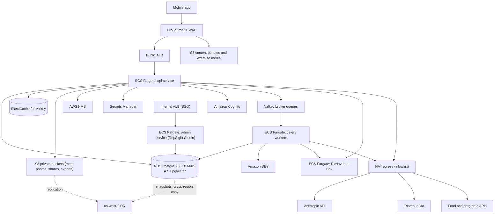

| Component | Configuration (start values; estimates to confirm at M1 with the AWS pricing calculator) |
|---|---|
| VPC | 3 AZs; public subnets (ALB, NAT), private app subnets, isolated data subnets; VPC endpoints for S3, KMS, Secrets Manager, ECR, CloudWatch Logs |
| ECS Fargate `api` | 2–20 tasks, 1 vCPU / 2 GB each; Uvicorn workers = 2 per task; ARM64 (Graviton) |
| ECS Fargate `worker` | Separate services per queue group (§11.5): 1–10 tasks each |
| ECS Fargate `admin` (RepSight Studio and admin API) | 1–2 tasks, internal only |
| ECS Fargate `rxnav` | RxNav-in-a-Box container(s), internal only; 1–2 tasks sized per its documentation |
| RDS PostgreSQL 18 | Multi-AZ, gp3 storage, PITR 35 days (canon §10.3), Performance Insights, `pgvector` 0.8.7 |
| ElastiCache for Valkey | Cluster mode off at 10k MAU (1 primary + 1 replica); cluster mode on at 100k MAU |
| S3 | Buckets per region and purpose: `content`, `media`, `meal-photos`, `shares`, `exports`, `logs`; versioning on `content` |
| CloudFront | Content bundles and exercise media; signed URLs for shares viewer assets |
| Egress | NAT gateway per AZ; outbound security-group allowlist to vendor domains via an egress proxy (decided in ADR-024) |

### 11.3 Autoscaling and connection pooling

| Service | Scale on | Min / max | Notes |
|---|---|---|---|
| `api` | Target CPU 55% and ALB requests per target; separate step policy on open SSE connections (>150 per task) | 2 / 20 | SSE turns are long-lived (up to 45 s); scale-in protection waits for in-flight streams (deregistration delay 60 s) |
| `worker-default` | Queue depth (custom CloudWatch metric from Valkey) | 1 / 10 | |
| `worker-llm` | Queue depth + Anthropic rate-limit headroom | 1 / 10 | §11.7 |
| RDS | Vertical (instance class), read replica added when CPU >60% sustained | — | Read replica for analytics views and Studio only |

**Pooling.** SQLAlchemy async engine per process: `pool_size=10`, `max_overflow=5`, `pool_pre_ping=True`, `pool_recycle=1800`. Rule: `(api tasks × 2 workers × 15) + (worker tasks × concurrency) + 20 admin` must stay below 80% of RDS `max_connections`; CI checks the Terraform values. If the limit is reached before 100k MAU, add PgBouncer in transaction mode (ADR-024 records the trigger). Long LLM calls never hold a DB connection: the orchestrator releases the session before calling Anthropic.

### 11.4 Valkey caching and keys

| Key pattern | Content | TTL | Invalidation |
|---|---|---|---|
| `jwks:{pool_id}` | Cognito JWKS | 1 h | Time |
| `revoked_sub:{sub}` | Deleted or signed-out-everywhere users | 2 h (longer than token life) | Time |
| `rl:{class}:{user_or_ip}` | Rate-limit windows | Window length | Time |
| `quota:{user_id}:{yyyymm}:{kind}` | Quota counters | 40 days | Month end + DB mirror |
| `idem:{user_id}:{key}` | Idempotency responses | 24 h | Time |
| `cs:{user_id}` | Current constraint set (plaintext effects only) | 1 h | On any constraint input change |
| `kbidx:{release}:{market}:{locale}` | KB index text for system block A | Until next release | Release publish |
| `rxsearch:{sha256(q)}` | RxNav search results (no user ID) | 24 h | Time |
| `food:{food_ref}` and `foodq:{sha256(q, locale)}` | Food lookups | 7 days (Open Food Facts cached per its terms) | Time |
| `heat:{lat1}:{lon1}:{hour}` | Heat-index result for a rounded cell | 1 h | Time |
| `cb:{route}` | LLM circuit-breaker state | 60 s | Time |
| `sem:llm:{route}` | Concurrency semaphore for Anthropic calls | Per call | Release on completion |
| `manifest:{cohort}` | Signed content manifest per rollout cohort | 5 min | Publish |

No decrypted `_enc` field is ever cached in Valkey.

### 11.5 Celery queues

Celery 5.6.3 with Valkey as broker (redis-py 8.1.0); results backend off except for exports. All tasks are idempotent and carry `request_id`.

| Queue | Tasks | Concurrency per task | Priority |
|---|---|---|---|
| `llm` | Debriefs, weekly narration, monthly benchmark summaries | 8 (I/O bound) | Normal |
| `meal` | Meal-scan retries, image deletion | 8 | High |
| `notify` | Push and email sends, quiet-hours scheduling, lifecycle prompts (F-081) | 16 | Normal |
| `sync-post` | Post-sync jobs: quality-volume ledger, benchmark extraction, plan progression, dose-cycle suggestions | 8 | Normal |
| `deletion` | Account and item deletion, crypto-shredding | 2 | High |
| `export` | Export ZIP builds | 2 | Low |
| `content` | KB chunk embedding on publish, label watch, review-due tickets | 2 | Low |
| `retention` | Retention jobs (§9.6), partitions | 1 | Low |
| `billing` | RevenueCat event processing | 4 | High |

Beat schedule lives in code (`app/jobs/schedule.py`) with one beat process (ECS service with exactly 1 task).

### 11.6 CDN for exercise media and content

Exercise demo videos (made by us, no user data), images, signed content bundles and the methodology page are served from S3 through CloudFront. Bundles use content-addressed paths (`/bundles/{kind}/{version}/{sha256}.json`) with `Cache-Control: public, max-age=31536000, immutable`; only the signed manifest (`/v1/content/manifest`) is dynamic. Exercise videos use HLS with 2–3 renditions; the app pre-downloads media for the current program week on Wi-Fi.

### 11.7 LLM throughput and rate limits

| Topic | Rule |
|---|---|
| Limits | Anthropic organisation rate limits (requests and tokens per minute, per model) are read from response headers and stored as metrics; the ops console shows headroom |
| Concurrency | A Valkey semaphore per route caps in-flight calls (start: `chat` 200, others 50), set below the org limit |
| 429 handling | SDK retries twice with backoff and `retry-after`; then the route's circuit breaker opens for 60 s and the app gets the "coach is busy" response (§7.13) |
| Priority | Interactive `chat` and `classifier` have reserved semaphore slots; background routes (`debrief`, `narration`) back off first |
| Capacity planning | Peak estimate at 100k MAU: ≈565,000 chat turns/month (§6.3: 9,000 active payers and 91,000 free MAU), with 15% of daily turns in the busiest hour → ≈2,800 chat turns/hour peak (≈0.8 turns/s), plus about 1.2 classifier calls per turn (assumption-based; measure in Beta). Request a rate-limit increase from Anthropic at M4 and at 50k MAU. |
| No batch path | Batch API is not used for user data (canon §0.7); only eval runs may use it |

### 11.8 Capacity and monthly cost

Canon §16.2 (infrastructure + AI + tools; people and marketing excluded; estimates):

| Line | 10k MAU | 100k MAU |
|---|---|---|
| Paying subscribers / active payers / free MAU | 1,200 / 900 / 9,100 | 12,000 / 9,000 / 91,000 |
| Infrastructure (AWS) | $1,300 | $4,200 |
| AI, Opus 5.5 on all routes | $3,444 | $34,442 |
| Tools | $1,700 | $5,100 |
| **Total run-rate** | **$6,444** | **$43,742** |
| AI as % of net revenue (KPI-15) | 30% | 30% |
| AI if D-02 moved every route to Sonnet 5.5 / Haiku 5.5 | $1,758 / $86 | $17,579 / $864 |
| Infrastructure per paying subscriber-month | $1.08 | $0.35 |

**Sizing that fits these budgets** (estimates; confirm at M1 and in the Beta load test):

| Item | 10k MAU | 100k MAU |
|---|---|---|
| API tasks (steady / peak) | 2 / 4 | 4 / 12 |
| Worker tasks (all queues) | 3 | 8 |
| RDS | 2 vCPU class, Multi-AZ, 100 GB gp3 | 4–8 vCPU class, Multi-AZ, 1 TB gp3 + 1 read replica |
| Valkey | Small node + replica | Medium nodes, cluster mode |
| Peak API load to test (§6.3 design capacity) | 75 requests/s; 20 concurrent SSE streams | 300 requests/s; 100 concurrent SSE streams |
| Sync volume | ~0.5 GB/month of metrics | ~5 GB/month of metrics |

### 11.9 Disaster recovery

| Item | Target / control |
|---|---|
| RPO | ≤15 min in-region (Multi-AZ + PITR); 24 h cross-region (canon §10.3) |
| RTO | 4 h |
| Backups | RDS automated backups + PITR 35 days; nightly snapshot copy to us-west-2; S3 cross-region replication for `content`, `shares`, `exports` (not `meal-photos`, which are transient) |
| KMS | Multi-region keys for `kms-storage` and data domains, so replicas can be decrypted in us-west-2 |
| Valkey | Not backed up across regions; quota counters rebuild from Postgres mirror |
| Runbook | `docs/runbooks/dr-us-west-2.md`: Terraform apply of the DR stack, restore latest snapshot, switch Route 53 records, rotate secrets |
| Test | DR restore drill before M4 and every 6 months; measured RTO recorded |
| App behaviour | During an outage the app runs in D2 (§7.13): on-device coaching, logging and bundled safety templates keep working |

### 11.10 Terraform layout and the India "region-ready" design

```text
infra/
  modules/
    network/        ecs-service/   rds-postgres/   valkey/
    s3-buckets/     kms/           cognito/        waf-cloudfront/
    observability/  ses/           rxnav/          github-oidc/
  cells/
    us-east-1/      # prod cell (V1.0)
    us-west-2-dr/   # DR stack (cold)
    ap-south-1/     # India cell, plan-only until triggered
    eu-central-1/   # V2
  envs/
    dev/  staging/  prod/          # compose cells + account-level resources
  global/
    route53/  iam/  log-archive/  research-account/
```

Terraform state in S3 with locking, one state per env × cell. GitHub Actions uses OIDC to assume deploy roles (no static keys). Every module takes `region` and `cell_id`; nothing is hard-coded to us-east-1.

**India region-ready design.** From day 1: `home_region` on every user-scoped row; per-region S3 buckets and KMS keys; a per-region Cognito user pool; the API routes a user to their cell by `home_region` in the token (custom claim); content bundles are global. India users (V1.3) are served from us-east-1 with `home_region='in'` and a DPDP transfer notice. The **ap-south-1 cell is deployed** when any trigger fires (canon §10.3): (1) a partner contract requires India storage; (2) a MeitY transfer restriction affects us; (3) India MAU >50,000. Migration plan when triggered: deploy the cell from the existing module, copy India users' rows (filter `home_region='in'`) with their wrapped keys re-wrapped under ap-south-1 KMS keys, switch the cell routing, verify, then delete the us-east-1 copies. LLM inference stays outside India in every case. Estimated effort: 3–4 engineer-weeks (assumption).

## 12. Internal Tools, Observability, Testing, CI/CD & Environments

### 12.1 Internal admin web app: "RepSight Studio" (F-110, F-111, F-115)

**Decision (ADR-015): content-as-code in the repo with a reviewed publish pipeline, plus a small internal web UI behind SSO.**

| Option considered | Verdict | Reason |
|---|---|---|
| Headless CMS (SaaS) | Rejected | Adds a data processor; clinical sign-off and signing would live outside our audit trail; safety configuration must not live in a third-party tool (canon §10.4) |
| Full React admin SPA | Rejected for V1 | A second front-end toolchain for a 3-person team |
| **Content-as-code + FastAPI server-rendered UI (Jinja2 templates + HTMX), same codebase and Python 3.14.8** | **Chosen** | One language and one deploy; Git history is the version history; pull requests give review; the UI exists so clinicians never need Git |

| Part | How it works |
|---|---|
| Source of truth | `content/` in the monorepo: `kb/` (Markdown + front matter), `rules/` (YAML), `safety/` (lexicons, triggers, templates, crisis routes), `exercises/` (definition JSON, §4.5), `cues/` (cue copy and variants), `claims/banned.yaml` |
| Editing | Studio forms write changes through a GitHub App: each edit becomes a branch and pull request with a structured description. Engineers may edit files directly; the same checks apply. |
| Review | Studio shows the rendered card or rule, the diff, the linked sources and test results. A `clinician-reviewer` approves in Studio; Studio records the approval (name, role, time) as a signed commit to the item's front matter and as a GitHub review. Two-person rule enforced by a required CI check. |
| Checks (CI) | Schema validation, rule fixtures, never-rule tests, banned-claims linter, link checker for sources, golden-video harness for exercise definitions (F-112), safety eval for KB/rules/templates/prompt changes (§12.4) |
| Publish | `admin` presses Publish in Studio → GitHub Actions `publish-content` workflow builds the release (manifest + bundles), signs it with the KMS signing key, uploads to S3/CloudFront, registers it in `content_releases`, loads cards and rules into Postgres, embeds KB chunks (`content` queue). A clinician co-signs medication releases. |
| Staged rollout (F-111) | Exercise definitions and cue copy roll out 5% → 25% → 100% using the bucket rule, stage length (≥72 h and ≥500 sets) and guard metrics of §4.5.4; a guard breach halts the rollout automatically; rollback publishes the previous content as a new, higher bundle version (§4.5.4) |
| Ops console (F-115) | Pages: AI cost per user/route/tier/day; quota and cost-breaker status; safety-event queue with pseudonymised context and review outcome; weekly production sample review; label-change tickets and `review_due` list; eval runs; support lookup (no health values; email reveal audited) |
| Access | Internal ALB, Cognito admin pool federated with Google Workspace, MFA, roles from §8.3, plus a network access layer (VPN or AWS Verified Access, chosen in ADR-015) |
| Pins | Jinja2 and HTMX versions pinned at M1 in ADR-015; HTMX served from our own static files (no third-party CDN) |

### 12.2 Logging, metrics, tracing and alerting

**Structured logging.** JSON logs (one event per line) to CloudWatch Logs via stdout. Required fields: `ts`, `level`, `service`, `env`, `region`, `request_id`, `trace_id`, `pseudo_id` (never `user_id`, email or name), `route`, `event`, `duration_ms`. A scrubbing processor removes or hashes known sensitive keys (`text`, `message`, `content`, `email`, `name`, `medicine`, `rxcui`, `display_name`, `value_enc`, `image`, `token`) and truncates strings over 200 characters. Request and response bodies are never logged. Chat text never appears in logs. Log retention: 30 days for app logs, 24 months for audit-relevant streams (DC-15).

**Metrics and tracing.** OpenTelemetry SDK in the API and workers (FastAPI, SQLAlchemy, Celery, redis-py and HTTP client instrumentation) exporting to CloudWatch via the AWS Distro for OpenTelemetry collector sidecar. Span attributes never contain user content. Custom metrics:

| Metric | Source |
|---|---|
| `coach.turn.latency_ms` (first token, full), by route and mode | Orchestrator |
| `llm.tokens.{input,cache_read,cache_write,output}` and `llm.cost_usd` by route, model, tier | `llm_calls` |
| `llm.cache_hit_ratio` by route | `llm_calls` |
| `llm.stop_reason` counts (incl. `refusal`, `max_tokens`) | Claude client |
| `safety.events` by stage, tier, never-rule | Safety layer |
| `quota.exhausted` by tier | Quota limiter |
| `sync.payload.rejected` by code | Sync endpoint |
| `content.release.active` by kind and version | Manifest service |
| App: crash-free sessions (Sentry), FPS, cue latency, assessed-rep rate (from session payloads, §4.10) | Sentry, sync |

**SLOs** (measured monthly; error budget policy: a breached SLO freezes non-fix releases for that service):

| SLO | Target |
|---|---|
| API availability (non-5xx on authenticated routes) | 99.9% |
| Session sync success (accepted / attempted, excluding validation rejects) | 99.9% |
| Coach request → first reply-text token p95 (PERF-25; the Claude call alone has a 2.5 s first-token budget, §7.3 step 7) | ≤6.0 s |
| Coach full turn p95 (stream mode) | ≤20 s |
| Safety template delivery when a red flag is detected | 100% (every miss is a SEV2) |
| Meal scan p95 | ≤12 s |
| Crash-free sessions | ≥99.5% at Beta exit, ≥99.7% at V1.0+90 d (KPI-22) |

**Alerts** (PagerDuty-style rota via the on-call tool chosen at M4; Slack for warnings):

| Alert | Condition | Severity |
|---|---|---|
| Safety pipeline error | Any exception in input guard, template renderer or output guard | Page |
| Never-rule hit in production | Any `safety_events.never_rule` from the output guard | Page (SEV2 review) |
| Anthropic error rate | >5% 5xx/429 for 5 min on `chat` | Page |
| Cost spike | Daily LLM spend >150% of 7-day average | Page |
| `max_tokens` stops | >0.5% of a route's calls in 1 h | Warn |
| Cache hit ratio | `chat` <60% for 1 h | Warn |
| Sync rejects | >2% for 15 min | Warn |
| Retention job failure | Any failure of meal-photo or deletion jobs | Page |
| Partitions | <2 future partitions | Warn |
| Content signature failure on devices | Any report from the app | Page |

### 12.3 Testing pyramid

| Layer | Tooling | Scope | Gate |
|---|---|---|---|
| Unit (backend) | pytest, Hypothesis | Constraint engine, rule fixtures, never-rules, quota logic, encryption, validators | 100% of rules and never-rules covered; line coverage ≥85% on `app.constraints`, `app.safety`, `app.planner` |
| Unit (mobile) | Jest with TypeScript ~6.0.3 | Rep state machine, cue scheduler, payload builder, unit conversion | Coverage ≥80% on `src/cv/` and `src/sync/` |
| Contract | Schemathesis against `api/openapi.yaml`; generated TS client compile check | Every endpoint, status code and schema | No undocumented responses |
| Integration | pytest with Testcontainers (Postgres 18 + pgvector, Valkey, RxNav-in-a-Box image, LocalStack) | API + DB + workers; deletion and export flows; row-ownership test for every member endpoint | All pass |
| LLM contract | Recorded Anthropic responses (fixtures) for each route; schema-valid output; refusal and `max_tokens` paths | Claude client and orchestrator | All pass; no live calls in unit CI |
| LLM safety eval | §7.12 suite | Prompt, model, route config, KB, rules, lexicons, templates | KPI-07 = 0 failures; KPI-08 ≥0.98; KPI-09 100% |
| Mobile end-to-end | Maestro flows on iOS simulator and Android emulator; nightly on the cloud device farm | Onboarding, consent, age gate, camera session with injected test video (§4), sync, chat with mocked LLM, paywall sandbox, deletion | Critical flows green |
| CV regression | Golden-video harness (F-112, §4 and `05-build-playbook.md` §7) | Exercise definitions and pipeline changes | No regression in KPI-01/KPI-02 metrics on golden sets |
| Performance | Device-lab FPS/latency/thermal jobs (§6); Locust load tests on staging (ADR-032) | KPI-03, KPI-04; §11.8 load targets | Targets met |
| Security | §10.13 | — | No high findings open at release |
| Accessibility | Automated checks + manual WCAG 2.2 AA audit before M4 | Every screen | No AA blockers |

### 12.4 Quality checks on every pull request

| Check | Fails the build when |
|---|---|
| Lint and types | Ruff, mypy (strict on `app/`), ESLint, `tsc --noEmit` |
| Banned-claims linter (F-114) | Any app string, store text, notification template or KB card matches `content/claims/banned.yaml` (canon §2.4) |
| Model-ID linter | Any model ID other than `claude-opus-5-5`, `claude-sonnet-5-5`, `claude-haiku-5-5` appears in code or docs (canon §0.3) |
| Forbidden APIs linter | Code references the Anthropic Batch or Files API outside `evals/`, a `fallbacks` parameter, or `inference_geo` other than `global`/`us` |
| SDK allowlist | A new mobile dependency is not on the allowlist (no ad/attribution SDKs) |
| OpenAPI diff | Breaking change on `/v1` |
| Migrations | §9.7 tests fail |
| Content checks | §12.1 |
| Safety eval | Path filter hits `app/llm/`, `app/safety/`, `app/coach/`, `content/kb/`, `content/rules/`, `content/safety/`, `config/llm_routes*` |

### 12.5 CI/CD

| Pipeline | Steps |
|---|---|
| Backend (GitHub Actions) | Build ARM64 image → tests (§12.3) → push to ECR (immutable tags = git SHA) → deploy to dev → on release tag: deploy to staging → smoke + Locust load test + ZAP → manual approval → prod: run migration task (`rs_migrator`) → ECS rolling deploy with circuit breaker and automatic rollback on failed health checks |
| Mobile | EAS Build for iOS and Android with profiles `development`, `preview`, `production`; `npx expo prebuild --clean` after native changes (canon §10.1); EAS Submit to TestFlight and Play internal/closed testing; production submission is manual |
| Content | `publish-content` workflow (§12.1); independent of app releases |
| Infra | Terraform plan on PR (comment), apply on merge per env with manual approval for prod |

**OTA update policy (EAS Update).** Allowed: JS-only fixes, copy changes that passed the banned-claims linter, UI fixes. Not allowed: anything that changes native code, permissions, data collection, consent text meaning, safety templates' logic, or the camera pipeline thresholds outside signed content bundles. OTA updates are signed (EAS code signing), use a runtime version tied to the native build, roll out 10% → 100% over 24 h, and each one is logged in the release notes. Store review guidelines on executable code are respected: OTA never adds features.

**Feature flags and remote config.**

| Kind | Tool | Examples |
|---|---|---|
| UI experiments | PostHog flags | Onboarding copy order, paywall layout (with RevenueCat Offerings) |
| Safety and product configuration | Our signed remote config (`/v1/config`, `/v1/content/manifest`) | Market policy (F-103), med class flags, kill switches (`coach.enabled`, `meal_scan.enabled`, `if6.enabled`), min app version, exercise definitions, cue copy |
| Paywalls | RevenueCat Offerings | Prices per storefront, trial experiments |

Signed config: JSON payload signed with the KMS asymmetric key (ECDSA P-256; ADR-025); the app ships the public keys and rejects unsigned or older-version payloads; on failure it keeps the last good config (D3 in §7.13).

### 12.6 Release process and store submission checklist

| Step | Owner | Done when |
|---|---|---|
| 1. Release branch cut, version bumped | Tech lead | Tag created |
| 2. All CI gates green incl. safety eval on the exact prompt/model/KB/rule tuple | CI | Eval run ID recorded in release notes |
| 3. Device-lab run on all 9 reference phones (§3, canon §3.4) | QA | KPI-03/KPI-04 met per tier |
| 4. Golden-video regression | ML/CV engineer | No regressions |
| 5. Clinical sign-off for any KB, rule, template or prompt change | Clinical lead | Recorded in Studio |
| 6. Privacy review: data flows unchanged or DPIA/labels updated | CEO + counsel | Checklist signed |
| 7. Store metadata: claims register check, banned-claims linter on store text | CEO | No banned claims |
| 8. Apple: privacy nutrition labels and privacy manifest, usage strings (camera, microphone, HealthKit, location), reviewer notes with demo account and explanation of on-device processing, organisation account, 18+ rating, AI-processing consent screen before first chat | CEO + engineer | Submitted |
| 9. Google: Health apps declaration, Data safety form (declares ephemeral processing), Health Connect declaration, web deletion URL, in-chat AI report button, target API 36, health-app disclaimer in description | CEO + engineer | Submitted |
| 10. Staged rollout (iOS phased release; Play staged 10% → 50% → 100%) | Tech lead | Crash-free ≥ target for 48 h before each step |
| 11. Post-release monitoring 72 h | On-call | No SEV1/SEV2 |

## 13. Analytics Event Taxonomy

### 13.1 Rules

| Rule | Detail |
|---|---|
| Naming | `object_action` in snake_case, past tense (`session_completed`). Properties in snake_case. No PII in names or values. |
| Identity | `distinct_id` = `pseudo_id`. No email, name, device advertising ID or IP storage (PostHog IP capture off). |
| Consent | Client events only when CON-11 allows (US/UK opt-out, India/EU opt-in). Server-side events follow the same consent flag. |
| No autocapture | Autocapture, session replay, heatmaps and surveys off (canon §10.4). Only events in the allowlist below can be sent; the client wrapper drops others and CI checks the allowlist file `analytics/events.yaml`. |
| No health values | No medicine names, classes, RxCUIs, symptoms, check-in values, weights, kcal, chat text, food names or ERR codes tied to body descriptions. Health-related events carry only counts, booleans and buckets. |
| No free text | Every property is an enum, number, boolean or ID from our own namespace. |
| Retention | 13 months (DC-14). |
| KPI sources | Safety, accuracy and cost KPIs come from our database (`llm_calls`, `safety_events`, session payloads), not from PostHog. |

### 13.2 Core events

| Event | Trigger | Properties | Data class | Consent | KPI fed |
|---|---|---|---|---|---|
| `app_installed_first_open` | First launch | `platform`, `app_version`, `market`, `install_source_bucket` (organic/store_ads/creator/partner/unknown) | DC-14 | CON-11 | KPI-10, KPI-12 |
| `onboarding_step_completed` | Each onboarding step | `step` (enum), `step_index` | DC-14 | CON-11 | KPI-10 |
| `age_gate_completed` | Age gate | `result` (passed only; blocked attempts use the anonymous counter). Queued on the device and sent only after the consent center records the CON-11 state; dropped if analytics is declined, or not granted in an opt-in market | DC-14 | CON-11 | — |
| `consent_changed` | Consent toggle | `consent_id`, `status` | DC-14 | CON-11 (CON-11 itself recorded server-side only) | — |
| `paywall_viewed` | Paywall shown | `placement` (onboarding/day4_7/feature_gate), `offering_id` | DC-14 | CON-11 | KPI-10 |
| `trial_started` | RevenueCat trial start (server) | `plan` (annual/monthly), `tier` | DC-13 | CON-11 | KPI-10, KPI-11 |
| `subscription_started` | First paid period (server) | `plan`, `tier`, `storefront` | DC-13 | CON-11 | KPI-11, KPI-12 |
| `subscription_renewed` | Renewal (server) | `plan`, `tier`, `period_index` | DC-13 | CON-11 | KPI-14 |
| `subscription_refunded` | Refund (server) | `plan`, `tier` | DC-13 | CON-11 | KPI-13 |
| `camera_session_started` | Camera session start | `ex_count`, `device_tier`, `pose_model` | DC-14 | CON-11 | KPI-06 |
| `camera_session_completed` | Session ends with ≥1 counted set | `sets_bucket`, `duration_bucket`, `assessed_rep_rate_bucket` | DC-14 | CON-11 | KPI-06, KPI-18 |
| `setup_coach_completed` | Setup Coach passes | `ex_id`, `attempts_bucket`, `view` | DC-14 | CON-11 | KPI-06 |
| `autoreg_prompt_answered` | Stop-set prompt answered | `response` (accepted/continued/overridden), `reason` (velocity_loss/form_drift/rom_drop) | DC-14 | CON-11 | KPI-20 |
| `form_not_assessed_shown` | Re-position prompt shown | `reason` (low_visibility/wrong_view/tracking_lost) | DC-14 | CON-11 | KPI-05 |
| `benchmark_completed` | Monthly benchmark done | `kind` | DC-14 | CON-11 | KPI-19 |
| `program_enrolled` | Enrolment | `program_code` | DC-14 | CON-11 | KPI-19 |
| `plan_proposal_decided` | Confirm/decline | `origin`, `decision`, `has_why_card` (bool) | DC-14 | CON-11 | KPI-25 |
| `coach_thread_started` | New thread | — | DC-14 | CON-11 | — |
| `coach_turn_completed` | Turn committed | `mode` (stream/hold), `cards_shown_count`, `had_proposal` (bool), `quota_bucket` | DC-14 | CON-11 | KPI-15, KPI-16 |
| `coach_message_reported` | In-chat report | `reason` (enum) | DC-14 | CON-11 | — |
| `safety_template_shown` | Any safety template rendered | `tier` (no trigger codes), `surface` (chat/checkin/session) | DC-14 | CON-11 | Ops only (KPI-08 is from DB) |
| `meal_scan_completed` | Scan parsed | `confirmed` (bool), `items_bucket` | DC-14 | CON-11 | KPI-16 |
| `food_logged` | Food entry saved | `source` (search/barcode/manual/meal_scan) | DC-14 | CON-11 | — |
| `medicine_list_updated` | Add/remove medicine | `action` (add/remove), `covered` (bool) — never the medicine or class | DC-14 | CON-11 | — |
| `quota_exhausted` | Quota hit | `kind` (coach/scan), `tier` | DC-14 | CON-11 | KPI-15 |
| `report_shared` | Clinician report created (V1.2) | `format` (pdf/link) | DC-14 | CON-11 | KPI-26 |
| `clip_shared` | Clip shared (V1.2) | `retention_bucket` | DC-14 | CON-11 | — |
| `discomfort_session_modified` | Modified session completed within 7 days after a discomfort log (V1.4) | — | DC-14 | CON-11 | KPI-27 |
| `cue_variant_outcome` | IF-7 bandit outcome (V1.4) | `variant_id`, `corrected_within_3` (bool) | DC-14 | CON-11 | KPI-28 |
| `notification_opened` | Push opened | `template_key` | DC-14 | CON-11 | KPI-21 |
| `account_deletion_requested` | Deletion requested | `channel` | DC-14 | CON-11 | — |
| `app_session_started` | App foreground | — | DC-14 | CON-11 | KPI-21 |

Bucket properties use fixed ranges (for example `assessed_rep_rate_bucket`: `<70`, `70-84`, `85-89`, `90-94`, `95+`).

## 14. Appendices

### Appendix A. Configuration and environment variables

All variables are read with pydantic-settings 2.16.0 (backend) or `app.config.ts` (mobile, build-time public values only). Secrets come from AWS Secrets Manager in deployed environments.

| Name | Purpose | Example | Used in |
|---|---|---|---|
| `ENV` | Environment name | `staging` | All |
| `CELL_ID` / `AWS_REGION` | Region cell | `us-east-1` | All |
| `API_BASE_URL` | Public API base URL | `https://<api-host>/v1` | Mobile, emails |
| `DATABASE_URL` | Postgres DSN (asyncpg) | `postgresql+asyncpg://rs_app@…/repsight` | API, workers |
| `DB_POOL_SIZE` / `DB_MAX_OVERFLOW` | Pool sizing (§11.3) | `10` / `5` | API, workers |
| `VALKEY_URL` | Cache and broker | `rediss://…:6379/0` | API, workers |
| `CELERY_BROKER_URL` | Broker URL (Valkey) | `rediss://…:6379/1` | Workers |
| `KMS_KEY_HEALTH_ARN` / `KMS_KEY_CHAT_ARN` / `KMS_KEY_PII_ARN` | Envelope encryption keys | `arn:aws:kms:…` | API, workers |
| `KMS_SIGNING_KEY_ARN` | Content and config signing | `arn:aws:kms:…` | Publish workflow |
| `CONTENT_PUBLIC_KEYS` | Accepted verification keys (JSON) | `[{"kid":"2027a","pem":"…"}]` | API, mobile build |
| `COGNITO_USER_POOL_ID` / `COGNITO_APP_CLIENT_ID` | Member auth | `us-east-1_xxxx` | API, mobile |
| `COGNITO_ADMIN_POOL_ID` | Admin auth | `us-east-1_yyyy` | Studio |
| `ANTHROPIC_API_KEY` | Anthropic key (per env and route group) | secret | API, workers |
| `ANTHROPIC_INFERENCE_GEO` | `global` or `us` | `global` | Claude client |
| `LLM_ROUTE_CONFIG_PATH` | Signed route config (model, effort, max_tokens per route × market × tier) | `config/llm_routes.prod.yaml` | Claude client |
| `LLM_MODE` | `live`, `mock` (fixtures) | `mock` | Local, CI |
| `LLM_MAX_TOOL_ROUNDS` | Tool round trips per turn | `6` | Orchestrator |
| `LLM_SEMAPHORE_CHAT` / `LLM_SEMAPHORE_BACKGROUND` | Concurrency caps (§11.7) | `200` / `50` | Claude client |
| `COACH_MAX_MESSAGE_CHARS` | Message length limit | `2000` | API |
| `COACH_MAX_MESSAGES_PER_HOUR` | Abuse limit | `30` | API |
| `COST_BREAKER_USER_MULTIPLIER` | Per-user daily cost breaker | `5` | Quota limiter |
| `KB_TOP_K` / `KB_MIN_SIMILARITY` | Retrieval tuning | `6` / `0.30` | Retrieval |
| `EMBEDDING_MODEL_PATH` | ONNX embedding model (ADR-007) | `/models/embed.onnx` | API, workers |
| `RXNAV_BASE_URL` | Self-hosted RxNav-in-a-Box | `http://rxnav.internal:4000` | API |
| `OPENFDA_API_KEY` | openFDA key | secret | Label watch |
| `USDA_FDC_API_KEY` | USDA FDC key | secret | Food search |
| `FOOD_PROVIDER` | `fatsecret` or `edamam` (D-10) | `fatsecret` | Food search |
| `FATSECRET_CLIENT_ID` / `FATSECRET_CLIENT_SECRET` | fatsecret credentials | secret | Food search |
| `OFF_USER_AGENT` | Custom User-Agent for Open Food Facts | `RepSight/1.0 (contact)` | Barcode lookup |
| `WEATHERKIT_KEY_ID` / `WEATHERKIT_TEAM_ID` / `WEATHERKIT_PRIVATE_KEY` | Apple WeatherKit REST | secret | Heat alerts |
| `REVENUECAT_WEBHOOK_AUTH` | Webhook header value | secret | Webhook |
| `REVENUECAT_API_KEY` | Server API key | secret | Entitlement sync |
| `REVENUECAT_PUBLIC_SDK_KEY_IOS` / `_ANDROID` | Public SDK keys | `appl_…` | Mobile |
| `EXPO_ACCESS_TOKEN` | Push sending | secret | Notify workers |
| `SES_FROM_ADDRESS` | Transactional email sender | `no-reply@<domain>` | Notify workers |
| `POSTHOG_API_KEY` / `POSTHOG_HOST` | Analytics (US cloud) | `phc_…` | Mobile, API |
| `SENTRY_DSN` | Crash reporting | `https://…` | Mobile, API |
| `OTEL_EXPORTER_OTLP_ENDPOINT` | Trace collector | `http://localhost:4317` | API, workers |
| `S3_BUCKET_MEAL_PHOTOS` / `S3_BUCKET_SHARES` / `S3_BUCKET_EXPORTS` / `S3_BUCKET_CONTENT` | Buckets per cell | `rs-prod-use1-meal-photos` | API, workers |
| `MEAL_PHOTO_MAX_AGE_HOURS` | Retry window before forced delete | `24` | Retention |
| `SHARE_DEFAULT_RETENTION_DAYS` / `SHARE_MAX_RETENTION_DAYS` | Clip retention | `30` / `365` | Sharing |
| `CHAT_RETENTION_MONTHS` | Chat retention | `18` | Retention |
| `DELETION_SLA_DAYS` | Account deletion deadline | `30` | Deletion |
| `MIN_APP_VERSION` | Oldest supported app | `1.0.0` | `/v1/config` |
| `GITHUB_APP_ID` / `GITHUB_APP_PRIVATE_KEY` | Studio pull-request bot | secret | Studio |

### Appendix B. Error codes

All errors are RFC 9457 problem details with `type: /problems/<code>` and the `code` field below.

| HTTP | `code` | Meaning | Client action |
|---|---|---|---|
| 400 | `validation_failed` | Body or query failed schema validation (`errors[]` with field paths) | Fix request |
| 400 | `unit_invalid` | Non-SI unit or out-of-range value | Fix request |
| 401 | `token_missing` / `token_invalid` / `token_expired` | Auth problem | Refresh or sign in |
| 401 | `account_revoked` | User deleted or signed out everywhere | Sign in again |
| 403 | `consent_required` | A required consent is missing (`consent_id` in body) | Show consent screen |
| 403 | `age_gate_blocked` | Under-18 date of birth reached bootstrap (server re-check; the Cognito user is deleted) | Show resources |
| 403 | `coach_locked` | Coach locked (minor signal, abuse) | Show `TPL-MINOR-01` or support |
| 403 | `tier_required` | Feature needs a higher tier | Show paywall |
| 403 | `market_restricted` | Disabled by regional policy (F-103) | Hide feature |
| 403 | `forbidden_role` | Admin role missing | — |
| 404 | `not_found` | Resource missing or not owned | — |
| 409 | `idempotency_key_reused` | Same key, different body | New key |
| 409 | `turn_in_progress` | Another coach turn running in the thread | Wait |
| 409 | `proposal_not_pending` / `proposal_stale` | Proposal already decided or outdated | Refresh proposals |
| 409 | `gate_open` | Feature paused by an open safety gate | Show gate template |
| 412 | `precondition_failed` | ETag mismatch | Refetch and retry |
| 413 | `payload_too_large` | Body over the limit | Split sync batch |
| 415 | `unsupported_media_type` | Image type not JPEG/HEIC/PNG | Convert |
| 422 | `exercise_definition_version_unknown` | Sync references an unknown definition version | Update content bundle |
| 422 | `proposal_invalid` | Proposal violates constraints (`violations[]` with `rule_id`) | Show reasons |
| 422 | `meal_not_food` | Meal photo shows no food | Retake |
| 426 | `app_version_unsupported` | Below `min_app_version` | Update app |
| 429 | `rate_limited` | Rate limit (`Retry-After`) | Back off |
| 429 | `quota_exhausted` | Monthly quota used (`kind`, `resets_on`) | Show upgrade or reset date |
| 429 | `cost_breaker_open` | Per-user cost breaker | Wait 24 h |
| 502 | `upstream_error` | Vendor failure (food, RxNav, WeatherKit) | Retry later |
| 503 | `coach_unavailable` | LLM circuit breaker open (D1) | Retry later; templates still work |
| 503 | `service_unavailable` | Maintenance or failover | Use offline mode |
| 500 | `internal_error` | Unexpected error (`request_id` for support) | Retry; report |

### Appendix C. ADR index (initial ADRs to write)

ADR numbers are shared across the whole Technical Specification (Parts A and B). Status at 2026-10-17: all "Proposed" until accepted at the gate shown.

| ADR | Title | Decides | Gate |
|---|---|---|---|
| ADR-001 | Mobile stack: React Native 0.88.0, Expo SDK 58 development builds, New Architecture only | Canon §10.1 pins | M1 |
| ADR-002 | Pose model: MediaPipe Pose Landmarker primary on both platforms; Apple Vision 2D fallback | Canon §8.2 | M1 |
| ADR-003 | iOS MediaPipe packaging (D-05) | Pod 1.0.0 vs vendored xcframework | M1 (2026-12-11) |
| ADR-004 | PoseEngine as a Nitro HybridObject (Swift + Kotlin) | §4.2 | M1 |
| ADR-005 | Exercise Definition DSL as signed, versioned remote config | §4.5 | M1 |
| ADR-006 | Mobile libraries pinned at M1 (`expo-router`, `expo-sqlite` + SQLCipher, `expo-secure-store`, `expo-notifications`, `react-native-purchases`, `@sentry/react-native`, `posthog-react-native`, HealthKit and Health Connect libraries) | Canon §10.1 | M1 |
| ADR-007 | Embedding model for pgvector (open weights, Apache-2.0/MIT, onnxruntime 1.31.0) and vector dimension | §7.7.3, §9.4 | M1 |
| ADR-008 | Amazon ElastiCache for Valkey instead of Redis | Canon §0.7 | M1 |
| ADR-009 | Celery 5.6.3 with Valkey broker | §11.5 | M1 |
| ADR-010 | Claude client configuration: Opus 5.5 on all routes, effort per route, strict tools, no server-side fallbacks, eager input streaming off | §7.4 | Phase 0 |
| ADR-011 | Grounding via `kb_card_ids` + verbatim cards instead of API citations (API citations cannot combine with structured outputs) | §7.7.3 | Phase 0 |
| ADR-012 | Constraint rules as clinician-owned YAML content-as-code with signed releases | §7.8 | M1 |
| ADR-013 | Safety layer: deterministic rules + classifier; templates only for red flags | §7.9 | Phase 0 |
| ADR-014 | Chat streaming policy: sentence-guarded stream vs hold-and-check | §7.3 | M2 |
| ADR-015 | Internal tooling: content-as-code + FastAPI/Jinja2/HTMX "Studio" behind SSO; network access layer | §12.1 | M1 |
| ADR-016 | No certificate pinning at V1.0 | §10.5 | M4 |
| ADR-017 | Field-level envelope encryption and crypto-shredding; crypto library pin | §9.3 | M1 |
| ADR-018 | Monthly partitioning of `reps`, `form_events`, `audit_log` | §9.6 | M2 |
| ADR-019 | Region-ready schema and cell routing; India ap-south-1 trigger | §11.10 | M1 |
| ADR-020 | Amazon Cognito for member and admin auth (Apple, Google, email OTP) | §8.2 | M1 |
| ADR-021 | OpenAPI 3.1 as contract; generated TypeScript client | §8.1 | M1 |
| ADR-022 | PostHog allowlist-only analytics; no autocapture or replay | §13 | M2 |
| ADR-023 | OTA update policy (EAS Update) | §12.5 | M4 |
| ADR-024 | Network egress control and database connection pooling (PgBouncer trigger) | §11.2, §11.3 | M2 |
| ADR-025 | Content and config signing (KMS asymmetric ECDSA P-256; key rotation with two public keys) | §12.5 | M1 |
| ADR-026 | Research account and de-identified keypoint store (CON-08) | §10.7 | Beta |
| ADR-027 | Model routing changes per route (D-02 outcomes; one entry per change) | §7.5 | M3 and each change |
| ADR-028 | HIPAA-ready B2B tenant (separate AWS account and Anthropic organisation with BAA) | §10.9 | V2 |
| ADR-029 | MediaPipe VIDEO running mode inside the async runner; per-frame budgets by tier | §4.2, §4.11.1 | M1 |
| ADR-030 | Camera pixel format per platform (zero-copy test result) | §4.1 | M1 |
| ADR-031 | Labelling tool: self-hosted Label Studio Community, version pinned | §5.3.4 | M1 |
| ADR-032 | Backend load-test tool: Locust, version pinned | §6.4, §12.3 | M2 |
| ADR-033 | Toolchain and local-service pins: pnpm, uv and Docker image tags | 05 §4.1, §4.6 | M1 |

### Appendix D. Open technical decisions

From canon §18 (technical ones; writers use the default until the owner decides):

| ID | Decision | Default used in this spec | Deadline |
|---|---|---|---|
| D-02 | Model routing per route | Opus 5.5 on every route; evals at M3; move only if all four criteria pass | 2027-04-23 (V1.0); 2027-08-13 (India) |
| D-05 | iOS MediaPipe packaging | Pin `MediaPipeTasksVision` 1.0.0 pod; vendor the xcframework if it fails in a release build | 2026-12-11 |
| D-06 | Anthropic data terms | Apply for ZDR now; consumer org without BAA; separate HIPAA org for V2 B2B | 2026-11-27 |
| D-08 | India go/no-go | Launch only with an eval-approved cheaper model for India routes or ≥1 partner licence | 2027-08-13 |
| D-10 | Nutrition database | fatsecret Premier Free + USDA FDC + Open Food Facts; fallback Edamam | 2026-12-04 |
| D-12 | CV fallback (build vs buy) | Build PoseEngine; evaluate QuickPose only if M1 gates fail | 2026-12-11 |
| D-13 | US web checkout | Stripe Billing + RevenueCat Web at V1.2, US only, after counsel review | 2027-07-01 |
| D-15 | EU entry | V2.0, Ireland + Germany, eu-central-1 cell | 2027-12-01 |

Added by this document (owner: tech lead):

| ID | Decision | Default | Deadline |
|---|---|---|---|
| TD-01 | Embedding model and vector dimension (ADR-007) | Smallest open-weights multilingual model (English + Hindi) that meets retrieval recall on the KB eval; `vector(768)` is a placeholder | 2026-12-11 |
| TD-02 | Cognito email one-time code implementation (native passwordless vs custom auth flow) | Native passwordless if available in the chosen Cognito tier | 2026-11-27 |
| TD-03 | Admin network access layer (VPN vs AWS Verified Access) | AWS Verified Access | 2026-12-11 |
| TD-04 | Egress control (NAT + security groups vs egress proxy with domain allowlist) | Egress proxy with domain allowlist | 2027-01-15 |
| TD-05 | Hold-and-check share of turns | Start with the §7.3 triggers; adjust if measured hold share differs from ~20% or p95 latency targets are missed | 2027-04-09 (M3) |
| TD-06 | ED screener instrument | Chosen by the clinical lead | 2027-01-15 |
| TD-07 | Production-sample review size | 200 conversations/week | 2027-03-05 (M2) |
| TD-08 | Hindi lexicons for deterministic safety rules | Written with clinicians and native speakers before the Hindi eval | 2027-08-13 |
| TD-09 | SB 243-style 3-hour "not human" reminder in long chats (D-14) | Implement for all users (strictest reading) | 2027-05-14 |
| TD-10 | Rate-limit increase with Anthropic before launch | Request at M4 with the §11.7 estimate | 2027-05-14 |
