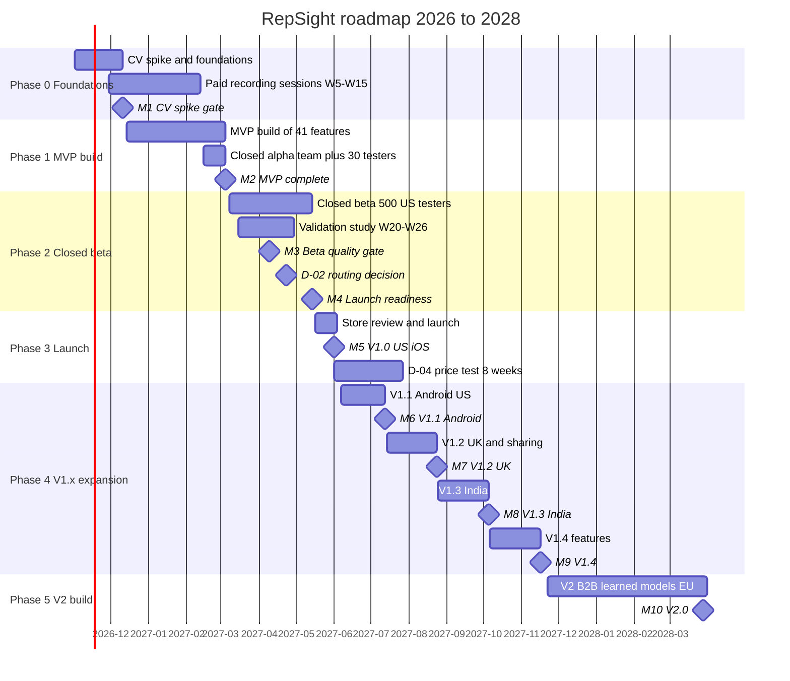
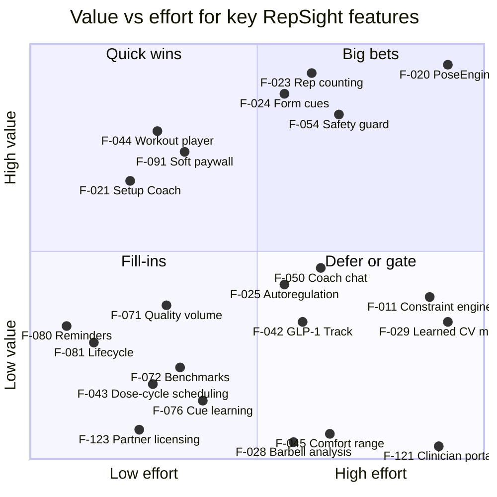
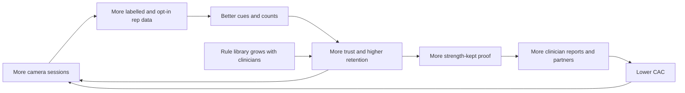
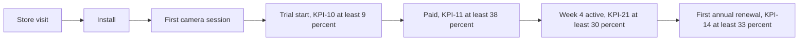
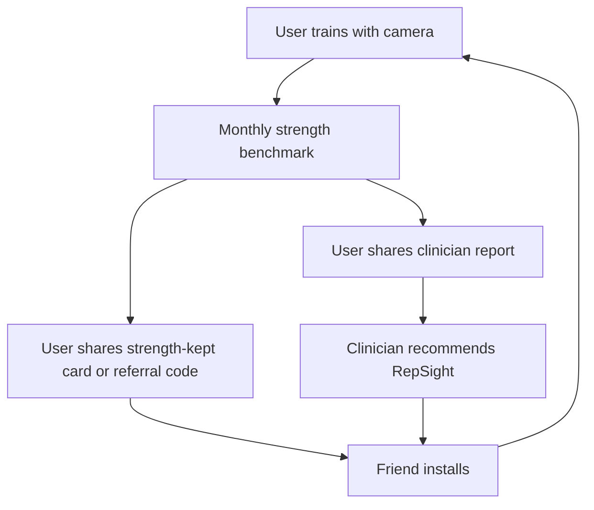

# RepSight — Product Roadmap & Strategy

| Field | Value |
|---|---|
| Document | 03 Product Roadmap & Strategy (`docs/03-product-roadmap-and-strategy.md`) |
| Version | 1.1 (consistency pass applying canon §0.8) |
| Date | 2026-10-18 |
| Status | Draft for review |
| Owner | CEO |
| Related documents | `docs/01-business-requirements-document.md` (BRD), `docs/02-technical-specification.md` (Tech Spec), `docs/04-innovative-features.md`, `docs/05-build-playbook.md`, research briefs [R1](research/R1-competitors.md), [R2](research/R2-cv-tech-stack.md), [R3](research/R3-coach-medication-safety.md), [R4](research/R4-regulatory-privacy.md), [R5](research/R5-market-business.md), [R6](research/R6-feature-novelty.md); product canon [`research/00-product-canon.md`](research/00-product-canon.md) (Product Canon, decision record v1.1, 2026-10-18; §0.8 lists decisions settled after this document was first written) |

**How to read this document.** It explains *when* we build, *why* in that order, *how* we sell, and *what it costs*. It does not repeat requirements (see BRD §7–§9) or architecture (see Tech Spec §2–§11). All IDs (F-###, IF-#, M#, KPI-##, R-##, D-##) come from the product canon; B# (strategic bets, §1.4) and X-## (experiments, §6.8) are local to this document. Figures marked **Estimate** are our own calculations; their assumptions are stated next to them.

**Terms used often.** *MAU* = monthly active users. *Payer* = a paying subscriber. *CAC* = customer acquisition cost per payer. *LTV36* = contribution per payer over 36 months. *CPI* = cost per install. *ASO* = App Store Optimization. *CPP* = Apple Custom Product Page. *RICE* = Reach × Impact × Confidence ÷ Effort. Full glossary: BRD Appendix B.

## Table of contents

1. Strategy on a Page
2. Development Phases & Roadmap
3. Feature Prioritization Matrix
4. Competitive Positioning
5. Go-to-Market Strategy
6. User Acquisition & Retention Plan
7. Business Model & Financial Plan
8. Budget Estimates
9. Risk Assessment & Mitigation
10. KPIs & Success Metrics
11. Contingency Plans
12. Governance & Decision Log

---

## 1. Strategy on a Page

### 1.1 Vision, mission, tagline

| Item | Statement |
|---|---|
| Vision | Anyone, on any medication and at any fitness level, can build and keep strength safely with a coach that sees how they move and respects their health context. |
| Mission | Turn a phone camera into a trustworthy strength coach that measures every rep, adapts each session within clinician-reviewed safety rules, and proves progress the user can share with their care team. |
| Tagline | "Every rep seen. Every plan in context." |
| Category | Phone-only AI strength coach (general wellness), adults 18+ |
| Launch segment | Adults on GLP-1 medicines who want to keep their strength while losing weight, and adults on everyday medicines that change how exercise feels |

### 1.2 Positioning (internal)

For adults who want to build or keep strength, especially while losing weight on a GLP-1 medicine or while taking everyday medicines that change how exercise feels, RepSight is a phone-only strength coach that sees every rep through the camera, adapts each session to what it saw, and plans within medication-aware safety rules reviewed by clinicians. Unlike camera form apps such as Zing (no nutrition logging) and Coach.AI, neither of which is medication-aware ([R1 S17](https://apps.apple.com/us/app/zing-ai-personal-trainer/id1552207792)), and AI health coaches such as Google Health Coach, MyFitnessPal and Oura, which never see how a workout was performed [R1 §2], RepSight closes the loop: **see, reason, adapt, prove** [R1 §6].

This is the internal statement. External copy follows the claims rules in §4.4 and never uses "first", "only" or "unique".

### 1.3 Where to play and how to win

| Choice | Decision | Reason |
|---|---|---|
| Who | P1 GLP-1 strength keepers (launch wedge), P2 everyday-medicines lifters, P3 solo lifters (free-tier growth), later P4 India value users and P5 partner clinicians | 11% of US adults use a GLP-1 for weight loss ([Gallup, R5 #18](https://news.gallup.com/poll/712157/glp-usage-reaches-new-high.aspx)); GLP-1 programs deliver muscle preservation as content or human PTs, not verified training [R1 §3.3] |
| Where | US iOS first (2027-06-01), US Android (2027-07-13), UK (2027-08-24), India (2027-10-05), EU at V2 (2028-03-28) | US conversion is highest (NA trial→paid 34.2% vs 15.2% in India/SE Asia) ([R5 #56](https://www.revenuecat.com/state-of-subscription-apps)); iOS first keeps the accuracy device matrix small |
| What | Camera-verified strength training + medication-aware safety layer + a coach grounded on measured data | The combination was not found in any consumer product as of 2026-10-16 [R1 §6], [R6 C1, C2] |
| How we win | (1) Accuracy users trust, (2) safety rules that clinicians sign, (3) proof of "strength kept" users can share, (4) privacy by design (video stays on the phone) | Missed reps and thin AI output are the top complaints in the category [R1 Summary] |
| How we earn | Freemium consumer subscriptions (Free, Premium, Premium+); partner licences from V1.3; clinic platform at V2 | Canon §12 |

### 1.4 Strategic bets

| # | Bet | What must be true | How we test it | Kill or pivot signal |
|---|---|---|---|---|
| B1 | GLP-1 users pay more for camera-verified strength (Premium+) | ≥10% of payers choose Premium+ (canon base case) | Beta GLP-1 cohort (≥150 users), launch paywall data | Premium+ share <5% after 90 days (pessimistic case) |
| B2 | Phone-camera accuracy can reach KPI-01/KPI-02 without hardware | Guided setup + confidence gating + our own labelled data | M1 and M3 gates, M4 validation study | M3 miss after the §11 contingency |
| B3 | Medication-aware rules are a trust advantage, not a regulatory trap | Fixed clinician rules stay inside general wellness ([FDA GW, R4 #2](https://www.fda.gov/media/90652/download)) | Counsel memo per market, AUP confirmation with Anthropic before 2026-11-12 | Counsel says a class rule makes the app a device |
| B4 | A free tier with real camera coaching drives organic growth | Free users reach the "aha" (§6.5) and refer others | Organic install share, referral rate | Organic share <40% at V1.0+90 days |
| B5 | Partners (clinics, telehealth, pharma support programs, Indian pharmacies) lower CAC | Partners value verified adherence | F-120 pilot (V1.2), F-123 (V1.3) | No signed partner by 2027-08-13 (D-08) |

### 1.5 What we will not do

| We will not | Why |
|---|---|
| Give dosing, diagnosis, treatment or symptom interpretation; show disease thresholds in user copy | Canon §0.6, never-rules §9.6 (BRD §9, §15) |
| Upload raw camera video by default | Principle 4; a clip leaves the phone only when the user shares that clip |
| Use ad, attribution or tracking SDKs, or target ads by health condition or medicine | Canon §10.5 and CON-12; FTC GoodRx precedent ([R4 #28](https://www.ftc.gov/news-events/news/press-releases/2023/02/ftc-enforcement-action-bar-goodrx-sharing-consumers-sensitive-health-info-advertising)) |
| Call the coach a doctor, dietitian, physio, nurse or therapist | Never-rule 7 |
| Claim "first", "only" or "unique" externally, or "prevents muscle loss/injury" | Canon §2.4 |
| Build tablet, watch or TV apps | Phones only at V1.0 (canon §3.3); revisit only at V2 planning |
| Sell rehab or pain programmes | Device/MDSW risk; IF-6 is a gated wellness feature only ([R4 #14](https://health.ec.europa.eu/document/download/b45335c5-1679-4c71-a91c-fc7a4d37f12b_en?filename=mdcg_2019_11_en.pdf)) |
| Scale paid acquisition before LTV36/CAC ≥1.5 for two consecutive months | KPI-17 gate (canon §13.3) |
| Serve users under 18 | Canon §11.4 |

---

## 2. Development Phases & Roadmap

### 2.1 Roadmap overview

Kickoff is Monday 2026-11-02 (W1). Release dates are Tuesdays. Six phases, ten milestones (M1–M10).

| Phase | Weeks | Dates | Goal | Release(s) | Gate |
|---|---|---|---|---|---|
| 0. Foundations & CV spike | W1–W6 | 2026-11-02 → 2026-12-11 | Prove the camera pipeline; set up foundations | — | M1 (2026-12-11) |
| 1. MVP build | W7–W18 | 2026-12-14 → 2027-03-05 (W8–W9 at half capacity) | Build the 41 MVP features; alpha from 2027-02-15 | MVP (closed alpha) | M2 (2027-03-05) |
| 2. Closed beta | W19–W28 | 2027-03-08 → 2027-05-14 | Calibrate, validate, build the 9 Beta and 4 V1.0 features, finish compliance | Beta | M3 (2027-04-09), M4 (2027-05-14) |
| 3. Launch | W29–W31 | 2027-05-17 → 2027-06-04 | Store review and US iOS launch | V1.0 (2027-06-01) | M5 (2027-06-01) |
| 4. V1.x expansion | W32–W55 | 2027-06-07 → 2027-11-19 | Android, UK, India, V1.4 features | V1.1–V1.4 | M6–M9 |
| 5. V2 build | W56–W74 | 2027-11-22 → 2028-03-31 | B2B platform, learned CV models, EU | V2.0 (2028-03-28) | M10 (2028-03-28) |

### 2.2 Phase 0 — Foundations & CV spike (W1–W6, 2026-11-02 → 2026-12-11)

| Item | Plan |
|---|---|
| Goal | Prove that on-device pose estimation is fast and accurate enough on real phones; set up every foundation the build needs |
| Scope | Repo, CI, Expo dev builds; F-020 PoseEngine prototype (iOS + Android); device-lab benchmarks; D-05 packaging; F-112 golden-video harness; backend skeleton; Claude client + F-054 guard skeleton; consent forms and data protocol; paid recording sessions start W5 (2026-11-30). Build detail: `05-build-playbook.md` §6. |
| Business work | Confirm the AUP reading with Anthropic before 2026-11-12 (R-01); apply for ZDR (D-06); engage clinical lead (D-07) and counsel; landing page and waitlist ($1k of the §6.3 Phase 0–1 budget) |
| Team | CEO 1.0, founding engineer 1.0, ML/CV engineer 1.0, designer 0.5; clinical reviewers ~20 h; session coaches; counsel (US package) |
| Exit gate M1 (2026-12-11) | Full model ≥30 FPS on Tier A and ≥20 FPS on Tier B over 20 min; p95 frame-to-overlay ≤150 ms on Tier B; iOS packaging proven in a release build (D-05); golden-video harness in CI; squat and push-up counted exactly on ≥90% of 50 golden sets; clinical lead and counsel contracted; recording protocol and releases approved; D-01, D-03, D-06, D-07, D-10, D-11, D-12, D-17 decided |
| Key risks | R-02 CV accuracy, R-08 iOS MediaPipe packaging, R-01 AUP reading, R-03 data collection |

### 2.3 Phase 1 — MVP build (W7–W18, 2026-12-14 → 2027-03-05)

| Item | Plan |
|---|---|
| Goal | Build all 41 MVP features; run the closed alpha (team + 30 invited testers) from 2027-02-15 |
| Scope (41 features) | Onboarding F-001–F-005; health F-010–F-013; camera F-020–F-025; workouts F-040, F-041, F-042, F-044; coach F-050–F-055, F-057; nutrition F-060–F-062; progress F-070; notifications F-080; subscription F-090, F-092; privacy F-100–F-102; admin F-110–F-114 |
| IF coverage | IF-1 (6 MVP classes: GLP1, BB, INS, SGLT2, ACAP, STAT; ~20 KB cards), IF-2 (prompt + suggestion), IF-3 (track + protein + logs), IF-4 (coach, tools, "Why this changed", debrief) |
| Data | 10 exercises (EX-01–EX-10); recording sessions to W15 (2027-02-12); labelling ≈600 h; thresholds v1 |
| Team | Core 3.0 FTE; designer 0.5; QA 0.5 from W15; clinical reviewers ~140 h; labellers ≈600 h |
| Exit gate M2 (2027-03-05) | All 41 MVP features done; KPI-01 met on Tier A golden sets for all 10 exercises; zero never-rule failures on eval suite v1; 6 classes and ~20 KB cards clinician-signed; ≈7,200 set clips labelled; crash-free ≥99%; alpha feedback triaged |
| Key risks | R-03 data slower than planned, R-16 team capacity, R-12 clinical reviewer availability |

### 2.4 Phase 2 — Closed beta (W19–W28, 2027-03-08 → 2027-05-14)

| Item | Plan |
|---|---|
| Goal | Calibrate thresholds, validate accuracy, ship the 9 Beta and 4 V1.0 features, finish compliance |
| Scope | Beta: F-026, F-043, F-056, F-071, F-073, F-081, F-091, F-104, F-115. V1.0: F-014, F-072, F-093, F-103. IF-1 grows to 15 classes and ~45 KB cards. |
| Validation | Study W20–W26 (rep accuracy, cue precision/recall, angle MAE vs Kinovea on 30 participants, velocity loss vs a linear position transducer on 20 participants), stratified by sex, age, BMI, skin tone, clothing, lighting and device tier |
| Business work | Beta recruitment and incentives ($16,000, §6.3); D-02 route evals (decide by 2027-04-23); D-04 launch price set by 2027-05-07; D-14 by 2027-05-14; D-16 GLP-1 wording by 2027-03-26; product-liability and E&O insurance before Beta (R-14) |
| Team | Core 3.0; designer 0.5; QA 0.5; growth & community lead 0.5; clinical ~110 h; labellers ≈230 h; counsel launch review |
| Gate M3 (2027-04-09) | Every GA cue meets KPI-02 on the held-out set; KPI-03/KPI-04 met on Tiers A and B; red-flag recall ≥0.98; D-02 route evals complete; dose-cycle scheduling and quality volume live; 9 V1.0 classes drafted |
| Gate M4 (2027-05-14) | All Beta-exit KPI targets (§10) met; validation report and methodology page published; 15 classes and ~45 cards signed; compliance checklist items 1–13 done (BRD §15); penetration-test findings fixed; paywall and subscription compliance live; store kits complete; release candidate frozen |
| Key risks | R-02 accuracy on mid-tier phones, R-04 AI safety, R-05 AI cost, R-09 app-store rejection, R-14 liability |

### 2.5 Phase 3 — Launch (W29–W31, 2027-05-17 → 2027-06-04)

| Item | Plan |
|---|---|
| Goal | Pass App Review and launch V1.0 in the US on iOS |
| Scope | Release candidate from M4; no new features. Submission 2027-05-17; **launch Tuesday 2027-06-01** |
| Business work | Launch plan §5.3; Apple Ads CAC test starts; D-04 price test runs 8 weeks (readout 2027-07-30) |
| Team | Core 3.0; designer 0.3; QA 0.5; growth lead 1.0; support 0.5 from launch (canon §14.3, Phases 3–4) |
| Gate M5 (2027-06-01) | App Review approved; on-call and support rota live; launch Apple Ads test running |
| Key risks | R-09 rejection (health claims 1.4.1, AI consent 5.1.2(i)), R-07 unit economics |

### 2.6 Phase 4 — V1.x expansion (W32–W55, 2027-06-07 → 2027-11-19)

| Release | Date | Market / platform | Scope | Gate |
|---|---|---|---|---|
| V1.1 | 2027-07-13 | US Android | Same features on the Android device matrix | M6: KPI-01–KPI-04 met on the Android matrix; Play Health apps and Health Connect declarations approved |
| V1.2 | 2027-08-24 | UK (plus US feature update) | F-027, F-074, F-094, F-120 (IF-5 report and pilot) | M7: UK checklist item 14 done; F-027, F-074, F-094, F-120 live; 3 design-partner clinics signed |
| V1.3 | 2027-10-05 | India (Android + iOS; en-IN, hi-IN) | F-063, F-123; India quotas; Hindi UI and cues | M8: D-08 passed; Hindi UI and cues; F-063 and F-123 live; India quotas; DPDP flows and checklist item 15 done |
| V1.4 | 2027-11-16 | All live markets (IF-6 US only) | F-015, F-028, F-045, F-064, F-075, F-076; HealthKit import inside F-010 | M9: IF-6 (US only, D-09), IF-7 and the listed features live |

Team: core 3.0; second engineer 1.0 from V1.1 if funded; designer 0.3; QA 0.5; growth lead 1.0; support 0.5; clinical ~20 h/month; counsel for UK (V1.2) and India (V1.3). Key risks: R-06 competition, R-07 unit economics, R-15 India, R-17 consumer law, R-18 chatbot laws.

### 2.7 Phase 5 — V2 build (W56–W74, 2027-11-22 → 2028-03-31)

| Item | Plan |
|---|---|
| Goal | Open the B2B clinician platform, ship learned CV models, enter the EU |
| Scope | F-029 learned CV models (IF-2), F-121 clinician portal and F-122 clinician-set guardrails (IF-5); HIPAA-ready tenant (separate AWS account and Anthropic organisation with a BAA); EU entry (D-15 default: Ireland + Germany, eu-central-1 cell) and es-US |
| Gate M10 (2028-03-28) | F-029, F-121, F-122 live; HIPAA-ready tenant; EU entry and es-US; checklist items 16–17 done |
| Team | Core 3.0; second engineer 1.0; designer 0.3; QA 0.5; growth 1.0; support 0.5; clinical ~20 h/month; counsel for EU and HIPAA/B2B |
| Key risks | R-01 regulatory (B2B portal must display data, never recommend treatment), R-10 privacy/security, R-13 third parties |

### 2.8 Scope-cut order if the schedule slips

Rule: **we cut features, never gates.** Safety (IF-1 MVP scope), privacy (F-100, F-101, F-102), compliance (F-093, F-103, F-114) and accuracy gates are never cut. The canon order (R-16) applies first.

| Order | Cut or slip | Trigger | Effect |
|---|---|---|---|
| 1 | IF-7 personal cue learning (F-076) → next release | V1.4 at risk | KPI-28 moves out |
| 2 | IF-6 comfort-range training (F-045, F-075) → V2 | V1.4 at risk or D-09 not cleared | KPI-27 moves out |
| 3 | F-028 barbell recorded-set analysis → V2 | V1.4 at risk | Gym barbell users wait |
| 4 | F-064 session-linked fuelling summary → V2 | V1.4 at risk | Minor |
| 5 | MVP reduced to 6 GA exercises (R-03 mitigation) | M2 at risk from data volume | Remaining exercises ship in Beta when they meet KPI-02 |
| 6 | Beta "Should" features F-026, F-056, F-073, F-104 → V1.x | M4 at risk | Voice logging, memory and health sync arrive after launch |
| 7 | Launch date moves (2027-06-01 → next Tuesday that passes M4) | Any M4 gate missed | Decided by the CEO with the §12 review; never ship with a failed safety or accuracy gate |

---

## 3. Feature Prioritization Matrix

### 3.1 Scoring method

The canon fixes MoSCoW and the release of each feature (canon §5). RICE does **not** change those decisions. We use RICE to (a) check that the canon order is sensible, (b) order work *inside* a release, and (c) pick what to cut first (§2.8).

| Factor | Scale | Assumption |
|---|---|---|
| Reach | % of MAU touched in the first 6 months after the feature's release | Estimate. Internal tools (F-110–F-115) score the share of users whose experience they make possible. GLP-1 features assume ~30% of MAU are GLP-1 users (launch wedge); medication features assume ~40% list at least one medicine |
| Impact | 3 = massive, 2 = high, 1 = medium, 0.5 = low, 0.25 = minimal | Effect on activation, retention, conversion or trust |
| Confidence | 100% = evidence in R1–R6 or canon; 80% = strong analogy; 50% = hypothesis | Lower for V1.x/V2 bets |
| Effort | Person-weeks from canon effort: S = 1, M = 2.5, L = 5, XL = 8 | Canon: S ≤1, M 2–3, L 4–6, XL >6 engineer-weeks |
| RICE | Reach × Impact × Confidence ÷ Effort | Higher = do sooner |
| Gate | "Yes" = required for safety, privacy, legal or platform approval | Built regardless of RICE score (principle 1: safety is never paywalled or cut) |

### 3.2 RICE scores for all 69 features

All scores are **estimates**.

| ID | Feature | MoSCoW | Release | Reach % | Impact | Conf. | Effort (pw) | RICE | Gate |
|---|---|---|---|---|---|---|---|---|---|
| F-001 | Account & sign-in | Must | MVP | 100 | 1 | 100% | 2.5 (M) | 40.0 | Yes |
| F-002 | Age gate & region | Must | MVP | 100 | 0.5 | 100% | 1 (S) | 50.0 | Yes |
| F-003 | Goals & equipment profile | Must | MVP | 100 | 1 | 100% | 1 (S) | 100.0 | — |
| F-004 | Pre-participation screening | Must | MVP | 100 | 1 | 80% | 2.5 (M) | 32.0 | Yes |
| F-005 | Locale & units | Must | MVP | 100 | 0.5 | 100% | 1 (S) | 50.0 | — |
| F-010 | Medication list | Must | MVP | 40 | 2 | 80% | 2.5 (M) | 25.6 | — |
| F-011 | Medication constraint engine | Must | MVP | 35 | 3 | 80% | 8 (XL) | 10.5 | Yes |
| F-012 | Dose schedule & side-effect log | Must | MVP | 30 | 2 | 80% | 2.5 (M) | 19.2 | — |
| F-013 | Safety gates & red-flag check-ins | Must | MVP | 100 | 2 | 100% | 2.5 (M) | 80.0 | Yes |
| F-014 | Heat-risk alerts | Should | V1.0 | 15 | 1 | 50% | 2.5 (M) | 3.0 | — |
| F-015 | Supplement & pre-workout check | Could | V1.x (V1.4) | 10 | 0.5 | 50% | 2.5 (M) | 1.0 | — |
| F-020 | PoseEngine native module | Must | MVP | 90 | 3 | 80% | 8 (XL) | 27.0 | — |
| F-021 | Setup Coach & personal baseline | Must | MVP | 90 | 2 | 80% | 2.5 (M) | 57.6 | — |
| F-022 | Exercise-rules engine | Must | MVP | 90 | 2 | 80% | 5 (L) | 28.8 | — |
| F-023 | Rep counting & per-rep metrics | Must | MVP | 90 | 3 | 80% | 5 (L) | 43.2 | — |
| F-024 | Real-time form cues | Must | MVP | 85 | 3 | 80% | 5 (L) | 40.8 | — |
| F-025 | Autoregulation prompt | Must | MVP | 60 | 2 | 80% | 5 (L) | 19.2 | — |
| F-026 | Voice logging | Should | Beta | 30 | 1 | 50% | 2.5 (M) | 6.0 | — |
| F-027 | Replay & shareable clip | Should | V1.x (V1.2) | 30 | 1 | 50% | 5 (L) | 3.0 | — |
| F-028 | Barbell recorded-set analysis | Could | V1.x (V1.4) | 15 | 1 | 50% | 5 (L) | 1.5 | — |
| F-029 | Learned CV models | Could | V2 | 80 | 2 | 50% | 8 (XL) | 10.0 | — |
| F-040 | Program planner | Must | MVP | 80 | 2 | 80% | 5 (L) | 25.6 | — |
| F-041 | Starter programs | Must | MVP | 80 | 1 | 100% | 2.5 (M) | 32.0 | — |
| F-042 | GLP-1 Strength Track | Must | MVP | 30 | 3 | 80% | 5 (L) | 14.4 | — |
| F-043 | Dose-cycle-aware scheduling | Must | Beta | 25 | 2 | 80% | 2.5 (M) | 16.0 | — |
| F-044 | Workout player & swaps | Must | MVP | 85 | 2 | 100% | 2.5 (M) | 68.0 | — |
| F-045 | Comfort-range training | Should | V1.x (V1.4) | 15 | 1 | 50% | 5 (L) | 1.5 | — |
| F-050 | Coach chat | Must | MVP | 60 | 2 | 80% | 5 (L) | 19.2 | — |
| F-051 | Grounding tools | Must | MVP | 60 | 2 | 80% | 5 (L) | 19.2 | — |
| F-052 | "Why this changed" cards | Must | MVP | 60 | 1 | 80% | 2.5 (M) | 19.2 | — |
| F-053 | Post-workout debrief | Must | MVP | 70 | 1 | 80% | 2.5 (M) | 22.4 | — |
| F-054 | Safety guard | Must | MVP | 60 | 3 | 100% | 5 (L) | 36.0 | Yes |
| F-055 | Knowledge-base cards | Must | MVP | 40 | 2 | 80% | 5 (L) | 12.8 | Yes |
| F-056 | Coach memory | Should | Beta | 40 | 0.5 | 80% | 2.5 (M) | 6.4 | — |
| F-057 | Eating-disorder-safe mode | Must | MVP | 5 | 3 | 100% | 2.5 (M) | 6.0 | Yes |
| F-060 | Food log | Must | MVP | 60 | 1 | 100% | 2.5 (M) | 24.0 | — |
| F-061 | Meal-photo logging | Must | MVP | 40 | 1 | 80% | 2.5 (M) | 12.8 | — |
| F-062 | Protein, fibre & intake-floor rules | Must | MVP | 40 | 2 | 80% | 2.5 (M) | 25.6 | Yes |
| F-063 | Indian food database | Must | V1.x (V1.3) | 10 | 2 | 80% | 2.5 (M) | 6.4 | — |
| F-064 | Session-linked fuelling summary | Could | V1.x (V1.4) | 20 | 0.5 | 50% | 2.5 (M) | 2.0 | — |
| F-070 | History & weekly insights | Must | MVP | 80 | 1 | 100% | 2.5 (M) | 32.0 | — |
| F-071 | Quality-volume ledger | Must | Beta | 50 | 2 | 80% | 2.5 (M) | 32.0 | — |
| F-072 | Camera strength benchmarks | Must | V1.0 | 30 | 2 | 80% | 2.5 (M) | 19.2 | — |
| F-073 | Health-platform sync | Should | Beta | 40 | 0.5 | 80% | 2.5 (M) | 6.4 | — |
| F-074 | Clinician-shareable report | Should | V1.x (V1.2) | 10 | 2 | 50% | 2.5 (M) | 4.0 | — |
| F-075 | Movement–discomfort journal | Could | V1.x (V1.4) | 10 | 0.5 | 50% | 2.5 (M) | 1.0 | — |
| F-076 | Personal cue learning | Could | V1.x (V1.4) | 60 | 1 | 50% | 2.5 (M) | 12.0 | — |
| F-080 | Reminders | Must | MVP | 70 | 1 | 100% | 1 (S) | 70.0 | — |
| F-081 | Lifecycle & proactive check-ins | Should | Beta | 80 | 1 | 80% | 1 (S) | 64.0 | — |
| F-090 | Entitlements | Must | MVP | 100 | 2 | 100% | 2.5 (M) | 80.0 | Yes |
| F-091 | Onboarding soft paywall | Must | Beta | 100 | 2 | 80% | 2.5 (M) | 64.0 | — |
| F-092 | Quotas & fair-use metering | Must | MVP | 60 | 1 | 100% | 2.5 (M) | 24.0 | Yes |
| F-093 | Subscription compliance | Must | V1.0 | 15 | 1 | 100% | 2.5 (M) | 6.0 | Yes |
| F-094 | US web checkout | Could | V1.x (V1.2) | 5 | 1 | 50% | 2.5 (M) | 1.0 | — |
| F-100 | Consent center | Must | MVP | 100 | 1 | 100% | 2.5 (M) | 40.0 | Yes |
| F-101 | On-device video guarantee | Must | MVP | 90 | 2 | 100% | 2.5 (M) | 72.0 | Yes |
| F-102 | Deletion & export | Must | MVP | 100 | 0.5 | 100% | 2.5 (M) | 20.0 | Yes |
| F-103 | Regional policy engine | Must | V1.0 | 100 | 1 | 100% | 2.5 (M) | 40.0 | Yes |
| F-104 | Training-data contribution | Should | Beta | 10 | 1 | 50% | 2.5 (M) | 2.0 | — |
| F-110 | Clinical KB & rules CMS | Must | MVP | 40 | 1 | 80% | 5 (L) | 6.4 | Yes |
| F-111 | Exercise-definition editor | Must | MVP | 90 | 1 | 80% | 2.5 (M) | 28.8 | — |
| F-112 | Golden-video harness | Must | MVP | 90 | 2 | 80% | 5 (L) | 28.8 | — |
| F-113 | Labelling pipeline | Must | MVP | 90 | 2 | 80% | 5 (L) | 28.8 | — |
| F-114 | Safety eval harness & claims linter | Must | MVP | 100 | 2 | 100% | 5 (L) | 40.0 | Yes |
| F-115 | Ops console | Must | Beta | 60 | 1 | 80% | 2.5 (M) | 19.2 | — |
| F-120 | Clinic design-partner pilot | Should | V1.x (V1.2) | 2 | 1 | 50% | 1 (S) | 1.0 | — |
| F-121 | Clinician portal | Could | V2 | 5 | 2 | 50% | 8 (XL) | 0.6 | — |
| F-122 | Clinician-set guardrails | Could | V2 | 3 | 2 | 50% | 5 (L) | 0.6 | — |
| F-123 | Partner licensing | Could | V1.x (V1.3) | 10 | 2 | 50% | 2.5 (M) | 4.0 | — |

**Check against the canon.** The median RICE score falls as the release gets later: MVP 28.8, Beta 16.0, V1.0 12.6, V1.x 1.5–5.2 (V1.2 2.0, V1.3 5.2, V1.4 1.5), V2 0.6. So the canon release plan is consistent with value per effort. Low-scoring features that ship early do so because they are gates (for example F-057 eating-disorder-safe mode: low reach, but a safety must) or market-entry enablers (F-063 for India, F-093 for subscription law).

### 3.3 Value vs effort (key features)

Value = Reach × Impact × Confidence, scaled to 0–1 (F-020 and F-023 = highest). Effort: S ≈ 0.1, M ≈ 0.3, L ≈ 0.6, XL ≈ 0.9, with small offsets so labels do not overlap.

**How to read it.** Big bets (top right) are the camera core and the safety guard: they are the product and they go first. Quick wins (top left) are setup, the player and the paywall. F-011 and F-042 sit lower on "value" only because they reach a segment, not all users; they are the **differentiators** (IF-1, IF-3) and they are gates for the launch wedge, so they stay in the MVP. Bottom-right items (F-028, F-045, F-121) are deferred to V1.4 or V2.

### 3.4 What is in and out of the MVP, and why

| Decision | Features | Rationale |
|---|---|---|
| **In: camera core** | F-020–F-025 | Without trusted rep counts and cues there is no product; missed reps are the top complaint in the category [R1 Summary] |
| **In: safety & context layer** | F-002, F-004, F-010–F-013, F-054, F-055, F-057, F-062, F-110, F-114 | Principle 1: safety is never paywalled; the medication layer is the main differentiator (IF-1) and must exist before any user lists a medicine |
| **In: GLP-1 wedge** | F-012, F-042, F-062 | The launch segment needs the track and protein rules from the first session (IF-3) |
| **In: grounded coach** | F-050–F-053, F-061, F-070 | The coach that "knows what the camera saw" is the closed loop (IF-4) |
| **In: business and trust plumbing** | F-001, F-003, F-005, F-040, F-041, F-044, F-060, F-080, F-090, F-092, F-100–F-102, F-111–F-113 | Needed to run, measure, bill and protect users |
| **Next (Beta)** | F-026, F-043, F-056, F-071, F-073, F-081, F-091, F-104, F-115 | Need MVP data first (dose-cycle scheduling needs side-effect logs; quality volume needs calibrated cues) |
| **Next (V1.0)** | F-014, F-072, F-093, F-103 | Needed for public launch, not for testers |
| **Out of MVP: V1.x** | F-015, F-027, F-028, F-045, F-063, F-064, F-074, F-075, F-076, F-094, F-120, F-123 | Market expansion, B2B pilots, or regulatory gating (IF-6 waits for D-09) |
| **Out of MVP: V2** | F-029, F-121, F-122 | Need our own labelled data at scale and a HIPAA-ready tenant |

---

## 4. Competitive Positioning

### 4.1 Landscape

All prices as checked in October 2026 by R1/R5.

| Category | Named competitors | What they do | Price (US unless stated) | Weakness for our segment | Source |
|---|---|---|---|---|---|
| Connected hardware with camera | Peloton IQ; Tonal 2 | Real-time form cues and rep counts on camera hardware | Peloton Bike+ $2,695 to Tread+ $6,695 plus membership; Tonal 2 $4,295 plus $59.95/mo | Needs expensive hardware; no chat coach; no medication context | [R1 S1](https://www.onepeloton.com/peloton-iq), [R1 S9](https://www.tonal.com/products/tonal-2) |
| Phone camera + chat | Zing AI; Coach.AI | Real-time phone-camera form feedback plus AI chat | Zing ~$19.99/mo, $59.99/yr; Coach.AI $12.99–$24.99 per period | No nutrition logging (Zing); no medication awareness; sync and duplicate-workout complaints | [R1 S17](https://apps.apple.com/us/app/zing-ai-personal-trainer/id1552207792), [R1 S18](https://apps.apple.com/us/app/coach-ai/id6504732473) |
| Upload-a-video form check | Form Fix, Formax, GymSpotter, SquatEye and others (≥9) | Post-hoc analysis of a recorded video | Freemium | Not real-time; video upload | [R1 §1.3] |
| Camera velocity training | Metric; SetSync; RepSpeed | Bar velocity and velocity-loss alerts | Metric $10.99/mo | No next-set prescription or form analysis; missed-rep complaints | [R6 #32](https://www.metric.coach/articles/introducing-real-time-feedback), [R1 S31](https://apps.apple.com/us/app/metric-strength-training/id1595510857) |
| Wearable AI coaches | Google Health Coach; WHOOP Coach; Oura Advisor; Samsung Health Assistant | LLM chat over wearable, sleep and food data | Google $9.99/mo (₹99/mo India); WHOOP $199–$359/yr; Oura $5.99/mo | Never see how a workout was performed | [R1 S53](https://techcrunch.com/?p=3120136), [R1 S58](https://hlth.com/insights/news/whoop-expands-digital-health-offering-with-healthex-integration-and-clinician-video-visits), [R1 S61](https://ouraring.com/blog/oura-advisor/) |
| Nutrition + GLP-1 companion | MyFitnessPal (AI Coach, GLP-1 Support, Cal AI) | Food logging, meal photos, dose and side-effect logs, AI coach | Premium $19.99/mo, $79.99/yr; GLP-1 Support free | No workout verification; training not adapted to medicines | [R1 S77](https://apps.apple.com/us/app/myfitnesspal-calorie-counter/id341232718), [R1 S78](https://www.bakersfield.com/ap/news/myfitnesspal-launches-comprehensive-glp-1-support-helping-users-stay-consistent-and-build/article_594b029e-ed9b-5c1a-ac3b-a4ea46e70908.html) |
| GLP-1 programs with prescribing | Noom (GLP-1Rx, "Muscle Defense"); WeightWatchers (GLP-1 Success); Found; Calibrate | Prescribing, coaching, strength videos, protein targets | Noom Med from $69/mo excl. drugs; WW $74–$84/mo; Calibrate from $199/mo | Muscle preservation delivered as content; no camera check of training | [R1 S88](https://apps.apple.com/us/app/noom-weight-loss-glp-1-care/id634598719), [R1 S89](https://www.weightwatchers.com/us/how-it-works/glp-1-program) |
| AI strength planners | Fitbod; Ladder; Freeletics | Algorithmic or coach-written plans | Fitbod $15.99/mo, $95.99/yr; Ladder $29.99/mo, $179.99/yr | No camera form feedback; no medication context | [R5 #26](https://apps.apple.com/us/app/fitbod-gym-fitness-planner/id1041517543), [R5 #50](https://joinladder.com/pricing) |
| Clinical MSK (B2B) | Hinge Health TrueMotion; Sword (Kaia); Kemtai | Camera-guided clinical exercise programs | Employer- or plan-paid | Employer-only; clinical scope, not general strength | [R1 S33](https://ir.hingehealth.com/news/news-details/2025/Hinge-Health-unveils-new-AI-powered-care-tools/default.aspx), [R1 S34](https://swordhealth.com/newsroom/sword-acquires-kaia-health) |
| General assistants | ChatGPT Health; Claude connectors | Chat over Apple Health and medical records | Plan-dependent | Chat only; no camera, no plan, no safety rules for training | [R1 S100](https://m.gsmarena.com/openai_launches_chatgpt_health_with_apple_health_and_myfitnesspal_integration-news-71006.php), [R1 S102](https://fortune.com/2026/01/11/anthropic-unveils-claude-for-healthcare-and-expands-life-science-features-partners-with-healthex-to-let-users-connect-medical-records/) |
| India | Healthify (Novo Nordisk GLP-1 program); cult.fit; Google Health Coach India | AI nutrition, GLP-1 support, live classes | cult.fit LIVE ₹449/mo, ₹1,999/yr; Google ₹99/mo | No camera verification of training | [R1 S84](https://uk.marketscreener.com/news/india-s-healthify-eyes-more-weight-loss-drugmaker-tie-ups-after-novo-nordisk-pact-ce7d51dcda81ff20), [R1 S55](https://www.tech2.com/gadgets/google-replaces-fitbit-app-with-google-health-brings-health-coach-to-india-text-ws-l-10080257.html) |
| Pose SDKs (possible copier enablers) | QuickPose; Sency; Kemtai | Off-the-shelf rep counting and form feedback | B2B | Commodity layer; anyone can license it | [R1 S44](https://quickpose.ai/) |

**Reading the landscape.** Products with a phone camera have no medication features. Products with medication features have no camera check of training [R1 §4]. That gap is our position.

### 4.2 Positioning statement (external-safe version)

> **For** adults who want to build or keep strength, especially while losing weight on a GLP-1 medicine or while taking everyday medicines that change how exercise feels, **RepSight is** a strength coach on your phone that sees every rep, adapts each session to what it saw, and plans within exercise-safety rules reviewed by pharmacists and physicians. **Unlike** form apps that ignore your medicines, or health coaches that never see your workout, RepSight connects what you do, what you eat and what you take into one plan you can share with your care team.

"Built for people using GLP-1 medicines" is used only after counsel review (D-16, deadline 2027-03-26).

### 4.3 Differentiation strategy

| Lever | What we do | Why it is hard to copy |
|---|---|---|
| Closed loop | See → reason → adapt → prove (IF-2, IF-4) | Needs camera, coach, planner and rules to share one data model (Tech Spec §2) |
| Medication-aware rules | 15 clinician-signed classes by V1.0 (IF-1) | Clinical review time, change control and liability posture take months |
| Proof of strength kept | Monthly camera benchmarks and quality volume (F-071, F-072) | Needs calibrated cues and trusted counts first |
| Privacy by design | Video never leaves the phone by default | Retrofits are expensive for upload-based apps |
| Partner channel | Clinic reports (V1.2), partner licences (V1.3), clinician guardrails (V2) | Relationships and trust build slowly |

Deep dives for IF-1..IF-7 are in `04-innovative-features.md` §3.

### 4.4 Messaging framework

| Pillar | Message (safe wording) | Proof point | Feature |
|---|---|---|---|
| 1. Every rep seen | "A strength coach that sees every rep." | Published methodology page with KPI-01/KPI-02 results and limits | F-020–F-025 |
| 2. Every plan in context | "Your plan respects the medicines you list, using exercise-safety rules reviewed by pharmacists and physicians. RepSight never changes your medicines — check with your clinician." | Named clinical reviewers; "last reviewed" on each KB card | IF-1 |
| 3. Strength you can see | "Helps you keep strength while you lose weight." | Monthly strength benchmarks; quality-volume ledger | IF-2, IF-3 |
| 4. Private by design | "Video is processed on your phone." | Privacy labels; no ad SDKs | F-101 |
| 5. Honest AI | "AI coach — not a doctor, dietitian or therapist." | Every plan change shows "Why this changed" (KPI-25) | IF-4 |

**Safe vs forbidden claims** (enforced by the F-114 linter; full list in BRD §6.3 and canon §2.4):

| Never say | Say instead |
|---|---|
| "First/only app with camera form correction" | "A strength coach that sees every rep" |
| "Prevents injuries", "injury-proof" | "Cues to help you keep good form; stop if you feel pain" |
| "Physical therapy", "rehab", "relieves pain" | "Train around discomfort; tell your physio if it persists" |
| "Prevents GLP-1 muscle loss", "protects your muscle" | "Helps you keep strength while losing weight" |
| "Treats obesity", "reverses diabetes" | "Supports your weight-management goals" |
| "Adjusts your GLP-1 dose", "safe to stop/start" | "Log your medicines and set your own reminders; check with your clinician" |
| "Clinically proven", "medical-grade", "as accurate as a physio" | "How our form scores work, and their limits" |
| "AI doctor/dietitian/physio", "your AI companion" | "AI coach — not a doctor, dietitian or therapist" |
| "Lose 5 kg in 2 weeks", "burn belly fat" | "Build habits that support your goals" |
| "HIPAA-compliant", "100% anonymous" | "Video is processed on your phone" |

### 4.5 Battlecards

Battlecards are for sales, partner and community conversations. They never disparage a competitor by name in public ads.

#### 4.5.1 Peloton IQ

| Item | Content |
|---|---|
| What it is | Real-time camera form feedback and rep tracking on Peloton Bike+, Tread+, Row+ and Tread Vision; IQ included with All-Access ([R1 S2](https://www.onepeloton.com/blog/what-is-peloton-iq)) |
| Where they win | Brand, content library, polished hardware, large member base |
| Where we win | No hardware (phone only); medication-aware plans; a coach that reads the rep data; nutrition and the GLP-1 Strength Track |
| Likely objection | "Peloton already does form feedback." |
| Our answer | "It does, on hardware that costs from $2,695. RepSight runs on the phone you have and plans around the medicines you list." |
| Watch for | Port of camera form feedback to the phone app; GLP-1 strength programs (R1 §7: CTO wants form feedback "across all of our modalities") |

#### 4.5.2 Zing AI

| Item | Content |
|---|---|
| What it is | Phone-camera real-time form feedback ("Zing Vision") plus AI chat; 4.8★ from ~31K ratings ([R1 S17](https://apps.apple.com/us/app/zing-ai-personal-trainer/id1552207792)) |
| Where they win | Head start, ratings, lower annual price (~$59.99/yr) |
| Where we win | Medication context and safety rules; nutrition logging and protein rules; GLP-1 Strength Track with camera benchmarks; quality volume and autoregulation; "Why this changed" |
| Likely objection | "Zing is cheaper and has camera coaching too." |
| Our answer | "If you take medicines that change how exercise feels, or you are losing weight on a GLP-1, RepSight plans around that and proves the strength you keep." |
| Watch for | Zing adding nutrition or GLP-1 features |

#### 4.5.3 Google Health Coach

| Item | Content |
|---|---|
| What it is | Gemini-powered coach in Google Health; plans, meal photos, medical records; $9.99/mo or ₹99/mo ([R1 S53](https://techcrunch.com/?p=3120136), [R1 S55](https://www.tech2.com/gadgets/google-replaces-fitbit-app-with-google-health-brings-health-coach-to-india-text-ws-l-10080257.html)) |
| Where they win | Price, distribution, wearable data, owns MediaPipe |
| Where we win | Sees each rep; clinician-signed medication rules (not free-form chat); GLP-1 dose-cycle scheduling; works without a Google wearable |
| Likely objection | "Google's coach is cheaper and knows my health data." |
| Our answer | "It knows your sleep and steps. RepSight knows how your squat moved today, and changes tomorrow's session within rules clinicians signed." |
| Watch for | A camera "form check" in the Fitness tab (R1 §7: fast, months) — see §11 contingency |

#### 4.5.4 MyFitnessPal (with Cal AI and GLP-1 Support)

| Item | Content |
|---|---|
| What it is | AI Coach, Meal Scan, free GLP-1 Support (dose logs, side effects, reminders); owns Cal AI ([R1 S77](https://apps.apple.com/us/app/myfitnesspal-calorie-counter/id341232718), [R1 S78](https://www.bakersfield.com/ap/news/myfitnesspal-launches-comprehensive-glp-1-support-helping-users-stay-consistent-and-build/article_594b029e-ed9b-5c1a-ac3b-a4ea46e70908.html)) |
| Where they win | Food database, habit, free GLP-1 tools, 40+ integrations |
| Where we win | Training is verified by camera; training adapts to the dose cycle and side effects; strength benchmarks show "strength kept", not only weight |
| Likely objection | "I already log food and doses in MyFitnessPal." |
| Our answer | "Keep logging. RepSight adds the part MyFitnessPal does not check: whether your strength training happened and was done well." |
| Watch for | Licensing a CV SDK or acquiring a form-check app (R1 §7: fast) |

#### 4.5.5 Noom and WeightWatchers GLP-1 programs

| Item | Content |
|---|---|
| What it is | Prescribing programs with companion content: Noom "Muscle Defense", WW GLP-1 Success with strength videos and a protein target ([R1 S88](https://apps.apple.com/us/app/noom-weight-loss-glp-1-care/id634598719), [R1 S89](https://www.weightwatchers.com/us/how-it-works/glp-1-program)) |
| Where they win | Prescribing, human coaches, brand trust in weight management |
| Where we win | Camera-verified training; medication rules beyond GLP-1; lower price for training-focused users |
| Positioning | **Complement, not rival.** Their members are our best users. We do not prescribe and do not compete on medicines. |
| Partnership angle | Partner licence (F-123, V1.3): $12 per activated member per month for Premium+ |
| Watch for | Licensing QuickPose or Kemtai (R1 §7) — answer with a partner offer first |

### 4.6 Moats and how they compound

| Moat | Built by | Grows with |
|---|---|---|
| Labelled form-error dataset | F-113 labelling, F-104 opt-in contributions | Every consented session; feeds F-029 at V2 |
| Clinician-reviewed medication-exercise rule library | F-110, F-011, F-055 | Each new class and label change |
| Outcome data on strength kept | F-071, F-072 | Each monthly benchmark |
| Per-user cue response | F-076 (IF-7) | Each corrected rep |
| Clinician and partner relationships | F-074, F-120, F-123, F-121 | Each report shared and each partner signed |

Pose-estimation code is **not** a moat; QuickPose, Sency and Kemtai sell it [R1 §6].

### 4.7 Threats and our response

| Threat | Speed (R1 §7) | Our response |
|---|---|---|
| Google adds a camera form check and reads medicines from records | Fast (months) | Lead on clinician-signed rules and GLP-1 proof; partner channel; non-Google wearables users |
| Peloton ports camera feedback to the phone app | Medium | Price and phone-only access; medication context |
| MyFitnessPal licenses a CV SDK or acquires a form app | Fast | Offer a data link or partnership; emphasize verified training and rules depth |
| Sword launches Pulse direct to consumers | Medium | Consumer price point; general strength (not MSK care) |
| Oura/WHOOP add training changes to GLP-1 features | Medium | Phone-only, no ring or band required; camera verification |
| GLP-1 telehealth licenses a pose SDK | Fast | Approach them first as partners (F-123) |
| Apple adds camera features to Health or Fitness | Slow–Medium (recently retrenched) | Cross-platform reach (Android, India); medication rules depth; clinician reports |
| General assistants commoditize chat | Already here | Our value is the loop and the rules, not the chat |

Contingency for a competitor launching the full combination: §11.

---

## 5. Go-to-Market Strategy

### 5.1 Market sequence

| Release | Date | Market | Platform | Price currency | Go/no-go |
|---|---|---|---|---|---|
| MVP (closed alpha) | 2027-02-15 → 2027-03-05 | Team + 30 invited testers | iOS + Android dev builds | none | M2 |
| Beta (closed) | 2027-03-08 → 2027-05-14 | US: 500 testers (400 iOS TestFlight, 100 Android Play closed testing), ≥150 GLP-1 users | iOS + Android | Sandbox; testers get Premium+ free for 6 months | M3, M4 |
| V1.0 | 2027-06-01 | US | iOS | USD | M4 gates; App Review approved |
| V1.1 | 2027-07-13 | US | Android | USD | KPI-01–KPI-04 on the Android matrix |
| V1.2 | 2027-08-24 | UK (+ US feature update) | iOS + Android | GBP incl. VAT | UK memo, DPIA, complaints procedure |
| V1.3 | 2027-10-05 | India | Android + iOS | INR incl. GST | D-08; DPDP readiness |
| V1.4 | 2027-11-16 | All live markets (IF-6 US only) | iOS + Android | — | D-09 for IF-6 |
| V2.0 | 2028-03-28 | EU (D-15 default Ireland + Germany) and US Spanish | iOS + Android | EUR (es-US stays in USD) | EU memo, DPIA, AI Act Art. 50 notices |

### 5.2 Closed-beta design

| Item | Decision |
|---|---|
| Size | 500 US testers: 400 iOS (TestFlight), 100 Android (Play closed testing) |
| Mix (target) | ≥150 GLP-1 users (P1); ~100 adults on other listed medicines (P2, assumption); ~250 solo lifters (P3) |
| Coverage | Every device tier A–C; ≥40% women, ≥30% aged 45+ (mirrors the canon §8.4 data coverage goals) |
| Recruitment | Waitlist; GLP-1 community partners (moderator-approved posts only); nano-creator seeding ($4k); beta recruitment ads ($6k) on fitness keywords and interests, **never** on health conditions or medicines. Health questions are asked only inside our own consented screener. |
| Incentive | Premium+ free for 6 months; tester incentives ($6k) for completing study tasks |
| Cohorts | A (2027-03-08): 100 testers, Tier A–B iOS; B (2027-03-22): +150 incl. Android; C (2027-04-12, after M3): +250 incl. Tier C |
| Cadence | Weekly build; weekly in-app survey; two moderated calls per week; safety events reviewed daily in F-115 |
| Success criteria | All Beta-exit targets in §10 met at M4, incl. KPI-01, KPI-02, KPI-07 = 0, KPI-08 ≥0.98, KPI-18 ≥2.0, KPI-19 ≥45%, KPI-21 ≥25%, KPI-22 ≥99.5%, KPI-23 = 0 |
| Exit outputs | Calibrated thresholds; validation report; paywall copy tested with sandbox purchases; first testimonials collected under FTC rules (no outcome claims; testimonials are not substantiation, [R4 #85](https://www.ftc.gov/business-guidance/resources/health-products-compliance-guidance)) |

### 5.3 Launch plan

| Window | Dates | Actions | Owner |
|---|---|---|---|
| Pre-launch | 2027-03-08 → 2027-05-31 | App Store page with 3 Custom Product Pages (GLP-1 strength, form coach, medicine-aware training); methodology page live (M4); press kit; creator briefs approved by counsel; App Store pre-order page if available; waitlist nurture emails (no health data used for segmentation) | CEO, growth lead |
| Submission | 2027-05-17 | Reviewer notes: wellness statement, AI-consent flow, demo account, camera explainer | Tech lead |
| Launch week | 2027-06-01 → 2027-06-04 | Launch Tuesday 2027-06-01; Apple Ads CAC test starts ($30k over the launch window); 5–10 micro-creators publish; founder posts; community AMAs in partner GLP-1 groups; daily safety and crash review | CEO, growth lead |
| Post-launch | 2027-06-07 → 2027-08-27 | D-04 price test ($99.99 vs $119.99/yr with $19.99/mo) for 8 weeks, readout 2027-07-30; trial-length experiment after the price test; Android launch 2027-07-13 ($4k) | Growth lead |

### 5.4 Channels

| Channel | Market / phase | Tactic | Measurement (no attribution SDKs) |
|---|---|---|---|
| ASO and Custom Product Pages | All, from V1.0 | Keyword sets per intent (strength + GLP-1, form check, home dumbbell); a CPP per intent; CPPs raise tap-through by 12.1% and conversion by 9.6% ([R5 #59](https://adapty.io/blog/apple-ads-benchmarks-2026/)); paywall copy matched to search intent (+41.5% install→trial, [R5 #60](https://ppc.land/apple-ads-gives-brazil-76-paid-subscribers-per-1-000-us-gets-15/)) | App Store Connect CPP reports; Play custom store listings |
| Apple Ads | US launch window; UK V1.2 | CAC test only until KPI-17 ≥1.5 for two months; US cost per download $2.51, H&F niches $1.89–$3.97 [R5 #59] | Apple Ads console; campaign links |
| Content and SEO | All, from Phase 0 | Methodology page; exercise guides for EX-01–EX-10; "training while on a GLP-1" guides reviewed by clinicians and the claims linter | Web analytics without health data |
| Creators | US from Beta; UK/India from V1.2/V1.3 | Nano and micro tiers (Instagram micro $250–$5,000 per post, [R5 #63](https://www.shopify.com/blog/influencer-pricing)); scripts pre-approved; FTC/ASA/ASCI disclosure; no before-and-after weight claims | Per-creator offer codes; "how did you hear about us" question |
| GLP-1 communities | US from Phase 0 | Moderator partnerships; expert AMAs with our clinical reviewers; no paid health targeting | Offer codes; waitlist source field |
| Clinics and telehealth partners | US from V1.2 | F-120 pilot with 3 design-partner clinics (free 6 months); telehealth partner licences (F-123) | Partner codes; KPI-26 |
| Pharma patient-support programs | US and India from V1.3 | Partner licence with activation codes only; partners see no user data unless the user shares a report; Healthify–Novo Nordisk India shows the channel exists [R1 S84] | Activated members |
| India partner codes | India from V1.3 | Clinics and pharmacies hand out codes; ₹149 per activated member per month | Activated members per partner |
| Referrals and sharing | All, from V1.0 | See §6.4 growth loops | Offer-code redemptions |

### 5.5 Pricing and packaging

| Tier | US | UK (incl. 20% VAT) | India (incl. 18% GST) | What is included |
|---|---|---|---|---|
| **Free** | $0 | £0 | ₹0 | Camera coaching with full cues for 5 exercises (EX-01, EX-03, EX-07, EX-08, EX-09); Foundations program; food log; medication list, dose schedule, side-effect log and reminders; the **full Safety & Context Layer**; 10 coach messages + 3 meal scans/month (India 4 + 1); template debriefs; session history |
| **Premium** | **$14.99/month · $99.99/year** | £12.99 · £89.99 | ₹349 · ₹2,499 | All 10 exercises; autoregulation and quality volume (IF-2); all starter programs; adaptive planner with "Why this changed"; 150 coach messages + 90 meal scans/month (India 60 + 36); LLM debriefs and weekly narration; health-platform sync; coach memory |
| **Premium+** | **$29.99/month · $179.99/year** | £24.99 · £149.99 | ₹699 · ₹4,999 | Everything in Premium + GLP-1 Strength Track (dose-cycle scheduling, protein/fibre rules, monthly camera benchmarks); clinician-shareable report (V1.2); 1.8× AI quota (270 + 160; India 108 + 64) |

EUR prices (V2, D-15 default): Premium €14.99/month and €99.99/year; Premium+ €29.99 and €179.99 (incl. VAT).

**Paywall and trial design**

| Rule | Decision | Evidence |
|---|---|---|
| Paywall type | Soft, annual-led, inside onboarding, after the first camera session preview | 82–86% of H&F trials start on Day 0 [R5 §4] |
| Second prompt | Days 4–7, tied to the user's own progress (F-081) | Adapty shows a further 2.6% of H&F trials start on Days 4–14 [R5 §4] |
| Trial | 7 days on annual plans only, all markets; no trial on monthly plans | Canon §12.1 |
| Annual discount | Premium 44% off 12× monthly; Premium+ 50% off | Canon §12.1 |
| Safety | Never behind the paywall; never counted against quotas | Principle 1 |
| Experiments | D-04 price test first; then 7 vs 14-day trial; then plan duration and localization (the test types most likely to win, [R5 #58](https://adapty.io/blog/health-fitness-app-subscription-benchmarks/)) | RevenueCat remote offerings (F-091) |
| Compliance | Affirmative consent records, annual reminder, easy cancellation (F-093); RBI pre-debit in India | BRD §15 |

### 5.6 PR and community

| Activity | Timing | Rule |
|---|---|---|
| Methodology page with accuracy results and limits | M4 | Shows stratified results; no "clinically proven" wording |
| Clinical advisory panel announcement (PharmD lead, sports-medicine physician, RD, DPT) | Beta | Named roles only with their written consent |
| Founder story and "strength while losing weight" content | Launch | Claims linter on every press release |
| Community: monthly expert AMAs; tester council of 20 beta users | From Beta | Moderation rules; crisis routing links in community spaces |
| Trade press: digital health and fitness tech | Launch, V1.2 (clinic pilot) | No outcome claims before validation |

### 5.7 UK playbook (V1.2, 2027-08-24)

| Item | Decision |
|---|---|
| Readiness | Qualification memo (MHRA intended-purpose test), DPIA, UK GDPR/DUAA complaints procedure (checklist item 14) |
| Data | Served from us-east-1 under the UK extension to the EU-US Data Privacy Framework, IDTA as fallback |
| Product | en-GB spelling, kg display (body weight optionally st/lb), UK crisis resources (999, NHS 111, Samaritans 116 123, Beat); medication features only after the memo (F-103); IF-6 not in UK |
| Prices | £12.99/£89.99 and £24.99/£149.99 incl. VAT (£89.99 → £74.99 before VAT → £63.74 after a 15% fee) |
| Ads rules | CAP Code s.13: no spot reduction, no precise-loss claims, no under-18 targeting ([R4 #86](https://www.asa.org.uk/type/non_broadcast/code_section/13.html)) |
| Channels | ASO with UK CPPs; Apple Ads UK (cost per download $2.02, [R5 #59](https://adapty.io/blog/apple-ads-benchmarks-2026/)); UK micro-creators; $3k/month budget |
| Success at V1.2+90 days | Same funnel targets as the US (KPI-10–KPI-13) as a working goal; reviewed at the monthly business review |

### 5.8 India playbook (V1.3, 2027-10-05)

| Item | Decision |
|---|---|
| Go/no-go (D-08, by 2027-08-13) | Launch only if D-02 approves a cheaper model for India routes (English + Hindi) or ≥1 partner licence is signed; otherwise Free + partner codes only |
| Why | On Opus the India base case gives LTV36/CAC 0.11; with an eval-approved Haiku 5.5 it gives 1.20 (canon §13.4) |
| Product | en-IN and hi-IN UI and voice cues; IFCT 2017 food database (F-063); India quotas (Free 4 + 1; Premium 60 + 36; Premium+ 108 + 64); Hindi chat only if the Hindi safety eval passes; **no medication counselling in chat** — medication context appears only as fixed plan cards |
| Prices | ₹349/₹2,499 and ₹699/₹4,999 incl. GST; no web billing before 2028 (D-13) |
| Compliance | DPDP duties (from 2027-05-13), dark-patterns self-audit, Hindi copy review, ASCI AI-ad labelling ([R4 #73](https://www.khaitanco.com/sites/default/files/2026-10/Ergo_ASCI%20Guidelines%20on%20SGC%20Labelling_12%2010%202026.pdf)); the Drugs and Magic Remedies Act schedule includes obesity, so no obesity-cure claims ([R4 #87](https://www.indiacode.nic.in/indiacode/bitstream/123456789/1412/1/A1954-21.pdf)) |
| Channels | Partner codes through clinics, pharmacies and pharma patient-support programs (₹149 per activated member per month, minimum 200, first 3 months at 50%); Android-first ASO (vendor data puts Android share above 95% and H&F CPI at about $0.20, Low confidence, [R5 #61](https://linkrunner.io/cost-per-install-benchmark)); $3k/month incl. partner development |
| Infrastructure | us-east-1 with a disclosed transfer; ap-south-1 cell only on a trigger (partner contract, MeitY restriction, or India MAU >50,000) |

---

## 6. User Acquisition & Retention Plan

### 6.1 Funnel targets (US)

| Stage | KPI | V1.0+90 days (2027-08-30) | By V2.0 (2028-03-28) | Benchmark |
|---|---|---|---|---|
| Download → trial (D30) | KPI-10 | ≥9% | ≥12% | H&F median 6.9% [R5 #56] |
| Trial → paid | KPI-11 | ≥38% | ≥42% | H&F median 37.7% [R5 #56] |
| Download → paid (D35) | KPI-12 | ≥3.0% | ≥4.5% | H&F median 2.9%, upper quartile 6.2% [R5 #56] |
| Refund rate | KPI-13 | ≤4% (US) | ≤4% US, ≤8% India | H&F 4.71% [R5 #57] |
| First annual renewal | KPI-14 | — | First cohort renews from 2028-06-01; target ≥33% | NA median 26% [R5 #56] |

### 6.2 CAC targets by channel and market

Rule: LTV36/CAC ≥1.5 before paid scaling (KPI-17). US base LTV36 is $71.72 (canon §13.3), so the US paid CAC ceiling is **$47.81** (= $71.72 ÷ 1.5). All channel figures below are **estimates**.

| Market | Channel | Target CAC per payer | Basis |
|---|---|---|---|
| US | Blended (all channels) | ≤$60.00 at V1.0+90 days; ≤$47.81 before scaling | Canon base CAC $60.00 |
| US | Apple Ads | ≤$45 | R5 implies ~$32–$41 per H&F payer from Apple Ads ($2.51–$3.20 ÷ 7.8%) [R5 §5.1] |
| US | Micro-creators | ≤$45 | Assumption; per-creator offer codes measure it |
| US | Organic, ASO, content, referral | ≤$10 (content and tools cost only) | Assumption |
| US | Partner licences | ~$0 (partner pays $12 per activated member per month) | Canon §12.2 |
| UK | Blended | ≤$45 | Assumption: lower net revenue after VAT; Apple Ads UK gives ~19 payers per $1,000 (~$53, all categories) [R5 #60] |
| India | Paid installs | No paid acquisition on Opus (LTV36 $1.34); ≤$10 only if Haiku 5.5 passes D-02 (LTV36 $15.04 ÷ 1.5) | Canon §13.4 |
| India | Partner codes | ~$0 | Canon §12.2 |

### 6.3 Channel budget by phase (canon §16.3)

| Phase | Dates | Budget | Use |
|---|---|---|---|
| Phases 0–1 | 2026-11-02 → 2027-03-05 | $6,000 | Landing page and waitlist $1k; content and SEO $2k; GLP-1 community outreach and alpha recruitment $3k |
| Phase 2 (beta) | 2027-03-08 → 2027-05-14 | $16,000 | Beta recruitment ads $6k; tester incentives $6k; nano-creator seeding $4k |
| Launch window | 2027-05-17 → 2027-08-27 | $66,000 | Apple Ads CAC test $30k (~9,400–12,000 downloads at $2.51–$3.20 each); micro-creators $24k; launch PR and assets $6k; CPPs and ASO $2k; Android launch $4k |
| V1.x growth | 2027-09-01 → 2028-02-29 | $84,000 base ($14k/month: US $8k organic, creator and referral; UK $3k; India $3k incl. partner development) | Paid scaling up to $26k/month ($156,000 total) only after KPI-17 ≥1.5 for two consecutive months |
| **Total to V2 start** | | **$172,000** ($244,000 if the gate is met) | |

### 6.4 Growth loops

| Loop | How it works | Feature | Guardrail |
|---|---|---|---|
| Strength-kept share | Monthly benchmark result → user chooses to share a "strength kept" card (numbers, no body images) → friends install | F-072, F-071 | Share card shows only what the user picks; no weight or body data by default; ED-safe mode hides weight |
| Referral | User shares an offer code → friend gets an extended trial → referrer gets a free month | F-090, F-091 (store offer codes) | No health data in referral messages; never counts against safety |
| Clinician report | User shares the report with their clinician → clinician recommends RepSight to other patients → clinic joins the pilot or partner program | F-074, F-120, F-123 | User-initiated only (CON-09); 14-day expiring links |
| Partner codes | Partner hands codes to members → members activate → partner renews | F-123 | Partners see no user data unless the user shares a report |

### 6.5 Activation plan: the first camera session "aha"

**Aha definition:** the user completes a first camera set and sees reps counted correctly with at least one useful cue, within the first session. Target: KPI-06 camera session completion ≥80% at Beta exit, ≥85% at V1.0+90 days.

| Step | Design | Target |
|---|---|---|
| 1. Onboarding | Goals, equipment, medicines (optional), screening; under 3 minutes (assumption) | ≥80% finish onboarding (internal goal) |
| 2. Setup Coach | Distance 2–4 m, view, framing, light; three slow reference reps set the baseline (F-021) | ≥90% of starters pass setup (internal goal) |
| 3. First set | A free-tier exercise (EX-01 squat or EX-08 chair stand); counted reps on screen; ≤1 cue per rep | KPI-01 accuracy |
| 4. Debrief | Template debrief (Free) or LLM debrief (trial) with one "Why" | — |
| 5. Paywall | Soft annual-led paywall after the first set preview | KPI-10 |

### 6.6 Retention mechanics

| Mechanic | Design | KPI |
|---|---|---|
| Habit loop | Planned sessions on user-chosen days → reminder (F-080) → camera session → debrief → progress | KPI-18, KPI-21 |
| Safe streaks | Weekly targets, not daily streaks; logged side-effect days and rest days never break a streak; no calorie or weight streaks; no "burn it off" framing | KPI-19 |
| Lifecycle messaging (F-081) | Day 4–7 progress prompt; missed-session nudge; dose-day check-in; weekly review; push payloads use generic text, never medicine or health words | KPI-21 |
| Proof of progress | Quality-volume ledger, monthly benchmarks, "strength kept" trend | KPI-18, KPI-19 |
| Re-engagement | After 14 days inactive: one email + one push with a short "restart" session; stop after two attempts | KPI-21 |
| First-renewal work | Month-11 value recap (sessions, benchmarks); annual reminder (F-093) | KPI-14 |

### 6.7 Churn reduction and save offers

| Churn reason (R5 §4) | Response |
|---|---|
| Cost (25–45% of churn) | Offer a switch from Premium+ to Premium or from monthly to annual; partner codes where available |
| Not using it enough (26–40%) | Shorter 15-minute sessions; reschedule wizard; dose-cycle scheduling |
| Billing errors (32.2% of Play cancellations) | Grace periods and billing-retry handling via RevenueCat |
| Missed reps or wrong cues | In-session "report a miss" button; fix through F-111 remote config without an app release |

Save offers appear only where counsel confirms they comply with ROSCA and CA ARL click-to-cancel duties (F-093). Cancellation is never blocked or delayed.

### 6.8 Experiment backlog

| # | Hypothesis | Primary metric | Phase | Priority |
|---|---|---|---|---|
| X-01 | $119.99/yr with $19.99/mo beats $99.99/yr with $14.99/mo on revenue per install (D-04) | Revenue per install D35 | Launch +8 weeks | P0 |
| X-02 | 14-day trial beats 7-day on trial→paid without lowering revenue per install | KPI-11 | After X-01 | P0 |
| X-03 | Intent-matched CPPs (GLP-1, form coach, medicines) beat the default page | KPI-10 | Launch | P0 |
| X-04 | Paywall after the first camera set beats paywall before it | KPI-10 | Launch | P0 |
| X-05 | Day 4–7 progress prompt raises trial starts | KPI-10 | V1.0 | P1 |
| X-06 | Premium+ shown first to users who pick the "keep strength while losing weight" goal raises Premium+ share (goal answer only; never medicine data) | Premium+ share | V1.0 | P1 |
| X-07 | 15-minute session option raises week-4 retention | KPI-21 | V1.1 | P1 |
| X-08 | Strength-kept share card drives installs | Offer-code installs | V1.0 | P1 |
| X-09 | Referral reward of one free month vs extended trial | Referral installs | V1.1 | P2 |
| X-10 | Localized UK paywall copy beats US copy with GBP | KPI-10 (UK) | V1.2 | P2 |
| X-11 | Hindi-first onboarding raises India activation | KPI-06 (India) | V1.3 | P2 |
| X-12 | Fewer free coach messages (10 → 6) lowers AI per install without lowering conversion | KPI-16, KPI-10 | V1.x | P2 |

---

## 7. Business Model & Financial Plan

### 7.1 Revenue streams

| Stream | Buyer | Price | Starts | Role |
|---|---|---|---|---|
| Consumer subscriptions (Premium, Premium+) | Individuals | §5.5 | V1.0 | Main revenue |
| US web checkout (Stripe Billing + RevenueCat Web) | US individuals | Same list prices; lower fees | V1.2 (D-13) | Margin lever |
| Partner licence | GLP-1 telehealth, pharma patient-support programs, Indian clinics and pharmacies | **$12** (US) or **₹149** (India) per activated member per month for Premium+; minimum 200 activated members; first 3 months at 50% | V1.3 | Lower CAC; India economics |
| Clinic design-partner pilot | 3 US clinics | Free for 6 months | V1.2 | Validation, not revenue |
| RepSight Clinic | Clinics (portal) | **$29 per practitioner/month + $8 per active patient/month** (Physitrack anchor $18.99 + $8, [R5 #67](https://www.physitrack.com/physitrack-pricing)) | V2 | B2B revenue |
| Employers and insurers | Wellness programs | No list price; outcome-linked pilots | After V2 | Upside only |

No advertising revenue and no sale of data, ever.

### 7.2 Unit economics (canon §13)

**Token math summary** (Opus 5.5: $4 input, $20 output, $0.20 cache read, $5 cache write per 1M tokens).

| Unit | Opus 5.5 | Sonnet 5.5 | Haiku 5.5 |
|---|---|---|---|
| One coach turn (5K cached + 1K fresh in + 800 out) | $0.0210 | $0.0110 | $0.00055 |
| Active Premium user-month (30 chat turns, 36 classifier calls, 10 cache writes, 12 debriefs, 4 weekly narrations, 45 meal scans) | **$2.42** | $1.23 | $0.06 |
| Active Premium+ user-month (1.8× usage) | $4.36 | $2.21 | $0.11 |
| Free monthly active user | $0.12 | $0.062 | $0.003 |
| Per install, first 30 days (free + trial) | **$0.20** | — | — |

Output tokens include adaptive thinking; real usage is measured in beta. Full math: Tech Spec §7.5 and canon §13.2.

**Results (US, 36-month cohort per acquired payer)**

| Scenario | CAC | Net revenue 12 / 36 months | Contribution 12 / 36 months | LTV36/CAC | Payback month |
|---|---|---|---|---|---|
| Pessimistic | $187.50 | $48.49 / $64.82 | −$11.44 / −$6.33 | **<0** | Never |
| **Base** | **$60.00** | **$73.64 / $105.07** | **$48.40 / $71.72** | **1.20** | **13** |
| Optimistic | $16.67 | $85.94 / $140.86 | $73.40 / $121.37 | **7.28** | 1 (annual paid upfront) |

Key base inputs: install→paid 3.0%; 60% of installs paid; CPI $3.00; 65% annual plans; 10% Premium+; refunds 4%; 15% store fee; infrastructure $0.35 per paying month (100k-MAU scale; $1.08 at 10k-MAU scale, used in the pessimistic case); free + trial AI $0.20 per install.

**AI share of net revenue (Opus, base):** an annual Premium payer nets $81.59 in year 1 and costs $17.42 of AI (21%); a monthly Premium payer nets $12.23/month and costs $2.42 when active (20%). Including free users, AI is 30% of net revenue at both 10k and 100k MAU.

**India (canon §13.4):** base on Opus LTV36/CAC **0.11**; with Haiku 5.5 (only if D-02 English + Hindi evals pass) **1.20**. India launches only under D-08.

### 7.3 36-month projection (Estimate)

**This is an estimate, not a forecast.** It applies the canon §16.2 ratios to an assumed MAU path.

| Assumption | Value | Source |
|---|---|---|
| Months | Month 1 = June 2027 (V1.0) to month 36 = May 2030 | Our choice |
| MAU at quarter end | 8k, 18k, 28k, 40k, 52k, 65k, 80k, 100k, 115k, 130k, 145k, 160k | **Assumption** (Q1 averages 60% of quarter-end MAU) |
| Payers | 12% of MAU | Canon §16.2 |
| Net revenue | $1.1379 per MAU per month ($11,379 per 10k MAU; blended $9.48 per payer-month) | Canon §16.2 |
| AI (Opus on all routes) | $0.3444 per MAU per month ($3,444 per 10k MAU) | Canon §16.2 |
| Infrastructure + tools | Linear between $3,000/month at 10k MAU and $9,300/month at 100k MAU; floor $3,000 | Canon §16.2 |
| People | $29,050/month after launch; $24,050 in June 2027 because the second engineer starts with V1.1 in July 2027 (founders 3 × $5,000; second engineer $5,000; designer 0.3 × $3,500; QA 0.5 × $2,000; growth lead $3,000; support 0.5 × $2,000 (rate assumed); clinical 20 h × $150) | Canon §14.3, §16.1; support rate is an **assumption** |
| Marketing | $22,000/month in the launch window; $14,000/month after (paid scaling excluded) | Canon §16.3; continuation after 2028-02-29 is an **assumption** |
| Limitation | India and UK MAU earn less per user than the blended US ratio; D-02 savings are excluded | See §7.5 |

| Quarter | Avg MAU | Avg payers | Net revenue | AI (Opus) | Infra + tools | Contribution | People + marketing | Operating result |
|---|---|---|---|---|---|---|---|---|
| Q1 Jun–Aug 2027 | 4,800 | 576 | $16,386 | $4,959 | $9,000 | $2,426 | $148,150 | −$145,724 |
| Q2 Sep–Nov 2027 | 13,000 | 1,560 | $44,378 | $13,432 | $9,630 | $21,316 | $129,150 | −$107,834 |
| Q3 Dec 2027–Feb 2028 | 23,000 | 2,760 | $78,515 | $23,764 | $11,730 | $43,021 | $129,150 | −$86,128 |
| Q4 Mar–May 2028 | 34,000 | 4,080 | $116,066 | $35,129 | $14,040 | $66,897 | $129,150 | −$62,253 |
| Q5 Jun–Aug 2028 | 46,000 | 5,520 | $157,030 | $47,527 | $16,560 | $92,943 | $129,150 | −$36,207 |
| Q6 Sep–Nov 2028 | 58,500 | 7,020 | $199,701 | $60,442 | $19,185 | $120,074 | $129,150 | −$9,076 |
| Q7 Dec 2028–Feb 2029 | 72,500 | 8,700 | $247,493 | $74,907 | $22,125 | $150,461 | $129,150 | $21,311 |
| Q8 Mar–May 2029 | 90,000 | 10,800 | $307,233 | $92,988 | $25,800 | $188,445 | $129,150 | $59,295 |
| Q9 Jun–Aug 2029 | 107,500 | 12,900 | $366,973 | $111,069 | $29,475 | $226,429 | $129,150 | $97,279 |
| Q10 Sep–Nov 2029 | 122,500 | 14,700 | $418,178 | $126,567 | $32,625 | $258,986 | $129,150 | $129,836 |
| Q11 Dec 2029–Feb 2030 | 137,500 | 16,500 | $469,384 | $142,065 | $35,775 | $291,544 | $129,150 | $162,394 |
| Q12 Mar–May 2030 | 152,500 | 18,300 | $520,589 | $157,563 | $38,925 | $324,101 | $129,150 | $194,951 |

| Year | Net revenue | AI | Infra + tools | Contribution | Operating result |
|---|---|---|---|---|---|
| Year 1 (Jun 2027–May 2028) | $255,345 | $77,284 | $44,400 | $133,660 | −$401,939 |
| Year 2 (Jun 2028–May 2029) | $911,457 | $275,864 | $83,670 | $551,923 | $35,323 |
| Year 3 (Jun 2029–May 2030) | $1,775,124 | $537,264 | $136,800 | $1,101,060 | $584,460 |
| **36 months** | **$2,941,926** | **$890,412** | **$264,870** | **$1,786,645** | **$217,845** |

AI is 30% of net revenue across the period, which matches KPI-15's V1.0+90-day ceiling (≤30%) but not its V2 target (≤15%); D-02 and quota tuning close that gap.

### 7.4 Break-even path (Estimate)

Monthly operating break-even = contribution ≥ people + base marketing ($43,050/month).

| Case | Break-even MAU | When (on the §7.3 path) |
|---|---|---|
| Base (Opus on all routes) | ≈63,000 | Q7 (Dec 2028–Feb 2029) |
| D-02 moves every route to Sonnet 5.5 | ≈51,000 | ~Q6 (Sep–Nov 2028) |
| Tokens 2× the model | ≈120,000 | ~Q10 (late 2029) |
| Payers 8% of MAU instead of 12% | ≈108,000 | ~Q9 (mid-2029) |
| Sonnet 5.5 and payers 8% | ≈82,000 | ~Q8 (spring 2029) |

Method: contribution per month = MAU × (net revenue − AI) − infrastructure and tools, with the §7.3 per-MAU ratios. In the 8%-payer cases, net revenue scales to 8/12 and AI is re-computed from the canon §13.2 unit costs (fewer payers also means less AI: $0.267 per MAU on Opus, $0.137 on Sonnet 5.5).

The cumulative cash low point on the base path is about **−$447,000** of post-launch operating loss at the end of Q6 (2028-11). Cash for this is in the §8.4 funding plan.

### 7.5 Sensitivity analysis

**Per-payer (canon §13.3, one change at a time, US base LTV36/CAC 1.20):**

| Change | LTV36/CAC |
|---|---|
| Top-quartile conversion (6.2%) | 2.59 |
| 60% organic installs | 1.79 |
| Haiku 5.5 on all routes (only if D-02 evals pass) | 1.66 |
| $119.99/yr and $19.99/mo Premium (D-04) | 1.52 |
| Sonnet 5.5 on all routes (only if D-02 evals pass) | 1.43 |
| R5's draft $89.99/yr | 1.08 |
| Apple's standard 30% first-year fee | 0.98 |
| Tokens 2× | 0.83 |

**Reading:** conversion and organic share matter more than model choice. Price is the next lever. The two downside risks are token overrun and losing the Small Business Program rate.

### 7.6 What has to be true

| # | Condition | Measured by | Deadline |
|---|---|---|---|
| 1 | Users trust the camera (counts and cues are right) | KPI-01, KPI-02, KPI-24 | M4; V1.0+90 days |
| 2 | Download → paid reaches ≥3.0% in the US | KPI-12 | 2027-08-30 |
| 3 | AI stays ≤30% of net revenue, falling to ≤15% | KPI-15, KPI-16 | V1.0+90 days; V2.0 |
| 4 | Organic and partner channels carry most installs until LTV36/CAC ≥1.5 | Install source mix, KPI-17 | Monthly |
| 5 | GLP-1 users choose Premium+ (≥10% of payers) | Plan mix | V1.0+90 days |
| 6 | First annual renewal ≥33% | KPI-14 | From 2028-06-01 |
| 7 | MAU reaches ≈63,000 (or ≈51,000 with D-02) | MAU | Before cash runs out (§8.4) |

---

## 8. Budget Estimates

### 8.1 Build budget, Phase 0 → V1.0 (2026-11-02 → 2027-05-31, 7 months, USD; canon §16.1)

Assumption: India-based core team at $5,000 per loaded FTE-month (D-03, D-17). Pre-launch marketing ($22,000) is in §8.3.

| Line item | Lean AI-assisted | Standard team |
|---|---|---|
| Core team | 3 founders × 7 months × $5,000 = $105,000 | 9 FTE × 7 × $5,000 = $315,000 |
| Product designer, contract 0.5 FTE × 7 × $3,500 | $12,250 | In core team |
| QA / device tester, contract 0.5 FTE × 4 × $2,000 | $4,000 | In core team |
| Growth & community lead | 0.5 FTE × 3 × $3,000 = $4,500 | 1.0 FTE × 3 × $3,000 = $9,000 |
| Clinical reviewers, 270 h × $150 | $40,500 | $40,500 |
| Privacy / regulatory counsel (US package) | $25,000 | $25,000 |
| ML data program (120 participants, session coaches, ≈830 h labelling) | $35,000 | $35,000 |
| Validation study | $6,000 | $6,000 |
| Claude API for development and evals ($1,000/month) | $7,000 | $7,000 |
| Claude Code seats (3 × $200/month) | $4,200 | — |
| Cloud before launch | $5,600 | $9,600 |
| SaaS tools before launch ($600/month) | $4,200 | $4,200 |
| Device lab (9 phones) | $6,000 | $6,000 |
| Entity, trademark searches and filings (US + India) | $5,000 | $5,000 |
| Penetration test | $8,000 | $8,000 |
| WCAG 2.2 AA audit | $4,000 | $4,000 |
| **Subtotal** | **$276,250** | **$474,300** |
| Contingency 15% | $41,438 | $71,145 |
| **Total to V1.0** | **$317,688** | **$545,445** |
| Same plan if people are US-based ($16,000 per loaded FTE-month; every people line × 3.2 ($16,000 ÷ $5,000), other lines unchanged) | $635,835 | $1,365,165 |

### 8.2 Monthly run-rate after launch (canon §16.2; people and marketing excluded)

| Line | 10k MAU | 100k MAU |
|---|---|---|
| Paying subscribers / active payers / free MAU | 1,200 / 900 / 9,100 | 12,000 / 9,000 / 91,000 |
| Infrastructure (AWS) | $1,300 | $4,200 |
| AI, Opus 5.5 on all routes (default) | $3,444 | $34,442 |
| Tools | $1,700 | $5,100 |
| **Total run-rate** | **$6,444** | **$43,742** |
| Net revenue (reference) | $11,379 | $113,792 |
| AI as % of net revenue (KPI-15) | 30% | 30% |
| AI if D-02 moved every route to Sonnet 5.5 / Haiku 5.5 | $1,758 / $86 | $17,579 / $864 |
| Infrastructure per paying subscriber-month | $1.08 | $0.35 |

AWS figures are estimates to confirm with the AWS pricing calculator at M1.

### 8.3 Marketing by phase

See §6.3 (canon §16.3): **$172,000** to V2 start, or $244,000 if the paid-scaling gate is met.

### 8.4 Funding requirement and runway (D-17)

D-17 default: lean scenario ($317,688 to V1.0) with an India-based team; raise enough for **18 months of runway including launch marketing** (2026-11-02 → 2028-04-30).

| Item (18 months) | Lean, India-based (default) | Lean, US-based | Basis |
|---|---|---|---|
| Build to V1.0 | $317,688 | $635,835 | §8.1 |
| Pre-launch marketing | $22,000 | $22,000 | §6.3 |
| People after launch (11 months; second engineer 10 months) | $314,550 | $1,006,560 | Canon §14.3 roles; US-based = every people line × 3.2 ($16,000 ÷ $5,000), the same rule as §8.1 |
| Marketing after launch (launch window $66,000 + V1.x $84,000 + 2 months × $14,000) | $178,000 | $178,000 | §6.3; last 2 months assumed |
| UK and India counsel | $30,000 | $30,000 | **Assumption** (canon gives only the US package) |
| Product-liability and E&O insurance | $10,000 | $10,000 | **Assumption**; obtain quotes before Beta (R-14) |
| Operating contribution from users | $0 (not counted, conservative) | $0 | §7.3 shows +$133,660 in year 1 |
| **Funding requirement (Estimate)** | **≈$872,000** | **≈$1,882,000** | Sum |

**Recommendation:** raise about **$0.9M** for the lean India-based plan. On the §7.3 base path the business reaches monthly operating break-even in Q7 (Dec 2028–Feb 2029), which is **after** the 18-month runway ends (2028-04-30). So the plan needs one of: (a) a follow-on raise planned for Q1 2028 using V1.0–V1.2 traction, (b) D-02 savings plus the D-04 price lift, which bring break-even forward to mid-2028, or (c) partner revenue from V1.3. The CEO decides at the 2027-10 quarterly review (§12.1).

---

## 9. Risk Assessment & Mitigation

Scoring: the P and I ratings come from canon §17; we convert them to numbers L = 1, M = 2, H = 3. Score = P × I (1–9). Score ≥6 = red, 3–4 = amber, ≤2 = green. The risk register is reviewed monthly (§12).

| R | Category | Risk | P | I | Score | Mitigation | Owner | Early-warning signal | Contingency |
|---|---|---|---|---|---|---|---|---|---|
| R-01 | Regulatory | Medication features or chat answers drift into device/CDS territory; our AUP reading proves wrong | M | H | 6 | Fixed clinician rules; never-rules + eval gate; banned-claims linter; counsel memo per market; confirm AUP reading with Anthropic before 2026-11-12; regional flags (F-103) | CEO + counsel | Anthropic or counsel questions; eval drift on medication items | §11 "Regulatory challenge" |
| R-02 | CV accuracy | Missed reps or wrong cues on mid/low-tier phones or messy rooms destroy trust | M | H | 6 | Guided setup, confidence gating, Beta labels, golden-video CI, device lab, Lite fallback; QuickPose fallback (D-12) | ML/CV engineer | M1 or M3 gate misses; "missed rep" reports; KPI-05 below target | §11 "CV accuracy misses" |
| R-03 | Data | Collection or labelling slower or costlier than planned | M | H | 6 | Recording from W5; US/India split; BlazePose Heavy pre-labels | ML/CV engineer | Labelled clips behind plan by >15% at W12 | Cut MVP to 6 GA exercises (§2.8) |
| R-04 | AI safety | Unsafe advice, eating-disorder harm or a missed red flag | L | H | 3 | Deterministic guards, verbatim cards, ED-safe mode, change control, helplines, weekly production sampling | CEO + clinical lead | Any KPI-07 failure; KPI-08 <0.98 | Disable free-text coach replies on the affected route; templates only until fixed |
| R-05 | AI cost | Thinking tokens or usage push AI above 30% of revenue | M | M | 4 | Quotas, caching, low effort on non-chat routes, cost dashboard (F-115), D-02 evals | Tech lead | KPI-16 >$0.25 per install; KPI-15 >30% | §11 "AI cost above target" |
| R-06 | Competition | Google, Peloton, MyFitnessPal, Sword or Oura/WHOOP copy the combination | H | M | 6 | Speed; clinician-reviewed rule library; labelled dataset; partner channels; medication-aware positioning | CEO | Competitor announcements; CPP conversion drop | §11 "Competitor launches the combination" |
| R-07 | Unit economics | LTV36/CAC stays below 1.5 or turns negative | M | H | 6 | KPI-17 gate on paid scaling; organic, creator and B2B channels; price test; paywall work | CEO + growth | KPI-12 <3.0%; KPI-17 <1.2 | §11 "Low conversion" |
| R-08 | Technical dependency | iOS MediaPipe packaging (CocoaPods trunk read-only from 2026-12-02) | M | M | 4 | D-05 at M1; vendored xcframework fallback | ML/CV engineer | Release build fails with the pod | Vendor the xcframework; Apple Vision 2D fallback |
| R-09 | App stores | Rejection over health claims (1.4.1), AI consent (5.1.2(i)) or Play health declaration | M | M | 4 | Checklist items 5, 10, 11; reviewer notes; methodology page | CEO | Reviewer questions in TestFlight external review | §11 "App-store rejection" |
| R-10 | Privacy / security | Breach or unauthorised disclosure | L | H | 3 | No ad SDKs; encryption; least privilege; pen test; runbook and tabletop; minimised LLM payloads | Tech lead | KPI-23 >0; security alerts | Breach runbook (HBNR 60 days, DPDP 72 hours) |
| R-11 | Biometric law | Face points or movement series treated as biometric or gait data | L | H | 3 | Landmarks 0–10 dropped natively; keypoint series off by default; written retention schedule | Tech lead + counsel | New state laws or enforcement | Disable keypoint contribution (F-104) in the affected state |
| R-12 | Clinical operations | Reviewer availability; KB goes stale after label changes | M | M | 4 | Retainers; DailyMed/openFDA change tickets; `review_due`; 12-month re-review | Clinical lead | Overdue `review_due` items | Hide the affected class card behind the generic "check with your clinician" card |
| R-13 | Third parties | NLM RxNav funding lapse; pose model age; Anthropic policy or pricing changes | M | M | 4 | Self-hosted RxNav-in-a-Box; Apple Vision fallback; pinned model IDs with eval gates; quarterly vendor review | Tech lead | Vendor notices | §11 "Vendor outage or policy change" |
| R-14 | Liability | A user is injured following a program or cue | L | H | 3 | ACSM screening; conservative progression; "stop if you feel pain"; no injury-prevention claims; insurance before Beta | CEO | Injury reports in support | Incident review; pause the affected exercise definition via remote config |
| R-15 | India | Low conversion and Opus costs make India negative | H | M | 6 | D-08 gate; India quotas; partner licences; Hindi evals | CEO | D-02 Hindi eval fails; no partner by 2027-08-13 | Free + partner codes only |
| R-16 | Team capacity | Three-person core; key-person risk; schedule slip | M | H | 6 | Claude Code with CLAUDE.md; contractors; scope-cut order; second engineer from V1.1 | CEO | Two consecutive weeks with <80% of planned epic tasks done (`05-build-playbook.md` §10) | §2.8 scope-cut order |
| R-17 | Consumer law | Subscription rules (ROSCA, CA ARL, EU withdrawal, India dark patterns) | L | M | 2 | F-093; consent records; annual reminder; easy cancellation | CEO + counsel | Complaints or chargebacks | Counsel review and flow fix within one release |
| R-18 | Chatbot laws | SB 243-style duties applied to us | M | M | 4 | Build to the strictest version; D-14 | Counsel | New state laws; reporting duties from 2027-07-01 | Annual-report readiness; geo-specific notices |

---

## 10. KPIs & Success Metrics

### 10.1 North Star metric

**North Star: weekly camera-verified strength sessions per active payer** (median; the same measure as KPI-18). Target: ≥2.0 at Beta exit and V1.0+90 days; ≥2.5 by V2.0.

Why this metric:

| Test | Why it passes |
|---|---|
| Captures user value | Strength training ≥2–3×/week is what users come for; the 2025 joint advisory recommends ≥3×/week for GLP-1 users ([R3 #13](https://pmc.ncbi.nlm.nih.gov/articles/PMC12304835/)) |
| Captures our difference | "Camera-verified" counts only sessions the camera saw; coaches without a camera cannot measure it (§4.1) |
| Leads revenue | Usage predicts renewal; "not using it enough" drives 26–40% of churn [R5 §4] |
| Hard to game | Requires ≥1 counted set from the camera; not a tap or an open |
| Safe | It does not reward more intensity, weight loss or daily streaks |

### 10.2 KPI targets by phase (canon §15)

Beta exit = M4 (2027-05-14); V1.0+90 d = 2027-08-30; By V2.0 = 2028-03-28. KPI definitions: canon §15; phase success criteria: BRD §11.

| KPI | Name | Beta exit | V1.0+90 d | By V2.0 | Owner |
|---|---|---|---|---|---|
| KPI-01 | Rep-count accuracy | ≥95% / ≥99% on Tiers A–B (iOS) | Same on iOS + Android; Tier C ≥90% exact | ≥97% exact, all tiers | ML/CV engineer |
| KPI-02 | Cue precision / recall | ≥0.90 / ≥0.70 | ≥0.90 / ≥0.70 | ≥0.92 / ≥0.75 | ML/CV engineer |
| KPI-03 | Cue latency | ≤500 ms (A–B), ≤700 ms (C) | Same | Same | ML/CV engineer |
| KPI-04 | Pose FPS | A ≥30, B ≥20, C ≥15 (Lite) | Same incl. Android | Same | ML/CV engineer |
| KPI-05 | Assessed-rep rate | ≥85% | ≥90% | ≥92% | ML/CV engineer |
| KPI-06 | Camera session completion | ≥80% | ≥85% | ≥88% | Product (CEO) |
| KPI-07 | Never-rule failures | 0 | 0 | 0 | Clinical lead |
| KPI-08 | Red-flag recall | ≥0.98 | ≥0.98 | ≥0.99 | Clinical lead |
| KPI-09 | Medication-answer grounding | 100% | 100% | 100% | Clinical lead |
| KPI-10 | Download → trial (D30, US) | — | ≥9% | ≥12% | Growth lead |
| KPI-11 | Trial → paid (US) | — | ≥38% | ≥42% | Growth lead |
| KPI-12 | Download → paid (D35, US) | — | ≥3.0% | ≥4.5% | Growth lead |
| KPI-13 | Refund rate | — | ≤4% (US) | ≤4% US, ≤8% India | Growth lead |
| KPI-14 | First annual renewal | — | — | First cohort renews from 2028-06-01; target ≥33% | CEO |
| KPI-15 | AI cost share | — | ≤30% | ≤15% (after D-02 and quota tuning) | Tech lead |
| KPI-16 | AI cost per install | ≤$0.25 (measured on beta) | ≤$0.20 | ≤$0.12 | Tech lead |
| KPI-17 | LTV36/CAC | — | ≥1.2 | ≥1.5 before paid scaling | CEO |
| KPI-18 | Strength-session frequency (North Star) | ≥2.0 | ≥2.0 | ≥2.5 | CEO |
| KPI-19 | GLP-1 strength-dose adherence | ≥45% | ≥50% | ≥60% | Product (CEO) |
| KPI-20 | Autoregulation acceptance | ≥50% | ≥60% | ≥65% | ML/CV engineer |
| KPI-21 | Week-4 retention (assumption-based target) | ≥25% | ≥30% | ≥35% | Growth lead |
| KPI-22 | Crash-free sessions | ≥99.5% | ≥99.7% | ≥99.8% | Tech lead |
| KPI-23 | Privacy integrity | 0 | 0 | 0 | Tech lead |
| KPI-24 | Store rating | — | ≥4.5 | ≥4.6 | CEO |
| KPI-25 | Explained plan changes | 100% | 100% | 100% | Tech lead |
| KPI-26 | Report sharing (from V1.2) | — | — | ≥10%; ≥3 design-partner clinics signed by V1.2 (M7) and still active at V1.4 | CEO |
| KPI-27 | Discomfort continuity (from V1.4) | — | — | ≥70% | Product (CEO) |
| KPI-28 | Cue-learning effect (from V1.4) | — | — | ≥20% lower | ML/CV engineer |

### 10.3 Guardrail metrics

A guardrail blocks a launch, an experiment or a growth push when it is breached, even if the North Star improves.

| Guardrail | Threshold | Action when breached |
|---|---|---|
| Safety: KPI-07 never-rule failures | 0 | Release blocked; route falls back to templates |
| Safety: KPI-08 red-flag recall | ≥0.98 (≥0.99 by V2.0) | Release blocked |
| Safety: KPI-09 medication grounding | 100% | Release blocked |
| Privacy: KPI-23 | 0 | Incident runbook; feature disabled |
| Quality: KPI-01, KPI-02 | Phase targets | Exercise or cue returns to Beta maturity |
| Stability: KPI-22 | Phase targets | Rollout paused |
| Economics: KPI-15, KPI-16 | ≤30%; ≤$0.20 per install | Quota tuning; D-02 review |
| Honesty: KPI-13 refunds | ≤4% US | Paywall and trial copy review |
| Wellbeing: share of users in ED-safe mode and crisis-template rate | Tracked weekly; a week-over-week rise of >25% (internal threshold) triggers review | Clinical lead review of recent copy, prompts and experiments |

---

## 11. Contingency Plans

| Scenario | Trigger | Actions | Owner | Decision by |
|---|---|---|---|---|
| CV accuracy misses M1 | Any M1 FPS, latency or golden-set target missed on 2026-12-11 | (1) Lite model on Tier B; (2) two-week extension of Phase 0 using W8–W9 slack; (3) evaluate QuickPose SDK (D-12); (4) narrow MVP to squat, push-up, glute bridge, chair stand, plank (EX-01, EX-03, EX-07, EX-08, EX-09) | ML/CV engineer | CEO, within 1 week |
| CV accuracy misses M3 | A GA cue misses KPI-02 on 2027-04-09 | Demote the cue to Beta; collect more data for that cue; if >3 exercises miss, launch with counting-only on them and full cues on the rest; never launch a GA cue that fails | ML/CV engineer | CEO at M3 review |
| Low conversion | KPI-12 <2.0% or KPI-10 <6% for 4 weeks after launch | Stop paid tests; run X-03/X-04/X-05; tighten paywall placement; consider a hard paywall test for Premium+ only; increase partner and organic work | Growth lead | CEO, monthly review |
| AI cost above target | KPI-16 >$0.25 or KPI-15 >30% for 2 consecutive weeks | Lower free quotas (X-12); shorten debriefs; move eligible routes under D-02 only if eval criteria pass; never cut safety calls | Tech lead | CEO |
| A competitor launches the combination | Google, Peloton, MyFitnessPal, Sword, Oura or WHOOP ships camera verification plus medication-aware training | Within 2 weeks: update battlecards and CPPs; double down on clinician rules depth, GLP-1 proof and partners; accelerate F-074/F-120; offer partnership where they are telehealth or nutrition players | CEO | CEO |
| Regulatory challenge | Counsel, FDA, MHRA, CDSCO, a state regulator or Anthropic questions a feature | Pause the feature via F-103 flags in the affected market; counsel memo within 2 weeks; reword or remove; never argue in production | CEO + counsel | CEO |
| App-store rejection | Rejection at submission (2027-05-17) | Fix and resubmit within 48 hours; use reviewer notes and methodology page; if a feature is the cause, flag it off for the store build; launch moves to the next Tuesday | Tech lead | CEO |
| Vendor outage or policy change | Anthropic outage or policy/pricing change; RevenueCat, Cognito or nutrition API outage | Camera coaching and safety templates keep working offline; coach shows a fixed "coach unavailable" message (no model fallback); quarterly vendor review; for pricing changes re-run §7 and D-02 | Tech lead | Tech lead; CEO for pricing |
| Funding gap | Cash runway <6 months and the latest 6-month MAU forecast stays below the §7.4 break-even MAU | Cut paid marketing to organic only; pause V2 scope (F-121, F-122); keep second engineer only if funded; follow-on raise on traction | CEO | CEO with board |
| India economics fail | D-08 not met on 2027-08-13 | Launch Free + partner codes only on 2027-10-05; revisit at V1.4 | CEO | CEO |

---

## 12. Governance & Decision Log

### 12.1 Review cadence

| Forum | When | Who | Inputs | Outputs |
|---|---|---|---|---|
| Weekly build review | Every Monday | Core team | Epic progress (`05-build-playbook.md` §10), blockers | Next-week plan; scope-cut calls (§2.8) |
| Weekly safety review | Every Thursday | CEO, clinical lead, tech lead | Safety events (F-115), eval runs, weekly production sample | Fixes; KPI-07/08/09 status |
| Monthly business review | First Tuesday of each month | Core team, growth lead | KPI dashboard (§10), unit economics re-run (§7), risk register (§9) | Channel budget moves; experiment queue |
| Milestone gate review | At each M1–M10 date | Core team, clinical lead, counsel as needed | Exit criteria (§2) | Go / no-go; written record |
| Quarterly strategy review | 2027-01, 2027-04, 2027-07, 2027-10, 2028-01 (second week of the month) | Founders, advisors, investors | This document | Updated roadmap and funding plan |

### 12.2 Decision owners

| Area | Decides | Consulted |
|---|---|---|
| Scope, roadmap, pricing, markets | CEO | Tech lead, growth lead |
| Architecture, pinned versions (ADRs), model routing evidence | Tech lead | ML/CV engineer |
| CV thresholds, cue maturity (GA vs Beta) | ML/CV engineer | Labellers, tech lead |
| Medication rules, KB cards, safety templates | Clinical lead (PharmD) | Sports-medicine physician, RD, DPT |
| Claims, market entry, consumer law | Counsel | CEO |
| A safety or privacy gate failure | Any one of: CEO, clinical lead, tech lead can block a release | — |

### 12.3 Decision log (D-01..D-17)

Writers and the build use the recommended default until the owner decides.

| D | Decision | Recommended default | Deadline | Owner | Status |
|---|---|---|---|---|---|
| D-01 | Product name and trademark | "RepSight", after knockout searches (USPTO, UKIPO, India TMR) and App Store/Play name checks; fallbacks "FormSight", "SteadyRep" | 2026-11-20 | CEO | Open |
| D-02 | Model routing per route | Opus 5.5 on every route at V1.0; run the evals at M3; move a route only if all four criteria pass, in the order meal parsing → free-tier chat → India routes; paid chat, plan narration and the safety classifier stay on Opus | 2027-04-23 (V1.0); 2027-08-13 (India) | CEO (tech lead and clinical lead provide evidence) | Open |
| D-03 | Legal entity and team location | US Delaware C-corp with an Indian subsidiary if the team is India-based | 2026-11-13 | CEO | Open |
| D-04 | Launch price | $14.99/month and $99.99/year Premium; test $119.99/year with $19.99/month for the first 8 weeks after launch; readout 2027-07-30 | 2027-05-07 | CEO | Open |
| D-05 | iOS MediaPipe packaging | Pin the `MediaPipeTasksVision` 1.0.0 pod; vendor the xcframework via a config plugin if the pod fails in a release build; revisit SwiftPM when RN support is stable | 2026-12-11 (M1) | Tech lead | Open |
| D-06 | Anthropic data terms | Apply for ZDR now; consumer organisation without a BAA; a separate HIPAA-ready organisation only for B2B at V2 | 2026-11-27 | CEO | Open |
| D-07 | Clinical lead | US-licensed PharmD as clinical lead; sports-medicine physician as medical advisor; RD and DPT reviewers | 2026-11-13 | CEO | Open |
| D-08 | India go/no-go | Launch 2027-10-05 only if D-02 approves a cheaper model for India routes (English + Hindi) or ≥1 partner licence is signed; otherwise Free + partner codes only | 2027-08-13 | CEO | Open |
| D-09 | IF-6 Comfort-Range Training | Ship US-only in V1.4 after a counsel memo confirms the wellness framing; other markets only after a qualification-memo update | 2027-09-15 | CEO + counsel | Open |
| D-10 | Nutrition database | fatsecret Premier Free (if eligible) + USDA FDC + Open Food Facts; fallback Edamam ($69/month tier) | 2026-12-04 | Tech lead | Open |
| D-11 | Data-collection location | 60 US + 60 India participants | 2026-11-20 | ML/CV engineer | Open |
| D-12 | CV fallback (build vs buy) | Build PoseEngine; evaluate the QuickPose SDK only if M1 gates fail | 2026-12-11 | Tech lead | Open |
| D-13 | US web checkout | Stripe Billing + RevenueCat Web at V1.2, US only, after counsel reviews the ROSCA/CA ARL flows; no India web billing before 2028 | 2027-07-01 | CEO + counsel | Open |
| D-14 | Companion-chatbot law posture | Treat SB 243-style duties as applicable: AI disclosure, crisis protocol, annual-report readiness | 2027-05-14 | Counsel | Open |
| D-15 | EU entry | V2.0 in Ireland (en-IE) and Germany (de-DE) with an eu-central-1 cell; Premium €14.99/month and €99.99/year, Premium+ €29.99 and €179.99 (incl. VAT) | 2027-12-01 | CEO | Open |
| D-16 | GLP-1 wording in marketing | Tier stays "Premium+", program "GLP-1 Strength Track"; "built for people using GLP-1 medicines" only after counsel review; never in the app name | 2027-03-26 | CEO + counsel | Open |
| D-17 | Budget scenario and funding | Lean scenario ($317,688 to V1.0) with an India-based team; raise enough for 18 months of runway including launch marketing (§8.4 estimate ≈$0.9M) | 2026-11-06 | CEO | Open |

### 12.4 How new decisions are recorded

New strategic decisions get the next D-## number in the canon (the canon owner assigns it), a recommended default, an owner and a deadline. Architecture decisions go to ADR-### in the Tech Spec (§14, Appendix C). This document is updated at each quarterly review; the version number rises by 0.1 for each update.

*End of document.*
