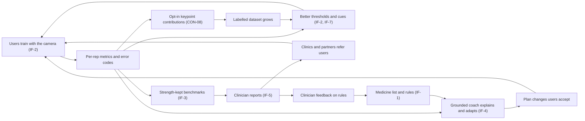
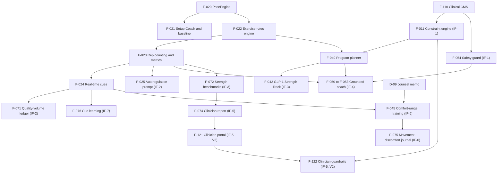

# RepSight — Innovative Features Recommendation

| Field | Value |
|---|---|
| Document | 04 — Innovative Features Recommendation (`docs/04-innovative-features.md`) |
| Version | 1.1 (consistency pass applying canon §0.8) |
| Date | 2026-10-18 |
| Status | Draft for review |
| Owner | CPO |
| Related documents | `docs/01-business-requirements-document.md` (BRD), `docs/02-technical-specification.md` (Tech Spec), `docs/03-product-roadmap-and-strategy.md` (Roadmap), `docs/05-build-playbook.md` (Playbook), research briefs [R1](research/R1-competitors.md), [R2](research/R2-cv-tech-stack.md), [R3](research/R3-coach-medication-safety.md), [R4](research/R4-regulatory-privacy.md), [R5](research/R5-market-business.md), [R6](research/R6-feature-novelty.md); product canon [`research/00-product-canon.md`](research/00-product-canon.md) (Product Canon, decision record v1.1, 2026-10-18; §0.8 lists decisions settled after this document was first written) |

**Table of contents**

1. Summary: the honest answer
2. Selection Method & Rejected Candidates
3. Feature Deep-Dives (3.1 IF-1 … 3.7 IF-7)
4. How the Features Compound into a Moat
5. Sequencing & Dependencies
6. Validation Plan

**How to read this document.** IDs come from the product canon: personas (P1–P5), features (F-###), innovative feature bundles (IF-1..IF-7), exercises (EX-##), KPIs (KPI-##), decisions (D-##), risks (R-##), consents (CON-##). "Novel" in this document always means "not found in the R6/R1 searches as of 2026-10-16". It never means "first in the world". Targets marked *proposed* are new targets set by this document; they are release gates to confirm, not measured results.

---

## 1. Summary: the honest answer

### 1.1 The founder's question

> "Are camera form correction and a fitness/diet/medication chatbot unique?"

**No. Neither idea is unique on its own.** Both already ship, often from large companies. The evidence:

| Idea | Who already ships it | Evidence |
|---|---|---|
| Real-time camera form correction on hardware | Peloton IQ (launched 2025-10-01) gives live form cues and counts reps on Bike+ ($2,695), Row+ ($3,495) and Tread+ ($6,695); Tonal 2 has "Smart View" coaching cues ($4,295 plus $59.95/month) | [R1 S2](https://www.onepeloton.com/blog/what-is-peloton-iq), [R6 #3](https://www.axios.com/2025/10/01/peloton-cross-training-ai-bike), [R1 S9](https://www.tonal.com/products/tonal-2) |
| Real-time camera form correction on a phone | Zing AI ("Zing Vision" plus an AI chat coach; 4.8★ from about 31K ratings); Coach.AI (camera, nutrition plans, chat, on-device) | [R1 S17](https://apps.apple.com/us/app/zing-ai-personal-trainer/id1552207792), [R1 S18](https://apps.apple.com/us/app/coach-ai/id6504732473) |
| Upload-a-video form checks | At least nine indie apps (Form Fix, Formax, GymSpotter, SquatEye, …) | [R1 §1.3] |
| Clinical camera exercise programmes | Hinge Health TrueMotion; Sword Health (bought Kaia for $285M); Kemtai | [R1 S33](https://ir.hingehealth.com/news/news-details/2025/Hinge-Health-unveils-new-AI-powered-care-tools/default.aspx), [R1 S34](https://swordhealth.com/newsroom/sword-acquires-kaia-health), [R1 S42](https://kemtai.com/) |
| Pose estimation as a product | QuickPose, Sency and Kemtai sell form feedback as an SDK; Google gives MediaPipe away | [R1 S44](https://quickpose.ai/), [R1 §1.6] |
| AI chat coach over fitness and food | Google Health Coach (Gemini; $9.99/month, ₹99/month in India) builds plans and logs meal photos; MyFitnessPal AI Coach; Oura Advisor; Samsung Health Assistant (US beta) | [R1 S53](https://techcrunch.com/?p=3120136), [R1 S55](https://www.tech2.com/gadgets/google-replaces-fitbit-app-with-google-health-brings-health-coach-to-india-text-ws-l-10080257.html), [R1 S77](https://apps.apple.com/us/app/myfitnesspal-calorie-counter/id341232718), [R1 S61](https://ouraring.com/blog/oura-advisor/), [R1 S65] |
| AI coach that knows medicines | WHOOP Coach reads diagnoses and medications from health records through HealthEx; ChatGPT Health and Claude connectors read medical records | [R1 S58](https://hlth.com/insights/news/whoop-expands-digital-health-offering-with-healthex-integration-and-clinician-video-visits), [R1 S100, S102] |
| GLP-1 companions | MyFitnessPal GLP-1 Support (free); Oura GLP-1 Insights; Noom "Muscle Defense"; WeightWatchers GLP-1 Success | [R1 S78](https://www.bakersfield.com/ap/news/myfitnesspal-launches-comprehensive-glp-1-support-helping-users-stay-consistent-and-build/article_594b029e-ed9b-5c1a-ac3b-a4ea46e70908.html), [R1 S63](https://ouraring.com/blog/glp-1-insights/), [R1 S88](https://apps.apple.com/us/app/noom-weight-loss-glp-1-care/id634598719), [R1 S89](https://www.weightwatchers.com/us/how-it-works/glp-1-program) |
| "Video never leaves your phone" | REPcount, RepChamp, Sency and others already promise it | [R6 C15] |

So the honest answer is: **we compete with Peloton, Google, MyFitnessPal and Zing on each feature alone, and we would lose a feature-by-feature fight.** The pose model is free. Generic health chat is a commodity [R1 S100, S102].

### 1.2 What is unique (combination, Medium confidence)

What we did not find in any shipping consumer product is the **closed loop**: see every rep, reason over nutrition and medication context within clinician-reviewed rules, adapt the next session, and prove strength progress the user can share [R1 §6]. The canon (§2.2) names five parts:

| # | What is not found elsewhere | Evidence of absence | Delivered by |
|---|---|---|---|
| 1 | **Medication-aware training changes**: exercise choice, intensity measure (HR vs RPE), timing, fuelling and safety prompts change from a medication list | R6 C1: NOVEL, Medium [R6 §3 C1]; no consumer app adapts training to beta-blockers, insulin/sulfonylureas, statins or anticoagulants [R1 §3.3] | IF-1 |
| 2 | **Camera-verified strength for GLP-1 users** | GLP-1 programmes deliver "muscle" as content or human PTs; none verifies training by camera [R1 W2, R1 §5] | IF-3 |
| 3 | **Velocity loss + form drift + automatic next-set suggestion on one phone**, with progress that counts only quality reps | R6 C2: no exact spec found; R6 C16 | IF-2 |
| 4 | **A coach that knows what the camera saw** | No AI coach receives rep-by-rep form or ROM data [R1 W1, Medium-High] | IF-4 |
| 5 | **Camera-enforced comfort-range caps with a shareable movement–discomfort journal** | Not found in consumer apps [R6 C6, R6 W1]; shipped only in wellness framing | IF-6 |

Internal one-sentence differentiator (canon §2.3, not for external copy):

> RepSight closes the loop that no consumer app we found closes: it sees every rep, reasons over your nutrition and medication context within clinician-reviewed rules, adapts your next session, and proves strength progress you can share.

**External copy rule.** No external copy may use "only", "first" or "unique" until the claims register entry has legal and evidence sign-off (canon §2.3–2.4; enforced by the banned-claims linter, F-114). The safe external line is "A strength coach that sees every rep".

### 1.3 The seven innovative features at a glance

Priority mapping used in this document: canon **P0 = Must-have**, **P1 = Should-have**, **P2 = Nice-to-have**. Complexity is defined in §3.x.5 of each deep dive.

| IF | Name | Novelty class (confidence) | Priority | Release path | Complexity | Primary KPI |
|---|---|---|---|---|---|---|
| IF-1 | Medication-aware Safety & Context Layer | NOVEL as a whole (Medium) | P0 / Must | MVP (6 classes) → V1.0 (15 classes + heat alerts) → V1.4 (supplement check, HealthKit import) | High | KPI-07 (never-rule failures = 0), KPI-08 (red-flag recall ≥0.98) |
| IF-2 | Rep-Quality Autoregulation | NICHE parts, NOVEL combination (Medium-High) | P0 / Must | MVP (prompt + suggestion) → Beta (voice RPE/RIR, quality volume) → V2 (learned models) | High | KPI-20 (stop-prompt acceptance ≥60% at V1.0+90 d), guarded by KPI-02 |
| IF-3 | GLP-1 Strength Track | MAINSTREAM category, NOVEL verification (Medium) | P0 / Must (launch wedge, Premium+) | MVP (track, protein, logs) → Beta (dose-cycle scheduling) → V1.0 (benchmarks) → V1.3 (partner licensing) | Medium | KPI-19 (strength-dose adherence ≥50% at V1.0+90 d) |
| IF-4 | Grounded Closed-Loop Coach | Combination NOVEL (Medium-High) | P0 / Must | MVP → Beta (memory) → V1.4 (fuelling summary) | High | KPI-25 (100% of plan changes explained), KPI-09 (100% of medication answers grounded) |
| IF-5 | Clinician Share & Guardrails | NICHE in rehab B2B, NOVEL for general strength (Medium) | P1 / Should | V1.2 (report + clinic pilot) → V2 (portal + guardrails) | Medium at V1.2; High at V2 | KPI-26 (≥10% of Premium+ share a report in 90 days; ≥3 design-partner clinics signed by V1.2 (M7) and still active at V1.4) |
| IF-6 | Comfort-Range Training | Swaps MAINSTREAM; full spec not found (Medium) | P1 / Should, gated by D-09 | V1.4, US only | Medium (regulatory risk High) | KPI-27 (≥70% complete a modified session within 7 days) |
| IF-7 | Personal Cue Learning | NOVEL, not specifically searched (Low-Medium) | P2 / Nice-to-have | V1.4 | Low-Medium | KPI-28 (median reps-to-correction ≥20% lower than fixed-cue control) |

**Recommendation in one paragraph.** Build IF-1, IF-2, IF-3 and IF-4 for V1.0, because together they are the closed loop and the launch wedge (P1 Jordan, P2 Sam, P3 Riley). Add IF-5 at V1.2 to open the clinician channel (P5 Morgan). Ship IF-6 and IF-7 at V1.4 only after their validation gates in §6 pass; they are the first features to cut if the schedule slips (R-16 scope-cut order: IF-7 → IF-6 → F-028 → F-064).

---

## 2. Selection Method & Rejected Candidates

### 2.1 Candidate pool

The pool has 23 candidates from the R6 novelty brief: **C1–C18** (ideas from the founder brief and the market scan) and **R6 W1–W5** (white-space ideas R6 added). R1 contributed a separate white-space list (**R1 W1–W6**). The two "W" lists use the same numbers for different ideas, so this document always writes the prefix ("R6 W3", "R1 W1").

### 2.2 How novelty was checked

| Item | Method |
|---|---|
| Search window | About 45 web searches and 45 direct page fetches on **2026-10-16** (R6), plus the R1 competitive scan of the same date |
| Sources | Official product pages, App Store and Google Play listings, FDA documents, Apple and Android developer docs, peer-reviewed abstracts [R6 Method] |
| Classes | **NOVEL** = no shipping implementation found. **NICHE** = only small or B2B products. **MAINSTREAM** = a major app or wearable (Apple, Google/Fitbit, Samsung, Peloton, Tonal, WHOOP, Oura, MyFitnessPal, Noom, Fitbod) or a large clinical MSK company (Hinge Health, Sword Health) |
| Confidence | High / Medium / Low per candidate, as rated in R6. "Medium" or lower for a NOVEL verdict means "we searched and found nothing", not proof that nothing exists |
| Known gaps | The shared search budget ran out. Reddit, patent databases, Exer Health, Physitrack, Uplift Labs, DARI, WHOOP Strength Trainer, WeightWatchers GLP-1 details, Shotsy and Peloton/Tonal GLP-1 content were **not** checked. The NOVEL verdicts for C1, C9, R6 W3, R6 W4 and R6 W5 rest on searches that found nothing [R6 Unverified] |
| Vendor claims | Vendor accuracy figures and user counts are treated as claims, not facts |
| Re-check | The CPO repeats the novelty search for each headlined IF before any external "new" or "first" wording is considered (claims register, canon §2.3), and at every release gate |

### 2.3 Scoring criteria

Selection runs in two stages. The gates decide; the score only ranks candidates that pass the gates.

**Stage 1 — gates (all must pass to be headlined)**

| Gate | Question | Evidence used |
|---|---|---|
| G1 Differentiation | Is the candidate unique *in combination with our core* (R6 column "Unique with our core?" = Yes)? | R6 §2 Scorecard; R1 §5 white space |
| G2 Regulatory | Can it ship as general wellness, with no dosing, no disease thresholds and no treat/prevent/diagnose claims? | R4 [R4 #2](https://www.fda.gov/media/90652/download), [R4 #14](https://health.ec.europa.eu/document/download/b45335c5-1679-4c71-a91c-fc7a4d37f12b_en?filename=mdcg_2019_11_en.pdf); R6 §4 |
| G3 Willingness to pay | Does it serve a persona that pays (P1–P5) and support a tier price in canon §12? | R5 §3–§4; canon §4 |
| G4 Data loop | Does it create or use data that makes the other features better (the moat in §4)? | R1 §6 moat |

**Stage 2 — screening score (this document's method).** Score = Impact + Feasibility + Defensibility − regulatory penalty (Low 0, Med 1, High 2), using the R6 ratings (each 1–5). The maximum is 15. A high score with a failed gate is not headlined. A low score with all gates passed can be headlined if the regulatory penalty is removed by design (example: C1, where fixed clinician rules replace free advice).

### 2.4 Scorecard and disposition of all 23 candidates

| ID | Candidate | R6 class (conf.) | I / F / D / Reg | Score | Gates failed | Disposition |
|---|---|---|---|---|---|---|
| C1 | Medication-aware training engine | NOVEL (M) | 4 / 3 / 3 / High | 8 | — (G2 met by design: fixed rules, no dosing) | **Headlined → IF-1** |
| C2 | Velocity loss + form drift autoregulation | NICHE (M-H) | 4 / 3 / 3 / Low | 10 | — | **Headlined → IF-2** |
| C3 | Longitudinal movement fingerprint | NICHE (M) | 3 / 3 / 4 / Med | 9 | G1 partly | Not headlined (see §2.5) |
| C4 | Equipment scan / machine lens | NICHE, crowded (H) | 3 / 4 / 1 / Low | 8 | G1, G4 | Not headlined |
| C5 | Camera-verified rep challenges | NICHE (H) | 3 / 3 / 2 / Med | 7 | G1, G2 | Not headlined |
| C6 | Pain-aware adaptation + physio report | MAINSTREAM swaps (M) | 4 / 4 / 3 / Med | 10 | G2 needs reframing | **Headlined, reframed → IF-6** |
| C7 | 60-s movement screen + readiness | NICHE (M) | 3 / 4 / 2 / Low | 9 | G1, G2 for readiness | Not headlined |
| C8 | Conversational voice coach | MAINSTREAM partial (H) | 4 / 3 / 2 / Low | 9 | G1 | Not headlined; used as the interface (F-026) |
| C9 | Camera spotter / safety mode | NOVEL camera version (M-L) | 3 / 3 / 2 / Med | 7 | G2 (liability) | Not headlined |
| C10 | Ghost-rep overlay / replay | NICHE (H) | 2 / 4 / 1 / Low | 7 | G1, G4 | Not headlined; replay only inside F-027 |
| C11 | Coach/physio portal with flagged clips | NICHE (M) | 4 / 4 / 3 / Med | 10 | — | **Headlined → IF-5** |
| C12 | GLP-1 companion | MAINSTREAM (H) | 5 / 4 / 2 / Med | 10 | G1 alone; passes with R6 W4 + camera | **Headlined → IF-3** |
| C13 | Cycle/menopause-aware training | MAINSTREAM insights (M) | 4 / 4 / 2 / Low | 10 | G1 | Not headlined |
| C14 | Meal photo tied to load and medicines | NICHE full linkage (M) | 4 / 4 / 2 / Med | 9 | — | Absorbed into IF-4 as F-064 (not a headline) |
| C15 | 100% on-device video | NICHE widespread (H) | 4 / 4 / 1 / Low | 9 | G1 | Not headlined; a trust requirement (F-101) |
| C16 | Quality-volume progress | NICHE partial (M) | 3 / 3 / 3 / Low | 9 | — | **Headlined inside IF-2** (F-071) |
| C17 | Multi-person tracking | NICHE (M) | 2 / 2 / 2 / Low | 6 | G1, G3 | Not headlined |
| C18 | Return to training with clearance | NICHE clinical (L-M) | 3 / 2 / 4 / High | 7 | G2 | Not headlined |
| R6 W1 | Movement–symptom link | NOVEL in consumer apps (M) | 4 / 3 / 4 / Med | 10 | G2 needs reframing | **Headlined inside IF-6** (F-075) |
| R6 W2 | Clinician-set guardrails | NICHE rehab, NOVEL general strength (M) | 4 / 3 / 4 / Med | 10 | — | **Headlined inside IF-5** (F-122, V2) |
| R6 W3 | Personal cue learning | NOVEL, not specifically searched (L-M) | 3 / 4 / 4 / Low | 11 | — | **Headlined → IF-7** |
| R6 W4 | Camera functional tests | NOVEL in consumer fitness, not specifically searched (L-M) | 4 / 4 / 3 / Med (Low as fitness) | 10 | — (framed as strength benchmarks) | **Headlined inside IF-3** (F-072) |
| R6 W5 | Supplement/stimulant check | NOVEL in fitness, not specifically searched (L) | 3 / 3 / 3 / Med | 8 | G2 partly | Absorbed into IF-1 as F-015 (V1.4, Could) |

Two IFs come from R1 rather than R6: **IF-4** is R1 W1 ("a coach that knows what the camera saw") and the dose-cycle part of **IF-3** is R1 W3. R1 W4 (medication-class rules beyond GLP-1) is part of IF-1.

### 2.5 Candidates not headlined, with the reason for each

| ID | Candidate | Why not headlined | Where it lives instead |
|---|---|---|---|
| C3 | Longitudinal movement fingerprint | Only partly unique with our core; needs months of data before it shows anything; regulatory risk rises to Med if framed as injury prediction [R6 C3]; Hinge already does it B2B [R6 #39](https://www.businesswire.com/news/home/20251021731830/en/Hinge-Health-unveils-new-AI-powered-care-tools) | Partly covered by monthly benchmarks (F-072) and ROM trends in the clinician report (F-074). Revisit after V2 |
| C4 | Equipment scanning | Crowded (GymScan, GymVision, Vyro, ANDES, LiftLens) and general multimodal models can copy it; no moat [R6 #49](https://apps.apple.com/us/app/gymscan-gym-equipment-scanner/id6751796947) | Backlog; possible onboarding convenience reusing the meal-photo model |
| C5 | Camera rep duels / challenges | Crowded (RepChamp, FitDuel, REPcount, FITROX); cash prizes bring contest law [R6 C5] | Backlog |
| C7 | Camera readiness score | Readiness from camera movement quality is unvalidated; "readiness" scores from camera data are banned in V1 copy (canon §2.4) | Not planned; Setup Coach baseline (F-021) covers onboarding |
| C8 | Conversational voice coach | Voice is the expected interface, not a moat (Peloton IQ voice, Apple Workout Buddy, CoachAI, Tracked) [R6 C8] | Voice cues (F-024) and voice logging (F-026) |
| C9 | Camera spotter | Hard to tell rest from a pinned lifter; main exposure is product liability [R6 C9] | Rely on watch fall detection [R6 #73](https://support.apple.com/en-us/108896); no camera safety claim |
| C10 | Ghost overlay | Replay is common (SetSync, OnForm, RivalRep) [R6 #34](https://setsync.app/) | Replay with timestamped errors inside F-027 (V1.2) |
| C13 | Cycle/menopause-aware training | Insights are mainstream (WHOOP, Oura, Fitbit coach) [R6 C13] | Backlog; user-enabled option at most |
| C14 | Meal photo tied to load and medicines | Full linkage is niche-novel but low defensibility (Def. 2) and Med regulatory risk for insulin users | Session-linked fuelling summary F-064 inside IF-4 (V1.4) |
| C15 | 100% on-device video | Common claim; table stakes [R6 C15] | Trust requirement F-101; copy "Video is processed on your phone" |
| C17 | Multi-person tracking | Occlusion, identity tracking and phone compute limit feasibility; consent of other people in frame [R6 C17] | Not planned |
| C18 | Return-to-training clearance | Clearance is a clinical decision; regulatory risk High [R6 C18] | Only through clinic partners after V2; IF-5 guardrails record clinician limits but never decide clearance |
| R1 W5 | Phone barbell feedback people trust | The bar hides keypoints; real-time is not reliable [R1 rec. 2] | Post-set analysis F-028 (V1.4, Could), not headlined |
| R1 W6 | India-first version | A market plan, not a feature | V1.3 India release (canon §3.1; 03 §2) |

---

## 3. Feature Deep-Dives

Each subsection has the same eight parts. Requirements (FR-###, NFR-###, BR-##) live in 01 §7.4, §8 and §9; algorithms, APIs and tables live in 02. This section explains *why* and *what*, and gives the success and validation targets.

### 3.1 IF-1 Medication-aware Safety & Context Layer

#### 3.1.1 Name & description

**Medication-aware Safety & Context Layer** (canon IF-1; sources R6 C1 + R1 W4). The user lists their medicines. A deterministic, clinician-owned engine maps each medicine to a drug class and applies a **constraint set** to the *training plan*. It never changes the medicine. Red-flag check-ins route to fixed templates. Every constraint shows a knowledge-base (KB) card with sources and a "last reviewed" date.

| Item | Value |
|---|---|
| Members | F-002, F-004, F-010, F-011, F-013, F-014, F-015, F-054, F-055, F-057, F-062, F-103, F-110, F-114 |
| Classes | 6 at MVP (GLP1, BB, INS, SGLT2, ACAP, STAT); 15 at V1.0 (adds AHT, DIU, FQ, CS, STIM, AD, ACH, THY, SUP) — canon §9.5 |
| KB cards | ~20 at MVP, ~45 at V1.0 |
| Tier | **All tiers.** Safety is never paywalled (canon principle 1) |

#### 3.1.2 How it works

**User flow**

1. The user passes the neutral age gate (18+; F-002, shown before any account is created) and the ACSM-based pre-participation screening (F-004).
2. The user grants CON-02 (health data). They add medicines by RxNorm search or manual entry (F-010). HealthKit Medications import is added at V1.4.
3. The engine maps RxCUI → RxClass → class code. A medicine outside the covered classes gets the generic card "check with your clinician or pharmacist about exercise" and no class-specific claims.
4. The planner (F-040) applies the constraint set. Examples: beta-blocker → intensity switches to RPE / talk test and HR zones turn off; SGLT2 inhibitor → keto and fasting templates are blocked; anticoagulant → contact and high-fall-risk drills are removed; insulin/secretagogue → pre- and post-session check-ins with no numbers.
5. Each constraint shows a KB card (F-055) rendered verbatim, with sources and "last reviewed".
6. During and after sessions, red-flag check-ins (F-013) route to the Emergency, Urgent, Crisis or Gate template (canon §9.6). The session stops for Emergency.
7. If the user grants CON-05, the coach can read medicine names and logs; otherwise it sees class-level rule IDs only. Every medication answer renders a cited KB card or the fixed referral template (KPI-09).
8. At V1.0, heat-risk alerts (F-014) use city-level location (CON-10) for heat-sensitive classes, and the SUP class adds the 400 mg/day caffeine counter (canon §9.5). At V1.4, the supplement label check (F-015) adds the label photo scan against the FDA "never recommend" ingredient list and the stimulant-stack warning.
9. The regional policy engine (F-103) changes behaviour per market. In India the chatbot gives no medication counselling; constraints appear as fixed plan cards only.

**Technical approach.** Constraint rules are versioned data (RULE-<CLASS>-##) authored in the clinical CMS (F-110) and evaluated by a deterministic engine before and after the LLM (02 §7). The LLM can never override a rule (canon principle 3). Rule changes pass the safety eval harness and claims linter in CI (F-114; 02 §12). Data model and field-level encryption for DC-05 are in 02 §9–§10. Business rules are in 01 §9.

#### 3.1.3 User benefit analysis

| Persona | Job to be done | Before (today) | After (with IF-1) |
|---|---|---|---|
| P2 Sam (metoprolol, atorvastatin, glipizide) | Get stronger without feeling unsafe | Watch HR zones never fit on a beta-blocker; they guess about lows and statin aches; generic apps ignore all three | RPE mode is on by default; check-ins before and after each session; statin muscle-symptom check-ins separate normal soreness from red flags; heat alerts in Phoenix summers |
| P1 Jordan (weekly GLP-1) | Keep strength while losing weight | GLP-1 apps log doses but never change training [R1 §3.3] | Lean-mass programming, protein rule and kcal-floor flags turn on from the medicine list |
| P4 Kiran (generic semaglutide, India) | Structured training that respects the medicine | Price-sensitive; no app links the medicine to training | Same constraints as fixed plan cards (no chat counselling, canon never-rule 9), in Free tier |
| P3 Riley (no medicines) | Trustworthy coaching | — | Benefit is indirect: screening and red-flag routing still protect them |
| P5 Morgan (clinician) | Simple guardrails for patients | Patients self-report; no app respects class cautions | Shareable medication context in the report (IF-5) built on the same engine |

#### 3.1.4 Competitive differentiation

| What exists elsewhere | Evidence |
|---|---|
| Apple counts "medications that might affect heart rate" only to correct its VO2 max estimate; it does not change training | [R1 S71](https://support.apple.com/en-us/HT211856), [R6 #16](https://support.apple.com/en-us/108790) |
| Samsung Health warns about drug–drug and drug–food interactions, with no exercise link | [R6 #17](https://www.androidcentral.com/apps-software/samsung-health-medications) |
| Visible and SmartGym tell beta-blocker users to reset their own HR zones | [R6 #27](https://help.makevisible.com/en/articles/10632785-using-visible-with-medications-that-impact-heart-rate), [R6 #28](https://help.smartgymapp.com/article/152-how-to-set-custom-heart-rate-zones) |
| WHOOP Coach reads medications from health records, but no training rules were found | [R1 S58](https://hlth.com/insights/news/whoop-expands-digital-health-offering-with-healthex-integration-and-clinician-video-visits) |
| Enhance-d shows glucose response to workouts for type 1 diabetes; no prescriptions | [R6 #29](https://apps.apple.com/us/app/enhance-d/id6497331467) |
| Medication data access is solved: HealthKit Medications API, RxNorm-coded | [R6 #18](https://developer.apple.com/videos/play/wwdc2025/321/) |

**Why ours differs.** We change the plan itself (exercise choice, intensity measure, timing, fuelling, safety prompts) from a medication list, across 15 classes, with a citation on every change. No product doing this was found [R6 C1, NOVEL, Medium].

**Defensibility.** Medium. The moat is the clinician-reviewed, versioned rule library, its eval suite (≥1,050 red-team items at V1.0) and outcome data. The weakness: Apple, Google and Samsung already hold users' medication lists [R6 C1].

**Copy speed for a large player.** Google could add medications to its Gemini coach in months, because it already reads medical records and asks about injuries [R1 §7]. The slower part to copy is the clinical review process and the regulatory confidence to ship it. Estimate: 9–18 months for a careful large player (assumption: they need their own clinical review and counsel sign-off, as we do).

#### 3.1.5 Implementation complexity

**High.**

| Aspect | Detail |
|---|---|
| Technical | F-011 is XL effort. Deterministic rules engine, versioned and signed; pre- and post-LLM guard (F-054); regional flags (F-103); RxNav-in-a-Box self-hosted |
| Dependencies | F-110 clinical CMS; clinical sign-off (D-07: PharmD clinical lead, sports-medicine physician, RD, DPT); consent center F-100; AUP confirmation with Anthropic before 2026-11-12 (R-01) |
| Data needs | RxNorm/RxClass; DailyMed and openFDA labels; guideline sources in canon §9.4. No interaction databases (DrugBank, FDB) |
| Key risks | R-01 (drift into device/CDS territory); R-04 (missed red flag); R-12 (KB goes stale after a label change); India counselling ban |

#### 3.1.6 Priority recommendation

**Must-have (P0).** MVP with 6 classes → V1.0 with all 15 classes and heat alerts → V1.4 supplement check and HealthKit import. Rationale: it is the strongest novelty claim (C1), the reason P2 trusts us, and the safety base that IF-3, IF-4, IF-5 and IF-6 all reuse. Without it, IF-4 cannot answer medication questions safely.

#### 3.1.7 Success metrics

| Type | Metric | Target | How measured |
|---|---|---|---|
| Safety (gate) | KPI-07 Never-rule failures | 0 at every phase | Safety eval suite in CI + weekly production sample (F-114) |
| Safety (gate) | KPI-08 Red-flag recall | ≥0.98 Beta exit and V1.0+90 d; ≥0.99 by V2.0 | Clinician-labelled red-flag set |
| Safety | KPI-09 Medication-answer grounding | 100% | Audit log: answers touching medicines that render a KB card or referral template |
| Adoption | Users who report taking a medicine and list ≥1 within 7 days | ≥60% at V1.0+90 d (*proposed*) | Onboarding answer vs medication list, allowlisted events (02 §13) |
| Adoption | Listed medicines that map to a covered class | ≥70% at V1.0+90 d (*proposed*; first measured in Beta) | RxClass mapping counts, aggregated |
| Engagement | KB card opens per month, among users with ≥1 active constraint | Median ≥1 at V1.0+90 d (*proposed*) | Allowlisted event |
| Outcome | KPI-18 strength-session frequency (users with ≥1 constraint) | ≥2.0 per week | Camera-verified sessions |
| Outcome | Users in RPE mode who train ≥3×/week (P2 success signal) | ≥40% at V1.0+90 d (*proposed*) | Session logs |
| Guardrail | KPI-23 privacy integrity | 0 | Consent audit |

#### 3.1.8 Safety, regulatory and claims notes

- Wellness only. Fixed, clinician-authored rules (AUP fixed-rule exclusion) [R3 #1](https://www.anthropic.com/aup). User-configured reminders and patient drug information sit under FDA enforcement discretion [R4 #6](https://www.fda.gov/medical-devices/device-software-functions-including-mobile-medical-applications/examples-software-functions-which-fda-will-exercise-enforcement-discretion).
- No numeric glucose or BP thresholds in user copy (canon §0.7). UK/EU medication features only after the qualification memo (F-103).

| Safe wording | Forbidden wording |
|---|---|
| "Your plan respects the medicines you list, using exercise-safety rules reviewed by pharmacists and physicians. RepSight never changes your medicines — check with your clinician." | "Adjusts your treatment" |
| "Glucose-lowering medicines can change how exercise feels. Plan snacks and check-ins with your care team." | "Eat 20 g carbs if glucose < X"; any dose language |
| "Log your medicines and set your own reminders; check with your clinician." | "Safe to train on X"; "safe to stop/start/combine" |
| "You may want to talk to a health professional." | "Your result is abnormal"; "you may have X" |

### 3.2 IF-2 Rep-Quality Autoregulation

#### 3.2.1 Name & description

**Rep-Quality Autoregulation** (canon IF-2; sources R6 C2 + C16). Per rep, the camera estimates concentric velocity and checks form. When the set slows down too much or form drifts, the app asks "end the set?" and proposes the next set's load and reps. The user confirms or overrides. The **quality-volume ledger** shows total volume next to quality volume and awards personal records (PRs) only on quality reps.

| Item | Value |
|---|---|
| Members | F-021, F-023, F-024, F-025, F-026, F-071, F-029 |
| Exercises | All rep-based exercises EX-01–EX-08 and EX-10; not EX-09 (plank) |
| Tier | Premium and Premium+ (canon §12.1). Free keeps full cues on 5 exercises |

**Key definitions**

| Term | Definition (canon §6, §19) |
|---|---|
| Velocity estimate | Tracked landmark displacement ÷ time, scaled by body height; landmark per exercise in canon §7.1 |
| Velocity loss | % drop in concentric speed versus the best of reps 1–2 |
| Stop threshold | Default 30%, user-adjustable 10–40%; calibrated in M3 |
| Form drift | A GA error absent in reps 1–2 appears on 2 consecutive reps, **or** ROM falls >15% below rep 1 |
| Quality volume | Load × reps counted only for assessed reps with no GA error |

#### 3.2.2 How it works

**User flow**

1. Setup Coach (F-021) checks distance (2–4 m), view, framing and light. The user does three slow reference reps to set their ROM baseline.
2. The user starts the set. Reps are counted (F-023). At each rep boundary, at most one corrective cue plays (audio + haptic + caption; F-024).
3. Each rep gets ROM, tempo, velocity estimate and confidence. A rep whose joints fail the visibility gate is counted and marked "form not assessed".
4. When velocity loss reaches the threshold **or** form drift fires, the app shows and speaks "End the set?" with a suggested next set (load and reps).
5. The user taps or says "end" or "continue". Overrides are always allowed and are logged.
6. From Beta, the user can say their RPE or reps in reserve (F-026, on-device speech; audio never stored). This refines the next-set suggestion.
7. After the session, the ledger (F-071, Beta) shows total vs quality volume. PRs count quality reps only. No rep is ever silently dropped.
8. At V2, learned models (F-029) trained only on our data may replace parts of the rules, behind the same gates.

**Technical approach.** On-device pipeline (canon §8.1): VisionCamera 5.2.3 → PoseEngine (MediaPipe Pose Landmarker Full, Lite fallback) → One Euro filter → state machine with hysteresis → per-rep metrics → rule engine → cue scheduler. Details: setup and baseline in 02 §4.4; rep segmentation in 02 §4.6; form-error rules in 02 §4.7; the autoregulation algorithm in 02 §4.8; cue arbitration in 02 §4.9; per-rep metrics in 02 §4.10. Thresholds ship as signed remote config (F-022, F-111), so tuning needs no app release. LLMs never produce live cues.

#### 3.2.3 User benefit analysis

| Persona | Job to be done | Before | After |
|---|---|---|---|
| P3 Riley (solo lifter) | Trustworthy feedback without a trainer; progress that counts good reps | Guesses when to stop; camera apps miss reps; VBT apps need a bar or give no next set | A stop prompt and a concrete next set; PRs that reflect clean reps; video stays on the phone |
| P1 Jordan (GLP-1) | Train hard enough, but not too hard on low-energy days | No feedback on effort; risk of grinding sloppy reps | Prompt ends the set when form fades; quality volume shows real work done |
| P2 Sam (beta-blocker) | Measure effort when HR is unreliable | HR zones mislead | Velocity loss and voice RPE replace HR as the effort signal |
| P4 Kiran (mid-range Android) | Same coaching on a cheaper phone | Apps lag or miss reps | Lite model and thermal governor; counting-only mode on the weakest phones (honest abstention) |

#### 3.2.4 Competitive differentiation

| What exists elsewhere | Evidence |
|---|---|
| Metric VBT: phone camera at 60 fps, alerts at a user-set 5–45% velocity loss; no next-set prescription, no form analysis | [R6 #32](https://www.metric.coach/articles/introducing-real-time-feedback) |
| SetSync and RepSpeed: velocity loss and stop thresholds, mostly post-hoc | [R6 #34](https://setsync.app/), [R6 #35](https://apps.apple.com/us/app/repspeed/id1584279988) |
| Vitruve: "Smart Auto-Regulation" with a bar-mounted encoder | [R6 #36](https://vitruve.fit/?p=678) |
| Peloton IQ suggests weights from form and rep performance; Tonal Spotter; both need $2.7k+ hardware | [R6 #2](https://www.onepeloton.com/en-GB/blog/peloton-iq-strength-training-features), [R6 #6](https://tonal.com/blog/why-tonals-spotter-is-a-game-changer), [R1 S1](https://www.onepeloton.com/peloton-iq), [R1 S9](https://www.tonal.com/products/tonal-2) |
| FitDuel scores "only clean reps" in duels; Rep-IQ scores each rep (waitlist, £11.99/month) | [R6 #55](https://play.google.com/store/apps/details?id=com.thefitduel), [R6 #89](https://rep-iq.app/) |

**Why ours differs.** One phone product combines velocity loss, form drift, a stop prompt and an automatic next-set suggestion, and counts only quality reps toward progress. No exact spec was found [R6 C2, C16].

**Defensibility.** Medium. Each part exists somewhere, so the combination alone is copyable. The defensible asset is the labelled dataset that links fatigue to form breakdown (≈7,200 labelled set clips by V1.0, canon §8.4) and the per-exercise thresholds tuned on it.

**Copy speed.** Peloton already has form models and form-aware weight suggestions; porting them to its phone app is a "Medium" speed move [R1 §7]. Estimate: 6–12 months for Peloton (assumption: it reuses its Guide/IQ models). Google could add a basic form check to its coach in months, but not our thresholds and dataset.

#### 3.2.5 Implementation complexity

**High.**

| Aspect | Detail |
|---|---|
| Technical | Depends on F-020 PoseEngine (XL). Velocity from a single 2D camera is noisy; body-height scaling; per-exercise landmark choice; hysteresis; confidence gating; thermal management on Tier B/C phones |
| Dependencies | F-020, F-021, F-022, F-023 (L), F-024 (L), F-112 golden-video harness, F-113 labelling pipeline |
| Data needs | 120 participants × 10 exercises (canon §8.4); 30 held-out validation participants; velocity validated against a linear position transducer on 20 participants (M4) |
| Key risks | R-02 (wrong cues destroy trust); R-03 (data slower than planned); false negatives in quality volume demotivate users [R6 C16]; a single-camera VBT app showed only poor-to-moderate agreement with a lab system [R6 #33](https://peerj.com/articles/17789) |

#### 3.2.6 Priority recommendation

**Must-have (P0).** MVP: stop prompt and next-set suggestion → Beta: voice RPE/RIR and quality-volume ledger → V2: learned models. Rationale: it is the strongest *training* feature in the pool (R6), it turns the commodity camera into an adaptive coach, and it is the main Premium upgrade reason for P3, the free-tier growth engine.

#### 3.2.7 Success metrics

| Type | Metric | Target | How measured |
|---|---|---|---|
| Engagement (primary) | KPI-20 Autoregulation acceptance | ≥50% Beta exit; ≥60% V1.0+90 d; ≥65% by V2.0 | Prompt accepted vs shown (allowlisted events, 02 §13) |
| Quality guard | KPI-02 Cue precision / recall per GA cue | ≥0.90 / ≥0.70 (≥0.92 / ≥0.75 by V2.0) | Held-out set; labelled production sample after launch |
| Quality guard | KPI-01 Rep-count accuracy | ≥95% exact / ≥99% within ±1 (Tiers A–B) | Frozen test set |
| Quality guard | KPI-05 Assessed-rep rate | ≥85% Beta exit; ≥90% V1.0+90 d | Session logs |
| Quality guard | Velocity-loss agreement vs linear position transducer | Within ±10 percentage points on ≥80% of sets | M4 validation study, 20 participants |
| Adoption | Premium camera sets on eligible exercises with autoregulation left on | ≥80% at V1.0+90 d (*proposed*; default is on) | Settings state + sets |
| Engagement | Active Premium users who open the quality-volume ledger weekly | ≥40% at V1.0+90 d (*proposed*) | Allowlisted event |
| Outcome | KPI-18 Strength-session frequency | ≥2.0 per active payer per week | Camera-verified sessions |
| Safety | Prompts that can be dismissed or overridden | 100% | UI test in CI (05 §7) |

#### 3.2.8 Safety, regulatory and claims notes

- All camera numbers are labelled **estimates** with error bands (canon principle 7). Velocity is never shown as precise bar speed.
- Low-confidence reps are counted and marked "form not assessed" (principle 2). Frontal-plane cues are Beta tips, never verdicts.
- Model limits shape copy: single person, ≤4 m, "not intended for human life-critical decisions" [R2 #2](https://storage.googleapis.com/mediapipe-assets/Model%20Card%20BlazePose%20GHUM%203D.pdf).

| Safe wording | Forbidden wording |
|---|---|
| "Estimates when your reps slow down or your form changes, and suggests when to end the set." | "Measures bar speed precisely" |
| "Cues to help you keep good form; stop if you feel pain." | "Prevents overtraining or injury"; "injury-proof" |
| "How our form scores work, and their limits" (methodology page) | "As accurate as a trainer"; "medical-grade" |

### 3.3 IF-3 GLP-1 Strength Track

#### 3.3.1 Name & description

**GLP-1 Strength Track** (canon IF-3; sources R6 C12 + R6 W4 + R1 W2/W3). Three camera-coached resistance sessions a week, scaled for beginners, built for people using GLP-1 medicines. It adds dose-cycle scheduling, a clinician-formula protein target and monthly camera strength benchmarks shown as a "strength kept" trend. This is the **launch wedge** and the core of Premium+.

| Item | Value |
|---|---|
| Members | F-012, F-042, F-043, F-062, F-072, F-080, F-081, F-123 |
| Tier | Premium+ ($29.99/month · $179.99/year; £24.99 · £149.99; ₹699 · ₹4,999). Medication list, dose schedule, side-effect log and reminders are free (canon §12.1) |
| Benchmarks | 30-s chair stand (EX-08), max quality push-ups (EX-03), quality plank hold (EX-09), squat-depth check-in (EX-01) |

#### 3.3.2 How it works

**User flow**

1. The user lists a GLP1-class medicine (IF-1) and picks the GLP-1 Strength Track (F-042).
2. They enter their schedule: weekly injectable or daily pill (F-012). Reminders are user-configured (F-080); push text is generic and never names a medicine.
3. **Dose-cycle scheduling (Beta, F-043), weekly injectables:** short energy and side-effect check-ins on days 0–3 after the dose. The app suggests where the hardest session goes. On a logged side-effect day it suggests a deload. The user confirms. Daily pills (Wegovy pill, Foundayo) use side-effect logs only.
4. **Protein (F-062):** 1.2–1.6 g/kg/day of adjusted weight, capped at 80–120 g/day; never below 0.4–0.5 g/kg; no targets for users who report kidney disease (they are referred to a dietitian). Fibre and small-meal suggestions on GI-symptom days. Kcal-floor flags at 1,200 kcal/day for women and 1,800 kcal/day for men (the registered dietitian sets the default when sex is not recorded) [R3 §2]; loss-rate cap 0.9 kg/week.
5. Three sessions a week run with full camera coaching (IF-2).
6. **Monthly benchmarks (V1.0, F-072):** the app schedules the four camera tests with the same setup each month and shows a "strength kept" trend with error bands.
7. Lifecycle check-ins (F-081, Beta): dose-day check-in, missed-session nudge, weekly review.
8. **Partner licensing (V1.3, F-123):** GLP-1 telehealth providers, pharma patient-support programmes and Indian clinics/pharmacies give activation codes. No PHI is exchanged.

**Technical approach.** Dose-cycle placement is a deterministic planner rule over check-in data, proposed and confirmed like any plan change (02 §7; planner and "Why this changed" in IF-4). Protein and floor rules are clinician-owned constraint rules (RULE-GLP1-##) in the same engine as IF-1. Benchmarks reuse the EX-08, EX-03, EX-09 and EX-01 definitions with a fixed benchmark protocol (02 §4.5, §4.10). STEADI counts full stands only [R6 #87](https://www.cdc.gov/steadi/hcp/clinical-resources/index.html). Partner codes use RevenueCat entitlements (F-090; 02 §8).

#### 3.3.3 User benefit analysis

| Persona | Job to be done | Before | After |
|---|---|---|---|
| P1 Jordan (weekly injection, −14 kg in 7 months) | Keep strength while losing weight; fit training around the dose; hit protein without obsessing | Stairs feel harder; nausea the day after the dose; generic plans ignore the dose cycle; no proof of strength kept | Hard sessions move away from dose-day+1; deloads on bad days; a protein number from a clinician formula; a monthly "strength kept" trend they can show their clinician |
| P4 Kiran (generic semaglutide, India) | Structured strength plus Indian-food protein targets | ₹99–₹449/month anchors; no camera coaching in GLP-1 apps | Partner code (F-123) or Premium+ in ₹; Indian food database (F-063, V1.3); Hindi cues |
| P2 Sam (if a GLP-1 is added later) | Combine GLP-1 with other medicines safely | Each app sees one piece | Track rules stack with BB, STAT and INS constraints from IF-1 |
| P5 Morgan / partners | Show patients are actually training | Self-reports | Camera-verified adherence in the clinician report (IF-5) |

**Why this segment.** In STEP 1, 38% of a 13.6 kg loss was lean mass; the 2025 joint advisory recommends strength training ≥3×/week and 1.2–1.6 g/kg/day protein [R3 #13](https://pmc.ncbi.nlm.nih.gov/articles/PMC12304835/). 11% of US adults use a GLP-1 for weight loss (Gallup, 2026) [R5 #18](https://news.gallup.com/poll/712157/glp-usage-reaches-new-high.aspx).

#### 3.3.4 Competitive differentiation

| What exists elsewhere | Evidence |
|---|---|
| MyFitnessPal GLP-1 Support (free): dose logs, reminders, side-effect patterns; no training component described | [R1 S78](https://www.bakersfield.com/ap/news/myfitnesspal-launches-comprehensive-glp-1-support-helping-users-stay-consistent-and-build/article_594b029e-ed9b-5c1a-ac3b-a4ea46e70908.html) |
| Oura GLP-1 Insights: flags Readiness dips about 48 h after a weekly dose, then tells members to consult a clinician before changing workouts; no training programme | [R1 S63](https://ouraring.com/blog/glp-1-insights/) |
| Noom "Muscle Defense"; WeightWatchers strength videos and a protein target of 1 g/kg of starting weight | [R1 S88](https://apps.apple.com/us/app/noom-weight-loss-glp-1-care/id634598719), [R1 S89](https://www.weightwatchers.com/us/how-it-works/glp-1-program) |
| Sword Pulse: PT-guided strength for GLP-1 users, employer channel only | [R1 S37] |
| Healthify (India) GLP-1 programme with Novo Nordisk India | [R1 S84](https://uk.marketscreener.com/news/india-s-healthify-eyes-more-weight-loss-drugmaker-tie-ups-after-novo-nordisk-pact-ce7d51dcda81ff20) |

**Why ours differs.** The GLP-1 companion *category* is mainstream [R6 C12]. What was not found is **verification**: none checks training quality or volume by camera [R1 W2], none moves training by dose day [R1 W3], and camera functional tests in consumer fitness were not found [R6 W4, not specifically searched].

**Defensibility.** Medium-Low on its own (R6 Def. 2 for C12). It rises with outcome data: a growing set of camera-verified strength trends from GLP-1 users, which no content-based programme can produce. Partner channels (F-123) add distribution others must negotiate.

**Copy speed.** Fast. MyFitnessPal could license a CV SDK or buy a form-check app; GLP-1 telehealth companies could license QuickPose or Kemtai [R1 §7]. Estimate: 6–12 months for a credible copy (assumption: SDK licence plus a programme team). This is why speed to launch and partner deals matter (R-06).

#### 3.3.5 Implementation complexity

**Medium.**

| Aspect | Detail |
|---|---|
| Technical | F-042 (L) and F-072 (M) reuse IF-2's camera stack; F-043 (M) is a deterministic planner rule; benchmark protocol needs consistent setup month to month |
| Dependencies | IF-1 (GLP1 class rules, F-062), IF-2 (camera coaching), F-040 planner, F-060 food log, F-090 entitlements; D-16 (GLP-1 marketing wording) |
| Data needs | Clinician protein formula (RD sign-off); dose-cycle check-in data from ≥150 GLP-1 beta testers; benchmark test-retest data |
| Key risks | Non-wellness claims ("protects muscle") [R6 #21](https://www.fda.gov/media/90652/download); R-06 copying; R-15 India economics for partner pricing; eating-disorder risk in weight-loss users (ED-safe mode F-057 applies) |

#### 3.3.6 Priority recommendation

**Must-have (P0), launch wedge sold in Premium+.** MVP: track, protein rules, dose and side-effect logs → Beta: dose-cycle scheduling → V1.0: camera benchmarks → V1.3: partner licensing. Rationale: highest impact in R6 (Impact 5), the segment with the clearest willingness to pay, and the clearest "see, reason, adapt, prove" story.

#### 3.3.7 Success metrics

| Type | Metric | Target | How measured |
|---|---|---|---|
| Outcome (primary) | KPI-19 GLP-1 strength-dose adherence | ≥45% Beta exit; ≥50% V1.0+90 d; ≥60% by V2.0 | Active Track users with ≥2 camera-verified sessions/week in ≥3 of 4 weeks |
| Outcome | Benchmark trend stable or rising (P1 success signal) | ≥70% of Track users with ≥3 monthly benchmarks, by V2.0 (*proposed*) | Chair-stand and push-up counts vs the user's first benchmark, within the error band |
| Adoption | GLP1-class users who start the Track within 14 days | ≥50% at V1.0+90 d (*proposed*) | Constraint set + programme events |
| Engagement | Dose-cycle suggestions confirmed by the user | ≥60% at V1.0+90 d (*proposed*) | Suggestion accepted vs shown |
| Engagement | Days per week protein target met (P4 signal: 4+ days) | Median ≥4 among loggers (*proposed*) | Food log totals |
| Business | Premium+ share of payers | 10% base (canon §13.1) | RevenueCat |
| Safety | Plans below kcal floors or above 0.9 kg/week loss | 0 | Rule-engine unit tests + eval (never-rule 5) |
| Safety | KPI-07 / KPI-08 | 0 / ≥0.98 | Eval suite incl. GLP-1 red flags (persistent vomiting → Urgent) |

#### 3.3.8 Safety, regulatory and claims notes

- "Built for people using GLP-1 medicines" only after D-16 counsel review (deadline 2027-03-26). Tier name stays "Premium+"; "GLP-1" never appears in the app name.
- Benchmarks are "strength benchmarks", never fall-risk tests. The app never adjusts or comments on the dose. ED-safe mode hides calories, weight and deficits.

| Safe wording | Forbidden wording |
|---|---|
| "Helps you keep strength while you lose weight." | "Prevents GLP-1 muscle loss"; "protects your muscle" |
| "Monthly strength benchmarks." | "Fall-risk test"; "treats muscle atrophy" |
| "Supports your weight-management goals." | "Treats obesity"; "lose 5 kg in 2 weeks" |
| "Log your doses and set your own reminders; check with your clinician." | "Adjusts your GLP-1 dose"; "skip your dose before a hard session" |

### 3.4 IF-4 Grounded Closed-Loop Coach

#### 3.4.1 Name & description

**Grounded Closed-Loop Coach** (canon IF-4; source R1 W1). "The RepSight coach (AI)" reads structured per-set metrics, food logs, the constraint set and wearable summaries through strict tools. It proposes plan changes; the rules validator checks them and the user confirms. Every change shows a "Why this changed" card. Debriefs narrate metrics only. Video never reaches the LLM.

| Item | Value |
|---|---|
| Members | F-040, F-050, F-051, F-052, F-053, F-056, F-061, F-064, F-070, F-081 |
| Model | `claude-opus-5-5` on every route at V1.0 (D-02 may move routes after M3 evals) |
| Tier | All tiers with quotas (canon §9.7). Free: 10 coach messages + 3 meal scans/month (India 4 + 1), template debriefs. Paid: LLM debriefs and weekly narration. Safety flows never count against quotas |

#### 3.4.2 How it works

**User flow**

1. Before the first chat or meal scan, the user grants CON-04 (AI processing). Each session starts with an AI notice; a persistent "AI coach" label and an in-chat report button stay visible.
2. After a camera session, the debrief (F-053) narrates the structured set metrics: reps, ROM, tempo, velocity loss, error codes with confidence.
3. The coach proposes a change through `propose_plan_change` or `propose_session_adjustment` (canon §9.3). The deterministic validator checks it against the constraint set (IF-1).
4. The user sees a "Why this changed" card (F-052), for example: "Velocity fell 34% by rep 7 and depth dropped 12%, so next session keeps the load." The user confirms or declines.
5. The user can ask questions in chat (F-050). Medication answers render a cited KB card or the fixed referral template.
6. The user logs meals by photo (F-061); the estimate is confirmed by the user and the photo is deleted server-side after parsing.
7. From Beta, coach memory (F-056) is visible, editable and deletable; health memories need CON-06.
8. At V1.4, the session-linked fuelling summary (F-064) links meals to the measured session and the medication schedule.

**Technical approach.** Backend proxy only; SSE streaming; structured outputs `{reply_text, kb_card_ids[], plan_change_proposal?, red_flag?}`; `strict: true` tools that only read or propose; prompt caching with four breakpoints; refusal stop reason returns a fixed template; server-side model fallbacks off (canon §9.1). Grounding does not use the Claude API citations feature (it returns a 400 when combined with structured outputs): tools return KB cards, the structured reply lists `kb_card_ids`, the server validates the IDs, and the app renders each card verbatim with its sources (canon §0.8 #2; 02 §7.7.3). Guard, tools and validator: 02 §7. Endpoints: 02 §8. Audit fields (model ID, prompt version, KB version, rule IDs, eval-run ID): 02 §9, §12.

#### 3.4.3 User benefit analysis

| Persona | Job to be done | Before | After |
|---|---|---|---|
| P3 Riley | Understand what to change next | Chat coaches give generic advice; they never saw the workout | Debrief and plan changes cite their own reps |
| P1 Jordan | One coach that knows training, food and the dose cycle | Separate apps for each; none connects them | One coach grounded on all three, with clinician-reviewed limits |
| P2 Sam | Ask questions without getting unsafe advice | General chatbots may answer dosing questions | Medication answers are KB cards or a referral; never dose advice |
| P4 Kiran | Coaching in budget and language | Price and language barriers | India quotas; Hindi chat only if the Hindi safety eval passes; medication context as plan cards only |

#### 3.4.4 Competitive differentiation

| What exists elsewhere | Evidence |
|---|---|
| Zing: camera plus chat, but no nutrition or medicines | [R1 S17](https://apps.apple.com/us/app/zing-ai-personal-trainer/id1552207792) |
| MyFitnessPal and Oura: chat plus nutrition plus GLP-1, but no workout verification | [R1 S77](https://apps.apple.com/us/app/myfitnesspal-calorie-counter/id341232718), [R1 S63](https://ouraring.com/blog/glp-1-insights/) |
| Peloton IQ: camera, but no chat | [R1 S2](https://www.onepeloton.com/blog/what-is-peloton-iq) |
| ChatGPT Health, Claude connectors: general chat over health data | [R1 S100, S102] |
| Table stakes in 2026: editable memory, proactive check-ins, photo meal logging | [R1 §2 observations] |

**Why ours differs.** No AI coach was found that receives rep-by-rep form or ROM data [R1 W1, Medium-High]. Ours also cannot change the plan outside the rules, and every change is explained.

**Defensibility.** Medium. The LLM is rented and copyable. The defensible parts are the grounding data (IF-2 metrics), the rule validator (IF-1) and the eval suite.

**Copy speed.** Google could connect a camera form check to its coach in months [R1 §7]. Without rep-level data and a rule validator, a copy is a chat feature, not a closed loop.

#### 3.4.5 Implementation complexity

**High.**

| Aspect | Detail |
|---|---|
| Technical | Strict tool schemas, validator round-trip, structured outputs, streaming, caching, quotas (F-092), cost dashboard (F-115) |
| Dependencies | IF-1 (F-054 guard, F-055 KB, F-011 rules), IF-2 metrics (F-023), F-100 consent center, F-114 eval harness, D-06 ZDR |
| Data needs | Red-team suite ≥1,050 items at V1.0; 200 dietitian-labelled meal photos; HealthBench consensus subset |
| Key risks | R-04 unsafe advice; R-05 AI cost (thinking tokens); R-18 chatbot laws; KPI-15 AI cost share ≤30% |

#### 3.4.6 Priority recommendation

**Must-have (P0).** MVP core → Beta memory → V1.4 fuelling summary. Rationale: the coach is the "reason" step of the loop and the user-facing proof that the product sees and adapts. Without grounding, it would be a commodity chatbot.

#### 3.4.7 Success metrics

| Type | Metric | Target | How measured |
|---|---|---|---|
| Trust (primary) | KPI-25 Explained plan changes | 100% | Every applied plan change has a card with a data or rule citation (audit log) |
| Safety (primary) | KPI-09 Medication-answer grounding | 100% | Audit log |
| Safety | KPI-07 / KPI-08 | 0 / ≥0.98 | Eval suite and weekly sample |
| Adoption | Active paid users who open ≥1 debrief per week | ≥50% at V1.0+90 d (*proposed*) | Allowlisted event |
| Engagement | Proposed plan changes confirmed by the user | ≥70% at V1.0+90 d (*proposed*) | Proposal confirmed vs shown |
| Cost guard | KPI-15 AI cost share | ≤30% V1.0+90 d; ≤15% by V2.0 | Cost dashboard (F-115) |
| Cost guard | KPI-16 AI cost per install | ≤$0.25 Beta; ≤$0.20 V1.0+90 d | Cost dashboard |
| Outcome | KPI-21 Week-4 retention | ≥30% V1.0+90 d | Cohort analytics |

#### 3.4.8 Safety, regulatory and claims notes

- The coach is "the RepSight coach (AI)", never a doctor, dietitian, physio or therapist. AI disclosure at each session start plus a persistent label (never-rule 7).
- No dosing, no symptom interpretation, no "burn it off" framing, no body-shape comments (never-rules 1–6). Chats are never used to train models.

| Safe wording | Forbidden wording |
|---|---|
| "An AI coach that uses your measured workouts, food log and the context you share." | "As good as a human trainer" |
| "AI coach — not a doctor, dietitian or therapist." | "AI doctor/dietitian/physio"; "your AI companion"; "prescribe" |
| "Ask your prescriber or pharmacist." | "Safe to combine"; any interaction verdict beyond the fixed class rules |

### 3.5 IF-5 Clinician Share & Guardrails

#### 3.5.1 Name & description

**Clinician Share & Guardrails** (canon IF-5; sources R6 W2 + C11). **V1.2:** a user-initiated report (PDF or 14-day expiring link) with adherence, quality volume, benchmark and ROM trends, user-entered medication context and a side-effect summary, with no interpretation; optional per-clip sharing; 3 US design-partner clinics. **V2:** a clinician portal where the patient's clinician, with patient consent, sets guardrails that the planner and camera enforce, in a separate HIPAA-ready tenant.

| Item | Value |
|---|---|
| Members | F-027, F-074, F-120, F-121, F-122 |
| Tier | Report in Premium+ (canon §12.1). Pilot free for clinics for 6 months; RepSight Clinic at V2: $29 per practitioner/month + $8 per active patient/month |

#### 3.5.2 How it works

**User flow (V1.2)**

1. The user taps "Share with my clinician" and grants CON-09 for this report.
2. The app builds a PDF or a 14-day expiring link (F-074). Content is data only: no interpretation, no "abnormal" labels.
3. Optionally, the user picks one clip to share (F-027). Faces are blurred on the device; the clip is encrypted; default retention is 30 days, user maximum 365 days.
4. The clinician opens the link; no account is needed. Design-partner clinics (F-120) are onboarded manually; no PHI exchange.

**User flow (V2)**

5. The clinician invites the patient from the portal (F-121); the patient consents in the app.
6. The clinician sets guardrails (F-122): RPE or HR ceilings the clinician supplies, ROM caps, banned movements, cautions.
7. The planner and the camera enforce them; the clinician sees adherence and flagged clips.

**Technical approach.** Report rendering, signed expiring links and clip upload: 02 §8, §10. Clip retention and DC-10 storage: 02 §9. The V2 portal runs in a separate AWS account and a separate Anthropic organisation with a BAA (canon §10.3); guardrails become clinician-sourced constraints in the IF-1 engine (02 §7).

#### 3.5.3 User benefit analysis

| Persona | Job to be done | Before | After |
|---|---|---|---|
| P5 Morgan (DPT, 6-practitioner clinic) | Verified home-exercise adherence without another dashboard | Unverified self-reports; HIPAA exposure | A patient-sent report at V1.2; guardrails they set and the app enforces at V2 |
| P1 Jordan | Show their clinician that strength is kept | Only weight on the scale | Benchmark and adherence trend in one PDF |
| P2 Sam | Let the cardiologist or GP see what they do | Verbal descriptions | Report with RPE trends and medication context they entered |

#### 3.5.4 Competitive differentiation

| What exists elsewhere | Evidence |
|---|---|
| Kemtai clinician app reports adherence per rep (rehab, B2B); KemtaiCARE reported as FDA-listed and 510(k)-exempt | [R6 #66](https://kemtai.com/product), [R6 #67](https://intuitionlabs.ai/software/physical-occupational-therapy/rom-and-goniometry-tracking/kemtai) |
| Hinge Movement Analysis turns joint angles, symmetry and endurance into "Hinge Scores"; Sword Phoenix summarises each session for the clinician (both B2B MSK) | [R6 #39](https://www.businesswire.com/news/home/20251021731830/en/Hinge-Health-unveils-new-AI-powered-care-tools), [R6 #65](https://medcitynews.com/2024/06/sword-health-financing-ai-musculoskeletal/) |
| TrueCoach: clients attach form videos manually; SetSync coach portals $11.99–$34.99/month | [R6 #78](https://capterra.com/p/155784/truecoach/reviews/), [R6 #34](https://setsync.app/) |

Pricing anchor, not a novelty finding: Physitrack charges $18.99/practitioner/month plus $8 per remotely monitored patient [R5 #67](https://www.physitrack.com/physitrack-pricing). R6 did not check Physitrack's features [R6 Unverified], so it is not listed above as "exists elsewhere".

**Why ours differs.** NICHE in rehab B2B, NOVEL for general strength [R6 W2, C11]. The flow starts with the consumer and their own data; no consumer app was found that picks out worst-rep clips for a coach or physio [R6 C11].

**Defensibility.** Medium-High over time. The clinician network is the moat (R6 Def. 4 for W2); every clinic that sets guardrails makes the app harder to replace for its patients.

**Copy speed.** Slow-Medium for consumer players, because clinic sales and HIPAA tenants take time. Sword could move faster: R1 rates "launch Pulse direct to consumers" as a Medium-speed move [R1 §7]. Hinge has the same kind of clinician base [R6 #39], but no consumer move was found.

#### 3.5.5 Implementation complexity

**Medium at V1.2; High at V2.**

| Aspect | Detail |
|---|---|
| Technical | V1.2: report generation, expiring links, on-device face blur, encrypted clip upload (F-027 L, F-074 M). V2: portal (F-121 XL) and guardrails (F-122 L), HIPAA-ready tenant |
| Dependencies | F-070, F-072 (benchmarks), F-100/F-101 privacy; checklist item 17 (BAA template, security questionnaire) for V2 |
| Data needs | Benchmark and quality-volume history; clinician feedback from 3 design-partner clinics |
| Key risks | Drift into "remote patient monitoring" or treatment advice; R-10 breach of shared clips; clinic sales slower than planned |

#### 3.5.6 Priority recommendation

**Should-have (P1).** V1.2 report and clinic pilot → V2 portal and guardrails. Rationale: it opens the B2B2C channel and the "prove" step of the loop, but V1.0 can launch without it.

#### 3.5.7 Success metrics

| Type | Metric | Target | How measured |
|---|---|---|---|
| Adoption (primary) | KPI-26 Report sharing | ≥10% of Premium+ users share ≥1 report within 90 days (from V1.2) | Share events |
| Channel (primary) | KPI-26 Design-partner clinics | ≥3 signed by V1.2 (M7, 2027-08-24) and still active at V1.4 | Signed pilot agreements |
| Engagement | Clinics that use reports with ≥10 patients (P5 success signal) | ≥2 of 3 pilot clinics by end of pilot (*proposed*) | Clinic interviews + link opens |
| Outcome | Pilot clinics that convert to RepSight Clinic at V2 | ≥2 of 3 (*proposed*) | Contracts |
| Privacy guard | KPI-23 Privacy integrity | 0 | Consent audit: no clip or report shared without CON-09 |
| Safety | Report copy with interpretation or "abnormal" wording | 0 | Claims linter on report templates |

#### 3.5.8 Safety, regulatory and claims notes

- The report displays data and never recommends treatment. FDA's CDS guidance gives enforcement discretion to some HCP-facing software [R6 #23](https://www.fda.gov/media/109618/download); the portal is designed to stay display-only.
- Consumer app is not a HIPAA entity; never claim "HIPAA-compliant".

| Safe wording | Forbidden wording |
|---|---|
| "Share your training data with your clinician." | "Remote patient monitoring" (before V2 legal review) |
| "Your clinician can set limits that the app follows." (V2) | "Clinically validated"; "billable"; "HIPAA-compliant" |

### 3.6 IF-6 Comfort-Range Training

#### 3.6.1 Name & description

**Comfort-Range Training** (canon IF-6; sources R6 C6 + R6 W1, reframed). Discomfort check-ins before and after sessions; swaps from a clinician-reviewed table; ROM caps set by the user or their physio (never inferred by the app) and enforced by camera cues; a deterministic **movement–discomfort journal** that shows co-occurrence only. Red flags route to templates; the LLM never interprets symptoms.

| Item | Value |
|---|---|
| Members | F-026, F-045, F-075 |
| Release | V1.4, **US only**, after D-09 counsel memo (deadline 2027-09-15); other markets only after a qualification-memo update |
| Tier | Not set in canon §12.1. *Recommended default:* discomfort check-ins and red-flag routing in all tiers (safety is never paywalled); ROM caps and the journal in Premium. Owner to confirm |

#### 3.6.2 How it works

**User flow**

1. Before a session, the user can log discomfort on a body map, 0–10 (tap or voice, F-026).
2. Red-flag answers route to the fixed template; the session does not start for Emergency tier.
3. The planner offers swaps from the clinician-reviewed table (F-045).
4. The user, or their physio via the user, sets a ROM cap for an exercise (example: squat depth). The app never proposes a cap.
5. During the set, the camera cues "stop at this depth" when the cap is reached.
6. After the session, the user logs discomfort again.
7. The journal (F-075) shows co-occurrence only, for example: "Discomfort was logged after 3 of 4 sessions where knee travel grew late in the set — you may want to discuss this with a professional."
8. The user can include the journal in the clinician report (IF-5).

**Technical approach.** ROM caps are a rule overlay on the exercise definition (02 §4.5, §4.7) with a dedicated cue in cue arbitration (02 §4.9). The journal is a deterministic co-occurrence query over DC-05 check-ins and DC-04 metrics, rendered from fixed templates (02 §7, §9). The LLM may read discomfort logs only as structured data and must route symptom questions to templates.

#### 3.6.3 User benefit analysis

| Persona | Job to be done | Before | After |
|---|---|---|---|
| P3 Riley (knee discomfort after squats) | Keep training around discomfort | Fitbod-style swaps remove whole exercises; no depth control | Keep squatting within a set depth; pattern journal to show a physio |
| P2 Sam (57, returning to training) | Train without flare-ups | Fear of making aches worse | Comfort-range caps and swaps; clear "see a professional" routing |
| P5 Morgan | Keep patients inside agreed limits after discharge | No visibility into home or gym training | Patient-set caps from their advice; journal in the report |

#### 3.6.4 Competitive differentiation

| What exists elsewhere | Evidence |
|---|---|
| Fitbod "Injuries / Limitations" swaps; Fitbit coach adjusts plans for "My knee is bugging me" (MAINSTREAM) | [R6 #58](https://help.fitbod.me/hc/en-us/articles/37629269518103), [R6 #11](https://blog.google/products-and-platforms/devices/fitbit/personal-health-coach-public-preview/) |
| Injurymap adapts from pain feedback; one source says it was approved as a medical device in Denmark | [R6 #61](https://apps.apple.com/us/app/injurymap-physiotherapy-app/id1102375789), [R6 #62](https://ds-sundhed.dk/en/injurymap/) |
| Hinge combines movement measures and questions into scores (B2B) | [R6 #39](https://www.businesswire.com/news/home/20251021731830/en/Hinge-Health-unveils-new-AI-powered-care-tools) |

**Why ours differs.** A camera-enforced ROM cap plus a discomfort journal plus a physio report was not found [R6 C6, R6 W1, Medium].

**Defensibility.** Medium-High if it works (R6 Def. 4 for R6 W1): the link between camera patterns and discomfort logs is personal longitudinal data.

**Copy speed.** Fitbod or Google could add swaps quickly; camera-enforced caps need a camera stack (6–12 months, estimate). The regulatory line slows everyone: Injurymap shows pain-driven adaptation pulls products toward device status.

#### 3.6.5 Implementation complexity

**Medium technically; regulatory risk High.**

| Aspect | Detail |
|---|---|
| Technical | F-045 (L), F-075 (M); ROM-cap cue; body map UI; voice discomfort logging |
| Dependencies | F-024 cues, F-026 voice, IF-1 red-flag templates, IF-5 report, **D-09** |
| Data needs | Clinician-reviewed swap table (DPT); journal wording reviewed by counsel |
| Key risks | "Rehab or pain programmes for a condition" are devices/MDSW [R4 #14](https://health.ec.europa.eu/document/download/b45335c5-1679-4c71-a91c-fc7a4d37f12b_en?filename=mdcg_2019_11_en.pdf); R-14 liability; second in the scope-cut order (R-16) |

#### 3.6.6 Priority recommendation

**Should-have (P1), gated.** V1.4, US only, only after the D-09 memo and the §6 validation. If D-09 says no, ship only discomfort check-ins with red-flag routing and swaps, which are mainstream (Fitbod, Fitbit coach [R6 C6]) and carry lower regulatory risk.

#### 3.6.7 Success metrics

| Type | Metric | Target | How measured |
|---|---|---|---|
| Outcome (primary) | KPI-27 Discomfort continuity | ≥70% of users who log discomfort complete a modified session within 7 days | Check-in + session events |
| Adoption | Users with a discomfort log who set ≥1 ROM cap | ≥30% by V2.0 (*proposed*) | Settings events |
| Engagement | Journal views per month, among users with ≥4 logged sessions that month | Median ≥1 by V2.0 (*proposed*) | Allowlisted event |
| Safety | Red-flag recall on discomfort entries (KPI-08 set) | ≥0.98 | Eval suite incl. discomfort red flags |
| Safety | Journal or cue copy that interprets symptoms or names a condition | 0 | Claims linter + clinician review |
| Guard | Users who report worse discomfort after a capped session | Tracked, reviewed monthly by the DPT reviewer (*no target; monitoring only*) | Post-session check-in |

#### 3.6.8 Safety, regulatory and claims notes

| Safe wording | Forbidden wording |
|---|---|
| "Train around discomfort; tell your physio if it persists." | "Pain relief"; "rehab"; "physical therapy" |
| "Discomfort was logged after 3 of 4 sessions where … — you may want to discuss this with a professional." | "Treats knee pain"; "predicts injury"; "this movement causes your pain" |

### 3.7 IF-7 Personal Cue Learning

#### 3.7.1 Name & description

**Personal Cue Learning** (canon IF-7; source R6 W3). For each recurring fault, the cue scheduler rotates 2–4 coach-written, reviewed cue variants (internal vs external focus, analogy, short vs detailed) [R6 #88](https://doi.org/10.1080/1750984X.2012.723728). It scores whether the fault recurs in the next 3 assessed reps and converges per user with a Thompson-sampling bandit, still at ≤1 corrective cue per rep.

| Item | Value |
|---|---|
| Members | F-076 |
| Release | V1.4 |
| Scope (this document's recommendation) | GA cues only. Beta cues stay single soft tips, because they are never verdicts |
| Tier | Not set in canon. *Recommended default:* wherever cues run, including Free's 5 exercises (no AI cost). Owner to confirm |

#### 3.7.2 How it works

**User flow**

1. The user trains as usual. Nothing new to learn.
2. When a GA fault recurs (example: ERR-EX01-01 depth short), the cue scheduler picks one of the approved variants, for example "Sit back to the chair" (external) vs "Bend your knees more" (internal).
3. The next 3 assessed reps are scored: did the fault recur?
4. The bandit updates its belief for this user × fault and picks better variants more often.
5. In settings, the user can see "cues that work best for you" and reset them.

**Technical approach.** Variants are fields in the signed `ExerciseDefinition` cue copy (02 §4.5), reviewed and linted like all cue copy (F-111, F-114). Variant selection sits in cue arbitration (02 §4.9). Recommended: bandit state runs on device and syncs as part of training metrics (DC-04); 02 §4.9 decides. A fixed-cue control group is required to measure KPI-28 (02 §13).

#### 3.7.3 User benefit analysis

| Persona | Job to be done | Before | After |
|---|---|---|---|
| P3 Riley | Fix a fault faster | Same cue every time; they tune it out | Cues that worked for them before come first |
| P2 Sam (large text, audio cues) | Understand the cue | Technical cues can be unclear | Analogy or short variants if those work better |
| P4 Kiran (Hindi cues) | Cues that make sense in their language | Literal translations | Variant set per language, learned per user |

#### 3.7.4 Competitive differentiation

| What exists elsewhere | Evidence |
|---|---|
| CoachAI lets users choose cue frequency only | [R6 #68](https://apps.apple.com/us/app/coach-ai/id6504732473) |
| Attentional-focus research supports testing internal vs external cues | [R6 #88](https://doi.org/10.1080/1750984X.2012.723728) |

**Why ours differs.** NOVEL, but not specifically searched (Low-Medium) [R6 W3]. Treat novelty as a hypothesis.

**Defensibility.** Medium-High over time: per-user cue response data grows with use and cannot be copied (R6 Def. 4).

**Copy speed.** Technically easy for any player with a camera form stack (estimate: 3–6 months). The data per user is the part that cannot be copied.

#### 3.7.5 Implementation complexity

**Low-Medium.**

| Aspect | Detail |
|---|---|
| Technical | F-076 (M): bandit, variant copy, control group, analytics |
| Dependencies | F-024 cues, F-111 editor, KPI-02 precision (a wrong fault label poisons learning) |
| Data needs | 2–4 reviewed variants per GA fault (20 GA errors at MVP); per-language variants |
| Key risks | Gains may be too small to notice; first in the scope-cut order (R-16) |

#### 3.7.6 Priority recommendation

**Nice-to-have (P2).** V1.4, only if the Beta variant test in §6 shows real differences between variants. Rationale: low regulatory risk and a data moat, but not needed for the launch story.

#### 3.7.7 Success metrics

| Type | Metric | Target | How measured |
|---|---|---|---|
| Outcome (primary) | KPI-28 Cue-learning effect | Median reps-to-correction ≥20% lower than the fixed-cue control | Randomised control group (*proposed* 20% holdout) |
| Engagement guard | KPI-20 Autoregulation acceptance | No drop vs control | A/B |
| Quality guard | KPI-02 per GA cue | ≥0.90 / ≥0.70 | Held-out set |
| Adoption | GA faults with ≥2 approved variants | 100% of GA faults at V1.4 (*proposed*) | Exercise-definition registry |

#### 3.7.8 Safety, regulatory and claims notes

| Safe wording | Forbidden wording |
|---|---|
| "Learns which cues work best for you." | "AI physio"; "personalised rehab" |
| "Cues to help you keep good form." | "Corrects your posture problems"; "prevents injury" |

---

## 4. How the Features Compound into a Moat

Pose-estimation code is not a moat: MediaPipe is free and SDKs are for sale [R1 §6]. The moat is three assets that grow with use and that a copier cannot buy [R1 §6, R6 Roadmap]:

1. **A labelled form, fatigue and discomfort dataset** (IF-2, IF-6, IF-7), starting with ≈7,200 labelled set clips by V1.0 and growing through opt-in keypoint contributions (F-104, CON-08).
2. **A clinician-reviewed medication–exercise rule library** with its eval suite (IF-1), reused by IF-3, IF-4 and IF-5.
3. **Outcome data on strength kept** (IF-3 benchmarks, IF-5 reports), plus the clinician network that reads it.

**How the loop works.** More camera sessions give more labelled reps. Better data gives more accurate cues and autoregulation, so users trust the camera and train more. The coach turns the same metrics into explained plan changes, which keeps users in the loop. Benchmarks give proof of strength kept. Reports carry that proof to clinicians, who refer patients and give feedback on the rules. Each turn of the loop makes every IF better at once.

**Limits of the moat (honest view).** Large players hold more users and medication lists (R-06). Our advantage is time and focus, not a lock. The plan is to reach partner channels (F-123, F-120) and a validated methodology page before a large player ships the same combination.

---

## 5. Sequencing & Dependencies

### 5.1 What unlocks what

**Critical path.** F-020 → F-022 → F-023 gates IF-2, IF-3, IF-4, IF-6 and IF-7. F-110 → F-011 gates IF-1, and through it IF-3, IF-4 and IF-5 guardrails. Both paths start in Phase 0 (W1–W6). The M1 CV spike gate (2026-12-11) is the first go/no-go for the whole set.

### 5.2 Release order

| Release (date) | IF-1 | IF-2 | IF-3 | IF-4 | IF-5 | IF-6 | IF-7 |
|---|---|---|---|---|---|---|---|
| MVP (code-complete M2, 2027-03-05) | 6 classes, ~20 KB cards; F-002, F-004, F-010, F-011, F-013, F-054, F-055, F-057, F-062, F-110, F-114 | F-021, F-023, F-024, F-025 | F-012, F-042, F-062, F-080 | F-040, F-050–F-053, F-061, F-070 | — | — | — |
| Beta (2027-03-08 → M4 2027-05-14) | 9 more classes drafted by M3 | F-026 voice RPE/RIR, F-071 quality volume | F-043 dose-cycle scheduling, F-081 | F-056 memory, F-081 | Clinic interviews (§6) | — | Variant test (§6) |
| V1.0 (2027-06-01, US iOS) | 15 classes, ~45 cards; F-014 heat alerts; F-103 | Live | F-072 benchmarks | Live | — | — | — |
| V1.1 (2027-07-13, Android US) | Live | KPI-01–KPI-04 on Android | Live | Live | — | — | — |
| V1.2 (2027-08-24, UK) | UK after memo | Live | Live | Live | F-027, F-074, F-120; 3 design-partner clinics signed (M7) | — | — |
| V1.3 (2027-10-05, India) | Plan cards only | Live | F-123 partner licensing | India quotas | — | — | — |
| V1.4 (2027-11-16) | F-015 supplement check; HealthKit import | Live | Live | F-064 fuelling summary | ≥3 clinics still active (signed by V1.2) | F-045, F-075 (US only, D-09) | F-076 |
| V2.0 (2028-03-28) | Live | F-029 learned models | Live | Live | F-121, F-122 | Other markets after memo update | Live |

Phase details and milestones: 03 §2 and canon §14. Epics and build order: 05 §6. If the schedule slips, cut in the R-16 order: IF-7 → IF-6 → F-028 → F-064.

---

## 6. Validation Plan

Each IF has one experiment or prototype that must pass **before its full build or release**. Thresholds marked *proposed* are set by this document; KPI thresholds come from canon §15. Sample sizes are planning estimates unless they come from the canon; the analysis plan recomputes them from observed variance.

| IF | What we validate | Experiment or prototype | Sample size | Success threshold | Timing | If it fails |
|---|---|---|---|---|---|---|
| IF-1 | Rules are safe and users understand that the app never changes medicines | (a) Red-team eval v1 on the 6 MVP classes, clinician double-review; (b) comprehension test of constraint cards with people on everyday medicines | (a) ≥420 items (6 classes × 7 categories × ≥10, canon §9.8 method); (b) 12 participants (*proposed*) | (a) KPI-07 = 0, KPI-08 ≥0.98; (b) ≥11 of 12 state that the app does not change their medicines (*proposed*) | AUP reading confirmed before 2026-11-12; (a) by M2 2027-03-05; (b) W12–W16 | Block release of the failing class; rewrite card; re-run |
| IF-2 | Camera velocity loss is accurate enough, and users accept the prompt | (a) Pilot: phone vs linear position transducer on EX-01, EX-02, EX-06, using the validation-study equipment; (b) alpha prompt test | (a) 8 participants (*proposed*); full study 20 participants at M4; (b) 30 alpha testers | (a) within ±10 pp on ≥70% of sets to continue (*proposed*); ≥80% at M4; (b) ≥50% acceptance (KPI-20 Beta target) | (a) W5–W8 (from 2026-11-30); (b) alpha 2027-02-15 → 2027-03-05 | Ship form-drift trigger only; velocity shown as "beta estimate"; recalibrate at M3 |
| IF-3 | GLP-1 users accept dose-cycle placement and reach the strength dose; benchmarks repeat reliably | (a) Concierge pilot: the team sends clinician-approved template suggestions by hand before F-043 code ships; (b) benchmark test-retest | (a) 40 GLP-1 beta testers (of ≥150) (*proposed*); (b) 20 participants, two tests ≤7 days apart (*proposed*) | (a) ≥60% confirm suggested placement; ≥45% meet KPI-19 over 4 weeks; (b) chair-stand counts within ±1 on ≥90% of pairs (*proposed*) | (a) W19–W22 (2027-03-08 → 2027-04-02); (b) W20–W26 validation window | (a) Keep logs and protein only; drop placement; (b) show benchmarks as trends with wider bands |
| IF-4 | "Why this changed" cards are correct and understood | (a) Offline card audit: the coach proposes changes from recorded session metrics; coach and clinical lead review every card; (b) user test of cards | (a) 200 proposals (*proposed*); (b) 12 participants (*proposed*) | (a) 100% cite data or a rule (KPI-25); ≥95% factually correct vs the metrics; 0 never-rule failures; (b) ≥10 of 12 explain the change in their own words | W12–W16 (2027-01-18 → 2027-02-19) | Template cards for the failing change types; fix prompts; re-run in CI |
| IF-5 | Clinicians will use a patient-sent report | Mock report (static PDF from beta data with consent) and interviews with physio, sports-medicine and obesity clinicians (P5 type) | 10 clinicians (*proposed*) | ≥6 of 10 would use it with ≥10 patients; ≥3 sign pilot letters of intent by 2027-07-31 (*proposed*) | Beta to V1.0 (2027-04 → 2027-07) | Keep the report as a consumer feature; delay F-120 and V2 portal investment |
| IF-6 | Wellness framing holds and users understand the journal is not a diagnosis | D-09 counsel memo; clickable prototype plus feature-flagged ROM-cap build with US testers who report discomfort; scripted red-flag test | 20 participants (*proposed*); 100 scripted discomfort entries | Counsel approves by 2027-09-15; ≥90% say the journal is not a diagnosis; ≥70% complete a modified session within 7 days (KPI-27); 0 red-flag misroutes | 2027-07 → 2027-09-15 | Ship only check-ins, red-flag routing and swaps; no caps or journal |
| IF-7 | Cue variants actually differ in effect (otherwise the bandit has nothing to learn) | Randomised rotation of 2 fixed variants per GA fault, no bandit | Estimate ≥300 users per arm with ≥3 recurring-fault sets each (assumption; recompute from Beta variance) | ≥1 fault per exercise where the better variant cuts reps-to-correction by ≥10% vs the worse (*proposed*) | Beta → V1.1 (2027-04 → 2027-07) | Drop F-076; keep the best single cue per fault |

**Rules for all experiments.** No experiment may change safety behaviour (IF-1 rules, red-flag routing, ED-safe mode). All test copy passes the banned-claims linter (F-114). All participants consent under CON-02 and, where data leaves the phone, the matching consent (CON-08, CON-09). Results and decisions are recorded in the decision log (03 §12).
